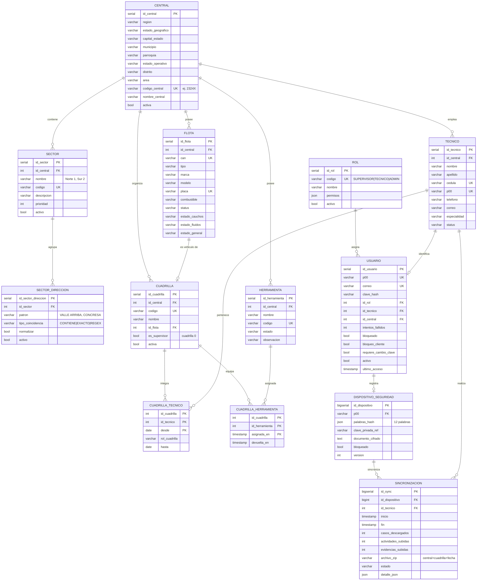
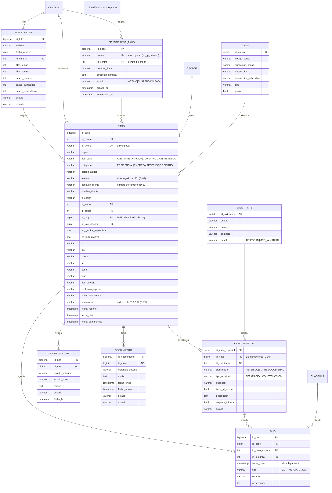
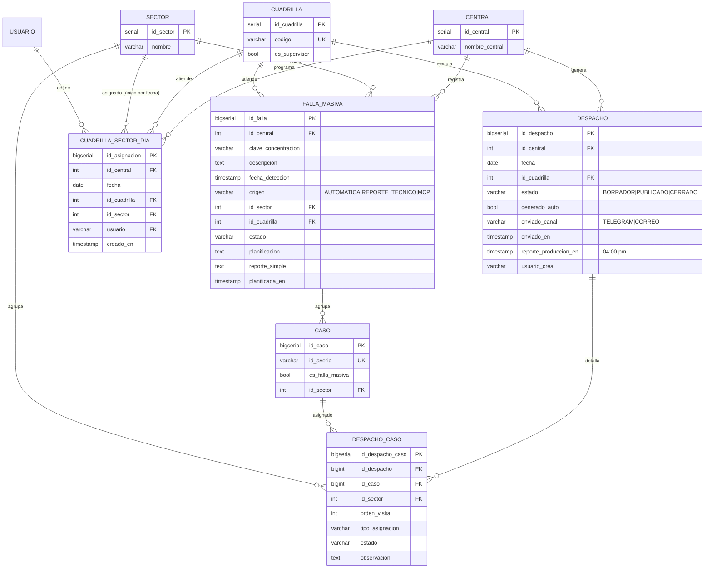
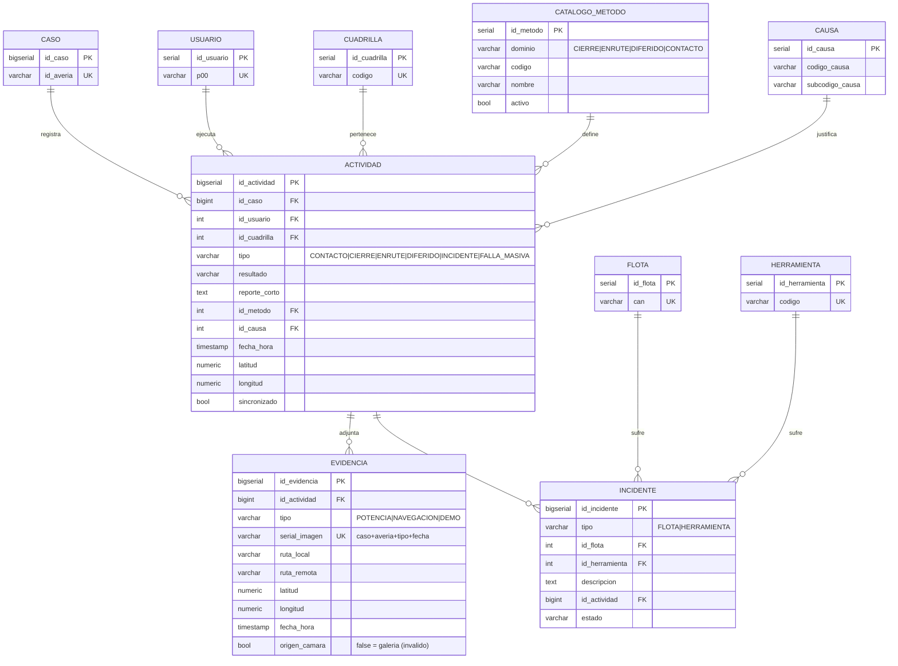
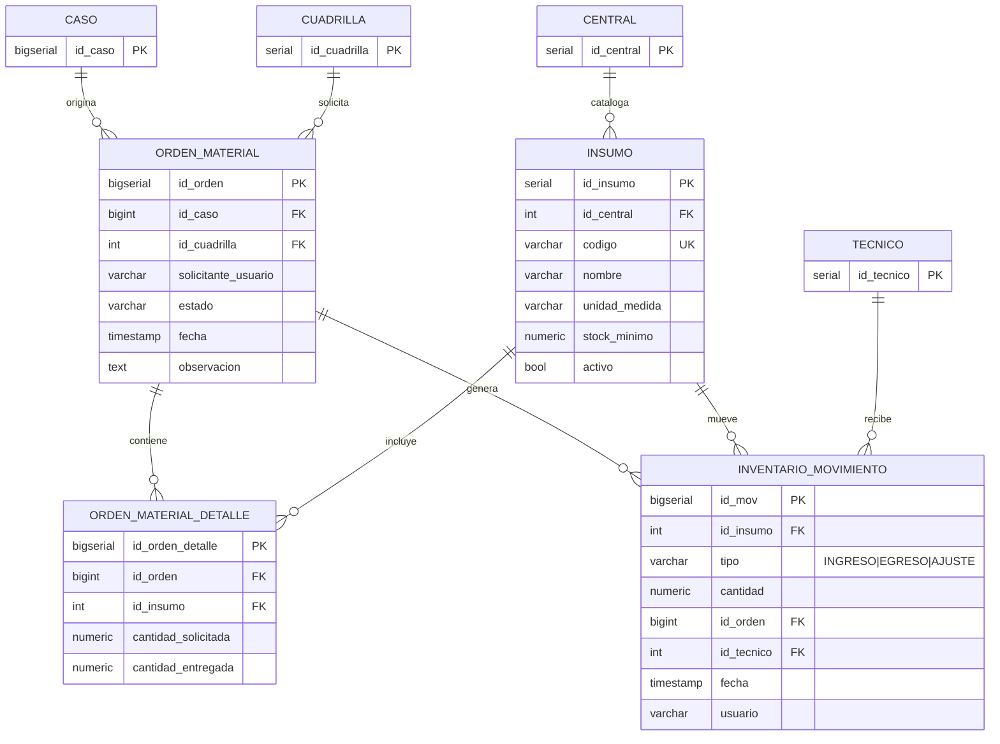
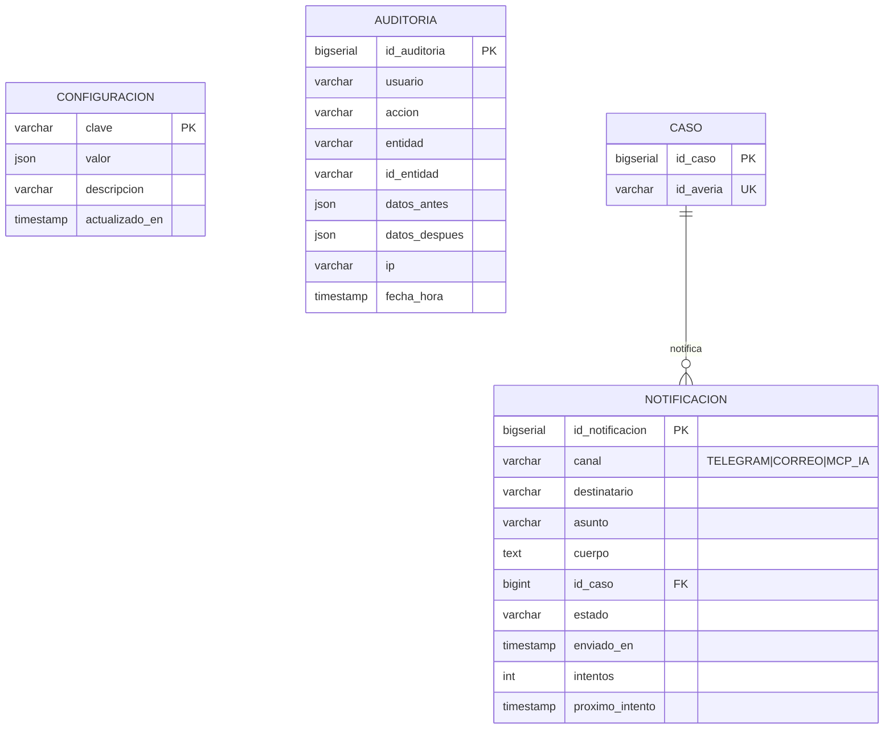

# Diagrama Entidad-Relación — Modelo de datos GGTO

| Dato | Valor |
|---|---|
| Proyecto | **GGTO** — Sistema de administración de reportes de avería y construcción de puntos ópticos |
| Cliente | CANTV C.A. — Central Francisco Salias (Área 4) |
| Motor | PostgreSQL 15 (`ggtov2`) |
| Script DDL | `RepoTecnico/db/schema.sql` — **41 tablas** (36 entidades en `modelo_er.md`) |
| Modelo de origen | `RepoTecnico/modelo_er.md` (7 bloques originales + bloque complementario §10) |
| Diccionario asociado | `RepoTecnico/Manuales/05-Diccionario-de-Datos/01-entidades.md` |
| Notación | Mermaid `erDiagram`, renderizable en GitLab/GitHub/VS Code |

> Este manual reproduce los bloques Mermaid de
> `RepoTecnico/modelo_er.md` (secciones 1 a 7 y bloque complementario §10), los organiza por
> dominio y los contrasta con el DDL local. El esquema desplegado no se consultó
> en la auditoría. Los diagramas de
> origen usan nombres de entidad en **MAYÚSCULAS** (`CASO`), mientras que las
> tablas físicas son **minúsculas** (`caso`): es la misma entidad.

## Visión general del modelo

### 41 tablas del DDL y 36 entidades del modelo

El esquema físico contiene **41 sentencias `CREATE TABLE`**
(`RepoTecnico/db/schema.sql`, revisado en el cierre de **D-89…D-94**), mientras que
`modelo_er.md` representa **36 entidades** en siete bloques temáticos y añade cinco tablas físicas posteriores en §10:

| # | Dominio (sección de `modelo_er.md`) | Entidades del diagrama | Nº |
|---|---|---|---|
| 1 | Vista general de relaciones (`RepoTecnico/modelo_er.md:30-79`) | Relaciones entre todas las entidades | — |
| 2 | Núcleo organizacional y seguridad (`RepoTecnico/modelo_er.md:83-235`) | ROL, CENTRAL, SECTOR, SECTOR_DIRECCION, TECNICO, USUARIO, FLOTA, HERRAMIENTA, CUADRILLA, CUADRILLA_TECNICO, CUADRILLA_HERRAMIENTA, DISPOSITIVO_SEGURIDAD, SINCRONIZACION | 13 |
| 3 | Casos: averías y solicitudes (`RepoTecnico/modelo_er.md:239-356`) | INGESTA_LOTE, CAUSA, CASO, CASO_ESPECIAL, SOLICITANTE, CASO_ESTADO_HIST, SEGUIMIENTO, CITA (+ **IDENTIFICADOR_PAGO**, añadido en D-94) | 8 (+1 en este manual) |
| 4 | Despacho y fallas masivas (`RepoTecnico/modelo_er.md:360-442`) | DESPACHO, DESPACHO_CASO, CUADRILLA_SECTOR_DIA, FALLA_MASIVA (+ CASO, CUADRILLA, SECTOR, CENTRAL como referencia) | 4 propias |
| 5 | Gestión técnica (`RepoTecnico/modelo_er.md:446-528`) | ACTIVIDAD, EVIDENCIA, INCIDENTE, CATALOGO_METODO (+ CAUSA, CASO, USUARIO, CUADRILLA, FLOTA, HERRAMIENTA) | 4 propias |
| 6 | Insumos v2 (`RepoTecnico/modelo_er.md:532-592`) | INSUMO, ORDEN_MATERIAL, ORDEN_MATERIAL_DETALLE, INVENTARIO_MOVIMIENTO | 4 |
| 7 | Soporte y auditoría (`RepoTecnico/modelo_er.md:596-635`) | CONFIGURACION, AUDITORIA, NOTIFICACION | 3 |

Las entidades definidas con atributos propios en los dominios 2 a 7 suman
13 + 8 + 4 + 4 + 4 + 3 = 36; además, el bloque complementario §10 agrega cinco tablas
físicas posteriores; cada bloque repite entidades de otros
dominios como referencia para dibujar la relación (por ejemplo, `CASO` en los
dominios 4, 5 y 7).

**Tablas que faltaban en los siete bloques originales** (ahora añadidas en `modelo_er.md` §10):

| Tabla | Ciclo | Nota |
|---|---|---|
| `identificador_pago` | **D-89** | Eje del histórico; **se documenta en este manual** (dominio 3). |
| `sync_log`, `sync_check` | D-73 | Sincronización móvil (apk). |
| `mensaje`, `mensaje_destino` | D-81 | Mensajería interna. |

El bloque complementario §10 del documento de origen ya registra las cinco tablas;
este manual conserva los diagramas por dominio y señala las diferencias conocidas
entre DDL y ORM.

### Convención de diagramas (Mermaid erDiagram)

`RepoTecnico/modelo_er.md:15-26` fija las convenciones de tipos, porque **Mermaid no admite
paréntesis** en la definición de atributos:

| Mermaid | PostgreSQL real |
|---|---|
| `serial` / `bigserial` | `serial` / `bigserial` |
| `varchar` | `varchar(n)` según el diccionario |
| `timestamp` | `timestamptz` |
| `numeric` | `numeric(12,2)` / `numeric(10,7)` para GPS |
| `json` | `jsonb` |
| `bool` | `boolean` |

Claves: `PK` primaria, `FK` foránea, `UK` única (`RepoTecnico/modelo_er.md:26`). Las
cardinalidades usadas por los bloques son `||--o{` (uno a muchos, lado
opcional) y `||--o|` (uno a cero o uno). Los comentarios entre comillas del
diagrama (por ejemplo `"unico global"` o `"sin solapamiento"`) provienen del
modelo y se conservan textualmente; algunos describen reglas que en el DDL se
implementan con `CHECK`, `UNIQUE` o directamente en la capa de servicio.

## Diagramas Mermaid por dominio

### Vista general de relaciones

Reproducido de `RepoTecnico/modelo_er.md:32-79`. Muestra el grafo de dependencias de las 36 entidades del modelo conceptual; el DDL local tiene 41 tablas y cinco no aparecen en estos bloques.

```mermaid
erDiagram
    ROL            ||--o{ USUARIO : asigna
    TECNICO        ||--o| USUARIO : "da identidad a"
    CENTRAL        ||--o{ SECTOR : contiene
    CENTRAL        ||--o{ TECNICO : emplea
    CENTRAL        ||--o{ FLOTA : posee
    CENTRAL        ||--o{ HERRAMIENTA : posee
    CENTRAL        ||--o{ CUADRILLA : organiza
    CENTRAL        ||--o{ CASO : administra
    CENTRAL        ||--o{ INGESTA_LOTE : recibe
    CENTRAL        ||--o{ INSUMO : cataloga
    SECTOR         ||--o{ SECTOR_DIRECCION : agrupa
    CUADRILLA      ||--o{ CUADRILLA_TECNICO : integra
    CUADRILLA      ||--o{ CUADRILLA_HERRAMIENTA : equipa
    CUADRILLA      ||--o{ DESPACHO : ejecuta
    CUADRILLA      ||--o{ CUADRILLA_SECTOR_DIA : atiende
    SECTOR         ||--o{ CUADRILLA_SECTOR_DIA : "asignado (único por fecha)"
    CUADRILLA      ||--o{ CITA : atiende
    FLOTA          ||--o| CUADRILLA : "es vehiculo de"
    SECTOR         ||--o{ CASO : ubica
    INGESTA_LOTE   ||--o{ CASO : origina
    CAUSA          ||--o{ CASO : clasifica
    CASO           ||--o{ CASO_ESTADO_HIST : historial
    CASO           ||--o{ ACTIVIDAD : registra
    CASO           ||--o{ EVIDENCIA : respalda
    CASO           ||--o{ DESPACHO_CASO : despacha
    CASO           ||--o{ SEGUIMIENTO : deriva
    CASO           ||--o{ CITA : agenda
    CASO           ||--o| CASO_ESPECIAL : especializa
    SOLICITANTE    ||--o{ CASO_ESPECIAL : solicita
    DESPACHO       ||--o{ DESPACHO_CASO : detalla
    ACTIVIDAD      ||--o{ EVIDENCIA : adjunta
    USUARIO        ||--o{ ACTIVIDAD : ejecuta
    USUARIO        ||--o| DISPOSITIVO_SEGURIDAD : registra
    DISPOSITIVO_SEGURIDAD ||--o{ SINCRONIZACION : sincroniza
    TECNICO        ||--o{ SINCRONIZACION : realiza
    ACTIVIDAD      ||--o{ INCIDENTE : reporta
    FLOTA          ||--o{ INCIDENTE : sufre
    HERRAMIENTA    ||--o{ INCIDENTE : sufre
    FALLA_MASIVA   ||--o{ CASO : agrupa
    ORDEN_MATERIAL ||--o{ ORDEN_MATERIAL_DETALLE : contiene
    ORDEN_MATERIAL ||--o{ INVENTARIO_MOVIMIENTO : genera
    INSUMO         ||--o{ ORDEN_MATERIAL_DETALLE : incluye
    INSUMO         ||--o{ INVENTARIO_MOVIMIENTO : mueve
    CATALOGO_METODO ||--o{ ACTIVIDAD : define
    CASO           ||--o{ NOTIFICACION : notifica
```



Observaciones verificadas sobre este grafo:

- La relación «CASO `||--o{` EVIDENCIA» del diagrama **no** es directa en el
  DDL: `evidencia` referencia a `actividad` (`RepoTecnico/db/schema.sql:534`) y
  llega al caso a través de ella. El bloque del dominio 5 sí modela la ruta
  correcta (`ACTIVIDAD ||--o{ EVIDENCIA`).
- «CENTRAL `||--o{` INSUMO» se cumple solo si `id_central` está informado;
  en el DDL la columna es **nullable** (`RepoTecnico/db/schema.sql:595`).
- «FALLA_MASIVA `||--o{` CASO» no tiene FK: la pertenencia se marca con
  `caso.es_falla_masiva` (`RepoTecnico/db/schema.sql:304`) y la agrupación por
  concentración se calcula en `app/services/fallas.py`.

### Núcleo organizacional y seguridad

Reproducido de `RepoTecnico/modelo_er.md:85-235`. Cubre los catálogos y los recursos de la
central, incluidos los de la app de campo (dispositivo y sincronización).



El comentario `"SUPERVISOR|TECNICO|ADMIN"` del atributo `ROL.codigo` quedó
desactualizado respecto del DDL: la semilla real inserta **cuatro** roles
(`SUPER`, `ADMIN`, `SUPERVISOR`, `TECNICO`) — `RepoTecnico/db/schema.sql:753-758`.
Además, `sector.codigo` y `cuadrilla.codigo` son únicos **por central**
(`UNIQUE (id_central, codigo)`), no globales (`schema.sql:139,238`), y
`ux_cuadrilla_supervisor` garantiza una sola cuadrilla 0 por central
(`RepoTecnico/db/schema.sql:241-242`).

### Casos (averías y solicitudes)

Reproducido de `RepoTecnico/modelo_er.md:241-356`. Es el núcleo transaccional del sistema.



> **Relación `identificador_pago 1 —— N caso` (D-89).** Es la relación central del
> incremento: `caso.id_pago` referencia `identificador_pago(id_pago)` con
> `ON DELETE RESTRICT` (`RepoTecnico/db/schema.sql:324-325`). Un identificador
> acumula **varios reportes** (cada uno con su propio `id_averia`), por lo que el
> histórico y la reincidencia se leen *desde el identificador* y no desde el caso
> (`app/services/pagos.py:250-286`, `app/services/monitoreo.py:335-393`). El
> bloque `IDENTIFICADOR_PAGO` y su relación **no** provienen de `modelo_er.md`:
> se añaden aquí al cierre de D-94.

Notas verificadas: el diagrama declara `CITA.id_cita` como `bigserial`, que es
el tipo real (`RepoTecnico/db/schema.sql:422`); el diccionario de origen lo describía como
`serial` (divergencia señalada en el manual del diccionario). La regla «sin
solapamiento» del atributo `fecha_hora` se apoya en el índice
`ix_cita_cuadrilla_fecha` (`RepoTecnico/db/schema.sql:687`); en el DDL **no** existe una
restricción `EXCLUDE` (el propio modelo la considera «opcional»,
`RepoTecnico/modelo_er.md:646`).

### Despacho y fallas masivas

Reproducido de `RepoTecnico/modelo_er.md:362-442`.



El diagrama ya marca `id_despacho` como `bigserial`, que es el tipo real
(`RepoTecnico/db/schema.sql:442`), a diferencia del diccionario de origen. La relación
`FALLA_MASIVA ||--o{ CASO` no tiene FK en el DDL: se materializa con la bandera
`caso.es_falla_masiva` (`RepoTecnico/db/schema.sql:304`) y con la detección por concentración de
`app/services/fallas.py`, cuyos parámetros viven en `configuracion`
(`fallas.activo`, `fallas.umbral_casos`, `fallas.ventana_horas`,
`fallas.campo_concentracion` — `RepoTecnico/db/schema.sql:805-808`).

La entidad **`CUADRILLA_SECTOR_DIA`** es la novedad del ciclo **D-66**: asigna dinámicamente
sectores a cuadrillas por día. En el DDL ocupa
`RepoTecnico/db/schema.sql:477-488` y su restricción `UNIQUE (fecha, id_sector)` garantiza
que un sector pertenezca como máximo a una cuadrilla por jornada
(`RepoTecnico/db/schema.sql:485`). Es la base del reparto del despacho descrito en
`app/services/despacho.py:194-263` y se documenta en
`RepoTecnico/Manuales/05-Diccionario-de-Datos/01-entidades.md`.

### Gestión técnica (offline)

Reproducido de `RepoTecnico/modelo_er.md:448-528`. El título original del documento es
«Gestión técnica (app móvil)». Existe una APK Flutter de campo (`1.1.0+9`);
las pantallas de gestión multirol V2 siguen pendientes. Este bloque describe el
modelo de datos para la operación en campo.



El bloque del dominio 5 sí incluye `CATALOGO_METODO.dominio = CONTACTO`, que
coincide con el `CHECK` real (`RepoTecnico/db/schema.sql:90-91`) y corrige la omisión del
diccionario. La regla «`origen_camara` debe ser `true`» se expresa como
`DEFAULT true` más la validación en servicio: el DDL no impone un `CHECK` que lo
fuerce (`RepoTecnico/db/schema.sql:543`).

### Insumos (v2)

Reproducido de `RepoTecnico/modelo_er.md:534-592`. Corresponde al alcance de la v2 (RF-05);
las tablas existen pero no tienen flujo de aplicación en la v1.



Detalle verificado: `inventario_movimiento` tiene además la columna
`observacion` que el diagrama no lista (`RepoTecnico/db/schema.sql:636`), y
`orden_material_detalle` restringe cada insumo a una sola aparición por orden
(`UNIQUE (id_orden, id_insumo)`, `RepoTecnico/db/schema.sql:624`).

### Soporte y auditoría

Reproducido de `RepoTecnico/modelo_er.md:598-635`.



Detalle verificado: `auditoria.ip` es de tipo `inet`, no `varchar`
(`RepoTecnico/db/schema.sql:667`), y tanto `auditoria` como `configuracion` carecen de clave
foránea; `notificacion` incorpora la columna `error` que el diagrama no lista
(`RepoTecnico/db/schema.sql:652`). En producción, los canales Telegram y correo aún no tienen
credenciales: las notificaciones quedan en estado `PENDIENTE` (patrón *outbox*,
`app/services/outbox.py`).

## Relaciones principales

### Relaciones 1:N

Relaciones uno-a-muchos verificadas contra las claves foráneas del DDL
(`RepoTecnico/db/schema.sql`):

| Padre | Hijo | FK | Cardinalidad |
|---|---|---|---|
| `central` | `sector` | `sector.id_central` | 1:N obligatoria |
| `central` | `tecnico` | `tecnico.id_central` | 1:N obligatoria |
| `central` | `flota` | `flota.id_central` | 1:N obligatoria |
| `central` | `herramienta` | `herramienta.id_central` | 1:N obligatoria |
| `central` | `cuadrilla` | `cuadrilla.id_central` | 1:N obligatoria |
| `central` | `caso` | `caso.id_central` | 1:N obligatoria |
| `central` | `ingesta_lote` | `ingesta_lote.id_central` | 1:N opcional |
| `central` | `despacho` | `despacho.id_central` | 1:N obligatoria |
| `central` | `falla_masiva` | `falla_masiva.id_central` | 1:N obligatoria |
| `central` | `insumo` | `insumo.id_central` | 1:N opcional |
| `central` | `cuadrilla_sector_dia` | `cuadrilla_sector_dia.id_central` | 1:N obligatoria (**D-66**) |
| `sector` | `cuadrilla_sector_dia` | `cuadrilla_sector_dia.id_sector` | 1:N con `ON DELETE CASCADE`; único por fecha (**D-66**) |
| `cuadrilla` | `cuadrilla_sector_dia` | `cuadrilla_sector_dia.id_cuadrilla` | 1:N con `ON DELETE CASCADE` (**D-66**) |
| `usuario` | `cuadrilla_sector_dia` | `cuadrilla_sector_dia.usuario` (→ `p00`) | 1:N opcional (**D-66**) |
| `sector` | `sector_direccion` | `sector_direccion.id_sector` | 1:N con `ON DELETE CASCADE` |
| `sector` | `caso` | `caso.id_sector` | 1:N opcional |
| `sector` | `despacho_caso` | `despacho_caso.id_sector` | 1:N opcional |
| `ingesta_lote` | `caso` | `caso.id_lote_ingesta` | 1:N opcional |
| **`identificador_pago`** | **`caso`** | `caso.id_pago` | **1:N opcional con `ON DELETE RESTRICT` (D-89)**: un identificador, varios reportes |
| `central` | `identificador_pago` | `identificador_pago.id_central` | 1:N obligatoria — **central de origen** (D-89) |
| `causa` | `caso` | `caso.id_causa` | 1:N opcional |
| `causa` | `actividad` | `actividad.id_causa` | 1:N opcional |
| `catalogo_metodo` | `actividad` | `actividad.id_metodo` | 1:N opcional |
| `flota` | `cuadrilla` | `cuadrilla.id_flota` | 1:N opcional |
| `cuadrilla` | `despacho` | `despacho.id_cuadrilla` | 1:N obligatoria |
| `cuadrilla` | `cita` | `cita.id_cuadrilla` | 1:N opcional |
| `cuadrilla` | `actividad` | `actividad.id_cuadrilla` | 1:N opcional |
| `cuadrilla` | `falla_masiva` | `falla_masiva.id_cuadrilla` | 1:N opcional |
| `cuadrilla` | `orden_material` | `orden_material.id_cuadrilla` | 1:N opcional |
| `caso` | `caso_estado_hist` | `caso_estado_hist.id_caso` | 1:N con `ON DELETE CASCADE` |
| `caso` | `seguimiento` | `seguimiento.id_caso` | 1:N con `ON DELETE CASCADE` |
| `caso` | `cita` | `cita.id_caso` | 1:N con `ON DELETE CASCADE` |
| `caso` | `despacho_caso` | `despacho_caso.id_caso` | 1:N con `ON DELETE CASCADE` |
| `caso` | `actividad` | `actividad.id_caso` | 1:N con `ON DELETE CASCADE` |
| `caso` | `notificacion` | `notificacion.id_caso` | 1:N con `ON DELETE SET NULL` |
| `caso` | `orden_material` | `orden_material.id_caso` | 1:N opcional |
| `caso_especial` | `cita` | `cita.id_caso_especial` | 1:N con `ON DELETE CASCADE` |
| `solicitante` | `caso_especial` | `caso_especial.id_solicitante` | 1:N opcional |
| `despacho` | `despacho_caso` | `despacho_caso.id_despacho` | 1:N con `ON DELETE CASCADE` |
| `actividad` | `evidencia` | `evidencia.id_actividad` | 1:N con `ON DELETE CASCADE` |
| `actividad` | `incidente` | `incidente.id_actividad` | 1:N con `ON DELETE SET NULL` |
| `usuario` | `actividad` | `actividad.id_usuario` | 1:N opcional |
| `usuario` | `orden_material` | `orden_material.solicitante_usuario` (→ `p00`) | 1:N opcional |
| `flota` | `incidente` | `incidente.id_flota` | 1:N opcional |
| `herramienta` | `incidente` | `incidente.id_herramienta` | 1:N opcional |
| `dispositivo_seguridad` | `sincronizacion` | `sincronizacion.id_dispositivo` | 1:N con `ON DELETE SET NULL` |
| `tecnico` | `sincronizacion` | `sincronizacion.id_tecnico` | 1:N opcional |
| `tecnico` | `inventario_movimiento` | `inventario_movimiento.id_tecnico` | 1:N opcional |
| `insumo` | `orden_material_detalle` | `orden_material_detalle.id_insumo` | 1:N obligatoria |
| `insumo` | `inventario_movimiento` | `inventario_movimiento.id_insumo` | 1:N obligatoria |
| `orden_material` | `orden_material_detalle` | `orden_material_detalle.id_orden` | 1:N con `ON DELETE CASCADE` |
| `orden_material` | `inventario_movimiento` | `inventario_movimiento.id_orden` | 1:N opcional |

### Relaciones N:M

Las tres relaciones muchos-a-muchos se resuelven con **tablas puente** que
tienen clave primaria compuesta:

| Tabla puente | Extremos | Clave primaria compuesta | Atributos propios |
|---|---|---|---|
| `cuadrilla_tecnico` | `cuadrilla` ↔ `tecnico` | `(id_cuadrilla, id_tecnico, desde)` | `rol_cuadrilla`, `hasta` |
| `cuadrilla_herramienta` | `cuadrilla` ↔ `herramienta` | `(id_cuadrilla, id_herramienta, asignada_en)` | `devuelta_en` |
| `despacho_caso` | `despacho` ↔ `caso` | `id_despacho_caso` (subrogada) + `UNIQUE (id_despacho, id_caso)` | `id_sector`, `orden_visita`, `tipo_asignacion`, `estado`, `observacion` |

Referencias: `RepoTecnico/db/schema.sql:244-260` (puentes de cuadrilla) y
`RepoTecnico/db/schema.sql:458-471` (`despacho_caso`). La pertenencia a cuadrilla es **histórica
y con vigencia** (`desde`/`hasta`), de modo que un técnico puede cambiar de
cuadrilla sin perder el registro anterior; la asignación de herramientas usa la
marca temporal como parte de la clave para permitir múltiples asignaciones
sucesivas de la misma herramienta a la misma cuadrilla.

### Dependencias de catálogo

Catálogos y su consumo:

| Catálogo | Consumido por | FK | Notas |
|---|---|---|---|
| `rol` | `usuario.id_rol` | Sí, obligatoria | 4 roles sembrados, incluido `SUPER` con bypass (`app/api/deps.py:20,65`). |
| `central` | 12 tablas (`sector`, `tecnico`, `flota`, `herramienta`, `cuadrilla`, `caso`, `ingesta_lote`, `despacho`, `cuadrilla_sector_dia`, `falla_masiva`, `insumo`, **`identificador_pago`**) | Sí | Base del filtro de ingesta y del alcance multi-central; en `identificador_pago` señala la **central de origen** (D-89). |
| `sector` | `caso`, `sector_direccion`, `despacho_caso`, `cuadrilla_sector_dia`, `falla_masiva` | Sí | Sectorización por coincidencia de dirección. |
| `causa` | `caso.id_causa`, `actividad.id_causa` | Sí | Catálogo administrable; semilla actual 0 filas. |
| `catalogo_metodo` | `actividad.id_metodo` | Sí | 9 métodos sembrados (`RepoTecnico/db/schema.sql:761-771`). |
| `configuracion` | Ninguna FK; la leen los servicios | No | Parámetros en `jsonb`; se actualiza por `PUT /api/v1/configuracion/{clave}` (`app/api/routes_config.py:534`). |
| `usuario` | `creado_por`, `usuario`, `creado_por` de `cita`, `usuario_crea`, `cuadrilla_sector_dia.usuario` | Parcial | `caso.creado_por` referencia `usuario(p00)` (`RepoTecnico/db/schema.sql:305`); otras columnas homónimas son `varchar(20)` sin FK. |

## Claves y restricciones

### Claves primarias

| Tipo | Tablas | Observación |
|---|---|---|
| PK simple `serial` | `rol`, `causa`, `catalogo_metodo`, `central`, `sector`, `sector_direccion`, `tecnico`, `usuario`, `flota`, `herramienta`, `cuadrilla`, `solicitante`, `caso_especial`, `insumo` | Catálogos y entidades maestras. |
| PK simple `bigserial` | `ingesta_lote`, **`identificador_pago`**, `caso`, `caso_estado_hist`, `seguimiento`, `cita`, `despacho`, `despacho_caso`, `cuadrilla_sector_dia`, `falla_masiva`, `actividad`, `evidencia`, `incidente`, `dispositivo_seguridad`, `sincronizacion`, `orden_material`, `orden_material_detalle`, `inventario_movimiento`, `notificacion`, `auditoria`, `sync_log` | Tablas transaccionales de alto volumen. |
| PK compuesta | `cuadrilla_tecnico` `(id_cuadrilla, id_tecnico, desde)`, `cuadrilla_herramienta` `(id_cuadrilla, id_herramienta, asignada_en)` | `schema.sql:251,259`. |
| PK natural `varchar` | `configuracion.clave` | `RepoTecnico/db/schema.sql:100`. |

### Claves foráneas

Políticas `ON DELETE` observadas en el DDL:

| Política | Ejemplos |
|---|---|
| `ON DELETE CASCADE` | `sector_direccion.id_sector` (`:145`), `caso_estado_hist.id_caso` (`:398`), `seguimiento.id_caso` (`:409`), `cita.id_caso` (`:423`), `despacho_caso.id_despacho` (`:460`) y `id_caso` (`:461`), `actividad.id_caso` (`:515`), `evidencia.id_actividad` (`:534`), `caso_especial.id_caso` (`:378`), `orden_material_detalle.id_orden` (`:620`), `dispositivo_seguridad.p00` (`:564`), `cuadrilla_sector_dia.id_cuadrilla` (`:481`) y `id_sector` (`:482`) |
| `ON DELETE SET NULL` | `incidente.id_actividad` (`:553`), `sincronizacion.id_dispositivo` (`:576`), `notificacion.id_caso` (`:649`) |
| `ON DELETE RESTRICT` explícito | **`caso.id_pago` → `identificador_pago` (D-89)**: no se puede borrar una ficha de identificador mientras tenga casos enlazados (`RepoTecnico/db/schema.sql:324-325`) |
| Sin `ON DELETE` (restrictivo por defecto) | La mayoría de las FK hacia catálogos (`central`, `rol`, `sector`, `causa`, `catalogo_metodo`, `tecnico`, `flota`, `herramienta`, `cuadrilla`); incluye `identificador_pago.id_central` |

Consecuencia operativa: no se puede eliminar una `central` que aún tenga
sectores, técnicos, casos o despachos (FK restrictiva); en cambio, borrar un
`caso` arrastra en cascada su historial de estados, seguimientos, citas y
asignaciones de despacho.

### Orden de creación y borrado (identificador de pago)

El identificador de pago **se crea antes** que el caso y **se borra después**:

| Operación | Orden verificado | Referencia |
|---|---|---|
| **Alta** | 1) `central` (ya existe); 2) `identificador_pago` — `INSERT … ON CONFLICT (numero) DO NOTHING` + `SELECT`; 3) `caso` con `id_pago`. El alta es idempotente y tolerante a concurrencia (dos ingestas simultáneas no crean fichas duplicadas). | `app/services/pagos.py:157-193` |
| **Enlace posterior** | `PATCH /api/v1/casos/{id}` o `POST /api/v1/casos`: el número `70\*` se resuelve (y crea la ficha si no existe) y se asigna a `caso.id_pago`; `caso.telefono` queda como alias. | `app/api/routes_casos.py:332-362,463-498` |
| **Borrado de la ficha** | **Restringido** (`ON DELETE RESTRICT`): primero hay que quitar o reasignar el `id_pago` de **todos** los casos enlazados. No existe endpoint de borrado de identificadores en la v1. | `RepoTecnico/db/schema.sql:324-325` |
| **Borrado del caso** | No toca la ficha: el identificador persiste con los reportes restantes (o con cero), que es lo que sostiene el histórico. | diseño D-89 (`RepoTecnico/incremento_D89_identificador_pago.md`) |

No hay DDL de «reversión»: la migración
`scripts/migrar_d89_identificador_pago.py` es **aditiva e idempotente** y deja
`caso_d89_backup` como respaldo del *backfill* para poder revertir el enlace
(`scripts/migrar_d89_identificador_pago.py:1-36`), con registro en
`RepoTecnico/BaseOperaciones/migracion_d89.log`.

### UNIQUE (id_averia)

La unicidad **global** de `caso.id_averia` es la clave de la deduplicación de
RF-22:

- Definición: `id_averia varchar(30) NOT NULL UNIQUE` — `RepoTecnico/db/schema.sql:290`.
- Formato sintético para casos sin incidencia de origen:
  `REF-<CÓDIGO_CENTRAL>-<NNNNNN>` (decisión D-23).
- Generación: función `generar_id_averia_ref(p_id_central integer)`
  (`RepoTecnico/db/schema.sql:41-57`), que lee `central.codigo_central`, lanza excepción si la
  central no existe (`:50-52`), pasa el código a mayúsculas y usa
  `lpad(nextval('seq_caso_ref')::text, 6, '0')` (`:54-55`).
- Secuencia de apoyo: `seq_caso_ref` (`RepoTecnico/db/schema.sql:39`).
- Ejemplo documentado: `REF-2324X-000001` (hoja de hechos de verificación).

Otras restricciones únicas destacadas: `rol.codigo`, `central.codigo_central`,
`tecnico.p00`, `tecnico.cedula`, `usuario.p00`, `usuario.correo`, `flota.can`,
`flota.placa`, `herramienta.codigo`, `insumo.codigo`, `evidencia.serial_imagen`;
**`identificador_pago.numero` (`uq_ip_numero`, D-89) — unicidad *global*, una sola
ficha por número** (`RepoTecnico/db/schema.sql:302`); compuestas
`sector(id_central, codigo)`, `cuadrilla(id_central, codigo)`,
`sector_direccion(id_sector, patron)`, `causa(codigo_causa, subcodigo_causa)`,
`catalogo_metodo(dominio, codigo)`, `despacho(fecha, id_cuadrilla)`,
`despacho_caso(id_despacho, id_caso)`, `cuadrilla_sector_dia(fecha, id_sector)`,
`orden_material_detalle(id_orden, id_insumo)`.
El índice único parcial `ux_cuadrilla_supervisor` implementa «una sola cuadrilla
0 por central» (`RepoTecnico/db/schema.sql:241-242`).

### CHECK de estados

Los enumerados se modelan con `CHECK` (no con `ENUM`) y se listan a
continuación; la columna «Valores» reproduce el orden del DDL:

| Tabla.columna | Valores | Línea |
|---|---|---|
| `catalogo_metodo.dominio` | `CIERRE`, `ENRUTE`, `DIFERIDO`, `CONTACTO` | `:90-91` |
| `sector_direccion.tipo_coincidencia` | `CONTIENE`, `EXACTO`, `REGEX` | `:147-148` |
| `tecnico.status` | `ACTIVO`, `INACTIVO`, `VACACIONES`, `SUSPENDIDO` | `:170-171` |
| `flota.status` | `DISPONIBLE`, `EN_RUTA`, `MANTENIMIENTO`, `FUERA_SERVICIO` | `:205-206` |
| `herramienta.estado` | `DISPONIBLE`, `ASIGNADA`, `AVERIADA`, `PERDIDA` | `:220-221` |
| `cuadrilla_tecnico.rol_cuadrilla` | `REPARADOR_PRINCIPAL`, `AYUDANTE`, `SUPERVISOR` | `:248-249` |
| `ingesta_lote.estado` | `PROCESANDO`, `OK`, `ERROR` | `:277-278` |
| `caso.origen` | `INGESTA_CSV`, `MANUAL`, `TELEGRAM`, `MCP_IA` | `:291-292` |
| `caso.tipo_caso` | `AVERIA`, `REPARACION`, `CONSTRUCCION`, **`REFERIDO`** (D-89) | `:315-316` |
| `caso.categoria` | `RESIDENCIAL`, `EMPRESA`, `REFERIDO`, `GOBIERNO` | `:317-318` |
| `caso.estado_actual` | `NUEVO`, `ASIGNADO`, `CONTACTADO`, `CITADO`, `DIFERIDO`, `EN_GESTION`, `ENRUTADO`, `CERRADO`, `CANCELADO` | `:319-321` |
| **`identificador_pago.estado`** | `ACTIVO`, `SUSPENDIDO`, `BAJA` (D-89) | `:298-299` |
| `solicitante.canal` | `TELEGRAM`, `MCP_IA`, `MANUAL`, `CORREO` | `:372` |
| `caso_especial.clasificacion` | `REFERIDO`, `EMPRESA`, `GOBIERNO` | `:380-381` |
| `caso_especial.tipo_actividad` | `REPARACION`, `CONSTRUCCION` | `:382-383` |
| `caso_especial.prioridad` | `ALTA`, `MEDIA`, `BAJA` | `:384-385` |
| `caso_especial.estado` | `ABIERTO`, `EN_PROCESO`, `ATENDIDO`, `CERRADO` | `:389-390` |
| `seguimiento.estado` | `EN_COLA`, `RESUELTO`, `DEVUELTO` | `:414-415` |
| `cita.tipo` | `CONTACTO`, `ATENCION` | `:427-428` |
| `cita.estado` | `PROPUESTA`, `CONFIRMADA`, `CUMPLIDA`, `REPROGRAMADA`, `DIFERIDA`, `CANCELADA` | `:429-430` |
| `despacho.estado` | `BORRADOR`, `PUBLICADO`, `CERRADO` | `:446-447` |
| `despacho.enviado_canal` | `TELEGRAM`, `CORREO` | `:449` |
| `despacho_caso.tipo_asignacion` | `REPARACION`, `CONSTRUCCION`, `REFERIDO`, `EMPRESA`, `FALLA_MASIVA` | `:464-466` |
| `despacho_caso.estado` | `ASIGNADO`, `GESTIONADO`, `CERRADO`, `CITADO`, `DIFERIDO`, `DEVUELTO` | `:487-500` |
| `falla_masiva.origen` | `AUTOMATICA`, `REPORTE_TECNICO`, `MCP` | `:496-497` |
| `falla_masiva.estado` | `DETECTADA`, `PLANIFICADA`, `ATENDIDA`, `CERRADA` | `:500-501` |
| `actividad.tipo` | `CONTACTO`, `CIERRE`, `ENRUTE`, `DIFERIDO`, `INCIDENTE`, `FALLA_MASIVA` | `:518-519` |
| `actividad.resultado` | `CONTACTADO`, `CERRADO`, `ENRUTADO`, `DIFERIDO` | `:520-521` |
| `evidencia.tipo` | `POTENCIA`, `NAVEGACION`, `DEMO` | `:535-536` |
| `incidente.tipo` | `FLOTA`, `HERRAMIENTA` | `:549` |
| `incidente.estado` | `REPORTADO`, `EN_REVISION`, `RESUELTO` | `:554-555` |
| `sincronizacion.estado` | `EN_PROCESO`, `OK`, `ERROR` | `:584-585` |
| `orden_material.estado` | `SOLICITADA`, `APROBADA`, `ENTREGADA`, `RECHAZADA` | `:610-611` |
| `inventario_movimiento.tipo` | `INGRESO`, `EGRESO`, `AJUSTE` | `:630` |
| `notificacion.canal` | `TELEGRAM`, `CORREO`, `MCP_IA` | `:645` |
| `notificacion.estado` | `PENDIENTE`, `ENVIADO`, `FALLIDO` | `:650-651` |

Restricciones `CHECK` de referencia (no enumeradas):

| Nombre | Regla | Línea |
|---|---|---|
| — | `cita`: `id_caso IS NOT NULL OR id_caso_especial IS NOT NULL` | `:434` |
| — | `incidente`: `id_flota IS NOT NULL OR id_herramienta IS NOT NULL` | `:557-558` |
| — | `orden_material_detalle.cantidad_solicitada > 0` | `:622` |
| — | `inventario_movimiento.cantidad > 0` | `:631` |

### Funciones (generar_id_averia_ref, triggers actualizado_en)

Funciones definidas en el esquema:

| Función | Tipo | Propósito | Línea |
|---|---|---|---|
| `set_actualizado_en()` | `plpgsql`, trigger | Asigna `NEW.actualizado_en := now()` en cada `UPDATE` | `RepoTecnico/db/schema.sql:27-34` |
| `generar_id_averia_ref(p_id_central integer)` | `plpgsql` | Devuelve `REF-<CÓDIGO>-<NNNNNN>` para casos sin incidencia | `RepoTecnico/db/schema.sql:41-57` |
| `app_central_actual()` | `sql STABLE` | Lee `current_setting('app.id_central', true)` y lo convierte a entero | `RepoTecnico/db/schema.sql:774-778` |
| **`fn_caso_reparacion_a_referido()`** | `plpgsql`, trigger | **D-89:** convierte a `REFERIDO` toda `REPARACION` sin `id_pago` o con `id_averia LIKE 'REF-%'` | `RepoTecnico/db/schema.sql:812-830` |

Disparadores `actualizado_en`: el bloque `DO` recorre el arreglo de **15 tablas**
(`central`, `sector`, `tecnico`, `usuario`, `flota`, `herramienta`, `cuadrilla`,
`caso`, `caso_especial`, `despacho`, `falla_masiva`, `insumo`, `orden_material`,
`configuracion`, **`identificador_pago`**) y crea
`trg_<tabla>_actualizado BEFORE UPDATE ... FOR EACH ROW`
(`RepoTecnico/db/schema.sql:848-864`). Hallazgo verificado: `dispositivo_seguridad` declara la
columna `actualizado_en` (`RepoTecnico/db/schema.sql:594`) pero **no** figura en el arreglo, por
lo que su marca no se refresca automáticamente. La secuencia `seq_caso_ref`
(`RepoTecnico/db/schema.sql:39`) alimenta la numeración de los identificadores `REF-`.

## RLS

### caso, despacho e identificador de pago

El DDL habilita Row Level Security (RLS) con forzado de política en tres tablas:

```sql
ALTER TABLE caso               ENABLE ROW LEVEL SECURITY;
ALTER TABLE caso               FORCE  ROW LEVEL SECURITY;
ALTER TABLE despacho           ENABLE ROW LEVEL SECURITY;
ALTER TABLE despacho           FORCE  ROW LEVEL SECURITY;
ALTER TABLE identificador_pago ENABLE ROW LEVEL SECURITY;
ALTER TABLE identificador_pago FORCE  ROW LEVEL SECURITY;
```

Referencias: `RepoTecnico/db/schema.sql:780-781` (`caso`), `:787-788`
(`despacho`) y `:796-797` (`identificador_pago`). `FORCE ROW LEVEL SECURITY`
hace que las políticas se apliquen también al propietario de la tabla, de modo
que no basta con ser dueño del objeto para saltarlas.

### políticas

Se definen tres políticas, una por tabla:

| Política | Tabla | Expresión `USING` / `WITH CHECK` | Línea |
|---|---|---|---|
| `p_caso_central` | `caso` | `app_central_actual() IS NULL OR id_central = app_central_actual()` | `RepoTecnico/db/schema.sql:782-785` |
| `p_despacho_central` | `despacho` | idéntica expresión | `RepoTecnico/db/schema.sql:789-792` |
| **`p_ip_central`** | **`identificador_pago`** | `USING`: `app_central_actual() IS NULL OR id_central = app_central_actual() OR EXISTS (SELECT 1 FROM caso c WHERE c.id_pago = identificador_pago.id_pago AND c.id_central = app_central_actual())`; `WITH CHECK`: solo la central de origen | `RepoTecnico/db/schema.sql:798-805` |

La política del identificador (D-89, DEC-IP-6) es **más permisiva en lectura que
en escritura**: la ficha es única y global, pero una central la ve si es su
**central de origen** o si tiene algún **caso enlazado**; en cambio, solo la
central de origen puede escribirla (`WITH CHECK`).

La función auxiliar `app_central_actual()` devuelve `null` cuando el parámetro
de sesión `app.id_central` no está definido (`RepoTecnico/db/schema.sql:774-778`). En ese caso
la política **permite todo** (modo compatibilidad declarado explícitamente en
`RepoTecnico/db/schema.sql:766-772`). El comentario del propio DDL advierte que, antes de
producción, debe eliminarse la cláusula `app_central_actual() IS NULL` para
pasar a un comportamiento de «denegar por defecto» (`RepoTecnico/db/schema.sql:768-769`).

Estado real de la aplicación: una búsqueda en `app/**/*.py` **no encuentra
ninguna sentencia `SET LOCAL app.id_central`** ni escritura equivalente. Es
decir, en la v1 el backend no fija el alcance de central en la conexión y, por
tanto, las políticas RLS no restringen filas: el aislamiento multi-central
depende hoy de `usuario.id_central` en la capa de servicio, no de la base. Debe
considerarse **pendiente de confirmar** el punto donde se fijará ese parámetro
(sesión por petición) o la eliminación de la cláusula permisiva.

### implicación multi-central (RNF-21)

RNF-21 exige «matriz rol × módulo × acción», alcance por `usuario.id_central`,
RLS como defensa en profundidad y **pruebas negativas** (la central A no accede
a datos de la central B) — `RepoTecnico/requerimientos.md:200`. La situación
verificada es:

| Elemento de RNF-21 | Estado verificado |
|---|---|
| Alcance por `usuario.id_central` | Columna presente (`RepoTecnico/db/schema.sql:184`), mapeada en el ORM (`app/models/entities.py:71`). |
| RLS en PostgreSQL | Definida en `caso`, `despacho` e **`identificador_pago`** (`RepoTecnico/db/schema.sql:780-805`), pero **no activada por la aplicación** (sin `SET LOCAL app.id_central`). |
| Defensa en profundidad | Parcial: la extensión al resto de tablas con `id_central` (`sector`, `tecnico`, `flota`, `cuadrilla`, `insumo`) está prevista para la Fase 3 (`RepoTecnico/db/schema.sql:771-772`). |
| Pruebas negativas entre centrales | **pendiente de confirmar**; no se localizaron pruebas de acceso denegado cruzado en `app/tests/`. |

Implicación práctica: mientras exista una sola central sembrada (`2324X`
FRANCISCO SALIAS, `RepoTecnico/db/schema.sql:894-899`), el comportamiento funcional es
correcto; al incorporar una segunda central, la ausencia de `app.id_central` en
la conexión convierte las políticas en no restrictivas y el aislamiento recae
por completo en la capa de servicio.

## Índices

### trigram (caso.direccion, sector_direccion.patron)

La sectorización por coincidencia de texto de RF-23/D-33 se apoya en la
extensión `pg_trgm` (`RepoTecnico/db/schema.sql:24`) y dos índices GIN con la clase de
operadores `gin_trgm_ops`:

| Índice | Tabla.columna | Definición | Línea |
|---|---|---|---|
| `ix_caso_direccion_trgm` | `caso.direccion` | `USING gin (direccion gin_trgm_ops)` | `RepoTecnico/db/schema.sql:757` |
| `ix_sector_patron_trgm` | `sector_direccion.patron` | `USING gin (patron gin_trgm_ops)` | `RepoTecnico/db/schema.sql:758` |

Estos índices habilitan búsquedas difusas/similares (`%`, `similarity`) sobre
direcciones normalizadas y permiten que la asignación de sector escale con el
volumen de casos. El campo `sector_direccion.normalizar`
(`RepoTecnico/db/schema.sql:149`) indica que la comparación se hace sin acentos ni mayúsculas,
y `tipo_coincidencia` admite `CONTIENE`, `EXACTO` o `REGEX`
(`RepoTecnico/db/schema.sql:147-148`).

### índices de apoyo

| Índice | Tabla (columnas) | Propósito | Línea |
|---|---|---|---|
| `ux_cuadrilla_supervisor` | `cuadrilla (id_central) WHERE es_supervisor` | Único parcial: una cuadrilla 0 por central | `:241-242` |
| **`ix_caso_id_pago`** | `caso (id_pago)` | **D-89:** histórico y métricas del identificador | `:738` |
| **`ix_caso_id_pago_fecha`** | `caso (id_pago, fecha_reporte)` | **D-89:** reportes del identificador en la ventana de reincidencia | `:739` |
| `ix_caso_central` | `caso (id_central)` | Filtro por central (RLS y consultas) | `:740` |
| `ix_caso_sector` | `caso (id_sector)` | Casos por sector | `:741` |
| `ix_caso_telefono` | `caso (telefono)` | Búsqueda en PANEL | `:742` |
| `ix_caso_estado` | `caso (estado_actual)` | Filtro por estado | `:743` |
| `ix_caso_fecha_reporte` | `caso (fecha_reporte)` | Monitoreo por fecha | `:744` |
| `ix_caso_gestion_supervisor` | `caso (en_gestion_supervisor)` | Cola de GESTIÓN (cuadrilla 0) | `:745` |
| `ix_caso_falla_masiva` | `caso (es_falla_masiva)` | Casos agrupados en fallas | `:746` |
| `ix_caso_lote` | `caso (id_lote_ingesta)` | Trazabilidad de la ingesta | `:747` |
| `ix_despacho_caso_caso` | `despacho_caso (id_caso)` | Casos de un despacho | `:748` |
| `ix_despacho_caso_despacho` | `despacho_caso (id_despacho)` | Detalle por despacho | `:749` |
| `ix_cuadrilla_sector_dia_fecha` | `cuadrilla_sector_dia (fecha, id_cuadrilla)` | Asignación de sectores del día (**D-66**) | `:511` |
| `ix_actividad_caso` | `actividad (id_caso)` | Actividades de un caso | `:750` |
| `ix_actividad_usuario` | `actividad (id_usuario)` | Actividades por técnico | `:751` |
| `ix_evidencia_actividad` | `evidencia (id_actividad)` | Evidencias de una actividad | `:752` |
| `ix_cita_cuadrilla_fecha` | `cita (id_cuadrilla, fecha_hora)` | Soporte de la regla «sin solapamiento» (RF-12) | `:753` |
| `ix_seguimiento_caso` | `seguimiento (id_caso)` | Seguimientos de un caso | `:754` |
| `ix_sector_direccion_sector` | `sector_direccion (id_sector)` | Patrones de un sector | `:755` |
| `ix_notificacion_caso` | `notificacion (id_caso)` | Notificaciones de un caso (outbox) | `:759` |
| `ix_auditoria_fecha` | `auditoria (fecha_hora)` | Consulta de bitácora por fecha | `:760` |

Total de objetos de índice en el DDL: **33** sentencias `CREATE [UNIQUE] INDEX`
—32 `CREATE INDEX` más `ux_cuadrilla_supervisor`—, de las cuales 2 son trigram y
1 es único parcial. Esta tabla lista los índices del modelo documentado; los
seis de la mensajería y la sincronización (D-73/D-81: `sync_log`,
`mensaje`, `mensaje_destino`) no se detallan aquí. Los dos de **D-89**
(`ix_caso_id_pago`, `ix_caso_id_pago_fecha`) sostienen el histórico y la
reincidencia por identificador.
Observación: varias claves foráneas de catálogos pequeños (`causa`, `rol`,
`catalogo_metodo`) no tienen índice dedicado; su volumen es bajo y el
planificador puede resolverlas con exploraciones secuenciales. Los índices que
cubren las consultas de mayor volumen (`caso`, `despacho_caso`, `actividad`,
`notificacion`) sí están presentes. Es **pendiente de confirmar**, con
`EXPLAIN ANALYZE` sobre datos reales, si falta algún índice compuesto para los
reportes de monitoreo (`app/services/monitoreo.py`) y para la métrica
`/monitoreo/identificadores` (que agrupa por `caso.id_pago`).
