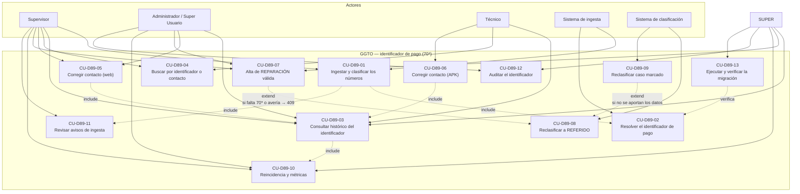
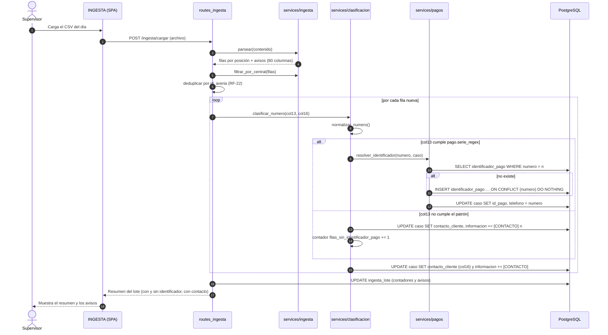
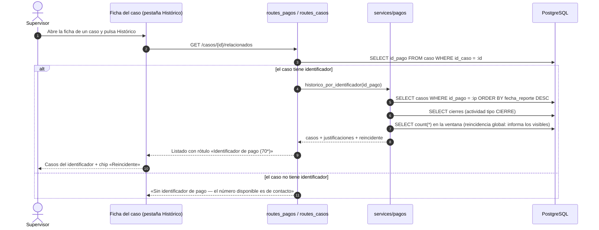
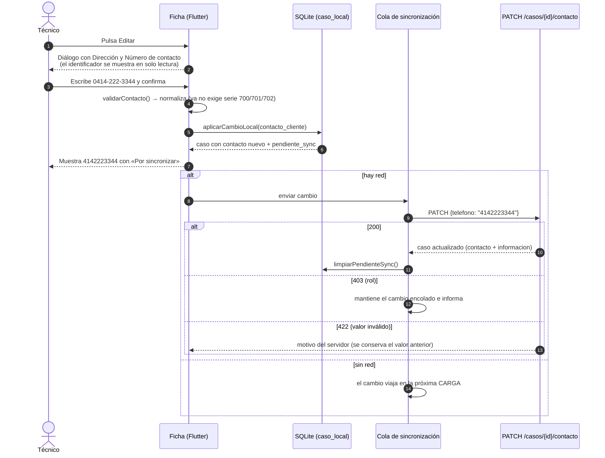
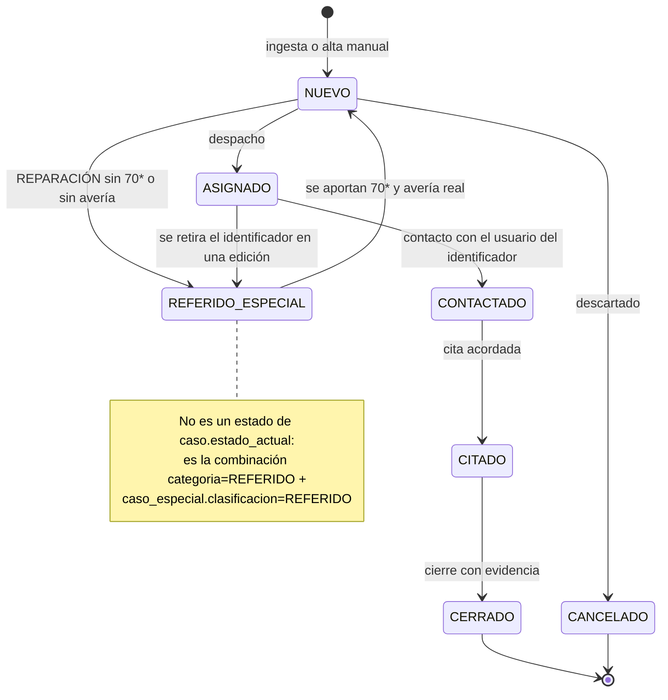

# Diagramas — Incremento **D-89…D-94** · Identificador de pago (70\*)

| Campo | Valor |
|---|---|
| Documento | Diagramas Mermaid del incremento (casos de uso, secuencias y decisiones) |
| Estado | **v0.3 — coherente con los casos de uso v0.3 (auditoría y DEC-IP-5/6/7 incorporadas)** |
| Fecha | 2026-10-08 |
| Base | [`casos_uso_D89.md`](casos_uso_D89.md) · [`../incremento_D89_identificador_pago.md`](../incremento_D89_identificador_pago.md) · [`../documento_tecnico_D89.md`](../documento_tecnico_D89.md) |

> Los actores y los nombres de los casos de uso son **exactamente** los del
> documento de casos de uso (mismos códigos CU-D89-01…12).

---

## 1. Diagrama de casos de uso (UML)



## 2. Secuencia — Ingesta, clasificación y enlace del identificador (CU-01, CU-02)



## 3. Secuencia — Histórico y reincidencia del identificador (CU-03, CU-10)



## 4. Secuencia — Edición del número de contacto desde la APK (CU-06)



## 5. Decisión — REPARACIÓN vs REFERIDO (CU-07, CU-08, CU-09)

```mermaid
flowchart TD
    A["Alta o edición de un caso"] --> B{"¿tipo_caso = REPARACION?"}
    B -- No --> C["Se guarda tal cual<br/>(AVERIA, CONSTRUCCION o REFERIDO)"]
    B -- Sí --> D{"¿tiene identificador de pago (70*)?"}
    D -- No --> F["tipo_caso := REFERIDO<br/>categoria := REFERIDO<br/>motivo: SIN_IDENTIFICADOR_PAGO"]
    D -- Sí --> E{"¿id_averia real<br/>(no REF-…)?}
    E -- No --> G["tipo_caso := REFERIDO<br/>motivo: SIN_ID_AVERIA"]
    E -- Sí --> H["Se guarda como REPARACION<br/>enlazada al identificador"]
    F --> I["caso_especial idempotente:<br/>clasificacion REFERIDO (o EMPRESA/GOBIERNO)<br/>tiene_id_averia=false<br/>+ bitácora y auditoría"]
    G --> I
    I --> J["Chip «Reclasificado» visible en web y APK"]

    K["Caso histórico marcado<br/>REPARACION sin IP o sin avería"] --> L{"Siguiente cambio del caso"}
    L -- Aporta lo que falta --> H
    L -- No aporta --> I
    L -- Solo cambia de estado en un caso ya terminal --> M["No reclasifica:<br/>pendiente histórico en MONITOREO"]

    T["Trigger BEFORE INSERT/UPDATE en caso<br/>(garantiza el tipo aunque no pase por el servicio)"]
    T -.->|convierte a REFERIDO antes de validar| F
    N["CHECK ck_reparacion_con_ip<br/>red de seguridad: rige toda escritura"] -.-> H
```

## 6. Estados del caso en el incremento



## 7. Trazabilidad de los diagramas

| Diagrama | Casos de uso | Requisitos |
|---|---|---|
| §1 Casos de uso | CU-01…CU-12 | RF-45…RF-56 |
| §2 Secuencia de ingesta | CU-01, CU-02, CU-11 | RF-45, RF-46, RF-47, RF-56, RNF-29, RNF-33 |
| §3 Secuencia de histórico | CU-03, CU-10 | RF-48, RF-54, RF-55, RNF-31 |
| §4 Secuencia de edición en APK | CU-06 | RF-52, RNF-30, RNF-32 |
| §5 Decisión REPARACIÓN/REFERIDO | CU-07, CU-08, CU-09 | RF-49, RF-50, RNF-29, RNF-32 |
| §6 Estados del caso | CU-07, CU-08, CU-09 | RF-49, RF-50 |

## 8. Historial de versiones

| Versión | Fecha | Cambio |
|---|---|---|
| v0.1 | 2026-10-08 | Emisión inicial: casos de uso, 3 secuencias, decisión de clasificación y estados. |
| **v0.2** | 2026-10-08 | Auditoría incorporada: **CU-13** (migración) en el diagrama de casos de uso, actor `SUPER`, y árbol de decisión reescrito con `tipo_caso='REFERIDO'`, el **trigger**, la excepción de estados terminales y una aclaración de que el `CHECK` es red de seguridad. |
| **v0.3** | 2026-10-08 | **DEC-IP-5/6/7**: la secuencia de ingesta usa `ON CONFLICT (numero) DO NOTHING` (ficha única global) y la de histórico indica que la reincidencia es **global** informando los casos visibles por alcance. |
