# Diagramas — Incremento **D-95 … D-98** · APK de Gestión (Supervisor · Administrador · Coordinador)

| Campo | Valor |
|---|---|
| Documento | Diagramas Mermaid del incremento (casos de uso, secuencias, estados, migración y arquitectura) |
| Estado | **v0.1 — coherente con los casos de uso v0.2 (24 CU) y el incremento v0.3.2** |
| Fecha | 2026-10-10 |
| Base | [`casos_uso_D95.md`](casos_uso_D95.md) · [`../incremento_D95_apk_gestion.md`](../incremento_D95_apk_gestion.md) · [`diagramas_D89.md`](diagramas_D89.md) (estilo de la casa) |
| Alcance | **D-95…D-98**: rol `COORDINADOR`, APK multi-rol, navegación por rol, caché de lectura y refresco de gestión, despacho, mensajería Coordinador → Supervisor, fallas masivas con orden de material, aislamiento por central y la migración de D-95 (§9.3 del incremento) |

> Los actores y los nombres de los casos de uso son **exactamente** los del documento
> de casos de uso: `SUP` Supervisor · `ADM` Administrador · `SUPER` Super Usuario ·
> `COO` Coordinador · `TEC` Técnico *(solo convivencia offline)*. Mismos códigos
> CU-D95-01…CU-D95-24.
>
> **Dos marcas que los diagramas respetan a propósito:** el **MFA no existe y queda diferido**
> (DEC-G14, riesgo aceptado **RA-01**) y la **caché local no se cifra** (DEC-G19, riesgo
> aceptado **RA-02**): ningún diagrama dibuja un segundo factor ni un cifrado que no se
> vaya a construir.

---

## Índice de figuras

| Figura | Tipo | Título | Casos de uso |
|---|---|---|---|
| [§1](#1-diagrama-de-casos-de-uso-uml) | `flowchart` | Diagrama de casos de uso (UML) del incremento | CU-D95-01…24 |
| [§2](#2-secuencia--ingreso-en-la-apk-de-gestión-sin-segundo-factor-cu-d95-01-cu-d95-02) | `sequenceDiagram` | Ingreso en la APK de gestión **sin segundo factor** | CU-D95-01, CU-D95-02 |
| [§3](#3-secuencia--navegación-por-rol-y-menú-por-rol-cu-d95-03-cu-d95-18) | `sequenceDiagram` | Navegación por rol y menú por rol | CU-D95-03, CU-D95-18 |
| [§4](#4-secuencia--refresco-automático-de-5-min-con-presupuesto-de-peticiones-cu-d95-05) | `sequenceDiagram` | Refresco automático de 5 min con presupuesto de peticiones | CU-D95-05 |
| [§5](#5-secuencia--armar-y-publicar-el-despacho-con-dos-supervisores-cu-d95-09) | `sequenceDiagram` | Armar y publicar el despacho (concurrencia entre dos Supervisores) | CU-D95-09 |
| [§6](#6-secuencia--mensaje-del-coordinador-al-supervisor-con-escalado-al-admin-cu-d95-13-cu-d95-20) | `sequenceDiagram` | Mensaje del Coordinador al Supervisor, con escalado al ADMIN | CU-D95-13, CU-D95-20 |
| [§7](#7-secuencia--solicitar-material-para-una-falla-la-única-escritura-del-coordinador-cu-d95-16) | `sequenceDiagram` | Solicitar material para una falla (única escritura del Coordinador) | CU-D95-15, CU-D95-16 |
| [§8](#8-secuencia--aislamiento-por-central-el-usuario-de-la-central-a-fuerza-id_central-de-la-central-b-cu-d95-22) | `sequenceDiagram` | Aislamiento por central: forzar `id_central` de otra central | CU-D95-22 (+ transversal) |
| [§9](#9-estados-de-una-falla-masiva) | `stateDiagram-v2` | Estados de una falla masiva | CU-D95-14, CU-D95-15, CU-D95-16 |
| [§10](#10-estados-de-la-cuenta-de-gestión) | `stateDiagram-v2` | Estados de la cuenta de gestión (alta → activa → bloqueada) | CU-D95-01, CU-D95-02, CU-D95-19 |
| [§11](#11-superficie-de-migración-de-d-95-8-objetos) | `flowchart` | Superficie de migración de D-95 (8 objetos de §9.3) | CU-D95-19, CU-D95-20, CU-D95-22 |
| [§12](#12-arquitectura-de-la-apk-multi-rol) | `flowchart` | Arquitectura de la APK multi-rol (TÉCNICO offline vs GESTIÓN online) | CU-D95-03, CU-D95-05, CU-D95-06, CU-D95-18 |

**Total: 12 figuras** (1 de casos de uso, 7 de secuencia, 2 de estados y 2 de estructura).
Las §13 y §14 son tablas de trazabilidad y de historial, no figuras.

---

## 1. Diagrama de casos de uso (UML)

Actores a la izquierda y a la derecha, los **24 casos de uso** agrupados por módulo y las
relaciones `include` / `extend` que existen de verdad: el refresco de 5 min y la caché de
lectura los **incluyen** las pantallas de gestión; la **orden de material** es una
**extensión** de la consulta de la falla; el **escalado al ADMIN** es una extensión del
mensaje al Supervisor; y el **alta y la edición ligera de casos** extienden el ciclo de
vida de un caso de la APK.

```mermaid
flowchart TB
    subgraph ACT["Actores"]
        SUP["Supervisor"]
        ADM["Administrador"]
        COO["Coordinador"]
        TEC["Tecnico"]
        SUPER["Super Usuario"]
    end

    subgraph SIS["Sistemas externos"]
        API["Backend / API GGTO"]
        ING["Ingesta"]
    end

    subgraph M_GEN["GGTO - APK de Gestion por modulo"]
        CU01["CU-D95-01<br/>Ingresar en la APK de gestion con autenticacion por rol"]
        CU02["CU-D95-02<br/>Ingresar los roles de gestion sin segundo factor"]
        CU03["CU-D95-03<br/>Navegar por la APK segun el rol autenticado"]
        CU05["CU-D95-05<br/>Refrescar automaticamente cada 5 minutos con presupuesto de peticiones"]
        CU06["CU-D95-06<br/>Consultar sin conexion con enmascaramiento visual y cache sin cifrar"]
        CU18["CU-D95-18<br/>Conservar el flujo offline del Tecnico con CARGA/DESCARGA manual"]
        CU21["CU-D95-21<br/>Publicar la APK multi-rol con su version y firma"]
    end

    subgraph M_MON["Modulo MONITOREO"]
        CU04["CU-D95-04<br/>Consultar el monitoreo de la gestion en sus 5 vistas"]
    end

    subgraph M_ESP["Modulo ESPECIALES"]
        CU07["CU-D95-07<br/>Listar, filtrar y abrir la ficha de un caso especial"]
        CU08["CU-D95-08<br/>Crear un caso especial con su caso asociado"]
    end

    subgraph M_DES["Modulo DESPACHO y GESTION"]
        CU09["CU-D95-09<br/>Armar y publicar el despacho del dia"]
        CU10["CU-D95-10<br/>Asignar y quitar un caso del despacho de la cuadrilla"]
        CU11["CU-D95-11<br/>Operar la pantalla GESTION de la cuadrilla 0"]
    end

    subgraph M_CAS["Modulo CASOS"]
        CU23["CU-D95-23<br/>Dar de alta manualmente un caso de gestion"]
        CU24["CU-D95-24<br/>Editar ligeramente un caso desde la APK"]
    end

    subgraph M_ALE["Modulo ALERTAS y FALLAS MASIVAS"]
        CU14["CU-D95-14<br/>Monitorear las alertas sin actuar, las fallas masivas y la bandeja de notificaciones"]
        CU15["CU-D95-15<br/>Consultar una falla masiva con detalle de planificacion y materiales"]
        CU16["CU-D95-16<br/>Solicitar material para una falla masiva"]
    end

    subgraph M_MEN["Modulo MENSAJES"]
        CU12["CU-D95-12<br/>Gestionar la bandeja de mensajes del Supervisor"]
        CU13["CU-D95-13<br/>Enviar un mensaje a un Supervisor concreto de su central"]
    end

    subgraph M_ADM["Modulo ADMINISTRACION y SEGURIDAD"]
        CU19["CU-D95-19<br/>Dar de alta la cuenta de gestion del Coordinador y acotar el RBAC"]
        CU20["CU-D95-20<br/>Habilitar el modelo de mensajeria por destinatario usuario"]
        CU22["CU-D95-22<br/>Aislar por central los datos de la APK de gestion"]
    end

    subgraph M_WEB["Canal WEB"]
        CU17["CU-D95-17<br/>Usar la WEB del Coordinador con las mismas capacidades"]
    end

    SUP --> CU01
    SUP --> CU03
    SUP --> CU04
    SUP --> CU07
    SUP --> CU08
    SUP --> CU09
    SUP --> CU10
    SUP --> CU11
    SUP --> CU12
    SUP --> CU14
    SUP --> CU15
    SUP --> CU16
    SUP --> CU23
    SUP --> CU24

    ADM --> CU01
    ADM --> CU03
    ADM --> CU04
    ADM --> CU07
    ADM --> CU08
    ADM --> CU09
    ADM --> CU10
    ADM --> CU11
    ADM --> CU12
    ADM --> CU14
    ADM --> CU15
    ADM --> CU16
    ADM --> CU23
    ADM --> CU24

    COO --> CU01
    COO --> CU03
    COO --> CU04
    COO --> CU07
    COO --> CU08
    COO --> CU13
    COO --> CU14
    COO --> CU15
    COO --> CU16
    COO --> CU17

    TEC --> CU03
    TEC --> CU18
    SUPER --> CU19
    SUPER --> CU20
    SUPER --> CU21
    SUPER --> CU22

    API -.-> CU21
    API -.-> CU22
    ING -.-> CU22

    CU01 -.->|include| CU02
    CU03 -.->|include| CU05
    CU03 -.->|include| CU06
    CU04 -.->|include| CU05
    CU07 -.->|include| CU05
    CU11 -.->|include| CU05
    CU14 -.->|include| CU05
    CU14 -.->|include| CU15
    CU15 -.->|extend<br/>si el usuario pide la orden de material| CU16
    CU13 -.->|extend<br/>si no hay Supervisor activo: escala al ADMIN| CU20
    CU12 -.->|extend<br/>destino_tipo = SUPERVISOR| CU20
    CU07 -.->|extend<br/>el Coordinador crea el especial| CU08
    CU10 -.->|extend<br/>alta manual sin averia| CU23
    CU10 -.->|extend<br/>edicion de Sector, Fecha de cita e Informacion| CU24
    CU08 -.->|include<br/>acotado a usuario.id_central| CU22
    CU16 -.->|include<br/>acotado a usuario.id_central| CU22
    CU17 -.->|include| CU13

    linkStyle 0,1,2,3,4,5,6,7,8,9,10,11,12,13 stroke:#1f6feb,stroke-width:1px
    linkStyle 14,15,16,17,18,19,20,21,22,23,24,25,26,27 stroke:#2da44e,stroke-width:1px
    linkStyle 28,29,30,31,32,33,34,35,36 stroke:#bf8700,stroke-width:1px
    linkStyle 37,38,39,40 stroke:#8250df,stroke-width:1px
    linkStyle 41,42,43 stroke:#cf222e,stroke-width:1px
    linkStyle 44,45,46,47,48,49,50,51,52,53,54,55,56,57,58 stroke:#57606a,stroke-width:1px,stroke-dasharray:4 3
```

> **Lectura del diagrama.** `SUP` y `ADM` comparten menú de gestión (DEC-G3); el `COO` **no**
> llega a CU-D95-09, CU-D95-10, CU-D95-11, CU-D95-23 ni CU-D95-24 (matriz §5: DESPACHO «—»,
> GESTIÓN «—», CASOS «—»); el `TEC` **solo** aparece en CU-D95-03 y CU-D95-18 — nunca en las
> pantallas de gestión ni en el temporizador de refresco (RNF-APK-03, D-84); el `SUPER` es el
> único actor de la migración, el modelo de mensajería, la publicación y el aislamiento por
> central. CU-D95-02 y CU-D95-06 son el reflejo en el diagrama de los riesgos aceptados
> **RA-01** y **RA-02**.

---

## 2. Secuencia — Ingreso en la APK de gestión **sin segundo factor** (CU-D95-01, CU-D95-02)

El login vigente emite el token en **un solo paso**: no hay pantalla de código de 6 dígitos,
ni endpoint `MFA`/`otp`/`totp`, ni rama de verificación. RNF-APK-04 queda **incumplido por
decisión expresa** (DEC-G14, riesgo aceptado **RA-01**). El bloqueo a los 3 intentos y la
recuperación con 3 de las 12 palabras sí se dibujan porque **existir, existen**.

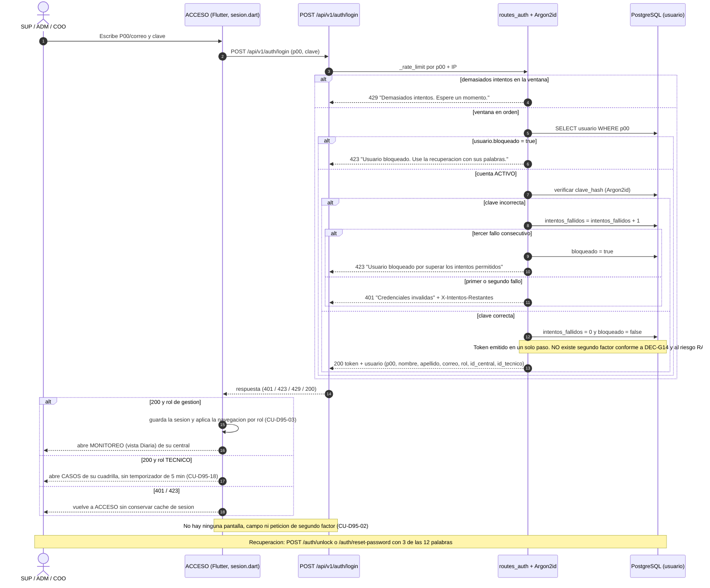

---

## 3. Secuencia — Navegación por rol y menú por rol (CU-D95-03, CU-D95-18)

Un solo binario, tres menús: **8 secciones** para `SUPERVISOR`/`ADMIN` (DEC-G3), **6** para el
`COORDINADOR` (sin `GESTIÓN` ni `DESPACHO`, DEC-G7) y el menú de campo del `TÉCNICO`. La
navegación directa por ruta interna **no renderiza** la pantalla prohibida.

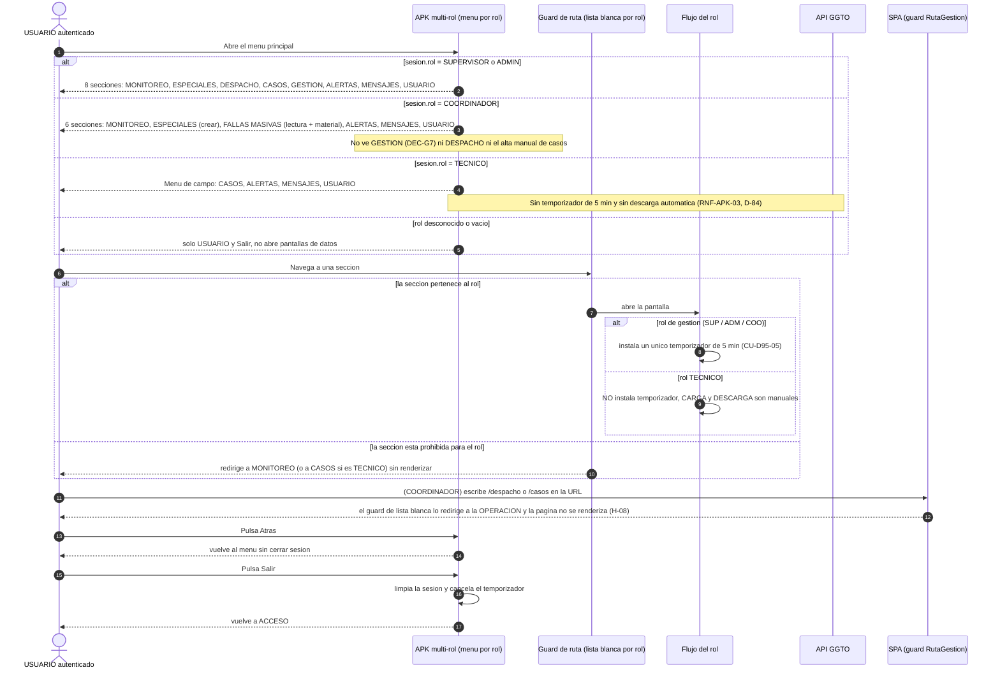

---

## 4. Secuencia — Refresco automático de 5 min con **presupuesto de peticiones** (CU-D95-05)

Solo la pantalla visible, una petición en vuelo como máximo, tope por token y política de
fallo definida (backoff a partir de 3 fallos consecutivos). El `TÉCNICO` **no aparece** en
este diagrama: su temporizador no se instala (RNF-APK-03, riesgo R1).

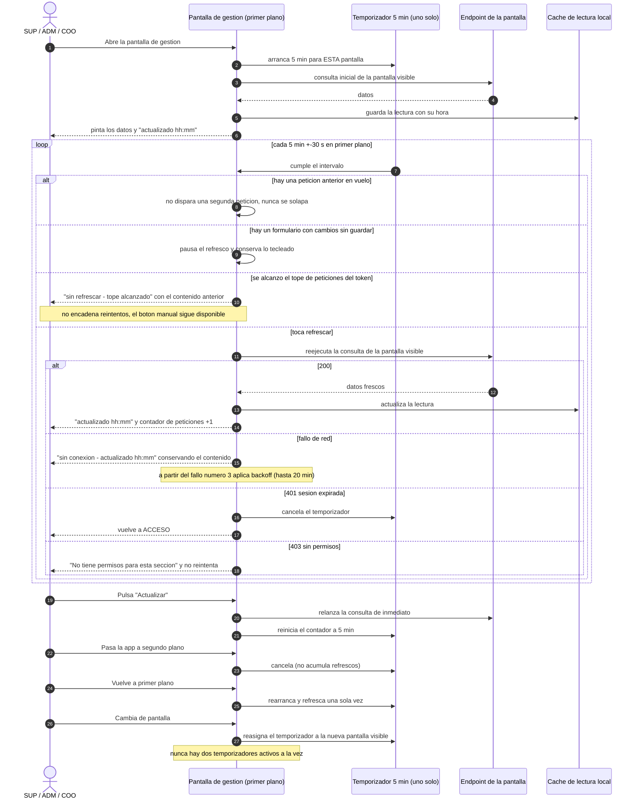

---

## 5. Secuencia — Armar y publicar el despacho, con dos Supervisores (CU-D95-09)

El conflicto de la concurrencia (riesgo R2 / H-12) se resuelve en el servidor con `409`: el
segundo Supervisor **no descarta en silencio** lo que el otro guardó.

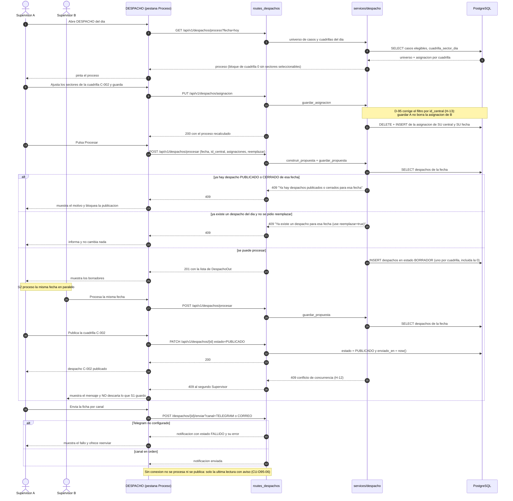

---

## 6. Secuencia — Mensaje del Coordinador al Supervisor, con **escalado al ADMIN** (CU-D95-13, CU-D95-20)

El destino es un **usuario concreto de su central** (DEC-G15). Si no hay ningún `SUPERVISOR`
activo, el mensaje **escala al `ADMIN` de la misma central** y deja constancia del motivo.
La vía es de **una sola dirección**: el Supervisor no tiene botón «Responder» (DEC-G9).

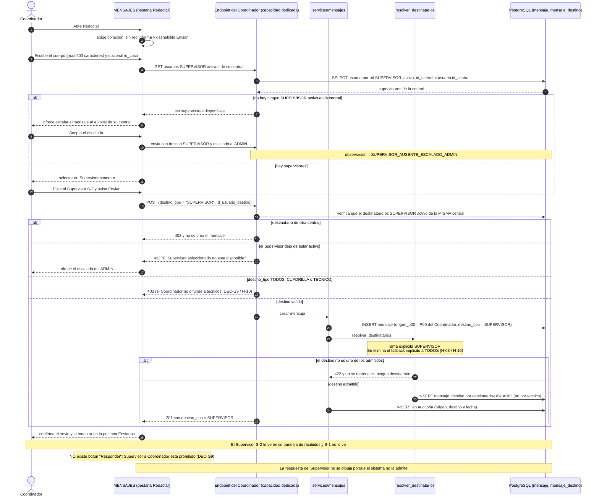

---

## 7. Secuencia — Solicitar material para una falla: la **única escritura** del Coordinador (CU-D95-16)

Es también la **única** extensión de la consulta de la falla: todo lo demás que el Coordinador
intenta sobre fallas masivas responde `403` (DEC-G8, DEC-G13, **H-05**).

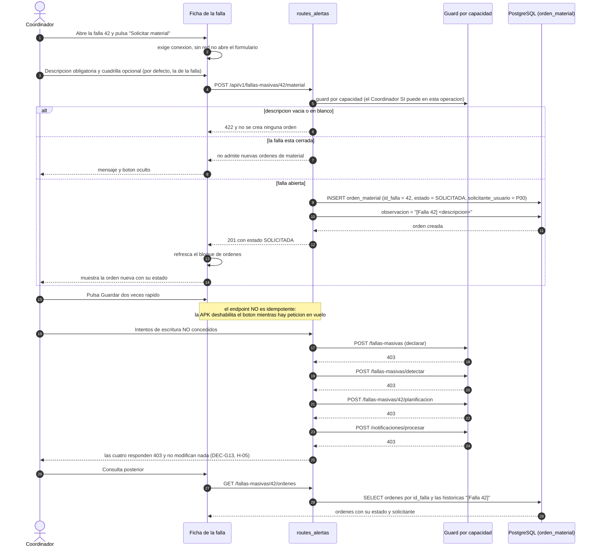

---

## 8. Secuencia — Aislamiento por central: el usuario de la central A fuerza `id_central` de la central B (CU-D95-22)

Hoy la RLS es **inerte** (con el parámetro `NULL` la política permite todo) y `resolver_central`
acepta el `id_central` del cliente sin compararlo: el diagrama muestra el comportamiento
**a implementar** en D-95 (H-01), con el `403` y las **0 filas** de la otra central como
criterio de cierre.

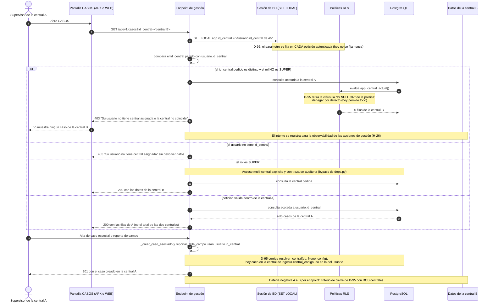

> **Defecto colateral que el mismo ciclo corrige:** el imprimible del despacho lleva el rótulo
> fijo «FRANCISCO SALIAS» en vez de la central real del despacho (CU-D95-22/A5). Está **fuera
> del alcance de la APK**, pero se cierra en D-95.

---

## 9. Estados de una falla masiva

Estados reales del modelo (`FallaMasiva.estado`, `app/models/despacho_entities.py:125`) y del
esquema de `PATCH` (`app/schemas/alertas.py:86`): `DETECTADA`, `PLANIFICADA`, `ATENDIDA` y
`CERRADA`. El Coordinador **no puede** recorrer ninguna transición: solo leer y pedir material
(DEC-G13).

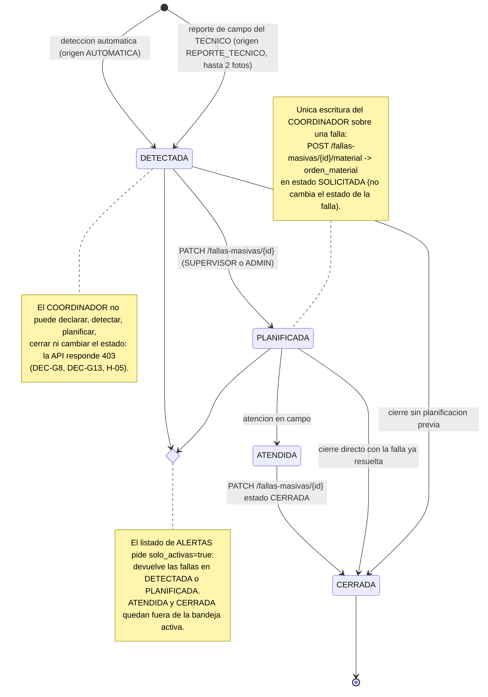

---

## 10. Estados de la cuenta de gestión

`usuario` no tiene columna `estado`: la cuenta se gobierna con `bloqueado` e
`intentos_fallidos` (`app/models/entities.py:82-83`) y con la recuperación de 3 de las 12
palabras. El alta la realiza el `SUPER` **sin fila en `tecnico`** (DEC-G16).

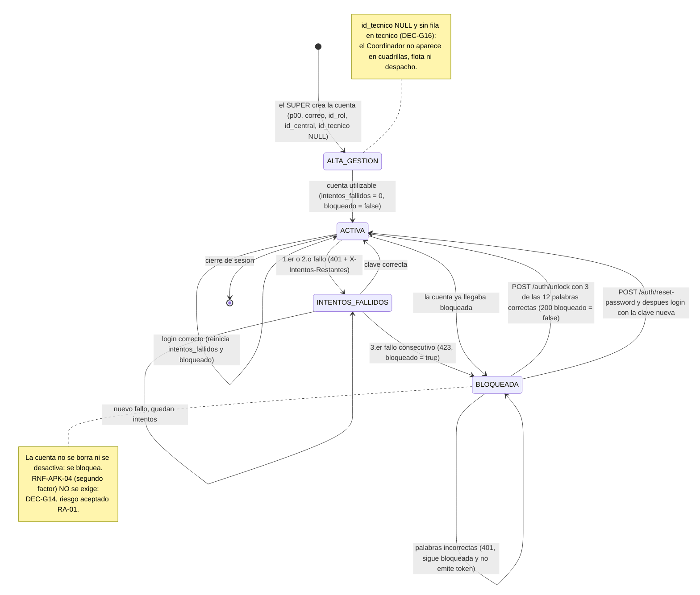

---

## 11. Superficie de migración de D-95 (8 objetos)

Los **8 objetos** de la tabla §9.3 del incremento, con su estado vigente y **qué cambia** en
cada uno. La migración es idempotente (`scripts/migrar_dXX_*.py`, simulación por defecto,
`--aplicar --si`, log en `RepoTecnico/BaseOperaciones/` y reflejo en `db/schema.sql`).

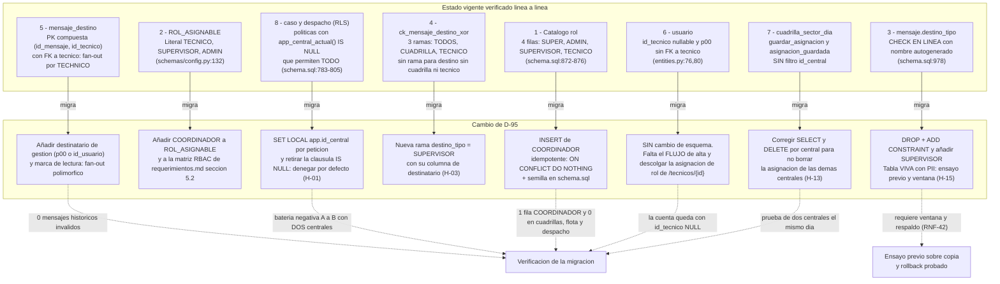

> **Orden de la migración.** `rol` y `ROL_ASIGNABLE` van primero (sin ellos el Coordinador no
> existe); después la mensajería (3, 4 y 5, que dependen entre sí); `usuario` no cambia de
> esquema, solo de flujo; y el aislamiento por central (7 y 8) se activa **al final**, porque
> a partir de ese momento toda lectura sin `app.id_central` deja de devolver datos.

---

## 12. Arquitectura de la APK multi-rol

Una sola APK (DEC-G2) con **dos arquitecturas de datos conviviendo**: el flujo del **TÉCNICO**
(offline, CARGA/DESCARGA manual, intacto por D-84) y el flujo de **GESTIÓN** (online con caché
de lectura y refresco de 5 min). El temporizador de gestión **nunca** entra en el flujo del
TÉCNICO (riesgo R1).

```mermaid
flowchart TB
    ACCESO["ACCESO<br/>POST /api/v1/auth/login: P00 + clave, un solo paso"]

    subgraph ROL["Navegacion por rol - un solo binario (DEC-G2)"]
        MENU_SUP["Menu SUPERVISOR y ADMIN - 8 secciones<br/>MONITOREO, ESPECIALES, DESPACHO, CASOS,<br/>GESTION, ALERTAS, MENSAJES, USUARIO"]
        MENU_COO["Menu COORDINADOR - 6 secciones<br/>MONITOREO, ESPECIALES (crear), FALLAS MASIVAS,<br/>ALERTAS, MENSAJES, USUARIO"]
        MENU_TEC["Menu TECNICO - campo<br/>CASOS, ALERTAS, MENSAJES, USUARIO"]
        MENU_SUPER["Menu SUPER USUARIO<br/>acceso total + SISTEMAS y auditoria en solo lectura"]
        GUARD["Guard de ruta: lista blanca por rol<br/>la seccion prohibida no se renderiza (H-08)"]
    end

    ACCESO --> GUARD
    GUARD --> MENU_SUP
    GUARD --> MENU_COO
    GUARD --> MENU_TEC
    GUARD --> MENU_SUPER

    subgraph GEST["Flujo GESTION - SUP, ADM, COO y SUPER"]
        MOD_MON["Modulo MONITOREO<br/>5 vistas: Diaria, Semanal, Mensual, Especiales, Construcciones"]
        MOD_ESP["Modulo ESPECIALES<br/>listar, filtrar, ficha y crear (COO: solo alta)"]
        MOD_DES["Modulo DESPACHO y GESTION<br/>CU-D95-09 a CU-D95-11 (el COO no los ve)"]
        MOD_CAS["Modulo CASOS<br/>alta manual CU-D95-23 y edicion ligera CU-D95-24"]
        MOD_ALE["Modulo ALERTAS y FALLAS MASIVAS<br/>leer todo; el COO escribe solo la orden de material"]
        MOD_MEN["Modulo MENSAJES<br/>bandeja del Supervisor y redaccion del Coordinador"]
        ONLINE["Escrituras ONLINE obligatorias<br/>asignar, quitar, crear, enviar, material, nuevo, editar"]
    end

    MENU_SUP --> GEST
    MENU_COO --> GEST
    MENU_SUPER --> GEST
    GEST --> ONLINE

    subgraph CACHE["Cache de lectura local - sin cifrar (RA-02, DEC-G19)"]
        CACHE_DB["Almacen local de lectura<br/>guarda telefono, nombre y direccion EN CLARO"]
        CACHE_PART["Particion por usuario y purga al cerrar sesion (H-14)"]
        MASK["Enmascaramiento visual por rol, solo en presentacion<br/>COO: telefono 70*******, iniciales y direccion sin numero de casa<br/>SUP y ADM: valores completos"]
        BANDA["Banda de estado<br/>Sin conexion - ultimo dato hh:mm dd/mm o dato antiguo (mas de 24 h)"]
    end

    GEST -->|lectura| CACHE
    MENU_COO -->|lectura sin red| MASK
    MASK --> BANDA
    CACHE --> CACHE_DB
    CACHE --> CACHE_PART

    subgraph REFRESCO["Refresco de gestion - CU-D95-05 (RNF-APK-01 y 06)"]
        TIMER["Un solo temporizador de 5 min +-30 s"]
        VISIBLE["Refresca UNICAMENTE la pantalla visible<br/>reejecuta la consulta de esa pantalla"]
        PRESUP["Presupuesto: 1 peticion en vuelo como maximo<br/>tope de peticiones por token (12 peticiones/hora configurables)"]
        MANUAL["Botón Actualizar: relanza y reinicia el contador"]
        FRESCO["Indicador actualizado hh:mm"]
        FALLO["Politica ante fallo<br/>sin conexion y backoff al 3.er fallo consecutivo; 401 vuelve a ACCESO"]
    end

    GEST --> TIMER
    TIMER --> VISIBLE
    VISIBLE --> PRESUP
    PRESUP --> FRESCO
    MANUAL --> TIMER
    VISIBLE --> FALLO
    FALLO -->|exito| FRESCO
    GEST -->|actualiza| CACHE_DB

    subgraph TECFLOW["Flujo TECNICO - offline, INTACTO por D-84 (RNF-APK-03)"]
        SQLITE["SQLite local (caso_local)<br/>casos de su cuadrilla"]
        DESC["DESCARGA explicita<br/>GET /api/v1/sync/descarga y marca de agua ultima_descarga_ts"]
        TRABAJO["Trabajo offline<br/>contactar, atender, cerrar, diferir, evidencias"]
        CARGA["CARGA explicita<br/>POST /api/v1/sync/carga con la cola local"]
        COLA["Cola con reintento y backoff<br/>no se pierde ninguna actividad"]
        SINCRONO["Sondeo de mensajes cada 60 s (vigente)"]
        CAMPORE["Reporte de campo de falla masiva<br/>POST /fallas-masivas/reporte-campo"]
    end

    MENU_TEC --> SQLITE
    DESC --> SQLITE
    SQLITE --> TRABAJO
    TRABAJO --> CARGA
    CARGA --> COLA
    COLA -->|red disponible| SQLITE
    SQLITE -.->|"NO hay descarga automatica ni temporizador de 5 min"| TXT_NOAUTO["El TECNICO no instala el temporizador de gestion<br/>y no existe sondeo de descarga"]
    SQLITE --> SINCRONO
    SQLITE --> CAMPORE
```

> **Lo que el diagrama afirma con letra pequeña.** (1) El TÉCNICO **no** comparte el
> temporizador: su bloque `TECFLOW` está aislado del bloque `REFRESCO`. (2) La caché local
> guarda PII **en claro** y el enmascaramiento es de presentación: el diagrama no dibuja ningún
> cifrado, TTL, `FLAG_SECURE` ni PIN (RA-02, DEC-G19). (3) Toda escritura de gestión exige red
> y **no se encola**, a diferencia de la cola del TÉCNICO (CU-D95-06/A2 frente a CU-D95-18/A4).

---

## 13. Trazabilidad de los diagramas

| Figura | Casos de uso | Requisitos | Decisiones / hallazgos |
|---|---|---|---|
| §1 Casos de uso | CU-D95-01…24 | RF-APK-13…30, RNF-APK-01…06, RT-APK-01…05 | DEC-G1…G19 |
| §2 Ingreso sin segundo factor | CU-D95-01, CU-D95-02 | RNF-APK-04, RT-APK-01 | DEC-G14 (**RA-01**), H-02 |
| §3 Navegación por rol | CU-D95-03, CU-D95-18 | RF-APK-27, RNF-APK-03, RNF-APK-05 | DEC-G2, G3, G7, G16; H-08 |
| §4 Refresco con presupuesto | CU-D95-05 | RNF-APK-01, RNF-APK-06, RF-APK-28 | DEC-G4, G5, G18; H-11 |
| §5 Armar y publicar el despacho | CU-D95-09 | RF-APK-15, RNF-APK-02 | DEC-G3, G4; R2, H-12, H-13 |
| §6 Mensaje al Supervisor con escalado | CU-D95-13, CU-D95-20 | RF-APK-22, RF-APK-24, RT-APK-03, RNF-APK-02 | DEC-G9, G15; H-03, H-10 |
| §7 Orden de material | CU-D95-15, CU-D95-16 | RF-APK-20, RF-APK-21, RT-APK-05 | DEC-G8, G13, G11; **H-05** |
| §8 Aislamiento por central | CU-D95-22 (y CU-D95-01, 04, 07, 08, 10, 11, 13, 14, 15, 17, 19, 23, 24) | **RT-APK-02**, RNF-21, RNF-APK-06 | DEC-G6 (corregida), G18; **H-01** |
| §9 Estados de la falla masiva | CU-D95-14, CU-D95-15, CU-D95-16 | RF-APK-20, RF-APK-21, RF-APK-25 | DEC-G8, G11, G13 |
| §10 Estados de la cuenta de gestión | CU-D95-01, CU-D95-02, CU-D95-19 | RNF-APK-04, RT-APK-01 | DEC-G14, G16, G17 |
| §11 Superficie de migración | CU-D95-19, CU-D95-20, CU-D95-22 | RT-APK-01, RT-APK-02, RT-APK-03, RT-APK-05 | §9.3 del incremento; H-01, H-03, H-13, H-15 |
| §12 Arquitectura de la APK multi-rol | CU-D95-03, CU-D95-04, CU-D95-05, CU-D95-06, CU-D95-18 | RF-APK-27, RNF-APK-01, RNF-APK-02, RNF-APK-03, RNF-APK-06 | DEC-G2, G4, G5, G19 (**RA-02**); H-14, R1 |

---

## 14. Historial de versiones

| Versión | Fecha | Cambio |
|---|---|---|
| **v0.1** | 2026-10-10 | Emisión inicial: **12 diagramas Mermaid** coherentes con los casos de uso v0.2 (24 CU) y el incremento v0.3.2 — casos de uso UML, **7 secuencias** (ingreso sin segundo factor, navegación por rol, refresco con presupuesto, despacho con dos supervisores, mensaje con escalado al ADMIN, orden de material, aislamiento por central), **2 diagramas de estados** (falla masiva y cuenta de gestión), **superficie de migración** de los 8 objetos de §9.3 y **arquitectura de la APK multi-rol**. Los 12 bloques se validaron con el analizador de Mermaid: parseo y render correctos. Sin modificar ningún otro archivo. |
