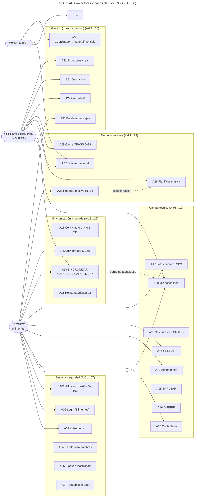
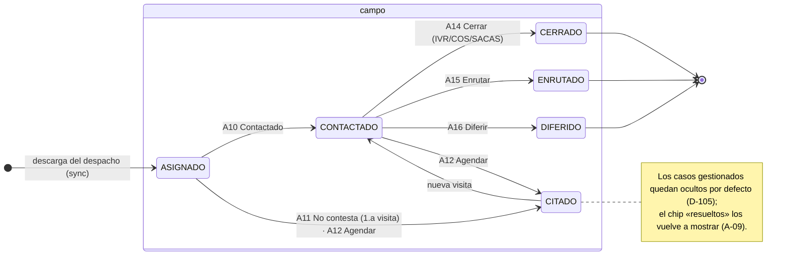
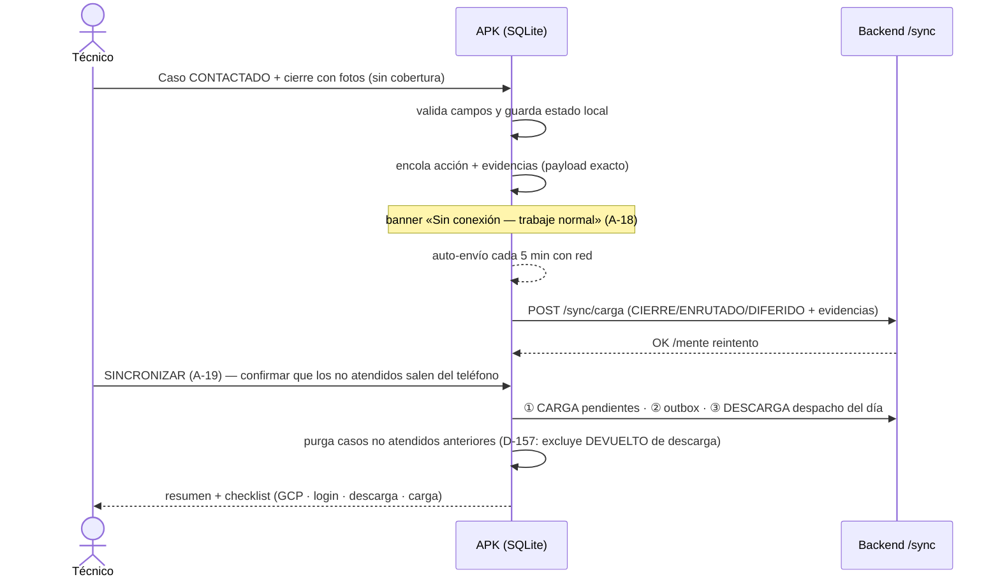
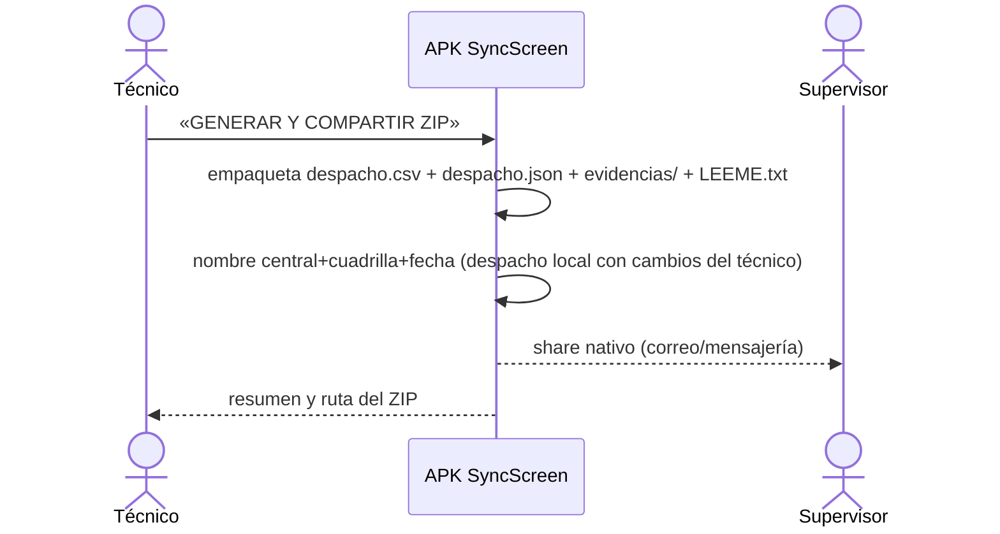
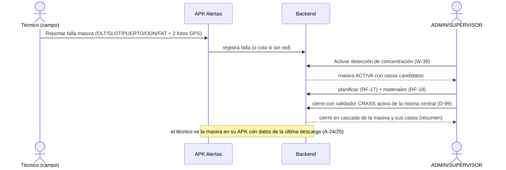
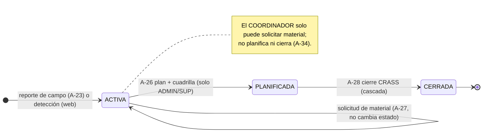

# Diagramas — GGTO V2 · Casos de uso de la APK

| Campo | Valor |
|---|---|
| Documento | Código **Mermaid** renderizable (GitHub/VS Code) usando los 36 CU de [`casos_uso_apk.md`](casos_uso_apk.md) |
| Formato | Bloques `mermaid` listos para pegar en visor o exportar a SVG |
| Fuente | Código vigente al 2026-10-23 (commit `4449f36`, despliegue v84, incluido D-157) |
| Estado | **v0.1** — previo a la auditoría `/auditar` |

---

## 1. Diagrama de casos de uso UML (APK por rol)

> Líneas punteadas: la purga del sincronizar (A-19, D-157) afecta el listado local de
> casos (A-08); el reporte de campo de una masiva (A-23) es el origen usual de la masiva
> que luego se planifica (A-26) y cierra (A-28).

## 2. Estados — Ciclo de vida del caso en la APK

## 3. Secuencia — Acción de campo fuera de línea + sincronización (CU-A-10/14 → A-19)

## 4. Secuencia — ZIP de la jornada (CU-A-20 · D-156)

## 5. Secuencia — Falla masiva: del campo al cierre (A-23 → W-39/W-45 · D-99)

## 6. Estados — Masiva desde la APK

