# Diagramas del Catálogo de Casos de Uso — GGTO v2 (Mermaid)

> Generados el 2026-11-12 (`/graficos`) a partir de los casos de uso **auditados y corregidos**
> (`README.md`, `casos_uso_web.md`, `casos_uso_apk.md`, `casos_uso_asistente.md`).
> Coherencia garantizada: mismos actores, mismos IDs de CU y mismas reglas citadas.
> Los bloques Mermaid se renderizan en GitHub, GitLab, VS Code y cualquier visor Mermaid.

*(Nota: la APK crea **6 tablas** SQLite — `caso_local`, `accion_pendiente`, `evidencia_local`,
`app_meta`, `mensaje_local`, `masiva_local` — versión 5 de `ggto.db`.)*

---

## 1 · Panorama general — actores ↔ paquetes funcionales

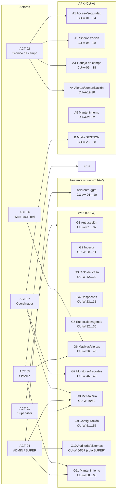

---

## 2 · G1 — Autenticación y sesión (relaciones include/extend)

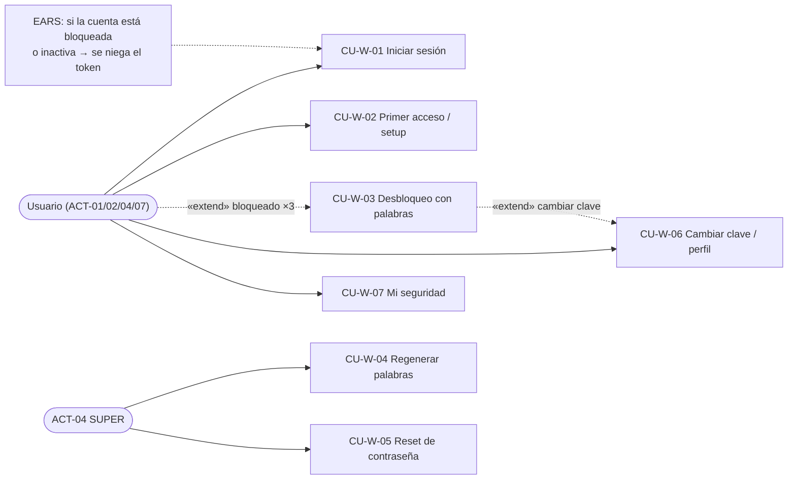

---

## 3 · G2/G3 — Ingesta y ciclo del caso (núcleo)

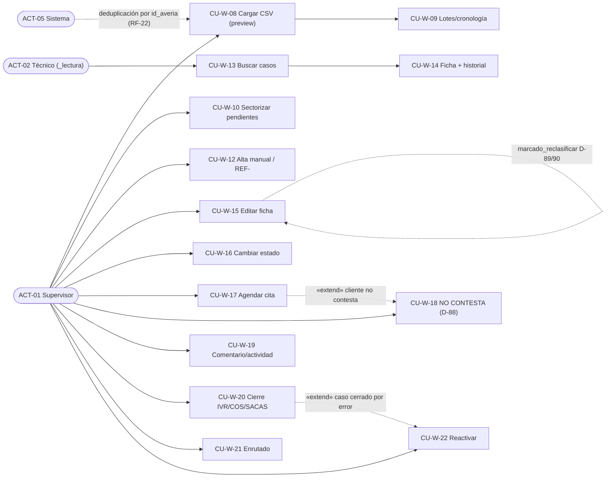

---

## 4 · G4 — Despacho diario

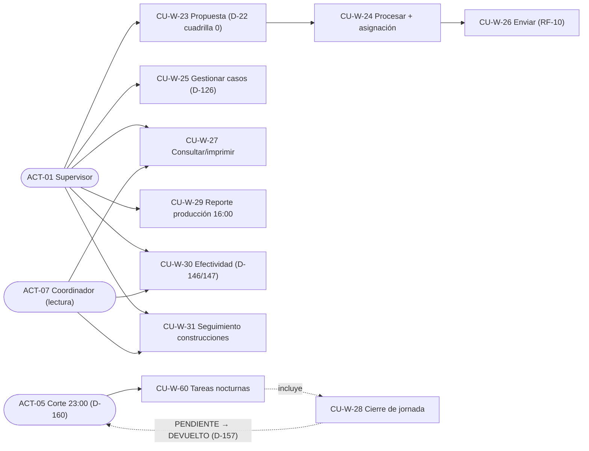

---

## 5 · G5/G6 — Especiales y fallas masivas

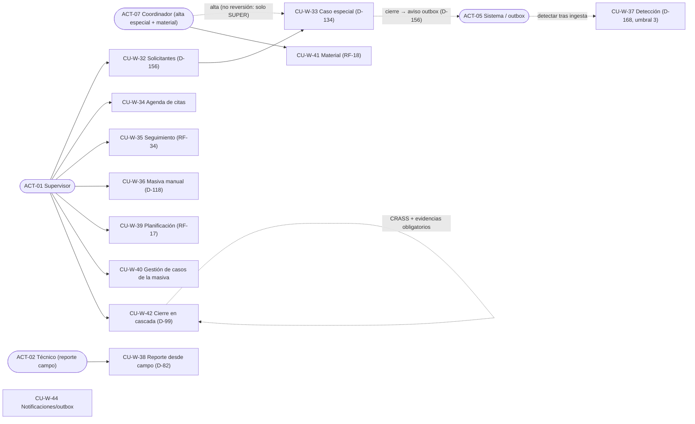

---

## 6 · G7–G11 — Monitoreo, mensajería, configuración, auditoría y mantenimiento

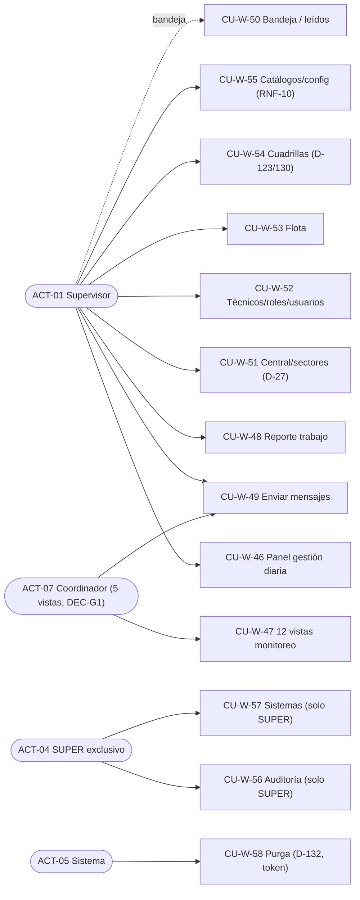

---

## 7 · APK del TÉCNICO (CU-A-01…22)

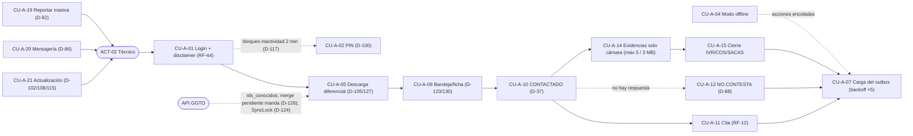

---

## 8 · APK modo GESTIÓN — Coordinador (CU-A-23…28)

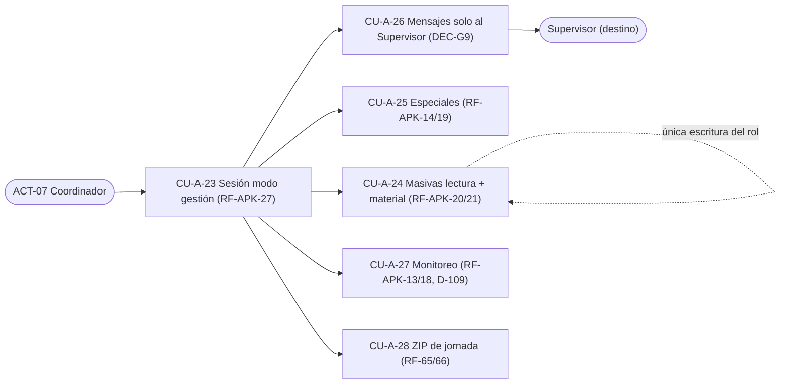

---

## 9 · Asistente virtual (CU-AV-01…10, ciclos C1–C6)

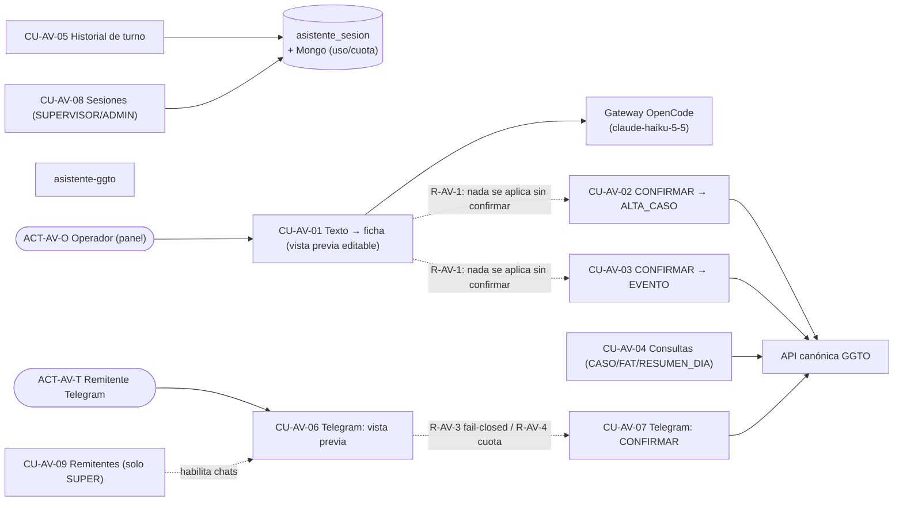

---

## 10 · Secuencia — Ingesta y despacho del día (flujo núcleo web)

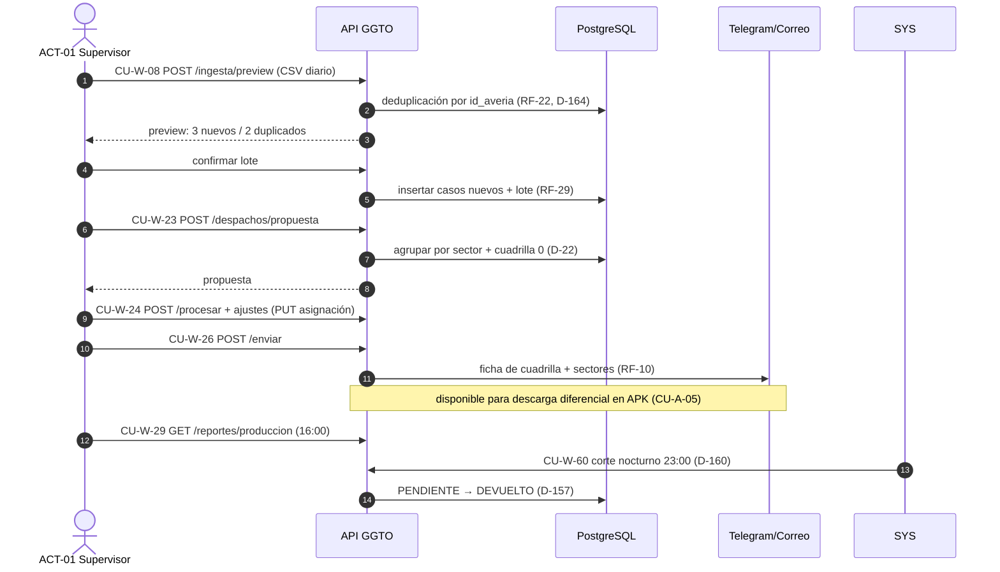

---

## 11 · Secuencia — Ciclo de campo del TÉCNICO (APK)

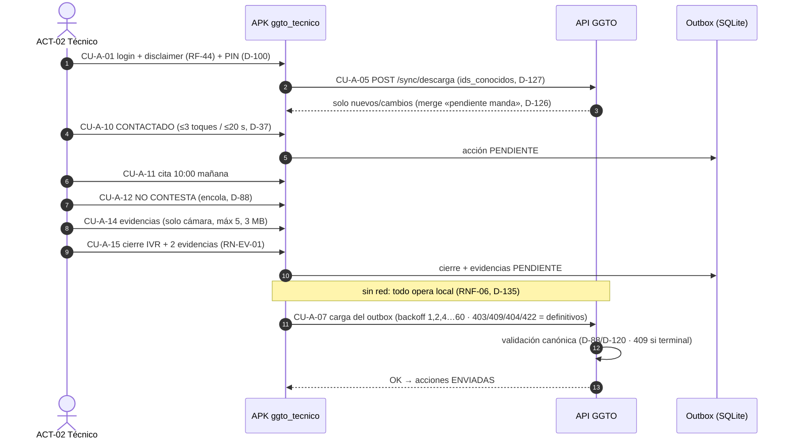

---

## 12 · Secuencia — Falla masiva (detección → cierre en cascada)

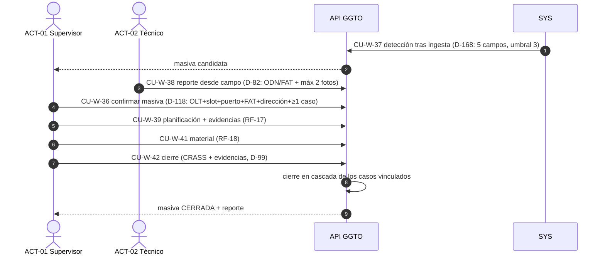

---

## 13 · Secuencia — Caso especial (D-134 / D-133 / D-156)

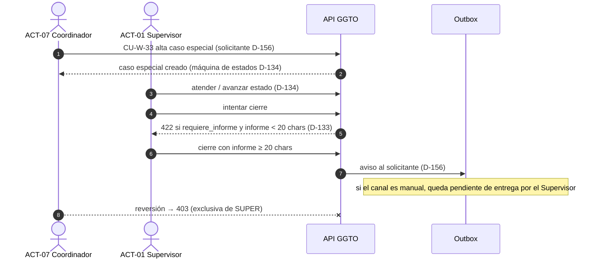

---

## 14 · Secuencia — Asistente virtual (texto libre → confirmación canónica)

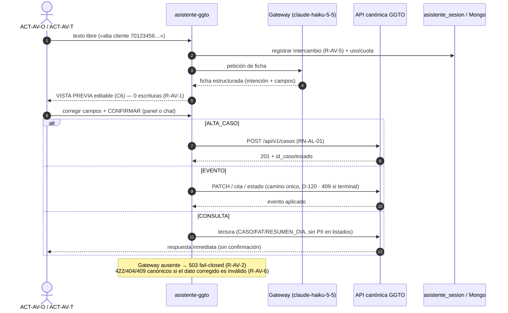

---

## 15 · Secuencia — Acceso endurecido (web y APK)

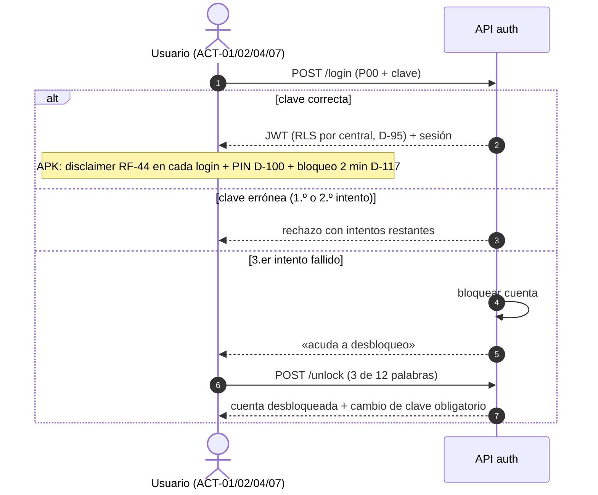

---

### Notas de coherencia

- Cada diagrama usa **exactamente los IDs del catálogo auditado**; si un CU cambia de nombre
  o de regla, el diagrama debe actualizarse en el mismo cambio.
- Las reglas citadas (D-88, D-99, D-118, D-120, D-126, D-132, D-157/D-160, D-168, RN-EV-01…)
  corresponden a las versiones corregidas de la auditoría del 2026-11-12.
- Si se pide **SVG**, rasterizar estos bloques con `mmdc` (mermaid-cli) o el visor de VS Code;
  el contenido es el fuente de verdad.
