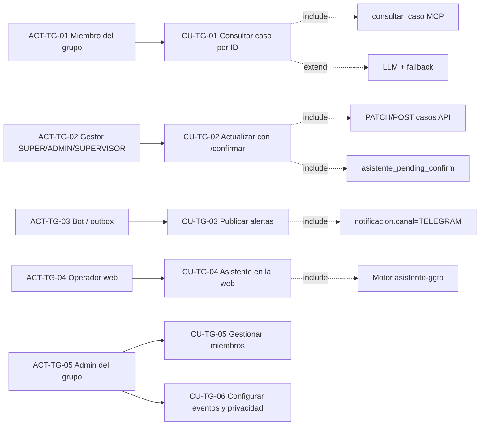
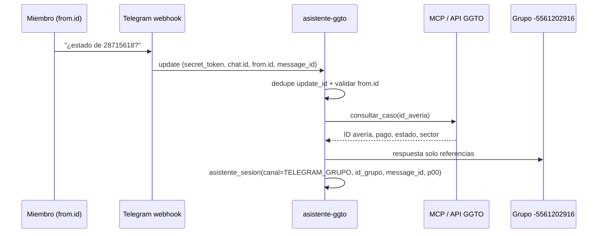
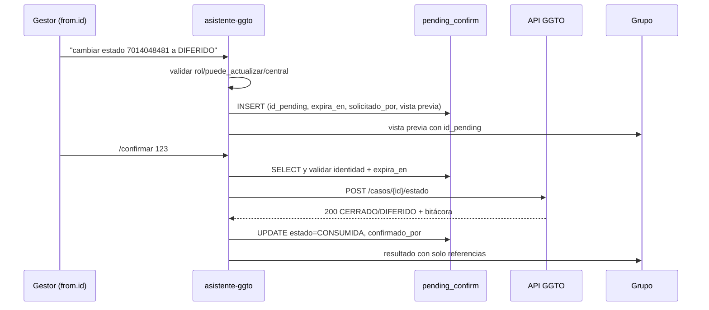
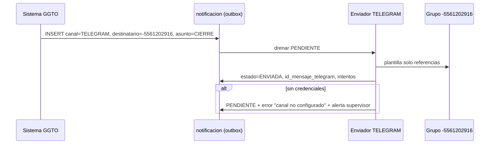

# Diagramas v2 — Asistente con IA en grupo de Telegram

> Coherentes con `casos_uso_telegram_grupo_v2.md` (APTO en re-auditoría) y con
> DEC-TG-01…13. Mermaid renderizable en cualquier visor.

## 1. Diagrama de casos de uso

## 2. Secuencia — consulta por identificador (CU-TG-01)

## 3. Secuencia — actualización con `/confirmar <id>` (CU-TG-02)

## 4. Secuencia — alerta al grupo (CU-TG-03)

