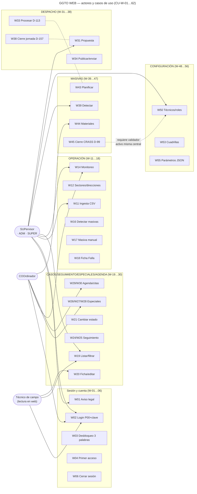
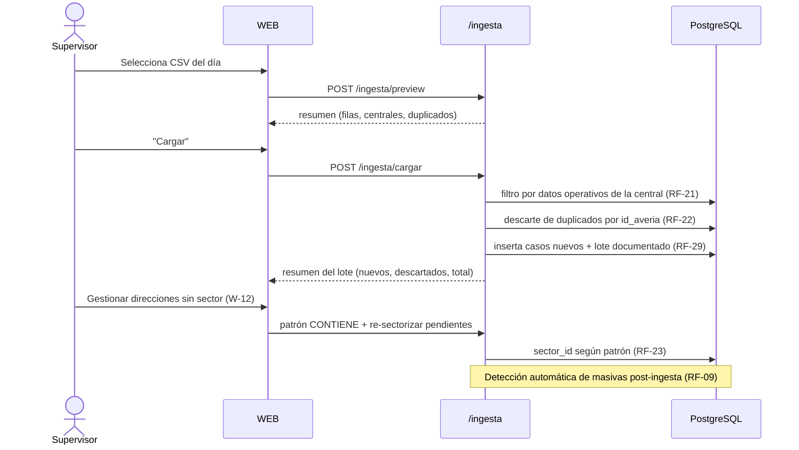
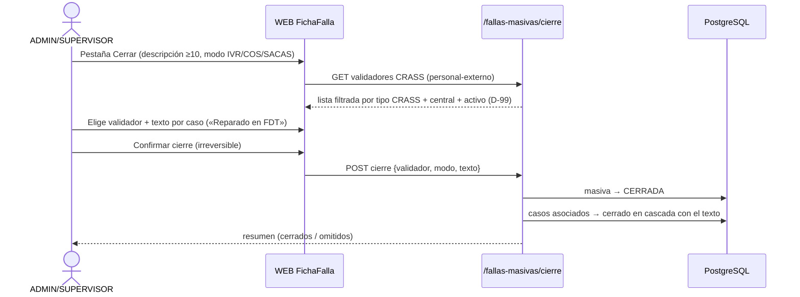
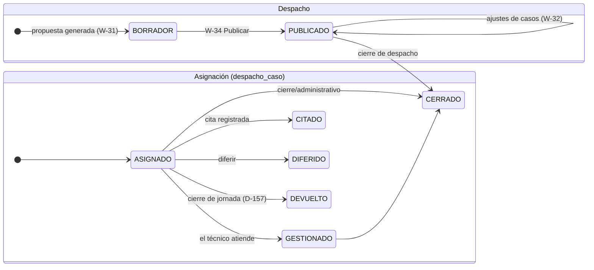
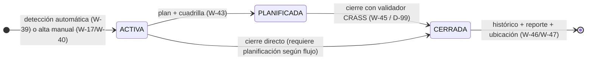

# Diagramas — GGTO V2 · Casos de uso de la WEB

| Campo | Valor |
|---|---|
| Documento | Código **Mermaid** renderizable (GitHub/VS Code) usando los 62 CU de [`casos_uso_web.md`](casos_uso_web.md) |
| Formato | Bloques `mermaid` listos para pegar en visor o exportar a SVG |
| Fuente | Código vigente al 2026-10-23 (commit `4449f36`, despliegue v84, incluido D-157) |
| Estado | **v0.1** — previo a la auditoría `/auditar`, que puede ajustar nombres y flujos |

---

## 1. Diagrama de casos de uso UML (visión general WEB)



> Relaciones de dependencia (líneas punteadas): el despacho procesado (W-33) alimenta la
> planificación de masivas (W-43); el cierre de jornada (W-38) depende de un despacho
> publicado (W-34); el cierre de masiva (W-45) exige un validador CRASS del personal
> externo configurado (W-56) y de la misma central.

## 2. Secuencia — Ingesta diaria del CSV (CU-W-11/W-12)



## 3. Secuencia — Ciclo del despacho diario (CU-W-31…38)

```mermaid
sequenceDiagram
    actor SUP as Supervisor
    participant W as WEB
    participant API as /despachos
    participant DB as PostgreSQL
    actor TEC as Cuadrilla (APK)

    SUP->>W: Generar propuesta (W-31)
    W->>API: POST /despachos
    API->>DB: aplica RF-25 → cuadrilla 0 (modo SUPERVISOR D-59)
    API->>DB: citados del día + ≥2 referidos + ≥1 empresa + 1 cuadrilla para construcción
    API-->>W: despacho BORRADOR

    SUP->>W: Ajustar asignaciones (W-32) y Procesar (W-33, D-113)
    SUP->>W: Publicar (W-34)
    W->>API: PATCH BORRADOR→PUBLICADO
    API-->>TEC: despacho disponible para descarga (sync)

    Note over TEC,API: Jornada de campo (APK: CU-A-08…A-19)

    SUP->>W: Cierre de jornada (W-38)
    W->>API: POST cierre-jornada
    API->>DB: renglones no atendidos → estado DEVUELTO (D-157)
    API-->>W: {asignaciones_devueltas: N}
    Note over DB: histórico conservado; APK y CASOS dejan de atribuir el caso (D-123 intacta)
```

## 4. Secuencia — Cierre de falla masiva con validador CRASS (CU-W-45 · D-99)



## 5. Estados — Despacho y asignaciones (`despacho.estado` / `despacho_caso.estado`)



## 6. Estados — Falla masiva (w-39…45 / A-26…28)


