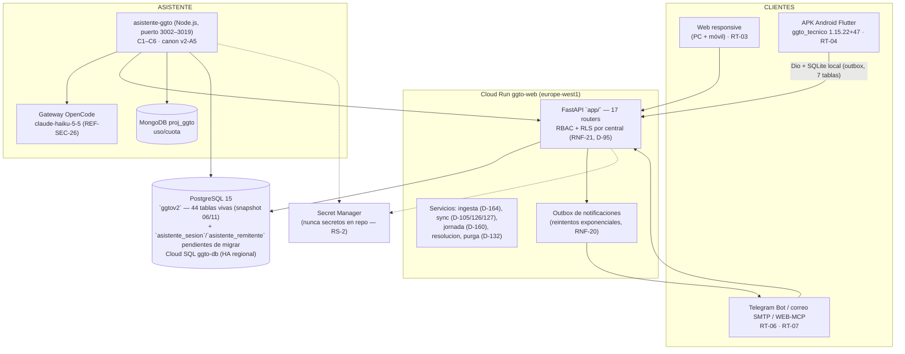

# Documento Técnico del Proyecto — GGTO v2

> Generado el 2026-11-12 (`/documento_tecnico`, Fase 2 del skill) a partir de la **Fase 1**
> (`requerimientos.md`, `diccionario_datos.md`, `entornos_globales.md`), del **catálogo de casos
> de uso auditado** (`casos_uso/`) y del **estado real del código y despliegue** (rama
> `GGTOv2-DSH-GCP`, HEAD `1302277`). Documentos técnicos por incremento anteriores:
> `documento_tecnico_D81/D89/D95.md` (este documento los consolida a nivel de proyecto).

---

## 1 · Visión general y alcance

**GGTO** es el sistema de **gestión de averías y puntos ópticos** de CANTV (Central Francisco
Salias `2324X`, Área 4). Cubre el ciclo completo: ingesta del CSV diario de averías GPON,
sectorización, despacho por cuadrillas, gestión en campo (APK offline), evidencias geolocalizadas,
cierres canónicos (IVR/COS/SACAS), casos especiales (REFERIDO/EMPRESA/GOBIERNO), fallas masivas,
monitoreo y mensajería — más el **asistente virtual de gestión por texto libre** (ciclos C1–C6).

**Fuera de alcance (v3/parked):** portal público para ACT-03 (D-156), insumos completos RF-05,
WhatsApp (RT-06), parque GPON `servicio_gpon` (DDL propuesto, no migrado).

- **RF cubiertos:** RF-01…RF-38 (requerimientos) + rangos por incremento RF-39…44, RF-45…56,
  RF-59…68, RF-73, RF-APK-06…30 (equivalencias en `casos_uso/README.md`).
- **Cobertura de casos de uso:** 101 CU auditados (63 web + 28 APK + 10 asistente) — 100 % con
  criterios Gherkin y trazabilidad.

## 2 · Arquitectura

### 2.1 Componentes

### 2.2 Contratos (17 routers de `app/main.py` → grupos de CU)

| Router (`app/api/routes_*`) | Dominio | CU |
|---|---|---|
| `auth` | login, unlock, palabras, reset, perfil | CU-W-01…07 |
| `ingesta` + `sincronizacion` | CSV diario, lotes, sectorización, checklist | CU-W-08…11 |
| `casos` | ciclo del caso (alta/edición/estado/cita/NC/cierre/enrutado) | CU-W-12…22 |
| `despachos` | propuesta→proceso→envío, jornada, efectividad | CU-W-23…31 |
| `especiales` | solicitantes, especiales (D-134), citas, seguimiento | CU-W-32…35 |
| `alertas` | masivas (D-118/168/99), notificaciones/outbox, Telegram, MCP | CU-W-36…45 |
| `panel` + `monitoreo` | gestión diaria, 12 vistas, reportes | CU-W-46…48 |
| `mensajes` | mensajería interna (D-81/D-86/D-95) | CU-W-49/50 |
| `config` | central/sectores, técnicos, flota, cuadrillas, catálogos | CU-W-51…55 |
| `auditoria` + `sistemas` | trazabilidad e introspección (solo SUPER) | CU-W-56/57 |
| `mantenimiento` | purga/cierres/tareas nocturnas (token fail-closed) | CU-W-58…60 |
| `asistente` | sesiones y remitentes del asistente (GGTO) | CU-W-61/62 |
| `health` | salud del servicio | CU-W-63 |

> **Nota de despliegue (H-2):** la imagen v100 en producción (06/11) contiene **16 routers**
> (sin `routes_asistente`); el router del asistente y sus 2 tablas se añadieron en `1302277`
> (11/11) y están **pendientes de desplegar/migrar** junto con `asistente-ggto`
> (checklist `asistente-ggto/DESPLIEGUE.md`).

**APK (`app_movil`):** SQLite v5 (`ggto.db`, 6 tablas: `caso_local`, `accion_pendiente`,
`evidencia_local`, `app_meta`, `mensaje_local`, `masiva_local`) con outbox `accion_pendiente`
(backoff 1,2,4…60 min, máx 5 intentos, 403/409/404/422 definitivos), descarga diferencial
(`ids_conocidos`, D-105/D-127), merge «pendiente manda» (D-126), SyncLock (D-124),
purga protegida (D-132), evidencias solo cámara (máx 5/caso, 3 MB) — CU-A-01…28.

**Asistente (`asistente-ggto`):** webhook Telegram fail-closed (`secret_token`, remitentes
en `asistente_remitente`), límites 30/min y 500/día (429), vista previa editable + confirmación
humana siempre (RNF-AV-06) — CU-AV-01…10. Pruebas: 39 `node --test` + 9 pytest.

### 2.3 Diagramas de flujo clave

Ver `casos_uso/diagramas_catalogo.md` (§10–§15): ingesta→despacho→corte 23:00, ciclo de campo
offline, masiva (detección→cierre en cascada), caso especial, asistente (texto→confirmación
canónica), acceso endurecido.

## 3 · Modelo de datos

**PostgreSQL 15** — 41 entidades catalogadas en `diccionario_datos.md` (44 tablas físicas en
producción según el snapshot del 06/11; `asistente_sesion`/`asistente_remitente` están en
`schema.sql` y sus migraciones idempotentes **pendientes de aplicar contra producción**;
`caso_d89_backup` existe en prod pero no está catalogada). DDL base en `RepoTecnico/db/schema.sql`.
Núcleo:

| Grupo | Entidades | CU principal |
|---|---|---|
| Organización | `central`, `sector`, `usuario`, `rol`, `tecnico`, `flota`, `herramienta`, `cuadrilla*` | CU-W-51…54, CU-A-09 |
| Casos | `caso` (66 columnas vivas, `id_averia` UQ, `REF-` D-23), `caso_estado_hist`, `actividad`, `evidencia`, `identificador_pago` (D-89) | CU-W-12…22 |
| Despacho | `despacho` (jornada D-99: `cerrado_en`, `reprocesado_en`), `despacho_caso`, `despacho_metrica_diaria` | CU-W-23…31 |
| Especiales | `caso_especial`, `solicitante`, `cita`, `seguimiento` | CU-W-32…35 |
| Masivas/alertas | `falla_masiva`, `incidente`, `notificacion` (outbox) | CU-W-36…45 |
| Sync APK | `sync_log` (D-81), `sync_check`, `dispositivo_seguridad` (12 palabras) | CU-A-05…08 |
| Catálogos/otros | `auditoria` (RNF-12), `configuracion` (RNF-10), `causa`, `catalogo_metodo`, `ingesta_lote`, `sector_direccion`, `cuadrilla_tecnico`, `cuadrilla_herramienta`, `falla_masiva_caso`, `orden_material*`, `inventario_movimiento`, `cuadrilla_sector_dia` | soporte transversal |
| Mensajería | `mensaje`, `mensaje_destino` (leído pegajoso D-86) | CU-A-20 |
| Asistente | `asistente_sesion` (C4), `asistente_remitente` (C5) | CU-AV-04…09 |
| Propuestas | `servicio_gpon` (**NO migrada** — DDL en `PROPUESTA_parque_gpon_pde.md`), `insumo`/`orden_material` (v2) | — |

ER completo: `RepoTecnico/modelo_er.md`. RNF-15: índices GIN (`pg_trgm`) para 20 000 casos/día
y 3 años de histórico.

## 4 · Trazabilidad componente ↔ CU ↔ requisitos

| Componente | Implementa CU | RF/RNF/RT clave *(muestra, no lista exhaustiva)* |
|---|---|---|
| `routes_auth` + `dispositivo_seguridad` | CU-W-01…07, CU-A-01…03 | RF-20, RNF-01/05/22, D-95/100/117/138 |
| `routes_ingesta` + parser 80/81 col (D-164) | CU-W-08…10 | RF-01/21/22/29, RNF-08/15, RT-05 |
| `routes_casos` + `services/resolucion.py` | CU-W-12…22 | RF-30…33, RNF-12, D-88/89/120, RN-EV-01*, RN-NC-01*, RN-EST-01* |
| `routes_despachos` + `services/jornada.py` | CU-W-23…31 | RF-08/10/24/25/27, D-22/157/160 |
| `routes_especiales` | CU-W-32…35 | RF-06/34/35/36, D-133/134/156 |
| `routes_alertas` | CU-W-36…45 | RF-09/16/17/18, D-82/99/118/168, RNF-20 |
| `routes_monitoreo`/`panel` | CU-W-46…48 | RF-26/28, RT-10, DEC-G1 |
| `routes_mensajes` | CU-W-49/50 | RF-41 (D-81), DEC-G9/G15 |
| `routes_config` | CU-W-51…55 | RF-02/03/04/38, RNF-10/21 |
| `routes_auditoria`/`sistemas` | CU-W-56/57 | RNF-12, DEC-G17 |
| `routes_mantenimiento` | CU-W-58…60 | D-132/153, RNF-18 |
| `routes_sync` + APK core | CU-A-01…22 | RF-11…15, RNF-04/06/09/13, D-73→RF-44*, D-100/105/117/124/126/127/132/138 |
| APK modo gestión | CU-A-23…28 | RF-APK-13…30, DEC-G16 |
| `asistente-ggto` + `routes_asistente` | CU-AV-01…10, CU-W-61/62 | RNF-AV (canon v2-A5), RNF-11/21, RT-07 |

\* asterisco = decisión de alcance/reciente (ver abajo); el resto es comportamiento vigente
verificado en código:
- **RN-EV-01 / RN-NC-01 / RN-EST-01**: requisitos nuevos aprobados, pendientes de implementación
  (`casos_uso/requisitos_nuevos.md`).
- **D-73→RF-44 (disclaimer)**: la aceptación del aviso legal es vigente (CU-A-01); la decisión
  del usuario fijó «aceptación en cada login», frente a la persistencia sugerida por la
  propuesta RF-44 — la variante vigente prevalece.

## 5 · Entornos, variables y despliegue

### 5.1 Producción (vigente, verificada 24/11/2026)

| Recurso | Valor |
|---|---|
| Proyecto GCP | `ggto-prod-txblvento2` (nº 695669822281) |
| URL web/API | `https://ggto-web-695669822281.europe-west1.run.app` (alias `ggto-web-depapaeivq-ew.a.run.app`) |
| Cloud Run | `ggto-web` (europe-west1), imagen `ggto-web:v106`, revisión `ggto-web-00016-k2k` al 100 % |
| Base de datos | PostgreSQL **16.15** en la VM `vm-databases` (`10.140.0.2:5432`, proyecto `plataforma-txbarlovento`), BD `ggtov2`, usuario `ggtov2_app` |
| Conexión | VPC connector `ggto-connector` (red `ggto-vpc`, egress `private-ranges-only`); Cloud SQL `ggto-db` de `ggto-prod-txblvento2` queda como respaldo |
| Secretos | Secret Manager (RS-2: nada en repo ni en claro; REF-SEC-26 vía `gcloud`): `ggto-secret-key`, `ggtov2-db-password`, `ggto-mantenimiento-token` |
| Programación | Cloud Scheduler: **5 jobs reales** (purgar, cerrar-sesiones, recordatorios-citas, alarmas-despacho, cierre-jornada `0 23 * * *`). La ingesta es manual (RF-01) y el reporte de 16:00 se genera bajo demanda (CU-W-29) — ver decisión pendiente en §6-R9. |

### 5.2 Desarrollo / preview

- Variables globales del workspace: `source /home/dsh/workspace/gcp-env.sh` + `.env.global`
  (detalle en `entornos_globales.md`; el `.env.global` apunta al entorno MCC — para GGTO usar
  el proyecto `ggto-prod-txblvento2`).
- Cloud SQL Proxy en `/home/dsh/tools/cloud-sql-proxy`; sin `docker`/`psql` en el host dev.
- Preview del asistente: vm-preview `100.113.94.52` (tailnet), checklist pendiente de ejecutar
  en `asistente-ggto/DESPLIEGUE.md` (usuario de servicio `GGTOAST001`, migraciones
  `--aplicar --si`, secrets, `setWebhook`).

### 5.3 CI/CD (RT-14, D-38)

**CI real** (`.github/workflows/ci.yml`): backend (ruff + mypy + `pytest`, cobertura ≥ 70 %),
web (build) y apk (analyze + test). **No incluye aún** el `node --test` del asistente (39 casos)
ni el build/push de imagen → Cloud Run (RT-14/D-38 son el objetivo; el despliegue actual se hizo
manualmente, ver `DESPLEGUE_ggto-prod-txblvento.md`). Mejoras pendientes → §6-R10.
Migraciones: **patrón real = scripts idempotentes `scripts/migrar_*.py`** (simula → `--aplicar
--si`, D-164); Alembic (RT-13) es requisito objetivo, no hecho consumido → §6-R11.

## 6 · Riesgos técnicos y decisiones pendientes

| # | Riesgo / decisión | Estado |
|---|---|---|
| R1 | **RN-EV-01/NC-01/EST-01 sin implementar**: las reglas de evidencias por tipo, contador de NO CONTESTA y matriz de transiciones son requisitos aprobados pero el código aún no las valida (hoy solo 409 de estados terminales). | Pendiente de Fase 3 |
| R2 | **Despliegue del asistente no ejecutado**: `asistente-ggto` probado (39 tests) pero sin usuario de servicio, secrets ni webhook en producción. | Checklist lista (`DESPLIEGUE.md`) |
| R3 | **`servicio_gpon` (parque GPON) solo documentado**: DDL propuesto no migrado; el Excel ODN-PDE quedó fuera de git (RS-2). | Aprobación pendiente |
| R4 | **Retención/backup**: la instancia anterior tenía backups deshabilitados; verificar que la política de `ggto-db` (HA regional + RPO ≤ 24 h, RNF-16) esté activa. | Verificar |
| R5 | **Cuenta de facturación con historial de cupo agotado** (proyecto anterior); monitorizar quota de `ggto-prod-txblvento`. | Vigilar |
| R6 | **Colisión de numeración RF** (RF-44 = alta de especiales en D-81 vs disclaimer en propuesta APK): resuelta con tabla de equivalencias; evitar nuevos números duplicados. | Documentada |
| R7 | **Dependencia del Gateway OpenCode** (servicio externo, modelo `claude-haiku-5-5`): fail-closed 503 cubre la caída; considerar healthcheck proactivo. | Mitigado |
| R8 | **COORDINADOR sin acceso a fichas de casos** (DEC-G20): la APK de gestión depende de vistas agregadas; mantener esa frontera en futuros CU. | Regla vigente |
| R9 | **Scheduler**: los jobs de ingesta automática y reporte 16:00 no existen (la ingesta es manual por RF-01 y el reporte se genera bajo demanda). **Decisión del usuario (2026-11-12): mantener manual** — no se crearán jobs. | ✅ Resuelto (manual) |
| R10 | **CI incompleto**: `ci.yml` no ejecuta `node --test` del asistente ni build/push de imagen → Cloud Run (el despliegue v100 fue manual). **Decisión del usuario (2026-11-12): tarea de Fase 3** — añadir ambos pasos al pipeline. | Tarea Fase 3 |
| R11 | **Alembic (RT-13) no implementado**: las migraciones reales son scripts idempotentes `migrar_*.py` (D-164); RT-13/RNF-24 son objetivo. **Decisión del usuario (2026-11-12): mantener el patrón idempotente hoy**; Alembic queda como objetivo futuro. | ✅ Resuelto (patrón D-164) |

## 7 · Referencias

- Requisitos: `requerimientos.md` · Casos de uso: `casos_uso/` (catálogo + diagramas + SVG)
- Datos: `diccionario_datos.md` · `modelo_er.md` · `db/schema.sql`
- Despliegue: `DESPLEGUE_ggto-prod-txblvento.md` · `entornos_globales.md` · `asistente-ggto/DESPLIEGUE.md`
- Documentos técnicos por incremento: `documento_tecnico_D81/D89/D95.md`
- Canon sensible (fuera de git, RS-2): `Asistente/MANUAL_ASISTENTES_V2.md`
