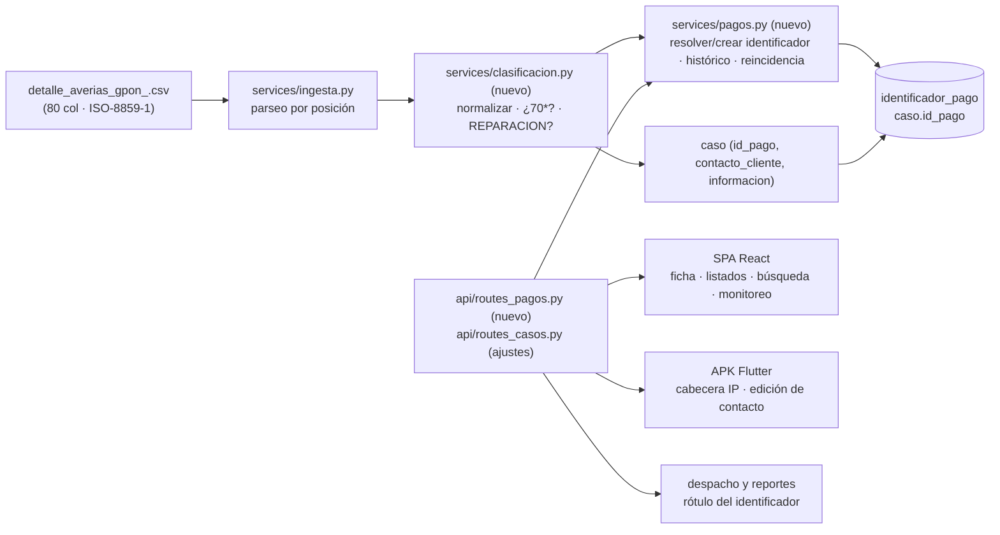
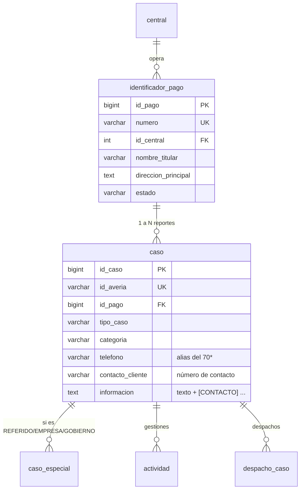

# Documento técnico — Incremento **D-89…D-94** · Identificador de pago (70\*) como eje

| Campo | Valor |
|---|---|
| Documento | Diseño técnico del incremento (arquitectura, modelo de datos, contratos, migración y pruebas) |
| Estado | **v0.4 — D-89 IMPLEMENTADO y verificado** (39 pruebas del ciclo; suite completa 344+ en verde) |
| Fecha | 2026-10-08 |
| Base | [`propuesta_identificador_pago.md`](propuesta_identificador_pago.md) **v1.2** · [`incremento_D89_identificador_pago.md`](incremento_D89_identificador_pago.md) v0.3 · [`casos_uso/casos_uso_D89.md`](casos_uso/casos_uso_D89.md) v0.3 · código en estado **D-89** |
| Auditorías | [`auditoria_D89_casos_uso.md`](auditoria_D89_casos_uso.md) · [`auditoria_D89_documento_tecnico.md`](auditoria_D89_documento_tecnico.md) |
| Decisiones | **DEC-IP-1…7 cerradas** por el usuario |
| Alcance | Ciclos **D-89** (datos e ingesta) · **D-90** (reglas REPARACIÓN/REFERIDO) · **D-91** (API e históricos) · **D-92** (web) · **D-93** (APK) · **D-94** (monitoreo, informes y manuales) |

---

## 1. Principios de diseño

1. **Aditivo y reversible.** Nada se renombra ni se elimina: se añade
   `identificador_pago`, `caso.id_pago` y las claves de configuración. La APK
   `1.1.0+8` y los contratos vigentes siguen funcionando (RNF-30, DEC-IP-4).
2. **Una sola fuente de verdad.** El identificador de pago vive en su tabla y
   `caso.telefono` se mantiene como **alias de lectura** que escribe **siempre**
   `services/pagos.py` (no una vista: H-22); la serialización de `CasoOut.telefono`
   sale del ORM y ningún cliente antiguo se rompe.
3. **Regla en el servicio y en la base.** La regla REPARACIÓN ⇐ 70\* + avería se
   aplica en la capa de servicios **y** en un `CHECK NOT VALID` (ríge para lo nuevo
   sin bloquear lo histórico, DEC-IP-3).
4. **Idempotencia.** La ingesta, la suma del contacto a `informacion` y el alta del
   identificador se pueden repetir sin duplicar datos.
5. **Nada de datos crudos en los documentos.** El titular y los números se tratan
   como PII (RNF-18/RNF-31).

## 2. Arquitectura del incremento



**Componentes nuevos**

| Componente | Responsabilidad | Interfaz |
|---|---|---|
| `app/services/pagos.py` | Normalizar números, resolver/crear el identificador, mantener el alias `caso.telefono`, histórico por `id_pago`, cálculo de reincidencia | Funciones puras + `Session` |
| `app/services/clasificacion.py` | Decidir 70\* vs contacto, sumar a `informacion`, exigir/regularizar REPARACIÓN y reclasificar a REFERIDO | `clasificar_numero()`, `aplicar_regla_reparacion()`, `esta_marcado()` |
| `app/api/routes_pagos.py` | `GET /pagos`, `GET /pagos/{numero}` (con sus casos) | FastAPI + Pydantic |
| `app/api/routes_auditoria.py` | `GET /auditoria` (traza filtrable por entidad/acción/fecha) + página AUDITORÍA (H-13) | FastAPI + Pydantic |
| `app/schemas/pagos.py` | Contratos del identificador y de su histórico | Pydantic v2 |

**Componentes modificados:** `services/ingesta.py` (clasificación y contadores),
`services/despacho.py` (rótulo), `services/monitoreo.py` (métricas por
identificador), `api/routes_casos.py` (histórico, contacto, búsqueda),
`api/routes_especiales.py` (`tiene_id_averia` real y reclasificación),
`api/routes_ingesta.py` (contadores y avisos), `schemas/casos.py`,
`web/src/components/FichaCaso.tsx` y páginas asociadas, `app_movil/lib/features/casos/*`.

## 3. Modelo de datos

### 3.1 DDL propuesto (RT-17)

```sql
-- 1) Entidad del identificador de pago (DEC-IP-1/4/6)
CREATE TABLE IF NOT EXISTS identificador_pago (
    id_pago             bigserial    PRIMARY KEY,
    numero              varchar(15)  NOT NULL,
    id_central          integer      NOT NULL REFERENCES central(id_central),  -- central de ORIGEN
    nombre_titular      varchar(160),
    direccion_principal text,
    estado              varchar(12)  NOT NULL DEFAULT 'ACTIVO'
                        CHECK (estado IN ('ACTIVO','SUSPENDIDO','BAJA')),
    creado_en           timestamptz  NOT NULL DEFAULT now(),
    actualizado_en      timestamptz  NOT NULL DEFAULT now(),
    CONSTRAINT uq_ip_numero UNIQUE (numero),                       -- ficha ÚNICA GLOBAL
    CONSTRAINT ck_ip_serie CHECK (numero ~ '^[0-9]{7,15}$')        -- formato, no patrón
);

-- 2) Enlace caso → identificador (1 → N) y alias del teléfono (DEC-IP-4)
ALTER TABLE caso ADD COLUMN IF NOT EXISTS id_pago bigint
    REFERENCES identificador_pago(id_pago) ON DELETE RESTRICT;   -- H-14
CREATE INDEX IF NOT EXISTS ix_caso_id_pago ON caso (id_pago);
CREATE INDEX IF NOT EXISTS ix_caso_id_pago_fecha ON caso (id_pago, fecha_reporte);  -- H-26

-- 3) La naturaleza REFERIDO es un tipo de caso (H-01): se amplía el CHECK vigente
ALTER TABLE caso DROP CONSTRAINT IF EXISTS caso_tipo_caso_check;
ALTER TABLE caso ADD  CONSTRAINT caso_tipo_caso_check
    CHECK (tipo_caso IN ('AVERIA','REPARACION','CONSTRUCCION','REFERIDO'));

-- 4) RLS de la tabla nueva (RNF-21 / DEC-IP-6): ficha única global, legible por su
--    central de origen o por cualquier central que tenga casos enlazados a ella.
ALTER TABLE identificador_pago ENABLE ROW LEVEL SECURITY;
DROP POLICY IF EXISTS p_ip_central ON identificador_pago;
CREATE POLICY p_ip_central ON identificador_pago
    USING (app_central_actual() IS NULL
           OR id_central = app_central_actual()
           OR EXISTS (SELECT 1 FROM caso c
                       WHERE c.id_pago = identificador_pago.id_pago
                         AND c.id_central = app_central_actual()))
    WITH CHECK (app_central_actual() IS NULL OR id_central = app_central_actual());

-- 5) Contadores y detalle de avisos de la ingesta (RF-56 / H-11)
ALTER TABLE ingesta_lote ADD COLUMN IF NOT EXISTS filas_sin_identificador_pago integer NOT NULL DEFAULT 0;
ALTER TABLE ingesta_lote ADD COLUMN IF NOT EXISTS filas_con_contacto            integer NOT NULL DEFAULT 0;
ALTER TABLE ingesta_lote ADD COLUMN IF NOT EXISTS avisos jsonb NOT NULL DEFAULT '[]'::jsonb;

-- 6) Regla de REPARACIÓN: el trigger decide ANTES de validar, así ninguna fila
--    histórica queda atrapada y los escritores actuales (routes_especiales) siguen
--    funcionando durante la transición D-89 → D-90 (H-01 + RN-IP-14).
CREATE OR REPLACE FUNCTION fn_caso_reparacion_a_referido() RETURNS trigger AS $$
BEGIN
    IF NEW.tipo_caso = 'REPARACION'
       AND (NEW.id_pago IS NULL OR NEW.id_averia LIKE 'REF-%') THEN
        NEW.tipo_caso := 'REFERIDO';
        IF NEW.categoria IN ('RESIDENCIAL', 'REFERIDO') THEN
            NEW.categoria := 'REFERIDO';
        END IF;   -- EMPRESA/GOBIERNO se conservan (clasificación de negocio, H-09)
    END IF;
    RETURN NEW;
END $$ LANGUAGE plpgsql;

DROP TRIGGER IF EXISTS trg_caso_reparacion_a_referido ON caso;
CREATE TRIGGER trg_caso_reparacion_a_referido
    BEFORE INSERT OR UPDATE ON caso
    FOR EACH ROW EXECUTE FUNCTION fn_caso_reparacion_a_referido();

-- 7) Red de seguridad: rige para toda escritura nueva (NOT VALID evita el escaneo
--    inicial de las filas históricas, que el trigger regulariza en su primer cambio).
DO $$
BEGIN
    IF NOT EXISTS (SELECT 1 FROM pg_constraint WHERE conname = 'ck_reparacion_con_ip') THEN
        ALTER TABLE caso ADD CONSTRAINT ck_reparacion_con_ip
            CHECK (tipo_caso <> 'REPARACION'
                   OR (id_pago IS NOT NULL AND id_averia NOT LIKE 'REF-%'))
            NOT VALID;
    END IF;
END $$;

-- 8) Parámetros nuevos (configuracion.valor es jsonb: se usa to_jsonb)
INSERT INTO configuracion (clave, valor, descripcion) VALUES
  ('pago.serie_regex', to_jsonb('^70[0-9]{8}$'::text),
   'Patrón del identificador de pago'),
  ('pago.reincidencia_dias', to_jsonb(90),
   'Ventana en días para marcar reincidencia'),
  ('referido.reclasificar_en_proximo_cambio', to_jsonb(true),
   'Marcar REPARACIONES sin IP/avería y reclasificarlas al siguiente cambio')
ON CONFLICT (clave) DO NOTHING;

-- 9) Trigger de `actualizado_en` para la tabla nueva (H-16): se añade
--    'identificador_pago' al bucle de triggers que ya existe para el resto del modelo.
--    (El alias `caso.telefono` lo mantiene el servicio, no una vista: H-22.)

-- NOTA (H-27): `ck_ip_serie` valida **formato**; la validación contra el patrón de
-- negocio (`pago.serie_regex`) es responsabilidad del servicio `services/pagos.py`.
```

**Validación de negocio (H-27):** `ck_ip_serie` solo comprueba el formato del número;
la pertenencia al patrón configurado se valida en `services/pagos.py` (y en el
esquema Pydantic `id_pago`), con su prueba unitaria. Cambiar `pago.serie_regex` no
requiere DDL.

### 3.2 Modelo relacional resultante



### 3.3 Por qué `contacto_cliente` no se convierte en tabla

Un caso puede recibir varios números de contacto a lo largo del tiempo; sin
embargo, la operación solo necesita **uno vigente** y buscable (DEC-IP-2). Se
mantiene `caso.contacto_cliente` normalizado, y los números adicionales que
aparezcan en la fila se **suman a `informacion`**. Si en el futuro se requiere
trazar la evolución del contacto, se añadirá `caso_contacto_hist` **sin** cambiar
el contrato (tarea fuera de este incremento).

## 4. Algoritmos y reglas

### 4.1 Normalización de números (RF-47)

```text
normalizar_numero(valor):
  d = solo dígitos de valor            # primero se descartan letras y separadores (H-19)
  si d empieza por "0058" -> d = d[4:]
  si d empieza por "58" y len(d) == 12 -> d = d[2:]
  si len(d) == 11 y d empieza por "0" -> d = d[1:]
  devolver d
```
Ejemplos: `+58 0414-222-3344` → `4142223344` · `0058 701-400.0848` → `7014000848` ·
`0422-310-9000` → `4223109000`.

### 4.2 Resolución del identificador (RF-45, idempotente)

```text
resolver_identificador(db, numero, caso, cache) -> id_pago | None
  n = normalizar_numero(numero)
  si n no cumple configuracion['pago.serie_regex'] -> None      # caso.telefono = NULL
  si n está en cache -> id_pago (evita una consulta por fila: RNF-33)
  INSERT INTO identificador_pago (numero, id_central, nombre_titular, direccion_principal)
  VALUES (n, caso.id_central, caso.nombre_cliente, caso.direccion)
  ON CONFLICT (numero) DO NOTHING                               # carrera resuelta (H-07)
  ip = SELECT id_pago FROM identificador_pago WHERE numero = n   # ficha única global (DEC-IP-6)
  cache[n] = ip.id_pago
  caso.id_pago = ip.id_pago
  caso.telefono = ip.numero          # alias (DEC-IP-4)
  devolver ip.id_pago
```

> El `SELECT` **siempre** se ejecuta después del `INSERT … DO NOTHING`, de modo que
> el resultado es el mismo si el identificador lo creó esta transacción o otra
> concurrente; nunca se propaga un `IntegrityError` al lote completo.

### 4.3 Clasificación de números y suma a `informacion` (RF-46)

- Columna 13 normalizada → si cumple `pago.serie_regex`: **identificador**;
  **si no**: número de contacto **y** `caso.telefono = NULL` (H-03).
- Columna 16 normalizada → **siempre** número de contacto **y** se suma a
  `informacion` como `[CONTACTO] <numero>`.
- **Precedencia de `contacto_cliente` (H-18):** el valor de la **columna 16** si
  viene; **si no**, el de la columna 13 cuando no cumple el patrón. Los demás
  números de la fila solo van a `informacion`.
- Columnas **78/79** (`telefono_oficina`, `telefono_movil`) son del técnico: **no**
  son contacto ni se suman a `informacion` (H-06).
- La suma es **idempotente y atómica** en SQL (H-09), sin leer-modificar-escribir
  desde la aplicación:

```sql
UPDATE caso
   SET informacion = CASE
         WHEN coalesce(informacion, '') LIKE '%[CONTACTO] ' || :numero || '%'
              THEN informacion
         ELSE coalesce(informacion || E'\n', '') || '[CONTACTO] ' || :numero
       END,
       contacto_cliente = COALESCE(contacto_cliente, :numero)
 WHERE id_caso = :id_caso;
```

- Al **corregir** el contacto (CU-05/06) se **reemplaza** la marca anterior:
  `regexp_replace(informacion, '\[CONTACTO\] [0-9| ]+', '[CONTACTO] ' || :nuevo)`,
  de modo que `informacion` no acumula números obsoletos (vacío 9).
- Si la fila trae varios contactos, el primero queda en `contacto_cliente` y los
  demás en `informacion` separados por `|` (vacío 10, documentado).

### 4.4 Regla de REPARACIÓN (RF-49, RN-IP-05/06)

```text
aplicar_regla_reparacion(db, caso, origen) -> ResultadoClasificacion
  si caso.tipo_caso != 'REPARACION': devolver SIN_CAMBIO
  falta_ip   = caso.id_pago is None
  falta_real = caso.id_averia is None or caso.id_averia LIKE 'REF-%'
  si not (falta_ip or falta_real): devolver OK
  # Reclasificar (mismo UPDATE; el trigger de BD garantiza el tipo aunque
  # el escritor no llame a esta función — RN-IP-14)
  si caso.id_averia LIKE 'REF-%' -> conservar el sintético
  si no -> generar REF-<código central>-<NNNNNN> y guardar el original en informacion
  caso.tipo_caso = 'REFERIDO'
  si caso.categoria in ('RESIDENCIAL','REFERIDO'): caso.categoria = 'REFERIDO'
  # caso_especial idempotente (una sola fila por caso)
  si no existe caso_especial para caso.id_caso:
      crear(clasificacion = caso.categoria si es EMPRESA/GOBIERNO si no 'REFERIDO',
            tipo_actividad = 'REPARACION', tiene_id_averia = not falta_real)
  registrar motivo en caso_estado_hist + auditoria
  devolver RECLASIFICADO(motivo = SIN_IDENTIFICADOR_PAGO | SIN_ID_AVERIA | AMBOS)
```

**Reparto D-89 / D-90 (H-01 de la auditoría técnica):** el **trigger** y el `CHECK`
se instalan en **D-89** (son seguros porque el trigger adapta cualquier escritura
existente, incluidas `routes_especiales.py:75-101` y `routes_casos.py:317-357`), y
**D-90** añade el servicio, la `caso_especial` idempotente, el chip y las métricas.
Estado transitorio admitido: entre D-89 y D-90 un caso puede quedar `tipo_caso='REFERIDO'`
sin fila de `caso_especial`; MONITOREO lo informa y D-90 lo completa.

**Marca derivada (DEC-IP-3):** `esta_marcado(caso) = caso.tipo_caso == 'REPARACION'
and (caso.id_pago is None or caso.id_averia LIKE 'REF-%')`. Se expone como chip en
web y APK y se evalúa en cada escritura del caso (`PATCH /casos/{id}`,
`POST /casos/{id}/estado|cierre|cita|enrutado|no-contesta`,
`POST /despachos/asignar-casos|quitar-casos`).

### 4.5 Reincidencia (RF-54)

```sql
SELECT id_pago, count(*) AS reportes
  FROM caso
 WHERE id_pago IS NOT NULL
   AND fecha_reporte >= now() - make_interval(days => :ventana)
 GROUP BY id_pago
HAVING count(*) >= 2;
```

Se sirve del índice `ix_caso_id_pago_fecha` (`id_pago`, `fecha_reporte`). La ficha
es **única global** (DEC-IP-6): el conteo es **global** y la respuesta informa
**cuántos de esos casos son visibles** para el usuario según el alcance de central
(ej. «2 reportes en total: 1 visible en su central»).

### 4.6 Concurrencia, idempotencia y rendimiento

| Tema | Regla |
|---|---|
| Alta concurrente del identificador | `INSERT … ON CONFLICT (numero) DO NOTHING` + `SELECT` posterior; mapa en memoria por lote (una consulta por número distinto, no por fila) |
| Reingesta del mismo archivo | Deduplicación por `id_averia` (ya existente) + suma `[CONTACTO]` idempotente en SQL: el texto no se duplica |
| Corrección del contacto | `regexp_replace` que **reemplaza** la marca anterior en lugar de acumularla |
| Filas históricas marcadas | El trigger las regulariza en su primer `UPDATE`; ninguna operación falla |
| Reejecución de la migración | Todo el DDL es idempotente (`IF NOT EXISTS`, `DROP … IF EXISTS`, `DO` sobre `pg_constraint`) y el backfill usa `ON CONFLICT` |

## 5. Contratos de API (RT-19)

| Método y ruta | Cambio | Autorización |
|---|---|---|
| `GET /api/v1/pagos?q=&page=&page_size=` | **Nuevo.** Lista identificadores con su número de casos | `SUPER`, `ADMIN`, `SUPERVISOR` |
| `GET /api/v1/pagos/{numero}` | **Nuevo.** Identificador + datos conocidos + casos (histórico) + reincidencia | Autenticado; el titular se enmascara a `TECNICO` |
| `PATCH /api/v1/pagos/{numero}` | **Nuevo (H-15).** Corrige el número y los datos conocidos del titular y gestiona su estado (`ACTIVO`/`SUSPENDIDO`/`BAJA`), validando `pago.serie_regex`, con auditoría; la baja exige no tener casos vigentes (RF-57) | `ADMIN`, `SUPERVISOR`, `SUPER` |
| `GET /api/v1/casos/{id}/relacionados` | **Modificado.** Pasa a resolver por `id_pago` (ya no por igualdad de texto). Contrato de salida sin cambios | Autenticado |
| `GET /api/v1/casos?telefono=` | **Ampliado.** Busca en identificador **y** en `contacto_cliente`, normalizando | Autenticado |
| `PATCH /api/v1/casos/{id}/contacto` | **Corregido (D-88 → H-02/H-05 + DEC-IP-7).** Esquema nuevo `ContactoUpdate{direccion?, contacto?, id_pago?}`. `contacto` actualiza `contacto_cliente` + `informacion` (normalizado); si el valor cumple `pago.serie_regex` **se registra como identificador del caso** (resuelve/crea la ficha, la enlaza, `200` informativo, auditoría `CONTACTO_A_IDENTIFICADOR`) y **no** se guarda como contacto. `id_pago` explícito: solo ADMIN/SUPERVISOR/SUPER. El campo **legado `telefono`** se interpreta igual que `contacto`, de modo que la APK antigua **no puede** corromper la ficha | `TECNICO`, `ADMIN`, `SUPERVISOR`, `SUPER` (campo `id_pago`: ADMIN/SUPERVISOR/SUPER) |
| `POST /api/v1/casos` (alta manual, RF-32) y `PATCH /api/v1/casos/{id}` | **Modificado.** Aceptan `id_pago` validado contra `pago.serie_regex`; si `tipo_caso=REPARACION` exigen identificador + `id_averia` real y, si faltan, **reclasifican a REFERIDO** en la misma transacción (`409` con la opción de registrarlo como referido; **sin** `forzar_reclasificacion`, DEC-IP-5). Todas las escrituras pasan por `services/pagos.py` (no `setattr` directo, H-10) | `ADMIN`, `SUPERVISOR`, `SUPER` |
| `POST /api/v1/casos-especiales` y `PATCH /api/v1/casos-especiales/{id}` | **Modificado.** `tiene_id_averia` se calcula de verdad (`id_averia` no sintético); la creación del especial es **idempotente** (una fila por caso); `clasificacion` por defecto `REFERIDO` cuando se aplica la regla | `ADMIN`, `SUPERVISOR`, `SUPER` |
| `GET /api/v1/auditoria?entidad=&accion=&desde=&hasta=` + página AUDITORÍA | **Nuevo (H-13).** Traza filtrable con usuario, fecha y `datos_antes`/`datos_despues` (PII enmascarada por rol). SISTEMAS→Base de datos sigue siendo exclusivo de SUPER | `SUPER`, `ADMIN` |
| `GET /api/v1/monitoreo/*` | **Ampliado.** Métricas por identificador y reincidentes | Según la matriz vigente (TECNICO acotado a su cuadrilla) |
| `GET /api/v1/ingesta/lotes/{id}` | **Ampliado.** `filas_sin_identificador_pago`, `filas_con_contacto` y su detalle | `ADMIN`, `SUPERVISOR`, `SUPER` |

**Esquema de la edición de contacto (H-05):**

```python
class ContactoUpdate(BaseModel):
    direccion: str | None = Field(default=None, min_length=5, max_length=200)
    contacto:  str | None = Field(default=None, max_length=20)   # cualquier número
    id_pago:   str | None = Field(default=None, max_length=15)   # solo ADMIN/SUPERVISOR/SUPER
    telefono:  str | None = Field(default=None, max_length=20)   # LEGADO = alias de `contacto`

    # `contacto`/`telefono`: normaliza; si cumple pago.serie_regex -> se registra
    # como identificador del caso (no como contacto) y se informa (RN-IP-11)
    # `id_pago`: normaliza y valida contra pago.serie_regex; rol insuficiente -> 403
```

**Compatibilidad:** `CasoOut.telefono` sigue devolviéndose (alias del 70\*), se
añaden `id_pago`, `identificador_pago` (número rotulado), `contacto_cliente`,
`tiene_identificador_pago`, `marcado_reclasificar`, `reincidente` y `tipo_caso`
(que ahora admite `REFERIDO`).

## 6. Seguridad, RBAC y privacidad (RNF-31)

| Acción | SUPER | ADMIN | SUPERVISOR | TECNICO |
|---|---|---|---|---|
| Ver identificador de pago y su histórico | ✅ | ✅ | ✅ | ✅ (sus casos; alcance de CASOS por central/RLS) |
| Ver nombre del titular del identificador | ✅ | ✅ | ✅ | ❌ enmascarado `A*** B***` |
| Crear/editar el identificador (**el número**, no el contacto) | ✅ | ✅ | ✅ (con auditoría) | ❌ `403` |
| Editar **número de contacto** | ✅ | ✅ | ✅ | ✅ (sus casos; `PATCH /contacto` exige hoy solo rol: `_gestion` en `app/api/routes_casos.py:51`; el acotado por cuadrilla se añade en **D-91**, riesgo R8) |
| Consultar reincidencia y métricas por identificador | ✅ | ✅ | ✅ | ❌ (en MONITOREO ve su cuadrilla, sin titular ni reincidencia) |
| Suspender / dar de baja el identificador | ✅ | ✅ | ❌ | ❌ |
| **Forzar** una REPARACIÓN sin identificador | ❌ | ❌ | ❌ | ❌ (**no existe**: DEC-IP-5) |
| Auditoría del identificador (página AUDITORÍA) | ✅ | ✅ | ❌ | ❌ |
| SISTEMAS → Base de datos (vigente, D-69) | ✅ | ❌ | ❌ | ❌ |

> **Aclaración (H-11):** la celda del TÉCNICO en «reincidencia y métricas» es `❌`
> para esta vista nueva; su acceso vigente a MONITOREO (acotado a su cuadrilla en
> `app/api/routes_monitoreo.py:25-58`) **no cambia**, y la matriz de
> `requerimientos.md` §5.2 se actualiza en D-94 para reflejarlo.

- RLS: las políticas vigentes de `caso` siguen aplicando; `identificador_pago` se
  acota con `id_central` (RNF-21) y su política se añade en D-89.
- PII: el número del identificador y el nombre del titular se enmascaran en las
  respuestas a roles sin permiso (extiende el patrón de `services/sistemas.py`).

## 7. Migración (RT-18)

| Paso | Acción | Verificación |
|---|---|---|
| 1 | Inventario de solo lectura: totales, con 70\*, sin 70\*, sin contacto, REPARACIONES sin id real, identificadores repetidos | Reporte impreso antes de tocar nada |
| 2 | DDL aditivo (§3.1) y parámetros | `\d identificador_pago`, `\d caso`, claves de configuración |
| 3 | Backfill de identificadores aplicando **el mismo normalizador de RF-47** (`+58`/`0058`/guiones/espacios/`0` inicial) sobre `DISTINCT caso.telefono` y filtrando `pago.serie_regex`, con `ON CONFLICT (numero) DO NOTHING` (H-08) | `count(*)` de `identificador_pago` = **números normalizados distintos que cumplen el patrón** (la verificación compara normalizado contra normalizado, no el texto crudo) |
| 4 | Enlace `caso.id_pago` (join por número normalizado + central) y sincronización del alias `caso.telefono` | 0 casos con número válido sin `id_pago`; 0 alias divergentes |
| 5 | Contactos: normalizar `contacto_cliente` y sumar `[CONTACTO] …` a `informacion` con el SQL idempotente de §4.3 | 0 marcas duplicadas; conteo de altas |
| 6 | **Conciliación pre-migración (H-20):** identificar duplicados por formato y casos huérfanos **antes** de crear el `UNIQUE`; después ya no pueden existir | Informe con la lista (si está vacía, el `UNIQUE` entra sin conflicto) |
| 7 | Marcas: listar los casos marcados e informar (sin conversión masiva). El trigger ya está instalado, así que su primer cambio los regulariza | Lista y total de marcados |
| 8 | `VALIDATE CONSTRAINT ck_reparacion_con_ip` cuando el paso 6 no deje violaciones | `pg_constraint.convalidated` = true |
| 9 | Reejecución del script | Informa «ya migrada» |

**Rollback (H-20):** paso 1 guarda un respaldo `caso_d89_backup` (id_caso,
telefono, contacto_cliente, informacion). Para revertir: `DROP TRIGGER
trg_caso_reparacion_a_referido`; `DROP CONSTRAINT ck_reparacion_con_ip`;
`DROP POLICY p_ip_central`; `DROP INDEX ix_caso_id_pago_fecha`;
`DROP INDEX ix_caso_id_pago`; restaurar el CHECK de `tipo_caso` a
`('AVERIA','REPARACION','CONSTRUCCION')` (solo si no hay filas `REFERIDO`);
restaurar `telefono`/`contacto_cliente`/`informacion` desde `caso_d89_backup`;
`DELETE FROM configuracion WHERE clave IN ('pago.serie_regex',
'pago.reincidencia_dias','referido.reclasificar_en_proximo_cambio')`; y dejar
`caso.id_pago`/`identificador_pago` sin uso (el código anterior opera con
`caso.telefono`, DEC-IP-4). El rollback **no** revierte las reclasificaciones ya
aplicadas: se registran en `auditoria` y su reincorporación es manual (declarado, H-27
de la auditoría de casos de uso).

**Script:** `scripts/migrar_d89_identificador_pago.py` — simulación por defecto,
`--aplicar --si`, transacción única, log en `RepoTecnico/BaseOperaciones/`,
verificación post-migración y **prohibido** `DELETE` sin filtro (D-55).

## 8. Rendimiento y observabilidad (RNF-33, RNF-19)

- La resolución del identificador usa la **unicidad global `numero`** (DEC-IP-6) y un
  **mapa en memoria por lote** (una consulta por número distinto, no por fila), con
  `INSERT … ON CONFLICT DO NOTHING` + `SELECT`; el alta masiva no degrada el SLO de
  20 000 filas/5 min.
- Se conserva el patrón de observabilidad vigente (`ObservabilidadMiddleware` con
  `request-id` y usuario; `/health`, `/ready`, `/metricas`; retención de logs ≥ 30 días).
- **Métricas nuevas** en `/metricas`: `casos_sin_identificador_pago`,
  `identificadores_creados`, `reparaciones_reclasificadas`,
  `contactos_sumados_a_informacion`, `referidos_sin_ficha_especial`.
- **Alertas nuevas:** (a) `filas_sin_identificador_pago` por encima de
  `ingesta.umbral_sin_identificador` (10 % del lote por defecto) → aviso al
  supervisor; (b) lote con estado `ERROR` por encabezado inválido (RT-20) → alerta
  inmediata (la ingesta diaria no ocurrió).
- **Migraciones y CI (RT-13/RT-14):** el DDL del incremento se versiona como script
  idempotente en `scripts/` (convención real del proyecto) y se refleja en
  `RepoTecnico/db/schema.sql`; el pipeline de GitHub Actions debe quedar en verde
  (`pytest` + `ruff` + `mypy` + cobertura ≥ 70 %) antes de desplegar.

## 9. Pruebas previstas

| Nivel | Alcance | Entregable |
|---|---|---|
| Unitarias | Normalización, patrón parametrizable, marca derivada, reincidencia | `app/tests/test_d89_reglas_pago.py` |
| Integración | Ingesta con 70\* y sin 70\*, idempotencia, resolución 1→N, reclasificación, histórico por `id_pago`, `PATCH /contacto` corregido | `app/tests/test_d89_identificador_pago.py` |
| Contratos | `/pagos*`, contrato de `relacionados`, campos nuevos de `CasoOut` | `app/tests/test_d89_contratos.py` |
| Migración | Simulación → aplicar → verificar → reejecutar sobre `ggto_test` | `scripts/migrar_d89_identificador_pago.py` + log |
| E2E (Playwright) | Rótulos, histórico por identificador, edición de contacto, chip de marcado | `RepoTecnico/pruebas/e2e/tests/24-identificador-pago.spec.js` |
| APK (`flutter test`) | Cabecera con IP y contacto, validación sin series, escritura optimista | `app_movil/test/d89_identificador_pago_test.dart` |
| Migración | Simulación → aplicar → verificar → reejecutar → `VALIDATE CONSTRAINT` sobre `ggto_test` | `scripts/migrar_d89_identificador_pago.py` + log |
| Regresión de la regla en BD | Inserción directa de `REPARACION` sin IP → la fila queda `REFERIDO`; `UPDATE` de una fila marcada no falla | `app/tests/test_d89_trigger_reparacion.py` |
| Concurrencia | Dos ingestas simultáneas del mismo número: un solo identificador, sin `IntegrityError`; doble reingreso: una sola marca `[CONTACTO]` | `app/tests/test_d89_concurrencia.py` |
| Rendimiento (RNF-33) | Dataset de 20 000 filas: ingesta ≤ 5 min p95 con resolución de identificador | `app/tests/test_d89_carga.py` (marcado `lento`, contra `ggto_test`) |
| Enmascaramiento y PII | Titular enmascarado al TECNICO; `COLUMNAS_PII` de `services/sistemas.py` incluye `numero`, `nombre_titular` y `direccion_principal` (H-17) | `app/tests/test_d89_privacidad.py` |
| Limpieza de pruebas | `SQL_LIMPIEZA` de `app/tests/conftest.py` incorpora `DELETE FROM identificador_pago;` **después** de los borrados de `caso` (H-21) | Suite completa en verde |

## 10. Entregables por ciclo

| Ciclo | Entregables | Criterio de cierre |
|---|---|---|
| **D-89** | DDL (entidad, `id_pago`, `tipo_caso` con `REFERIDO`, **trigger + CHECK**, RLS, contadores y `avisos` del lote) + migración aplicada + `services/pagos.py` + clasificación en ingesta + **RT-20** (encabezado) + pruebas | Migración verificada en `ggto_test` y en producción; el trigger regulariza las filas marcadas; pytest del ciclo en verde |
| **D-90** | Servicio `clasificacion.py` (regla sin forzado), `caso_especial` idempotente, marca, reclasificación en el próximo cambio, chip, `tiene_id_averia` real y métricas | Pruebas de los 5 caminos (válida, sin IP, sin avería, marcado regularizado, terminal informado) |
| **D-91** | `routes_pagos`, `routes_auditoria`, histórico por `id_pago`, corrección de `PATCH /contacto` (§5), `id_pago` en alta y edición, búsqueda ampliada, contrato OpenAPI | Contratos + integración en verde; APK vigente sigue operando (lectura 200, escritura de 70\* 422) |
| **D-92** | Rótulos, histórico por identificador, chip de marcado, búsqueda en dos grupos, reincidencia en web | E2E nuevo y suite completa en verde |
| **D-93** | Cabecera con IP y contacto, diálogo de edición sin series, tarjeta rotulada | `flutter analyze`/`flutter test` + APK firmada |
| **D-94** | Métricas por identificador, despacho impreso, y manuales con su ruta completa (H-24): técnico `RepoTecnico/Manuales/03-Implementacion/04-panel-y-casos.md`, `05-despacho.md`, `06-seguimiento-especiales-agenda.md` y `11-apk-tecnico-campo.md`, `RepoTecnico/Manuales/05-Diccionario-de-Datos/01-entidades.md` y `06-Diagrama-Relacional/01-diagrama-er.md`; literales en `docs/Manuales/**` + HTML/PDF + AYUDA; actualización de la matriz §5.2 de `requerimientos.md` (MONITOREO del TÉCNICO, H-15) | Manuales sincronizados y verificados |

## 11. Riesgos técnicos y decisiones pendientes

| # | Riesgo / decisión | Impacto | Mitigación / estado |
|---|---|---|---|
| R1 | Cambiar el patrón `pago.serie_regex` con datos ya cargados | Identificadores que dejan de cumplir el patrón de negocio | El `CHECK` de la tabla solo valida el **formato** (`^[0-9]{7,15}$`), así que cambiarlo no invalida datos; el script de revisión de D-90 informa los números que quedan fuera del patrón nuevo |
| R2 | Identificadores duplicados por formato en datos históricos | Históricos partidos | El backfill normaliza; el informe de conciliación lista los conflictos |
| R3 | Cambio de contrato de `PATCH /casos/{id}/contacto` (D-88 invierte la semántica) | APK antigua podría escribir el 70\* como contacto | **Sin heurísticas y sin pérdida (H-02 + DEC-IP-7):** el campo legado `telefono` se interpreta como contacto y, si el valor cumple el patrón, **se registra como identificador del caso**; nunca se guarda un 70\* en `contacto_cliente`. Se prueba con la APK `1.1.0+8` |
| R4 | `VALIDATE CONSTRAINT` con casos marcados pendientes | La restricción no se valida | Es intencional (DEC-IP-3): la validación se hace cuando el informe no tenga violaciones |
| R5 | Rendimiento en lotes de 20 000 filas con alta de identificadores | SLO de ingesta | Unicidad global `numero` + `ON CONFLICT` + **mapa en memoria por lote** + prueba de carga (RNF-33) |
| R6 | PII del titular en pantallas de TECNICO | Cumplimiento | Enmascaramiento por rol (RNF-31) + prueba negativa |
| R7 | Doble fuente de verdad del teléfono (alias vs identificador) | Datos divergentes | Toda escritura pasa por `services/pagos.py`; prueba de sincronía del alias |
| R8 | `PATCH /casos/{id}/contacto` hoy solo valida el rol (`_gestion`), no la pertenencia a la cuadrilla del TECNICO | Un técnico podría corregir el contacto de un caso ajeno | Se añade el acotado por cuadrilla en **D-91** (coherente con RNF-21) y su prueba negativa |
| R9 | El trigger regulariza el `tipo_caso` pero **no** crea la ficha `caso_especial` (la crea el servicio en D-90) | Entre D-89 y D-90 puede haber un REFERIDO sin ficha de especial | Estado transitorio declarado; MONITOREO lo informa (`referidos_sin_ficha_especial`) y D-90 lo completa de forma idempotente |
| R10 | Escrituras que no pasan por `services/pagos.py` (p. ej. `setattr` en `PATCH /casos/{id}`) | Alias `caso.telefono` desincronizado (H-10) | D-91 enruta **todas** las escrituras por el servicio y añade la prueba de sincronía del alias |
| R11 | Alembic (RT-13) y CI (RT-14) no existen como tal en el proyecto (no hay `db/migrations/`) | Deriva del esquema | Se mantiene la convención real (script idempotente en `scripts/` + `db/schema.sql`) y se declara la deuda en D-94; el pipeline debe quedar en verde |
| R12 | El rollback no revierte las reclasificaciones ya aplicadas | Cambios de clasificación irreversibles en lote | Se registran en `auditoria`; la reincorporación es manual y auditada (declarado) |
| R13 | Manuales desactualizados (04, 05, 06, 11) | Operación con rótulos/semántica viejos | Se regeneran en **D-94** (técnico + literal + HTML/PDF + AYUDA) |

**Decisiones cerradas por el usuario (2026-10-08, entrevista una a una):** **DEC-IP-5**
no se puede forzar una REPARACIÓN sin identificador; **DEC-IP-6** el identificador es
**único global** (`UNIQUE (numero)`, `id_central` = central de origen, RLS que permite
leer la ficha a la central con casos enlazados y reincidencia global informando los
visibles); **DEC-IP-7** un 70\* tecleado como contacto **se registra como identificador
del caso**. La duda de los casos marcados en estado terminal queda resuelta por
diseño: un cambio **a** estado terminal reclasifica; un cambio **en** un caso ya
terminal solo lo informa en MONITOREO (CU-09, H-19).

## 12. Trazabilidad componente ↔ caso de uso ↔ requisito

| Componente / artefacto | Casos de uso | Requisitos |
|---|---|---|
| `services/ingesta.py` + `routes_ingesta.py` | CU-01, CU-11 | RF-45, RF-46, RF-47, RF-56, RNF-29, RNF-33 |
| `services/pagos.py` | CU-01, CU-02, CU-03, CU-04, CU-10, CU-12 | RF-45, RF-47, RF-48, RF-51, RF-54, RF-55, RF-57 (**RN-IP-03**, ciclo de vida), RNF-29, RNF-31 |
| `app/services/sistemas.py` (`COLUMNAS_PII`) | CU-12 | RNF-31 (enmascarar `numero`, `nombre_titular`, `direccion_principal`, H-17) |
| `services/clasificacion.py` | CU-07, CU-08, CU-09 | RF-46, RF-49, RF-50, RNF-29, RNF-32 |
| `api/routes_pagos.py` + `schemas/pagos.py` | CU-02, CU-03, CU-04, CU-10 | RF-45, RF-48, RF-51, RF-54, RT-19 |
| `api/routes_casos.py` (contacto, histórico, búsqueda) | CU-03, CU-04, CU-05, CU-07 | RF-48, RF-51, RF-52, RNF-30, RNF-32, RT-19 |
| `api/routes_auditoria.py` (nuevo) + página AUDITORÍA | CU-12 | RNF-31, RNF-32, RT-19 |
| Validación del encabezado de 80 columnas (RT-20) | CU-01 | RT-20, RNF-29 |
| Script `migrar_d89_identificador_pago.py` | CU-13 | RT-17, RT-18 |
| `api/routes_especiales.py` | CU-07, CU-08 | RF-49, RF-50, RNF-29 |
| `db/schema.sql` + migración | CU-01, CU-02, CU-08, CU-09 | RT-17, RT-18, RNF-29 |
| SPA React (ficha, listados, monitoreo) | CU-03, CU-04, CU-05, CU-10, CU-11 | RF-48, RF-51, RF-52, RF-53, RF-54, RF-55 |
| APK Flutter | CU-03, CU-06 | RF-48, RF-52, RF-53, RNF-30 |
| Despacho / reportes | CU-10 | RF-53, RF-55 |
| SISTEMAS / auditoría | CU-12 | RNF-31, RNF-32 |

## 13. Estado de implementación — D-89 (2026-10-08)

| Artefacto | Qué se implementó |
|---|---|
| `RepoTecnico/db/schema.sql` | Tabla `identificador_pago` (`numero varchar(15)`, `UNIQUE (numero)`, `CHECK` de formato), `caso.id_pago` (FK `ON DELETE RESTRICT`), índices `ix_caso_id_pago` y `ix_caso_id_pago_fecha`, `tipo_caso` con **`REFERIDO`**, función y trigger `trg_caso_reparacion_a_referido`, `CHECK ck_reparacion_con_ip NOT VALID`, **RLS** `p_ip_central`, contadores y `avisos` en `ingesta_lote`, trigger `actualizado_en` de la tabla nueva y los 3 parámetros de `configuracion` |
| `app/models/pago_entities.py` (nuevo) | ORM `IdentificadorPago` |
| `app/models/caso_entities.py` | `Caso.id_pago`; `IngestaLote.filas_sin_identificador_pago`, `filas_con_contacto`, `avisos` |
| `app/services/pagos.py` (nuevo) | `normalizar_numero`, `patron_config`/`compilar_patron`, `es_identificador_pago`, `clasificar_numeros`, `componer_informacion`, `resolver_identificador` (normaliza + `ON CONFLICT (numero) DO NOTHING` + `SELECT`), `sumar_contacto_a_informacion` (SQL atómico), `reemplazar_contacto_en_informacion`, `historico_por_identificador`, `contar_casos`, `reincidencia` |
| `app/services/ingesta.py` | `columnas_encabezado`, `encabezado_valido` y `_linea` por fila (RT-20 y avisos) |
| `app/api/routes_ingesta.py` | Clasificación de los números de cada fila, enlace al identificador, suma `[CONTACTO]` a `informacion`, contadores y `avisos` del lote, y **RT-20** (encabezado ≠ 80 columnas → lote `ERROR` + `422`) |
| `app/api/routes_casos.py` + `app/schemas/casos.py` | `id_pago` en el alta manual y en la edición (`_aplicar_identificador`): un 70\* se resuelve como identificador y `telefono` queda como alias; cualquier otro número pasa a contacto + `informacion`. `CasoOut.id_pago`. **Adelanto de RT-19/D-91** para que el trigger no deje las altas manuales en REFERIDO |
| `scripts/migrar_d89_identificador_pago.py` (nuevo) | 12 bloques de DDL idempotente, backfill con **el normalizador de la aplicación**, limpieza del alias inválido, suma de contactos, respaldo `caso_d89_backup`, informes de inventario/conciliación, verificaciones, `--validar-check` y log en `RepoTecnico/BaseOperaciones/migracion_d89.log` |
| `app/tests/test_d89_reglas_pago.py` (23) y `app/tests/test_d89_identificador_pago.py` (16) | Unitarias + integración de todo lo anterior |

**Verificación ejecutada:**

1. **Suite completa: 344 pruebas en verde** (307 de la línea base + 37 de D-89; después se añadieron 2 más de alta/edición).
2. `ruff` sin hallazgos y `mypy` limpio en `app/` + el script nuevo (los 2 errores de `mypy` en `scripts/parchar_geolocator.py` y `scripts/inyectar_super_usuario.py` son **previos** y ajenos a este ciclo).
3. **Migración de punta a punta en una base limpia** (`ggto_d89` en el clúster temporal): simulación → `--aplicar --si` → reejecución. Resultado: 1 identificador creado y 2 casos enlazados (dos formatos del mismo número colapsan en **una sola ficha**), 1 contacto sumado, 2 alias inválidos limpiados (`04142223344` → contacto, `<TEL>` → `NULL`), verificaciones OK y **reejecución con 0 cambios** (idempotente).
4. El **trigger** convierte a `REFERIDO` toda REPARACIÓN insertada sin `id_pago` (comprobado en la base y en la prueba de integración) y **una fila histórica marcada se regulariza en su próximo `UPDATE` sin fallar** (probado desactivando el trigger para simular el estado previo).

**Notas de implementación:** la columna `identificador_pago.numero` es `varchar(15)` (no 10) para que el `CHECK` de formato `^[0-9]{7,15}$` y el patrón parametrizable sean coherentes; el patrón de negocio se valida en el servicio y un cambio de `pago.serie_regex` no requiere DDL.

**Lección de herramienta (repetida de D-82):** **no** usar `Set-Content`/`-replace` de PowerShell 5.1 sobre los archivos UTF-8 del repositorio; en esta sesión corrompió 5 archivos (mojibake + BOM) y hubo que revertir la transformación byte a byte. Editar con las herramientas del agente o con Python.

## 14. Estado de implementación — D-90 (2026-10-08)

| Artefacto | Qué se implementó |
|---|---|
| `app/services/clasificacion.py` (nuevo) | `tiene_id_averia_real`, `esta_marcado` y `motivo_marca` (marca **derivada**), `clasificacion_especial` (respeta EMPRESA/GOBIERNO), `asegurar_caso_especial` (**idempotente**: una fila por caso), `aplicar_regla_reparacion` (convierte a REFERIDO, ajusta `categoria`, crea la ficha y deja traza en `auditoria` con el motivo) y `aplicar_en_cambio` |
| Caminos de escritura | Alta manual (RF-32), edición (RF-31), cambio de estado (D-68), **cierre**, **cita**, **«No Contesta»** y **enrutado** aplican la regla antes del `commit`; el alta de casos especiales también clasifica su teléfono y aplica la regla |
| `app/api/routes_especiales.py` | `tiene_id_averia` **real** (el `REF-…` sintético no cuenta, defecto B3-3) y ficha **idempotente** (se actualiza la del caso en lugar de duplicarla) |
| `app/schemas/casos.py` + `_resumen` | Marcas expuestas en la ficha y los listados: `marcado_reclasificar`, `motivo_marca`, `tiene_identificador_pago`, `tiene_id_averia_real` |
| `app/services/monitoreo.py` + `GET /api/v1/monitoreo/reclasificaciones` | Métricas de RF-49/50/55: reparaciones válidas, referidos, reclasificadas, pendientes históricos (y de ellos los que están en terminal), referidos sin ficha y desglose por clasificación; acceso ADMIN/SUPERVISOR (TÉCNICO `403`) |
| Pruebas | `app/tests/test_d90_clasificacion.py` (**14**: 3 unitarias + 11 de integración) y los 3 casos de `test_especiales_api.py` alineados al contrato corregido |

**Corrección de diseño (CU-D89-09/A2).** La excepción «un cambio de estado en un caso **ya** terminal no lo reclasifica» es **inexecutable**: el `CHECK ck_reparacion_con_ip` rige para todo `UPDATE`, de modo que esa fila no podría guardarse sin reclasificar, y el trigger de la base la convierte igualmente. Se adopta que **cualquier escritura regulariza** el caso; los marcados que **no se han reescrito** permanecen marcados y se informan en MONITOREO (`pendientes_historicos_en_terminal`). Documentado en el caso de uso (v0.4) y en `incremento_D89` (v0.5).

**Pendiente del incremento:** D-91 (API `/pagos`, `/auditoria` y `relacionados` por `id_pago`), D-92 (web), D-93 (APK) y D-94 (monitoreo completo, informes y manuales).

## 15. Estado de implementación — D-92 (web) (2026-10-08)

> **D-91 (API `/pagos`, `/auditoria` y `relacionados` por `id_pago`) queda diferido** a otra
> versión por indicación del usuario; D-92 se resolvió con la API existente (el histórico ya
> funciona porque el identificador vive en `caso.telefono`) más un **adelanto mínimo** de D-91:
> la búsqueda `q`/`telefono` de `GET /casos/buscar` cubre también `contacto_cliente`.

| Artefacto | Qué se implementó |
|---|---|
| `app/web/src/api/types.ts` | `CasoOut` gana `id_pago`, `marcado_reclasificar`, `motivo_marca`, `tiene_identificador_pago`, `tiene_id_averia_real` |
| `app/web/src/components/FichaCaso.tsx` | Contacto: **«Identificador de pago (70\*)»** (con `#ficha-identificador-pago`) y **«Número de contacto»** (`#ficha-numero-contacto`); **chip «Reclasificar a REFERIDO»** con el motivo (`#ficha-marca-reclasificar`, D-90); pestaña **Histórico** reescrita: se arma por el identificador (`#historico-identificador`), explica cuando no lo hay (`#historico-sin-identificador`) y muestra **«Reincidente: N reportes»** (`#historico-reincidencia`, RF-54); utilidad exportada `motivoMarcaTexto()` |
| `app/web/src/components/FichaRapida.tsx` | Rótulos nuevos y el mismo chip en la ficha rápida (`#rapida-marca-reclasificar`) |
| `app/web/src/components/BuscadorGlobal.tsx` | Resultados **agrupados** por el dato que coincidió (`agruparResultados()`): «Identificador de pago (70\*)», «Número de contacto» y «Otros datos», con `data-grupo` para las pruebas (CU-D89-04) |
| `app/web/src/components/ModalCaso.tsx`, `pages/Agenda.tsx`, `pages/Despacho.tsx`, `styles.css` | Rótulos de la alta manual (con ejemplo `7014000848`), del localizador de AGENDA y de la tabla de DESPACHO, y estilos de los grupos del buscador |
| `app/api/routes_casos.py` | **RN-IP-07 en el alta:** el `contacto_cliente` se normaliza y se suma a `informacion` (antes solo se normalizaba al editar); `buscar` incluye `contacto_cliente` |
| `RepoTecnico/pruebas/e2e/tests/24-identificador-pago.spec.js` (nuevo) | **6 pruebas E2E** en verde: rótulos, histórico por identificador con reincidencia, contacto que no agrupa, búsqueda en dos grupos, chip con su motivo (respuesta interceptada) y su ausencia en una reparación válida |
| Especímenes ajustados | `03-casos` (etiqueta del alta) y `18-ficha-pestanas` (rótulo, histórico por identificador y reincidencia) |

**Verificación:** `tsc` sin hallazgos y `vite build` en verde (bundle `index-llXHV1hS.js`);
**E2E D-92 6/6** y los especímenes ajustados (`03-casos`, `18-ficha-pestanas`) en verde contra la app
real servida en local (PostgreSQL 18, esquema aislado `ggto_e2e`); suite backend **361 en verde**;
**suite E2E completa: 110 en verde y 11 fallos preexistentes** de esta copia de trabajo —ninguno en
las zonas tocadas por D-92—: colisiones de nombre en `getByRole('button', {name:'Agregar caso'})`
(la barra y «Agregar caso especial» del panel), `heading /Gestión diaria/i` duplicado o visible al
TÉCNICO, `columnheader 'Tipo'` ausente en ESPECIALES, fila «Gobierno E2E D-79» ausente, `.aviso-ok`
que no aparece al procesar el despacho y el índice de AYUDA con 25 secciones en lugar de 23. El
registro de la aplicación durante esa corrida **no muestra ningún 4xx/5xx**, y `estado_proyecto.md`
ya advierte que el frontend de **D-79/D-80 no está aplicado** en esta copia.

**E2E en Windows (cómo se ejecutó).** El runner oficial es `RepoTecnico/pruebas/run_e2e.sh`
(Linux, con Cloud SQL Auth Proxy). En esta máquina se replicó con el clúster PostgreSQL 18 temporal
(puerto 5599), `seed_e2e.py` sobre el esquema `ggto_e2e`, la app con `uvicorn` en
`127.0.0.1:8090` y `node node_modules/@playwright/test/cli.js test` (requiere `GGTO_E2E_URL`).
**El seed se actualizó (D-92):** los casos de E2E ahora llevan un **70\*** en `telefono` y el móvil en
`contacto_cliente`, con su `IdentificadorPago` enlazado; sin `id_pago` la REPARACIÓN `E2E-0007`
pasaba a REFERIDO por el trigger de D-89 y alteraba el universo del despacho.

**Incidencia ajena detectada y corregida de paso:** tres pruebas de `monitoreo`/`D-81` usaban
`date.today()` local mientras la base evalúa los `timestamptz` en **UTC**; entre las 20:00 y la
medianoche locales fallaban (el día UTC ya es el siguiente). Se hicieron deterministas usando el
día de la base. ⚠️ **Asunto de fondo para D-94:** el *día operativo* de las métricas es hoy el de
la base (UTC), no `America/Caracas` (RNF-13); debe fijarse en las consultas de MONITOREO e
INFORMES.

## 16. Estado de implementación — D-93 (APK) (2026-10-08)

| Artefacto | Qué se implementó |
|---|---|
| `app_movil/lib/features/casos/acciones_caso.dart` | Reglas nuevas: `patronIdentificadorPago` (`^70\d{8}$`, DEC-IP-1), `normalizarNumero()` (**idéntica** al servidor: `0058`/`58`/`0` inicial, RN-IP-07), `esIdentificadorPago()` y `errorNumeroContacto()` (cualquier número vale; solo falla si no hay dígitos). **Se retiran** `seriesTelefono`, `normalizarTelefono()` y `errorTelefono()` (la restricción 700/701/702 murió con D-88) |
| `app_movil/lib/widgets/ficha_caso.dart` | **CABECERA** con el **identificador de pago (70\*) rotulado y en solo lectura** («Identificador de pago (70\*): 7014000848» o «Sin identificador de pago») y el **«Número de contacto: …»**; el chip de estado sigue en la cabecera |
| `app_movil/lib/features/casos/caso_detalle_screen.dart` | Filas del grupo Contacto rotuladas («Identificador de pago (70\*)» / «Número de contacto»); el **diálogo de edición** edita la **dirección y el contacto** (arranca con `contacto_cliente`, no con el 70\*), con ayuda explícita de que un 70\* se registra como identificador del caso; `_agendarCita` pasa el **contacto** (el 70\* no es un número para llamar) |
| `app_movil/lib/features/casos/operaciones_service.dart` | `editarContacto()` envía la clave **`contacto`** (contrato corregido en D-91/D-92) y, si el valor es un 70\*, devuelve el mensaje «…se registró como identificador de pago del caso»; la cola offline conserva el mismo payload |
| `app_movil/lib/widgets/caso_card.dart` + `contactar_screen.dart` + `core/database.dart` | Tarjeta de la lista rotulada («Identificador de pago (70\*): …»); pantalla CONTACTAR con «Número de contacto» (parámetro `contacto`); la búsqueda local del dispositivo cubre también `contacto_cliente` |
| `app_movil/lib/widgets/estado_chip.dart` | **Defecto corregido:** el `Chip` con el relleno táctil por defecto (48 px) **desbordaba** el `trailing` del `ListTile` de la tarjeta; se compacta (`shrinkWrap` + `VisualDensity.compact`) y la fila completa sigue siendo pulsable |
| `app_movil/pubspec.yaml` + `lib/core/constants.dart` | Versión **`1.1.0+9`** (la prueba `version_visible_test` exige que coincidan) |
| `app_movil/test/d93_identificador_pago_test.dart` (nuevo) | **8 pruebas**: normalización, patrón 70\*, «cualquier número es contacto válido», cabecera rotulada, aviso de «sin identificador», rótulos del grupo Contacto, ayuda del diálogo y rótulo de la tarjeta |
| Ajustes | `test/d88_flujo_campo_test.dart` (las reglas de número) y `test/d87_ficha_test.dart` (cabecera rotulada y desplazamiento al grupo Administrativa) |

**Verificación:** `flutter analyze` **sin hallazgos** y `flutter test` **64/64 en verde**. **APK
firmada** con el keystore oficial (`CN=GGTO Tecnico, OU=Proyecto GGTO, O=Ing. Angel H. Lucci`,
verificada con `apksigner verify --print-certs`): versión **1.1.0+9**, 23 928 724 bytes, SHA-256
`303ae4f74d4c81a5f2ef5d463575d23416043715cb6f4563248d03da8e365608`, entregada en
`app_movil/GGTOv2.apk` y publicada en `app/web/public/apk/` con su `apk.json` regenerado
(herramienta `scripts/publicar_apk.py --confirmar`).

⚠️ **Pendiente (no ejecutado):** el **despliegue** de la imagen web, así que la descarga desde
`/login` en Cloud Run sigue sirviendo la **1.1.0+8** hasta que se publique una revisión nueva; y el
**manual 11 de la APK** (técnico y literal + HTML/PDF) todavía describe la serie 700/701/702
(tarea de **D-94**).

## 17. Estado de implementación — D-94 (métricas, informes y manuales) (2026-10-08)

| Artefacto | Qué se implementó |
|---|---|
| `app/services/tiempo.py` (nuevo) | **Día operativo** en un solo sitio: `ZONA_OPERATIVA = "America/Caracas"` (RNF-13), `ahora_operativo()`, `hoy_operativo()` y `dia_operativo()`, con reserva a `UTC-04:00` fijo si al entorno le falta la base de zonas (`tzdata`) |
| `app/services/monitoreo.py` | `_dia(columna)` = `date(timezone('America/Caracas', columna))` sustituye a `func.date(...)` en **todas** las métricas (ingresos, resueltos, citados, diferidos, por día de cuadrilla y globales): antes se truncaba en la zona de la **sesión** (UTC) y todo lo registrado tras las 20:00 de Caracas caía en el día siguiente. Nueva función **`identificadores()`** (RF-54/RF-55): identificadores con casos, casos con y sin 70\*, media y máximo de reportes, **reincidentes** según `pago.reincidencia_dias` y `top` con los números y sus conteos. `reporte_trabajo()` incorpora los bloques de identificador y de la regla |
| `app/api/routes_monitoreo.py` | `GET /api/v1/monitoreo/identificadores` (**ADMIN/SUPERVISOR**; el TÉCNICO recibe 403) que pasa la ventana configurada (`pagos.dias_reincidencia`), y los valores por defecto de `fecha` pasan a `svc.hoy_operativo()`. El **informe imprimible** añade el día operativo, las tarjetas del identificador (identificadores, reincidentes, casos sin 70\*, media), la tabla «Identificadores de pago con más reportes» y la tabla de la regla REPARACIÓN ⇐ 70\* + avería real |
| `app/services/mensajes.py` | Las **alarmas de despacho** usan el día operativo de la falla (`dia_operativo(fecha_deteccion)`), el mismo con el que se programa la cobertura de la cuadrilla |
| `app/api/routes_despachos.py` | El **despacho impreso** rotula las columnas «Identificador de pago (70\*)» y «Contacto» (antes «Teléfono») y el cuerpo del aviso `70*: … · Contacto: …` |
| `RepoTecnico/requerimientos.md` | Matriz RBAC §5.2 finalizada: se retira el «matriz alineada en D-94» de MONITOREO/GRÁFICOS y se añade la fila «MONITOREO — métricas por identificador de pago (D-94)» (SUPER/ADMIN/SUPERVISOR lectura; TÉCNICO —) |
| `RepoTecnico/metricas.md` | Definiciones base del identificador, reincidencia y reparación válida; **§10 nueva** con las métricas por identificador; §12 con el día operativo y el pendiente de los filtros con hora |
| `app/web/src/api/*` + `pages/Monitoreo.tsx` | Zona **«Identificador de pago (70\*)»** en MONITOREO (`#zona-identificador-pago`) con las tarjetas de reincidencia, la tabla `#tabla-identificadores-pago`, la regla REPARACIÓN/REFERIDO y los tipos/cliente nuevos; el TÉCNICO no la ve |
| `app/tests/test_d94_identificador_monitoreo.py` (nuevo) | **8 pruebas**: `hoy_operativo`, el caso de las 22:30 de Caracas que pertenece a ese día, el «hoy» por defecto del diario, el conteo de reportes/reincidentes, la ventana configurable, el RBAC (403 al TÉCNICO), el límite del listado y el informe imprimible |
| Especímenes E2E | `25-monitoreo-identificador.spec.js` (nuevo, **2 pruebas**) y `12-ayuda` corregido (el árbol real tiene **25 secciones**, no 23) |

**Verificación:** suite backend **369 en verde** (361 + 8 nuevas), `ruff` y `mypy` limpios; `tsc` sin
hallazgos y `vite build` en verde; **E2E**: `25` 2/2, `24` 6/6, `03` 6/6, `12-ayuda` 5/5.

### 17.1 Manuales sincronizados (equipo de manuales)

Los manuales estaban **sin actualizar** desde antes de D-89 (no mencionaban el identificador de
pago). En este ciclo se sincronizan con el **equipo de manuales**:

| Rol | Alcance |
|---|---|
| **TÉCNICO** | `RepoTecnico/Manuales/03-Implementacion/{03-ingesta-csv, 04-panel-y-casos, 05-despacho, 06-seguimiento-especiales-agenda, 07-monitoreo-y-reportes, 11-apk-tecnico-campo, 01-autenticacion-y-rbac, 09-api-endpoints}.md`, `05-Diccionario-de-Datos/01-entidades.md`, `06-Diagrama-Relacional/01-diagrama-er.md` y `01-Tecnologia/02-stack-backend.md` |
| **LITERARIO** | El mismo árbol en `docs/Manuales/**` (lenguaje sencillo, pasos numerados y marcadores `GENERAR_IMAGEN` para los gráficos) |
| **ASISTENTE PDF** | Regeneración de la edición HTML y de los PDF con la cadena del proyecto (`docs/Manuales/_build/generar.py` → `exportar_pdf.mjs` → `verificar_pdf.py`) |
| **INTEGRADOR** | Publicación en la SPA (`docs/Manuales/_build/sincronizar_manual.py` → `app/web/public/manual/`) y comprobación del índice de AYUDA |

## 18. Historial de versiones

| Versión | Fecha | Cambio |
|---|---|---|
| v0.1 | 2026-10-08 | Emisión inicial del diseño técnico del incremento. |
| **v0.3** | 2026-10-08 | **DEC-IP-5/6/7 cerradas por el usuario:** `UNIQUE (numero)` **global** con RLS de la ficha por casos enlazados y reincidencia global informando los visibles; el 70\* tecleado como contacto **se registra como identificador del caso** (actualizados DDL, §4.2, §4.3, §4.5, §5, §7, §11 y §12). |
| **v0.4** | 2026-10-08 | **D-89 implementado y verificado** (§13): esquema, ORM, `services/pagos.py`, clasificación en la ingesta, RT-20, script de migración y 39 pruebas del ciclo; `numero` a `varchar(15)`; alta/edición con `id_pago` (adelanto de D-91). |
| **v0.5** | 2026-10-08 | **D-90 implementado y verificado** (§14): servicio de clasificación, ficha idempotente, `tiene_id_averia` real, regla aplicada en los 8 caminos de escritura, marcas en `CasoOut` y métricas de reclasificados; corrección documentada de la excepción de estados terminales (CU-09/A2). |
| **v0.6** | 2026-10-08 | **D-92 (web) implementado y verificado** (§15) con **D-91 diferido**: rótulos, histórico por identificador con reincidencia, chip de reclasificación, búsqueda en dos grupos, `tsc`/`build` en verde y **E2E 6/6**; se normaliza el contacto en el alta y se hace determinista la prueba de fechas (día UTC de la base), con el asunto del día operativo anotado para D-94. |
| **v0.7** | 2026-10-08 | **D-93 (APK) implementado y verificado** (§16): cabecera con el identificador de pago en solo lectura y el número de contacto, edición del contacto sin la serie 700/701/702 (un 70\* se envía como `contacto`), rótulos en tarjeta y detalle, chip compacto que corrige un desbordamiento real, `flutter analyze` limpio, `flutter test` **64/64** y **APK `1.1.0+9` firmada y publicada**. |
| **v0.8** | 2026-10-08 | **D-94 (métricas, informes y manuales) implementado y verificado** (§17): día operativo en `America/Caracas` centralizado en `services/tiempo.py`, métricas y endpoint por identificador de pago (reincidentes), informes con el lado del identificador, despacho impreso rotulado, matriz RBAC §5.2 cerrada, **manuales sincronizados** y publicados, **369 pruebas backend** y E2E del ciclo en verde. |
