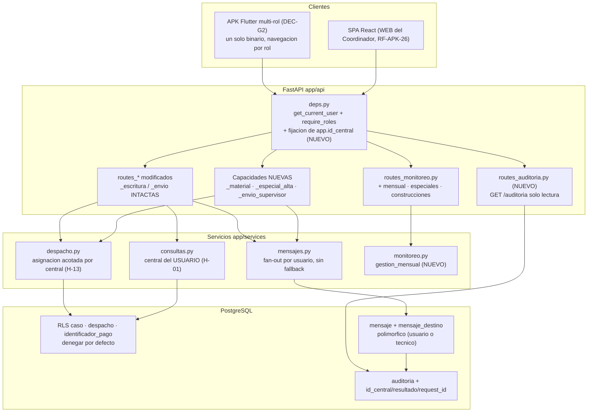
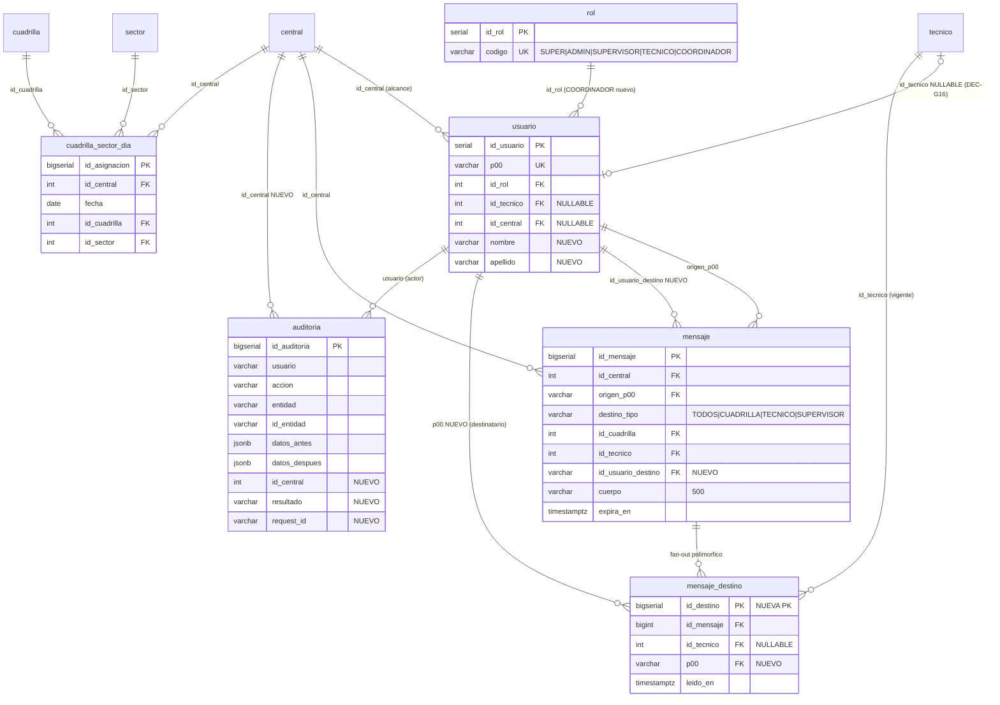

# Documento técnico — Incremento **D-95 … D-98** · APK de Gestión (Supervisor · Administrador · Coordinador)

| Campo | Valor |
|---|---|
| Documento | Diseño técnico del incremento (arquitectura, modelo de datos, contratos, migración, seguridad y pruebas) |
| Estado | Diseño objetivo auditado contra el checkout el 2026-10-12; **implementación incompleta y no desplegada**. |
| Fecha del diseño | 2026-10-10 · revisión de realidad: 2026-10-12 |
| Base | [`incremento_D95_apk_gestion.md`](incremento_D95_apk_gestion.md) v0.3.2 · [`INFORME_OPTIMIZACION_D95_V1.md`](INFORME_OPTIMIZACION_D95_V1.md) (auditoría de diseño, 38 hallazgos) · [`casos_uso/casos_uso_D95.md`](casos_uso/casos_uso_D95.md) v0.2 · [`casos_uso/diagramas_D95.md`](casos_uso/diagramas_D95.md) · estado real en [`auditoria_estado_real_v2.md`](auditoria_estado_real_v2.md) |
| Estilo | Sigue la estructura, numeración y nivel de detalle de [`documento_tecnico_D89.md`](documento_tecnico_D89.md) |
| Decisiones aplicadas | **DEC-G1…DEC-G19** cerradas (incremento §3 y §3.1) |
| Riesgos aceptados | **RA-01** — MFA diferido (DEC-G14) · **RA-02** — caché local sin cifrar (DEC-G19) |
| Alcance | Ciclos **D-95** (rol, contrato y seguridad base) · **D-96** (esqueleto de la APK y MONITOREO) · **D-97** (Supervisor y Administrador) · **D-98** (Coordinador, WEB, publicación) |

> **Regla de lectura de este documento.** Cada afirmación sobre el sistema vigente lleva
> **evidencia `ruta:línea`** verificada contra el repositorio. Cuando un dato **no** ha podido
> verificarse (nombre físico de una restricción en la base de destino, estado de los datos
> reales, ubicación del keystore), se escribe **«necesita verificación»** y **no** se presenta
> como hecho. Los diagramas de secuencia, estados y migración **no se duplican** aquí: viven en
> [`casos_uso/diagramas_D95.md`](casos_uso/diagramas_D95.md) y este documento los cita por
> figura (§1.3).

> **Aclaración de vigencia:** la indicación original «código en estado D-94» es la línea de partida del diseño, no el checkout actual. El checkout contiene cambios locales parciales D-89…D-95, pero no la APK multirol completa, no una migración D-95 compatible y no el despliegue de V2. El informe de auditoría enlazado arriba prevalece para afirmar qué existe hoy.

---

## 1. Visión general y alcance

### 1.1 Qué es este incremento

El incremento lleva a una **APK Flutter multi-rol** las capacidades de gestión que hoy solo
existen en la SPA React, e incorpora un **quinto rol** (`COORDINADOR`) con alcance propio en
APK y WEB. No es un incremento de pantallas: es un incremento de **contrato, modelo de datos y
seguridad**, porque tres de las capacidades pedidas **no existen** en el backend vigente y una
cuarta **no está activa** pese a estar documentada como vigente.

La petición del usuario (reproducida en el incremento §1, `incremento_D95_apk_gestion.md:18-25`)
tiene **tres puntos**:

| # | Punto pedido | Traducción técnica | Estado real de partida |
|---|---|---|---|
| **1** | El **Supervisor** hace en la APK las funciones esenciales de la WEB: monitoreo con selector (Diaria · Semanal · Mensual · Casos especiales · Construcciones), Gestión de Casos Especiales, Gestión de Despacho, Gestión de Casos (ver y asignar a cuadrilla); y una **pantalla GESTIÓN** con los casos de la «cuadrilla 0» | APK multi-rol con navegación por rol + **3 vistas de monitoreo que hay que construir** + pantalla GESTIÓN anclada al criterio real de cuadrilla 0 | ⚠️ El backend cubre casi todo, pero **las «5 vistas» de MONITOREO no existen** (H-18): `routes_monitoreo.py` solo expone `diario`, `semanal`, `globales`, `reparacion`, `construccion`, `cuadrilla`, `capacidad`, `reclasificaciones`, `identificadores` y `reportes/trabajo` (`app/api/routes_monitoreo.py:56,69,82,97,108,119,134,145,156,176`) |
| **2** | El **Coordinador** puede en APK **y WEB**: monitoreo con las mismas vistas, **crear** casos especiales, gestionar Fallas Masivas (lectura y **solicitud de materiales**) y **enviar mensajes al Supervisor**; y **monitorear las alertas** | Rol nuevo + alta de especiales + orden de material como **única** escritura + mensajería de una vía + lectura de alertas | ❌ El rol no existe (`grep` de `coordinador` en el repo: **0** coincidencias), la mensajería inversa es **inresoluble** con el modelo actual (`TIPOS_DESTINO = ("TODOS","CUADRILLA","TECNICO")`, `app/models/mensaje_entities.py:28`) y la recepción de un Supervisor devuelve lista vacía (`app/services/mensajes.py:203-204`) |
| **3** | La APK **se mantiene conectada con actualización automática cada 5 minutos** | Temporizador único, solo en primer plano, **solo la pantalla visible**, con presupuesto de peticiones y política de fallo | ⚠️ **Contradice D-84**, que hizo la sincronización del TÉCNICO totalmente **manual** (CARGA/DESCARGA). Resuelto en DEC-G4/DEC-G5 con **dos flujos de datos distintos** conviviendo en un solo binario |

### 1.2 Qué entra y qué queda fuera

**Entra** (incremento §4, §4.6 y §6):

- Rol `COORDINADOR` en el catálogo `rol`, en `ROL_ASIGNABLE` y en la matriz RBAC, con **alta de
  cuenta de gestión separada de `tecnico`** (DEC-G16) y gobierno declarado (DEC-G17).
- **Acotado real por central** (H-01): hoy la RLS es **inerte** y `resolver_central` acepta el
  `id_central` del cliente sin compararlo con `usuario.id_central`
  (`app/services/consultas.py:20-29`). Deja de ser «cero cambios de seguridad».
- **Rediseño del modelo de mensajería** (DEC-G15) con destinatario-usuario, nuevos `CHECK`,
  fan-out al Supervisor **concreto** y escalado al ADMIN de su central.
- **Guards por capacidad**: se **separan** las dependencias compartidas de alertas y de
  mensajería (H-09/H-10). Ampliarlas sería **elevación de privilegios**.
- **Corrección del borrado cruzado de `cuadrilla_sector_dia`** (H-13) y de los **defectos
  colaterales C-1/C-2** (central escrita a mano).
- **Traza en `auditoria`** de las acciones del Coordinador (RNF-44) y **`GET` de auditoría en
  solo lectura para el SUPER** (RT-APK-06, que hoy **no existe**).
- APK multi-rol con navegación por rol, caché de lectura **particionada por usuario y purgada
  al cerrar sesión**, `FLAG_SECURE` en las pantallas de gestión, refresco de 5 min con
  presupuesto, y las **5 vistas de MONITOREO** (3 construidas de cero).

**Queda fuera** por **DEC-G12** (`incremento_D95_apk_gestion.md:72`, y precisión de
`casos_uso_D95.md:23-29`), de forma expresa y verificable: **seguimiento** · **empresas** ·
**referidos** · **citas** · **configuración** · **ingesta** · **imprimibles del despacho**. El
menú de la APK no las ofrece y la navegación directa por ruta interna no las renderiza.

| Fuera por DEC-G12 | Evidencia del contrato que **no** se replica en la APK |
|---|---|
| Seguimiento | `GET/POST/PATCH /seguimiento` — `app/api/routes_especiales.py:486,504,526` |
| Citas | `GET/POST/PATCH/DELETE /citas` — `app/api/routes_especiales.py:388,418,446,472` |
| Configuración | `app/api/routes_config.py` (todo el router, `:62`) |
| Ingesta | `app/api/routes_ingesta.py` |
| Imprimible del despacho | `GET /despachos/{id_despacho}/imprimible` — `app/api/routes_despachos.py:441` |

También quedan **fuera del alcance** dos piezas que el diseño previo anunciaba y que **este
incremento no cierra**:

- **MFA** para los roles de gestión: **DIFERIDO** por **DEC-G14** (riesgo aceptado **RA-01**).
  RNF-22 y **RNF-APK-04 quedan incumplidos por decisión expresa**; ningún criterio de aceptación
  de este incremento exige segundo factor.
- **Cifrado de la caché local y TTL**: **no se implementan** por **DEC-G19** (riesgo aceptado
  **RA-02**). Lo que **sí** entra es el `FLAG_SECURE` y la purga al cerrar sesión (RNF-37,
  H-14 — ver §6.3).

Queda además **fuera de los cuatro ciclos, pero escalado**, el incidente **H-23** (el webhook de
Telegram y el endpoint MCP **fallan abiertos** y devuelven PII a un tercero). Se detalla en §6.4.

### 1.3 Actores y trazabilidad con los diagramas

| Actor | Rol de código | Alcance en este incremento | Fuente |
|---|---|---|---|
| `SUP` Supervisor | `SUPERVISOR` | APK de gestión completa (8 secciones) + WEB; dueño funcional y soporte de 1.º/2.º nivel del Coordinador; **destinatario** de la mensajería nueva | DEC-G3, DEC-G7, DEC-G15, DEC-G17 |
| `ADM` Administrador | `ADMIN` | **Mismo alcance que el Supervisor** en la APK (DEC-G3); escalado cuando no hay Supervisor (DEC-G15) | DEC-G3 |
| **`ACT-07` Coordinador** (actor nuevo) | `COORDINADOR` | Monitoreo (lectura), **alta** de casos especiales, fallas masivas (lectura) + **orden de material** (única escritura), alertas (lectura), **envío al Supervisor**; APK **y** WEB | DEC-G1, DEC-G8, DEC-G9, DEC-G11, DEC-G13, DEC-G16 (incremento §9.4) |
| `SUPER` Super Usuario | `SUPER` | Alta de la cuenta de gestión, **auditoría en solo lectura** de las acciones del Coordinador, custodia del keystore y publicación de la APK | DEC-G17 |
| `TEC` Técnico | `TECNICO` | **Convive** en el mismo binario con su flujo offline **intacto** (D-84): CARGA/DESCARGA manual, sin temporizador de gestión | RNF-APK-03, DEC-G2 |

**Figuras de `casos_uso/diagramas_D95.md` que este documento referencia y no duplica:**

| Figura | Contenido | Secciones que la citan |
|---|---|---|
| §4 | Secuencia del **refresco de 5 min con presupuesto de peticiones** | §7.2, §8.1 |
| §6 | Secuencia del **mensaje del Coordinador al Supervisor con escalado al ADMIN** | §4.2, §5.1 |
| §7 | Secuencia de la **orden de material** (única escritura del Coordinador) | §4.2, §5.4 |
| §8 | Secuencia del **aislamiento por central** (A→B) | §2.3, §5.2 |
| §9 / §10 | Estados de la **falla masiva** y de la **cuenta de gestión** | §3.3, §4.4 |
| §11 | **Superficie de migración de D-95** (8 objetos) | §3.1, §3.5 |
| §12 | **Arquitectura de la APK multi-rol** (dos flujos de datos) | §2.4 |

### 1.4 Principios de diseño

1. **Aditivo y reversible.** Nada se renombra ni se elimina. La ampliación del `CHECK` de
   destino es un **superconjunto** del vigente, de modo que los mensajes históricos siguen
   siendo válidos (`casos_uso_D95.md:1502`). La APK `1.1.0+9` sigue operando.
2. **Denegar por defecto.** El alcance por central pasa de «permitir todo si el parámetro es
   NULL» a **denegar por defecto**; los guards se escriben **por enumeración**, no por excepción
   (H-08/H-21).
3. **Capacidad, no módulo.** Cada operación sensible tiene **su propia** dependencia. No se
   amplía ninguna dependencia compartida: hacerlo sería elevación de privilegios (H-09/H-10).
4. **Una sola fuente de verdad.** La «cuadrilla 0» se materializa con `es_supervisor` +
   `en_gestion_supervisor`, nunca con un `id_cuadrilla = 0` (H-16).
5. **Lo que no se decide, no se promete.** MFA diferido y caché sin cifrar quedan escritos como
   riesgos aceptados con dueño y fecha, no como funcionalidad.

---

## 2. Arquitectura

### 2.1 Componentes y capas tras el incremento

El sistema no cambia de forma: la APK es un cliente más de la misma API. Lo que cambia es que
la API pasa a tener **tres modos de acceso**: campo (TÉCNICO, offline), gestión (SUP/ADM/COO,
online con caché de lectura) y supervisión del sistema (SUPER, incluida la auditoría).



**Componentes nuevos**

| Componente | Responsabilidad | Interfaz |
|---|---|---|
| `app/api/routes_auditoria.py` | `GET /auditoria` (traza filtrable) en **solo lectura** para el SUPER (RT-APK-06) | FastAPI + Pydantic |
| `app/schemas/auditoria.py` | Contrato de la traza (con `datos_antes`/`datos_despues`) | Pydantic v2 |
| Capacidades en `app/api/deps.py` (o módulo hermano) | Fijar `app.id_central` **por petición** y derivar la central del usuario; fábricas de guard **por capacidad** | FastAPI `Depends` |
| `app/services/central.py` | `central_del_usuario()`, `acotar_central()`: una sola implementación del acotado | Funciones puras + `Session` |
| `app/services/monitoreo.py` → `gestion_mensual()` | Vista Mensual construida sobre `_por_dia_cuadrilla` (`app/services/monitoreo.py:165`) | Funciones + `Session` |
| `scripts/migrar_d95_rol_gestion.py` | DDL idempotente de §3.1 + backfill + verificaciones + rollback | Script CLI (convención D-89) |
| `app/tests/test_d95_*.py` | Contrato, RBAC por endpoint (concedido **y** denegado), aislamiento A→B, migración | pytest |

**Componentes modificados**

| Componente | Cambio | Motivo |
|---|---|---|
| `app/api/deps.py` (`:52-71`) | No se amplía `require_roles`; se **añaden fábricas nuevas** y la fijación del parámetro de sesión | H-08/H-09/H-10 |
| `app/services/consultas.py` (`:20-29`) | `resolver_central` deja de aceptar la central del cliente cuando difiere de la del usuario | H-01 |
| `app/services/mensajes.py` (`:55-83`) | Rama explícita `SUPERVISOR`; **sin fallback**; fan-out por usuario; lectura y contador por usuario | H-03/H-10 |
| `app/models/mensaje_entities.py` (`:26-28,58-72,81-86`) | `TIPOS_DESTINO` + `SUPERVISOR`; XOR con rama nueva; PK sustituta en el fan-out | DEC-G15 |
| `app/services/despacho.py` (`:225-230,264-294`) | `SELECT`/`DELETE` de `cuadrilla_sector_dia` con `id_central` | H-13 |
| `app/api/routes_alertas.py` (`:43`, uso) | `_escritura` **intacta**; `_material` nueva solo en el material; `reporte-campo` enumerado; `_o_404` acotado por central; rótulo de central real (C-2) | H-09, DEC-G11, C-2 |
| `app/api/routes_despachos.py` (`:486`) | Rótulo de la central real del despacho | C-1 |
| `app/api/routes_especiales.py` (`:73-78`) | El caso asociado se crea en la central del usuario, no en la configurada | H-01 |
| `app/api/routes_auth.py` (`:61-70,264`) | `nombre`/`apellido` desde `usuario` con respaldo en `tecnico` | §9.5 del incremento |
| `app/services/monitoreo.py` | `gestion_mensual` y agregados de especiales/construcciones | H-18 |
| `app_movil/lib/core/sesion.dart` (`:27-29`) | Se sustituyen los booleanos por una **matriz de capacidades por rol** | H-08 |
| `app_movil/lib/core/database.dart` (`:16,37-98`) | Versión de esquema local + namespace por usuario + tablas de lectura de gestión | H-14 |
| `app_movil/lib/core/auth_storage.dart` (`:55-58`) | `limpiarSesion()` pasa a **purgar** la caché local | H-14, RNF-37 |
| `RepoTecnico/requerimientos.md` §5.2 y §5.3 | Matriz RBAC con la columna `COORDINADOR` y gobierno del rol | DEC-G1, DEC-G17 |

### 2.2 El rol `COORDINADOR` y el RBAC por capacidad

El rol se añade al catálogo (`INSERT` idempotente, §3.1 bloque 1) y a `ROL_ASIGNABLE`
(`app/schemas/config.py:132` → `Literal["TECNICO","SUPERVISOR","ADMIN"]`), que **no** admite
`SUPER` a propósito (D-68). El RBAC vigente es **por código de rol en el código**, no por la
columna `rol.permisos` (`RepoTecnico/db/schema.sql:69`, jsonb hoy con `'{}'`): **este incremento
no cambia eso** y no introduce RBAC dinámico.

#### 2.2.1 Las dependencias compartidas NO se amplían (H-09 / H-10)

Esta es la regla que más riesgo elimina, y hay que escribirla explícitamente porque el
incremento v0.3 la citaba mal (`RT-APK-05` decía «incluir COORDINADOR» sin enumerar dónde):

| Dependencia compartida | Dónde vive | Qué protege hoy | Por qué **no** se amplía |
|---|---|---|---|
| `_escritura = require_roles("ADMIN","SUPERVISOR")` | `app/api/routes_alertas.py:43` | **Seis** endpoints con una sola dependencia: declarar falla (`:177`), `/detectar` (`:251`), `PATCH` (`:267`), `/planificacion` (`:283`), `/material` (`:336`) y procesar el outbox (`:376`) | Añadir `COORDINADOR` le abriría **declarar, planificar y cerrar** fallas: **elevación de privilegios** contra DEC-G8 y la matriz §5 (`incremento_D95_apk_gestion.md:290`) |
| `_envio = require_roles("ADMIN","SUPERVISOR")` | `app/api/routes_mensajes.py:29` | La bandeja de **enviados** (`:55`) y el `POST /mensajes` (`:66`), que acepta `TODOS`, `CUADRILLA` y `TECNICO` sin comprobar el rol del emisor (`app/services/mensajes.py:134-157`) | Añadir `COORDINADOR` le daría **difusión a toda la plantilla** (`TODOS` enumera las cuentas con rol `TECNICO` de la central, `app/services/mensajes.py:72-83`), contra la matriz §5 |
| `_escritura` de despacho | `app/api/routes_despachos.py:47` | Propuesta, generar, asignación, procesar, publicar, agregar/quitar casos, enviar | El Coordinador **no** tiene DESPACHO (DEC-G7): se queda como está |
| `_escritura` de casos | `app/api/routes_casos.py:51` | Alta manual y edición de casos, cierre, cita, enrutado | Coherente con DEC-G8: el Coordinador no escribe casos |
| `_gestion` de casos | `app/api/routes_casos.py:53` | `ADMIN`,`SUPERVISOR`,`TECNICO` (cambio de estado, contacto, «No Contesta») | El Coordinador no gestiona el ciclo de vida de un caso |

**Dependencias nuevas (por capacidad), que conviven con las anteriores:**

| Guard nuevo | Valor | Se aplica **solo** a | Justificación |
|---|---|---|---|
| `_material` | `require_roles("ADMIN","SUPERVISOR","COORDINADOR")` | `POST /fallas-masivas/{id_falla}/material` | DEC-G8/DEC-G13: la orden de material es la **única** escritura del Coordinador |
| `_especial_alta` | `require_roles("ADMIN","SUPERVISOR","COORDINADOR")` | `POST /casos-especiales` | DEC-G13 y matriz §5: «ESPECIALES (crear) = CRUD (alta)» |
| `_envio_supervisor` | `require_roles("COORDINADOR")` | `POST /mensajes/supervisor` | DEC-G9/DEC-G15: destino **forzado** a `SUPERVISOR`, sin acceso a `TODOS`/`CUADRILLA`/`TECNICO` |
| `_falla_escritura` | `require_roles("ADMIN","SUPERVISOR")` | Se **nombra** la dependencia para el bloque de declarar/detectar/planificar/procesar (mismo valor que `_escritura`, distinto nombre) | Hacer explícito que la denegación al Coordinador es **deliberada** y no un efecto colateral |
| `_auditoria_lectura` | `require_roles()` → solo `SUPER` (el bypass de `deps.py:65` lo hace efectivo) | `GET /auditoria` | DEC-G17: auditoría en solo lectura por el SUPER |

> **Nota de implementación.** «Solo SUPER» se implementa como `require_roles()` **sin argumentos**
> para no enumerar el rol privilegiado; el efecto es que únicamente `SUPER` pasa
> (`app/api/deps.py:65`). Si se prefiere explicitud, el resultado es idéntico.

#### 2.2.2 Matriz RBAC resultante (se incorpora a `requerimientos.md` §5.2)

Se reproduce la matriz del incremento §5 (`incremento_D95_apk_gestion.md:174-189`) **corregida**
con los `require_roles` reales (H-21) y con la fila ALERTAS de `casos_uso_D95.md:1968-1974`:

| Módulo / acción | SUPER | ADMIN | SUPERVISOR | **COORDINADOR** | TECNICO |
|---|---|---|---|---|---|
| MONITOREO — 5 vistas | Lectura | Lectura | Lectura | **Lectura** | Lectura de su cuadrilla |
| MONITOREO — reclasificaciones / identificadores (`_gestion`) | Lectura | Lectura | Lectura | **— (403)** | — |
| CASOS (ver · buscar · ficha · historial · relacionados) | Lectura | Lectura | Lectura | **— (403)** | Lectura de sus casos |
| CASOS (alta manual RF-APK-29 · edición ligera RF-APK-30) | Escritura | Escritura | Escritura | **— (403)** | — |
| ESPECIALES (listar / abrir ficha) | Lectura | Lectura | Lectura | **Lectura** | — |
| ESPECIALES (crear, incluido `crear_solicitante` en línea) | Escritura | Escritura | Escritura | **Escritura (alta)** | — |
| ESPECIALES (`PATCH`) · SOLICITANTES (`POST`) · CITAS · SEGUIMIENTO | Escritura | Escritura | Escritura | **— (403)** | — |
| DESPACHO (todo, incluido `GET /proceso`) | Escritura | Escritura | Escritura | **— (403)** | Lectura de su despacho |
| GESTIÓN (cuadrilla 0) | Escritura | Escritura | Escritura | **— (403)** | — |
| FALLAS MASIVAS (consulta, ficha, órdenes) | Lectura | Lectura | Lectura | **Lectura** | Lectura |
| FALLAS MASIVAS (declarar / detectar / planificar / cerrar) | Escritura | Escritura | Escritura | **— (403)** | **—** |
| ORDEN DE MATERIAL de una falla | Crear/consultar | Crear/consultar | Crear/consultar | **Crear / consultar** | — |
| Reporte de campo (`POST /fallas-masivas/reporte-campo`) | Sí | Sí | Sí | **— (403, DEC-G11)** | **Sí** |
| ALERTAS (bandeja de notificaciones, notificaciones) | Lectura | Lectura | Lectura | **Lectura** | Lectura |
| MENSAJERÍA — enviar a técnicos (`POST /mensajes`) | Crear | Crear | Crear | **— (403)** | — |
| MENSAJERÍA — enviar al Supervisor (`POST /mensajes/supervisor`) | — | — | — | **Crear** | — |
| MENSAJERÍA — bandeja propia (recibidos / enviados) | Recibidos | Recibidos | Recibidos + enviados | **Enviados** | Recibidos |
| AUDITORÍA (`GET /auditoria`) | **Lectura** | — (403) | — (403) | — (403) | — (403) |
| CONFIGURACIÓN · INGESTA · SISTEMAS | los vigentes | | | **— (403)** | — |

> **MFA: DIFERIDO (RA-01 · DEC-G14).** ADMIN, SUPERVISOR y COORDINADOR entran con `P00` + clave,
> bloqueo a los **3** intentos (`RepoTecnico/db/schema.sql:933`) y recuperación con **3 de las 12**
> palabras (`app/api/routes_auth.py:73-85`). **RNF-22 y RNF-APK-04 quedan incumplidos** por
> decisión expresa de la dirección del proyecto.

### 2.3 El acotado real por central (H-01): de diseño inerte a control activo

**Estado verificado de partida** (no es una garantía, es trabajo a hacer):

| Comprobación | Evidencia | Veredicto |
|---|---|---|
| La aplicación fija la central en la sesión de BD | `grep "SET LOCAL app.id_central"` en `app/**/*.py` = **0** (solo aparece en documentación) | ❌ **No se fija** |
| La RLS deniega por defecto | `app_central_actual()` = `nullif(current_setting('app.id_central', true),'')::integer` (`RepoTecnico/db/schema.sql:774-778`) y las políticas usan `app_central_actual() IS NULL OR id_central = app_central_actual()` (`:783-785`, `:790-792`, `:799-805`); el propio comentario `:767-769` admite que sin el parámetro **«la política permite todo»** | ❌ **RLS inerte** |
| La central se deriva del usuario | `resolver_central` acepta el `id_central` de la petición y, si no viene, usa `ingesta.central_codigo`; **nunca** `usuario.id_central` (`app/services/consultas.py:20-29`) | ❌ **No se compara** |
| `require_roles` comprueba la central | `app/api/deps.py:52-71` compara **solo** el código de rol | ❌ **No la comprueba** |
| El alta de un especial usa la central del usuario | `_crear_caso_asociado` llama `resolver_central(db, None, config)` (`app/api/routes_especiales.py:74-75`) | ❌ **Usa la central configurada** |
| El reporte de campo acota por el reportante | `reportar_falla_campo` también resuelve con `resolver_central(db, None, …)` (`app/api/routes_alertas.py:220`) | ❌ **Usa la central configurada** |
| Los listados de lectura exigen rol | `GET /fallas-masivas` (`app/api/routes_alertas.py:157`), `GET /casos` (`app/api/routes_casos.py:181-183`), `GET /despachos` (`app/api/routes_despachos.py:127`), `GET /despachos/proceso` (`:185`) y todo MONITOREO (`app/api/routes_monitoreo.py:56-187`) están tras `get_current_user` | ❌ **Solo autenticación** |

**Diseño (entregable de D-95).** Cuatro piezas, en este orden:

1. **Fijar el parámetro por petición.** `get_db` ya crea **una sesión por petición**
   (`app/core/db.py:43-49`), así que el sitio natural es `get_current_user`
   (`app/api/deps.py:29-49`), que recibe esa misma sesión: tras resolver el `Usuario`, se ejecuta
   `SELECT set_config('app.id_central', :c, true)` con `usuario.id_central`.
   **`set_config(..., true)` y no `SET LOCAL`**: `SET LOCAL` **no admite parámetros ligados** y
   forzaría concatenación de SQL; `set_config` con `is_local = true` es su equivalente
   transaccional parametrizable.
2. **Derivar la central y rechazar la ajena.** Nuevo `app/services/central.py`:
   - `central_del_usuario(db, usuario)` → `usuario.id_central` (o `403` «Su usuario no tiene
     central asignada»).
   - `resolver_central(db, id_central_peticion, config, usuario)`: si `id_central_peticion`
     difiere de la del usuario → **`403`** (y `0` filas), **salvo rol `SUPER`**, que es
     multi-central por diseño (DEC-G6, `casos_uso_D95.md:1662`). El intento se registra
     (RNF-41: «intento denegado por rol»).
3. **Retirar la cláusula permisiva** de las **tres** políticas que hoy la tienen:
   `p_caso_central` (`:782-785`), `p_despacho_central` (`:789-792`) e `p_ip_central`
   (`:798-805`), conservando en esta última la rama «central con casos enlazados» (DEC-IP-6).
4. **Enumerar los guards de lectura** que hoy exigen solo autenticación, según la matriz §2.2.2.

**Tres consecuencias que hay que declarar (y que ninguna versión anterior del incremento veía):**

| # | Consecuencia | Detalle | Mitigación en el diseño |
|---|---|---|---|
| **A** | **La RLS solo cubre 3 tablas.** `ALTER TABLE … ENABLE/FORCE ROW LEVEL SECURITY` existe **solo** para `caso`, `despacho` e `identificador_pago` (`RepoTecnico/db/schema.sql:780-805`). `caso_especial`, `falla_masiva`, `orden_material`, `mensaje`, `solicitante`, `auditoria` y `sincronizacion` **no tienen RLS** | Activarla no basta para «no ver otra central» | El acotado de esas tablas es **de aplicación** (§5.2): toda consulta pasa por `central_del_usuario`. Extender la RLS al resto queda **declarado fuera** de D-95 |
| **B** | **`FORCE ROW LEVEL SECURITY` aplica al dueño de la tabla** (`:781,788,797`), y la aplicación se conecta como `ggtov2_app`, que es el propietario del esquema (`RepoTecnico/entornos_globales.md:142`) | Con «denegar por defecto», **cualquier** proceso que no fije el parámetro deja de leer `caso`/`despacho`: ingesta, scripts de migración, `inyectar_super_usuario.py`, tareas de purga | Ver §5.2.3: la ingesta fija la central configurada; el script de migración fija un modo explícito y **auditado**; el arranque en frío se prueba con la batería A→B |
| **C** | **El SUPER suele tener `id_central = NULL`** (`usuario.id_central` es *nullable*, `RepoTecnico/db/schema.sql:184`) | Con «denegar por defecto» el SUPER vería **0 filas** en `/api/v1/resumen`, `/metricas` y los listados | El diseño fija un **segundo** parámetro de sesión `app.sin_acotar = 'on'`, que **solo** `get_current_user` establece y **solo** cuando el rol es `SUPER`; las políticas conservan una rama estrecha: `USING (id_central = app_central_actual() OR current_setting('app.sin_acotar', true) = 'on')`. La rama es **inalcanzable** para los demás roles porque el parámetro jamás se fija para ellos y se cubre con prueba negativa (un `SUPERVISOR` no puede activarlo) |
| **D** | Efecto **positivo** colateral | `GET /metricas` cuenta **todas** las centrales sin filtro (`app/api/routes_alertas.py:589-601`) y `/api/v1/resumen` cuenta tablas (`app/api/routes_health.py:60-78`) | Con la RLS activa, esas consultas quedan acotadas **automáticamente** a la central de la sesión (y globales solo para el SUPER) |

**Prueba de cierre (obligatoria).** La **batería negativa A→B** con **dos** centrales
(`casos_uso_D95.md:1700-1703`) sobre cada endpoint de la matriz §2.2.2: el 100 % responde `403`
o devuelve **0 filas** de la otra central. Sin esta batería en verde **no se declara cerrado
D-95** (`casos_uso_D95.md:1711`).

### 2.4 La APK multi-rol: dos flujos de datos en un solo binario

La decisión **DEC-G2** (una sola APK) convive con **DEC-G4** (gestión online con caché de
lectura) y con **D-84** (el TÉCNICO sincroniza **a mano**). El diseño está dibujado en
`casos_uso/diagramas_D95.md` §12 y se resume aquí:

| Dimensión | Flujo **TÉCNICO** (intacto, RNF-APK-03) | Flujo **GESTIÓN** (SUP · ADM · COO · SUPER) |
|---|---|---|
| Motor de datos | SQLite local `ggto.db`, **versión de esquema 4** (`app_movil/lib/core/database.dart:16`) con `caso_local`, `accion_pendiente`, `evidencia_local`, `mensaje_local`, `app_meta` (`:37-98`) | **Nuevo** almacén local de **lectura** para las entidades de gestión |
| Cuándo baja datos | **DESCARGA explícita**: `GET /sync/descarga` con `ids_conocidos` (`app/api/routes_sync.py:62-70`) y marca de agua `ultima_descarga_ts` (`app_movil/lib/core/database.dart:250`) | **Automática cada 5 min** (RNF-APK-01) pero **solo la pantalla visible** |
| Escrituras | Cola local `accion_pendiente` con reintento y **CARGA** explícita | **Online obligatorias**; sin conexión la escritura se **bloquea** y se informa antes de intentarla (RNF-APK-02) |
| Mensajes | Sondeo cada 60 s ya existente (`app/api/routes_mensajes.py:32`) | Refresco de 5 min de la pantalla de bandeja |
| Temporizador de 5 min | **No se instala nunca** (riesgo R1) | Uno solo, cancelado en segundo plano |
| PII | Cachea `nombre_cliente`, `telefono`, `direccion` en claro (`app_movil/lib/core/database.dart:149-201`) | Igual, **sin cifrado** (RA-02); con **purga al cerrar sesión** y `FLAG_SECURE` (§6.3) |

**Navegación por rol (RF-APK-27).** Hoy la APK tiene **cinco rutas de campo** sin guard de rol
(`app_movil/lib/main.dart:111-120`) y un `_RutaProtegida` que **solo comprueba autenticación**
(`:126-143`); la única distinción es `esTecnico`/`esSuper`/`soloLectura`
(`app_movil/lib/core/sesion.dart:27-29`), donde `soloLectura => esTecnico` marca a **todo** rol
no técnico como escritor. Se sustituye por:

- Una **matriz de capacidades por rol** en `sesion.dart` (`puedeVer(seccion)` /
  `puedeEscribir(capacidad)`), derivada de la matriz §2.2.2, con **lista blanca** (H-08: el
  guard deja de negar «por excepción»).
- Un **guard de router** que no renderiza la sección prohibida y redirige a la primera permitida;
  cubierto con `flutter test` de «ruta prohibida → redirección» **por rol**.
- Menús resultantes: **SUP/ADM** 8 secciones (MONITOREO, ESPECIALES, DESPACHO, CASOS, GESTIÓN,
  ALERTAS, MENSAJES, USUARIO); **COORDINADOR** 6 (MONITOREO, ESPECIALES —solo alta—, FALLAS
  MASIVAS, ALERTAS, MENSAJES, USUARIO); **TÉCNICO** su menú de campo; **SUPER** acceso total +
  auditoría en solo lectura (duda abierta nº 5 de §12).

---

## 3. Modelo de datos

### 3.1 DDL del incremento (RT-APK-01, RT-APK-03, H-13, H-01)

Se parte de la **superficie exacta de migración** del incremento §9.3
(`incremento_D95_apk_gestion.md:307-322`, 8 objetos) y se añade lo que el diseño descubre
(bloques 9 a 12). Todo el DDL es **idempotente** y **aditivo**; se refleja en
`RepoTecnico/db/schema.sql`.

```sql
-- ===========================================================================
-- BLOQUE 1 — Catálogo `rol`: alta del COORDINADOR (RT-APK-01)
--   Estado vigente: 4 filas (RepoTecnico/db/schema.sql:872-877)
-- ===========================================================================
INSERT INTO rol (codigo, nombre, descripcion) VALUES
    ('COORDINADOR', 'Coordinador',
     'Coordinación de la gestión: monitoreo, casos especiales, fallas masivas (lectura) y orden de material')
ON CONFLICT (codigo) DO NOTHING;

-- ===========================================================================
-- BLOQUE 2 — `mensaje.destino_tipo`: alta de SUPERVISOR  (RT-APK-03 · H-15)
--   El CHECK vigente está EN LÍNEA en la columna (schema.sql:978) → su nombre
--   físicamente es el autogenerado por PostgreSQL (`mensaje_destino_tipo_check`
--   por convención, **necesita verificación** en la base destino). Obliga a
--   DROP + ADD sobre una tabla VIVA con PII (retención configurable, purga en
--   `app/services/purga.py:60-77`).
-- ===========================================================================
SET LOCAL lock_timeout = '5s';                    -- evita bloquear la tabla indefinidamente
ALTER TABLE mensaje DROP CONSTRAINT IF EXISTS mensaje_destino_tipo_check;
ALTER TABLE mensaje DROP CONSTRAINT IF EXISTS ck_mensaje_destino_tipo;
ALTER TABLE mensaje ADD  CONSTRAINT ck_mensaje_destino_tipo
    CHECK (destino_tipo IN ('TODOS','CUADRILLA','TECNICO','SUPERVISOR')) NOT VALID;
-- La validación se hace en un paso aparte, cuando no haya violaciones:
--   ALTER TABLE mensaje VALIDATE CONSTRAINT ck_mensaje_destino_tipo;

-- ===========================================================================
-- BLOQUE 3 — Destinatario-usuario declarado en la cabecera (DEC-G15)
--   `usuario.p00` es UNIQUE (schema.sql:179) y ya es destino de FK en
--   `mensaje.origen_p00` (schema.sql:977): el destino simétrico es coherente.
-- ===========================================================================
ALTER TABLE mensaje ADD COLUMN IF NOT EXISTS id_usuario_destino varchar(20)
    REFERENCES usuario(p00) ON DELETE SET NULL;

-- ===========================================================================
-- BLOQUE 4 — `ck_mensaje_destino_xor` con la RAMA NUEVA (H-03)
--   Vigente en el esquema: tres ramas, SIN columna de destinatario-usuario y
--   sin nombre explícito (schema.sql:989-993). Su nombre real en la base
--   **necesita verificación**: PostgreSQL lo autogenera (`mensaje_check`,
--   `mensaje_check1`, … según el orden). El script lo DESCUBRE antes de tocar:
--     SELECT conname FROM pg_constraint
--      WHERE conrelid = 'mensaje'::regclass AND contype = 'c';
-- ===========================================================================
ALTER TABLE mensaje DROP CONSTRAINT IF EXISTS ck_mensaje_destino_xor;
ALTER TABLE mensaje DROP CONSTRAINT IF EXISTS mensaje_check1;   -- nombre probable (verificar)
ALTER TABLE mensaje ADD  CONSTRAINT ck_mensaje_destino_xor CHECK (
       (destino_tipo = 'TODOS'      AND id_cuadrilla IS NULL AND id_tecnico IS NULL
                                     AND id_usuario_destino IS NULL)
    OR (destino_tipo = 'CUADRILLA'  AND id_cuadrilla IS NOT NULL AND id_tecnico IS NULL
                                     AND id_usuario_destino IS NULL)
    OR (destino_tipo = 'TECNICO'    AND id_tecnico IS NOT NULL AND id_cuadrilla IS NULL
                                     AND id_usuario_destino IS NULL)
    OR (destino_tipo = 'SUPERVISOR' AND id_usuario_destino IS NOT NULL
                                     AND id_cuadrilla IS NULL AND id_tecnico IS NULL)
) NOT VALID;

-- ===========================================================================
-- BLOQUE 5 — `mensaje_destino`: el fan-out pasa a ser POLIMÓRFICO (H-03)
--   Vigente: PK (id_mensaje, id_tecnico) con FK a `tecnico` (schema.sql:1000-1005;
--   ORM en app/models/mensaje_entities.py:81-86). El fan-out es POR TÉCNICO y no
--   puede representar a un destinatario-usuario sin fila en `tecnico` (DEC-G16).
--   Solución: PK sustituta + una fila con `p00` **o** con `id_tecnico`, nunca ambas.
--   `bigserial` rellena las filas existentes en PostgreSQL >= 11 (la instancia
--   operativa es POSTGRES_15, RepoTecnico/entornos_globales.md:71).
-- ===========================================================================
ALTER TABLE mensaje_destino ADD COLUMN IF NOT EXISTS id_destino bigserial;
ALTER TABLE mensaje_destino ADD COLUMN IF NOT EXISTS p00 varchar(20)
    REFERENCES usuario(p00) ON DELETE CASCADE;
ALTER TABLE mensaje_destino ALTER COLUMN id_tecnico DROP NOT NULL;

ALTER TABLE mensaje_destino DROP CONSTRAINT IF EXISTS mensaje_destino_pkey;
ALTER TABLE mensaje_destino ADD  CONSTRAINT mensaje_destino_pkey PRIMARY KEY (id_destino);

ALTER TABLE mensaje_destino ADD CONSTRAINT ck_mensaje_destino_un_destinatario
    CHECK ((p00 IS NULL) <> (id_tecnico IS NULL)) NOT VALID;

CREATE UNIQUE INDEX IF NOT EXISTS ux_mensaje_destino_tecnico
    ON mensaje_destino (id_mensaje, id_tecnico) WHERE id_tecnico IS NOT NULL;
CREATE UNIQUE INDEX IF NOT EXISTS ux_mensaje_destino_p00
    ON mensaje_destino (id_mensaje, p00) WHERE p00 IS NOT NULL;
-- Índice de la BANDEJA DEL SUPERVISOR (simétrico al del técnico, schema.sql:1006):
CREATE INDEX IF NOT EXISTS ix_mensaje_destino_p00 ON mensaje_destino (p00, id_mensaje);

-- ===========================================================================
-- BLOQUE 6 — `usuario.nombre` / `usuario.apellido` (§9.5 del incremento)
--   `Usuario` NO tiene dónde guardar el nombre: viven SOLO en `tecnico`
--   (schema.sql:163-164; ORM app/models/entities.py:58-70 frente a :72-89).
--   Sin esto, la cuenta de gestión (sin fila en `tecnico`, DEC-G16) muestra su
--   P00 como nombre (`app_movil/lib/core/sesion.dart:22-25`).
--   ⚠️ DECISIÓN ABIERTA nº 1 de §12: columnas en `usuario` vs. tabla de perfil.
-- ===========================================================================
ALTER TABLE usuario ADD COLUMN IF NOT EXISTS nombre   varchar(80);
ALTER TABLE usuario ADD COLUMN IF NOT EXISTS apellido varchar(80);

-- Backfill de las cuentas existentes desde su fila `tecnico` (idempotente):
UPDATE usuario u
   SET nombre   = COALESCE(u.nombre,   t.nombre),
       apellido = COALESCE(u.apellido, t.apellido)
  FROM tecnico t
 WHERE t.id_tecnico = u.id_tecnico
   AND (u.nombre IS NULL OR u.apellido IS NULL);

-- ===========================================================================
-- BLOQUE 7 — `cuadrilla_sector_dia`: aislamiento por central (H-13, defecto real)
--   `asignacion_guardada` y `guardar_asignacion` NO filtran `id_central`
--   (app/services/despacho.py:225-230 y :272), de modo que guardar la asignación
--   de una central BORRA la de las demás del mismo día. La tabla SÍ tiene la
--   columna (schema.sql:503) y su UNIQUE es (fecha, id_sector) (:509).
--   ⚠️ El nombre real del UNIQUE **necesita verificación** (autogenerado;
--   por convención `cuadrilla_sector_dia_fecha_id_sector_key`). El script lo
--   descubre por pg_constraint.
--   ⚠️ Paso previo obligatorio: conciliación de duplicados (fecha, sector) entre
--   centrales; si existen, el ADD UNIQUE falla y el script NO inventa datos.
-- ===========================================================================
ALTER TABLE cuadrilla_sector_dia DROP CONSTRAINT IF EXISTS cuadrilla_sector_dia_fecha_id_sector_key;
ALTER TABLE cuadrilla_sector_dia DROP CONSTRAINT IF EXISTS uq_cuadrilla_sector_dia;
ALTER TABLE cuadrilla_sector_dia ADD  CONSTRAINT uq_cuadrilla_sector_dia
    UNIQUE (fecha, id_central, id_sector);
CREATE INDEX IF NOT EXISTS ix_cuadrilla_sector_dia_central
    ON cuadrilla_sector_dia (fecha, id_central, id_cuadrilla);

-- ===========================================================================
-- BLOQUE 8 — RLS: denegar por defecto + escape ACOTADO del SUPER (H-01)
--   Se retira la cláusula `app_central_actual() IS NULL OR …` de las 3 políticas
--   (schema.sql:783-785, :790-792, :799-805). El parámetro `app.id_central` lo
--   fija get_current_user con set_config(..., true) (§5.2.2); el escape
--   `app.sin_acotar` SOLO lo fija el servidor para el rol SUPER (§2.3-C).
-- ===========================================================================
DROP POLICY IF EXISTS p_caso_central ON caso;
CREATE POLICY p_caso_central ON caso
    USING      (id_central = app_central_actual()
                OR current_setting('app.sin_acotar', true) = 'on')
    WITH CHECK (id_central = app_central_actual()
                OR current_setting('app.sin_acotar', true) = 'on');

DROP POLICY IF EXISTS p_despacho_central ON despacho;
CREATE POLICY p_despacho_central ON despacho
    USING      (id_central = app_central_actual()
                OR current_setting('app.sin_acotar', true) = 'on')
    WITH CHECK (id_central = app_central_actual()
                OR current_setting('app.sin_acotar', true) = 'on');

-- DEC-IP-6 se conserva: la ficha se ve por su central de origen O por una central
-- que tenga casos enlazados a ella.
DROP POLICY IF EXISTS p_ip_central ON identificador_pago;
CREATE POLICY p_ip_central ON identificador_pago
    USING      (id_central = app_central_actual()
                OR EXISTS (SELECT 1 FROM caso c
                            WHERE c.id_pago = identificador_pago.id_pago
                              AND c.id_central = app_central_actual())
                OR current_setting('app.sin_acotar', true) = 'on')
    WITH CHECK (id_central = app_central_actual()
                OR current_setting('app.sin_acotar', true) = 'on');

-- ===========================================================================
-- BLOQUE 9 — `auditoria`: columnas que RNF-41 y RNF-44 exigen y NO existen
--   Vigente: usuario, accion, entidad, id_entidad, datos_antes, datos_despues,
--   ip, fecha_hora (schema.sql:723-733) — SIN central, SIN resultado, SIN request-id.
--   RNF-41 pide «acción, actor, entidad, central, resultado, request-id».
-- ===========================================================================
ALTER TABLE auditoria ADD COLUMN IF NOT EXISTS id_central integer REFERENCES central(id_central);
ALTER TABLE auditoria ADD COLUMN IF NOT EXISTS resultado  varchar(20);
ALTER TABLE auditoria ADD COLUMN IF NOT EXISTS request_id varchar(40);
CREATE INDEX IF NOT EXISTS ix_auditoria_entidad ON auditoria (entidad, id_entidad);
CREATE INDEX IF NOT EXISTS ix_auditoria_central ON auditoria (id_central, fecha_hora DESC);
CREATE INDEX IF NOT EXISTS ix_auditoria_usuario ON auditoria (usuario, fecha_hora DESC);

-- ===========================================================================
-- BLOQUE 10 — Parámetros nuevos (mismo patrón que D-89: `ON CONFLICT DO NOTHING`)
-- ===========================================================================
INSERT INTO configuracion (clave, valor, descripcion) VALUES
    ('apk.refresco_segundos',      '300'::jsonb,
     'Periodo del refresco automático de la APK de gestión (RNF-APK-01)'),
    ('apk.refresco_max_hora',      '12'::jsonb,
     'Tope de peticiones por token y hora del refresco automático (RNF-35)'),
    ('apk.refresco_backoff_min',   '20'::jsonb,
     'Backoff máximo en minutos tras 3 fallos consecutivos del refresco (RNF-35)'),
    ('apk.version_minima',         '"1.1.0+10"'::jsonb,
     'Versión mínima soportada de la APK; por debajo se avisa y se bloquea (RNF-45)'),
    ('auditoria.retencion_dias',   '365'::jsonb,
     'Retención de la traza de auditoría de las acciones de gestión (RNF-38)'),
    ('mensajeria.retencion_gestion_dias', '90'::jsonb,
     'Retención de la mensajería de gestión (origen COORDINADOR / destino SUPERVISOR) (RNF-38)')
ON CONFLICT (clave) DO NOTHING;
```

> **Decisión de diseño sobre la retención (RNF-38).** La mensajería de gestión **no** hereda los
> **5** días de `mensajeria.retencion_dias` (`app/services/mensajes.py:107`): un mensaje del
> Coordinador al Supervisor es **correspondencia de gestión**, no una alarma operativa. Se le da
> su propia clave (`mensajeria.retencion_gestion_dias`, 90 días) y la purga
> (`app/services/purga.py:60-77`) la usa por `origen_p00`/`destino_tipo`. **La verificación
> confirma que la purga vigente NO se rompe** con el nuevo destino: su subconsulta
> `NOT EXISTS (… leido_en IS NULL)` encuentra las filas con `p00` no leídas y las protege. El
> plazo definitivo queda como **duda abierta nº 6** de §12 (necesita confirmación del director).

### 3.2 Los 8 objetos de la §9.3, uno a uno

| # | Objeto (§9.3) | Estado vigente (evidencia) | Cambio de D-95 | Bloque |
|---|---|---|---|---|
| 1 | Catálogo `rol` | 4 filas (`schema.sql:872-877`) | `INSERT` idempotente de `COORDINADOR` | 1 |
| 2 | `ROL_ASIGNABLE` | `Literal["TECNICO","SUPERVISOR","ADMIN"]` (`app/schemas/config.py:132`) | Añadir `COORDINADOR` (**no es DDL**: es contrato) | — |
| 3 | `mensaje.destino_tipo` | `CHECK` **en línea** (`schema.sql:978`) | `DROP` + `ADD` con `SUPERVISOR`, `NOT VALID` + `VALIDATE` | 2 |
| 4 | `ck_mensaje_destino_xor` | Tres ramas, sin columna de destinatario-usuario (`schema.sql:989-993`) | Cuarta rama para `SUPERVISOR` con `id_usuario_destino` | 3, 4 |
| 5 | `mensaje_destino` | PK `(id_mensaje, id_tecnico)` con FK a `tecnico` (`mensaje_entities.py:81-86`) | PK sustituta + `p00` + unilateralidad + índices | 5 |
| 6 | `usuario` | `id_tecnico` *nullable* (`:80`); **sin** `nombre`/`apellido` (`:72-89`) | `nombre`/`apellido` + backfill desde `tecnico` | 6 |
| 7 | `cuadrilla_sector_dia` | `SELECT`/`DELETE` sin `id_central` (`app/services/despacho.py:225-230,272`) | Filtro por central **en código** + `UNIQUE` con central | 7 |
| 8 | RLS de `caso`/`despacho` | `app_central_actual() IS NULL → permite todo` (`schema.sql:783-805`) | Denegar por defecto + `set_config` por petición | 8 |

### 3.3 Diagrama ER del área tocada

Solo se dibuja lo que **el incremento toca**; el modelo completo vive en
`RepoTecnico/modelo_er.md`.



### 3.4 Invariantes de datos que el diseño hace cumplir

| Invariante | Dónde se garantiza | Prueba |
|---|---|---|
| Un mensaje con destino `SUPERVISOR` **siempre** tiene destinatario-usuario | `ck_mensaje_destino_xor` rama 4 | Insertar `SUPERVISOR` sin `id_usuario_destino` → error |
| **Ninguna** fila del fan-out tiene técnico **y** usuario a la vez | `ck_mensaje_destino_un_destinatario` | Insertar ambas → error |
| Un par (mensaje, técnico) y un par (mensaje, p00) son **únicos** | Índices únicos parciales | Doble fan-out → error |
| **Un sector pertenece a una sola cuadrilla por día y central** | `uq_cuadrilla_sector_dia (fecha, id_central, id_sector)` | Guardar dos veces desde centrales distintas → la segunda **no** borra la primera |
| Un `caso`/`despacho` solo es visible desde su central (o desde el modo SUPER explícito) | Políticas RLS de §3.1 bloque 8 | Batería A→B |
| `mensaje.tipo` sigue restringido a los 4 valores vigentes | `ck_mensaje_tipo` (`mensaje_entities.py:62-65`) sin cambios | — |
| `expira_en > creado_en` sigue vigente | `ck_mensaje_expira` (`mensaje_entities.py:66`) sin cambios | — |

> **No se toca `rol.permisos`.** La columna jsonb existe (`schema.sql:69`) pero el RBAC es
> **código + matriz**, no datos. Poblarla sería un cambio de arquitectura de autorización que
> **no** está decidido y que este incremento no hace.

### 3.5 Migración idempotente, rollback y prueba con dos centrales

**Convención vigente** (`scripts/migrar_d89_identificador_pago.py:1-52`): simulación por defecto,
`--aplicar --si`, DDL idempotente, log en `RepoTecnico/BaseOperaciones/`, prohibido `DELETE` sin
filtro (D-55) y reflejo en `db/schema.sql`.

**Script:** `scripts/migrar_d95_rol_gestion.py` — misma estructura, **transacción única**.

| Paso | Acción | Verificación |
|---|---|---|
| 0 | **Descubrimiento de restricciones reales** (`pg_constraint` sobre `mensaje` y `cuadrilla_sector_dia`): imprime los nombres físicos de los `CHECK` y del `UNIQUE` antes de tocar nada | Informe impreso; si un nombre esperado **no** aparece, el script **se detiene** (no adivina) |
| 1 | **Inventario de solo lectura**: filas de `rol`; `mensaje` por `destino_tipo`; nº de `mensaje_destino`; nº de `usuario` con `id_central` NULL y con `id_tecnico` NULL; **duplicados** `(fecha, id_sector)` en `cuadrilla_sector_dia`; nº de supervisores activos por central | Reporte previo (es el respaldo lógico del rollback) |
| 2 | **Respaldo verificado** de lo que se modifica: `mensaje_destino_d95_backup (id_mensaje, id_tecnico, leido_en)` y `usuario_d95_backup (p00, nombre, apellido)`; y `pg_dump` de las tablas tocadas | Conteo de respaldo = conteo de origen (RNF-42) |
| 3 | Bloque 1: alta del rol | `count(*) FROM rol WHERE codigo='COORDINADOR'` = **1** |
| 4 | Bloques 2 y 3: `CHECK` de destino + `id_usuario_destino` | `pg_get_constraintdef` contiene `SUPERVISOR`; `SELECT count(*) FROM mensaje WHERE NOT (destino_tipo IN (...))` = 0 |
| 5 | Bloque 4: `XOR` con la rama nueva | `SELECT count(*) FROM mensaje m WHERE NOT (<expresión del XOR>)` = **0** (ningún histórico inválido) |
| 6 | Bloque 5: PK sustituta del fan-out | `count(*) mensaje_destino` **igual** antes y después; 0 filas con `p00` y `id_tecnico` no nulos |
| 7 | Bloque 6: `nombre`/`apellido` + backfill | 0 cuentas con `id_tecnico` no nulo y `nombre` nulo |
| 8 | Bloque 7: filtro por central (código) + `UNIQUE` con central, **solo** si el paso 1 no deja duplicados | **Prueba de dos centrales** (§3.5.1) |
| 9 | Bloque 8: políticas RLS | `pg_policies` sin la cláusula `IS NULL`; batería A→B |
| 10 | `VALIDATE CONSTRAINT` de los `CHECK` creados `NOT VALID` | `pg_constraint.convalidated = true` |
| 11 | Reejecución del script | Informa «ya migrada» y **0 cambios** |

#### 3.5.1 Prueba obligatoria con **dos** centrales

| # | Escenario | Resultado exigido |
|---|---|---|
| 1 | Central A guarda la asignación del día (`PUT /despachos/asignacion`) | Se crean filas con `id_central = A` |
| 2 | Central B guarda la asignación **del mismo día** | Las filas de A **siguen existiendo** (hoy se borrarían: `app/services/despacho.py:272`) |
| 3 | Central A lee su asignación guardada | Devuelve **solo** lo de A (`asignacion_guardada` con `id_central`) |
| 4 | Un `SUPERVISOR` de A fuerza `?id_central=<B>` en `GET /casos`, `GET /despachos`, `GET /fallas-masivas`, `GET /monitoreo/diario` | **`403`** en los cuatro, **0** filas de B |
| 5 | Un `COORDINADOR` de A llama a los mismos endpoints **sin** parámetro | Solo filas de A; el conteo **no** es el total de A+B |
| 6 | Un `SUPERVISOR` intenta activar el modo sin acotar | **No puede** (el parámetro solo lo fija el servidor para `SUPER`) |
| 7 | Un `SUPER` consulta sin acotar | Ve A y B (comportamiento multi-central declarado) y queda traza |
| 8 | La **ingesta** carga el CSV de la central configurada | La RLS no bloquea la escritura (parámetro fijado por el proceso, §5.2.3) |

#### 3.5.2 Rollback

| Objeto | Reversión |
|---|---|
| Rol `COORDINADOR` | `DELETE FROM rol WHERE codigo='COORDINADOR'` **solo si** `0` usuarios lo tienen; si hay cuentas, el script **se detiene** e informa (quedarían inutilizables) |
| `mensaje.destino_tipo` | Se restaura el `CHECK` de 3 valores **solo si** `0` mensajes tienen `SUPERVISOR`; si los hay, se detiene |
| `XOR` | Restaurar la definición de 3 ramas (misma condición previa) |
| `mensaje_destino` | `DROP` de los índices nuevos y de la columna `p00`; la PK sustituta **se conserva** (es inocua y volver a `(id_mensaje,id_tecnico)` exige unicidad que ya no se puede garantizar) → **declarado**: el rollback es **parcial** aquí |
| `usuario.nombre/apellido` | Se conservan (aditivas y nulas para el TÉCNICO, que las lee de `tecnico`); no se borran datos |
| `cuadrilla_sector_dia` | Restaurar el `UNIQUE (fecha, id_sector)` **solo si** no hay dos centrales con el mismo sector el mismo día |
| Políticas RLS | Se restauran las definiciones vigentes **con** la cláusula `IS NULL` (vuelve el modo compatibilidad) → **solo** como salida de emergencia, con aviso explícito de que **reapertura H-01** |
| `auditoria` | Se conservan las columnas (aditivas) |
| `configuracion` | `DELETE` de las 6 claves nuevas (filtrado, nunca sin `WHERE`, D-55) |

> **Rollback no reversible, declarado:** las **reclasificaciones** y los **mensajes ya
> entregados** no se deshacen; y el rediseño del fan-out no vuelve a la PK original. Consta en
> `auditoria` y en el log de la migración.

---

## 4. Contratos y API

### 4.1 Resumen: endpoints nuevos y modificados con su rol resultante

| # | Método y ruta | Estado | Rol resultante (tras D-95) | Qué **rechaza** |
|---|---|---|---|---|
| 1 | `POST /api/v1/usuarios-gestion` | **NUEVO** (DEC-G16) | `SUPER`, `SUPERVISOR` | `403` a ADMIN/COORDINADOR/TECNICO; `409` si el `p00` o el `correo` ya existen; `404` si el rol no está en el catálogo; `422` si falta `id_central`; `403` si el `id_central` no es el del llamante (salvo SUPER) |
| 2 | `GET /api/v1/auth/primer-acceso` | **Modificado** | público (con rate limit) | Sin cambio de rechazos; **devuelve `nombre`/`apellido`** desde `usuario` con respaldo en `tecnico` |
| 3 | `POST /api/v1/mensajes/supervisor` | **NUEVO** (DEC-G9/G15) | **`COORDINADOR`** (guard dedicado) | `403` a todo lo demás (incluido `SUPERVISOR`, que no puede escribir al Coordinador: DEC-G9); `404` si el Supervisor no está activo **en su central**; `409` si no hay ningún `SUPERVISOR` activo y no se pide `escalar_al_admin` |
| 4 | `GET /api/v1/mensajes` (sondeo/recibidos) | **Modificado** | autenticado (TÉCNICO y cuentas de gestión) | Sin `id_tecnico` **ni** `p00` destinatario → lista vacía; nunca datos de otra central |
| 5 | `POST /api/v1/mensajes/leidos` · `POST /api/v1/mensajes/{id}/leido` · `GET /api/v1/mensajes/no-leidos` | **Modificados** | autenticado | `404`/`0` si no hay fila de fan-out **para ese usuario**; desaparece el `403` «Su usuario no es un técnico» para las cuentas de gestión |
| 6 | `GET /api/v1/mensajes/bandeja` | Sin cambio de contrato | `ADMIN`,`SUPERVISOR` (**`_envio` intacta**) | `403` al COORDINADOR (no amplía `_envio`) |
| 7 | `POST /api/v1/mensajes` | **Sin cambio** (`_envio` intacta) | `SUPER`,`ADMIN`,`SUPERVISOR` | `403` al COORDINADOR (H-10: no puede difundir a `TODOS`/`CUADRILLA`/`TECNICO`); `422` destino inválido |
| 8 | `POST /api/v1/fallas-masivas/{id_falla}/material` | **Modificado** | `SUPER`,`ADMIN`,`SUPERVISOR`,**`COORDINADOR`** (`_material` nueva) | `403` al TECNICO; `404` si la falla no existe **o no es de su central** (defecto actual: `app/api/routes_alertas.py:47-51` no comprueba central) |
| 9 | `POST /api/v1/fallas-masivas/reporte-campo` | **Modificado** (DEC-G11) | `SUPER`,`ADMIN`,`SUPERVISOR`,`TECNICO` | **`403` al COORDINADOR**; la falla se crea en la central **del reportante** (hoy usa la configurada, `app/api/routes_alertas.py:220`) |
| 10 | `POST /fallas-masivas` · `/detectar` · `PATCH /fallas-masivas/{id}` · `/planificacion` · `/notificaciones/procesar` | Sin cambio de contrato | `SUPER`,`ADMIN`,`SUPERVISOR` (`_escritura` **intacta**, ahora nombrada `_falla_escritura`) | `403` al COORDINADOR y al TECNICO; `404` si la falla no es de su central |
| 11 | `GET /api/v1/fallas-masivas` · `/{id_falla}` · `/{id_falla}/ordenes` · `GET /notificaciones` | **Modificados** | `SUPER`,`ADMIN`,`SUPERVISOR`,`COORDINADOR`,`TECNICO` (lectura acotada) | `403` a un rol no enumerado; `404`/`0` filas de otra central |
| 12 | `GET /api/v1/auditoria` | **NUEVO** (RT-APK-06) | **solo `SUPER`** (DEC-G17) | `403` a ADMIN, SUPERVISOR, COORDINADOR y TECNICO; **no** ofrece `POST`/`PATCH`/`DELETE` |
| 13 | `GET /api/v1/monitoreo/mensual` | **NUEVO** (H-18) | `SUPER`,`ADMIN`,`SUPERVISOR`,`COORDINADOR`,`TECNICO` (con `_alcance` que fuerza la cuadrilla del TÉCNICO, `app/api/routes_monitoreo.py:41-50`) | `403` a un rol no enumerado; `403`/`0` filas de otra central |
| 14 | `GET /api/v1/monitoreo/especiales` | **NUEVO** (H-18) | ídem #13 | ídem |
| 15 | `GET /api/v1/monitoreo/construcciones` | **NUEVO** (H-18) | ídem #13 | ídem. **No confundir** con `GET /monitoreo/construccion` (vigente, «pendientes de construcción por tipo», `app/api/routes_monitoreo.py:108-116`), que **se conserva** |
| 16 | `GET /api/v1/monitoreo/reclasificaciones` · `/identificadores` | Sin cambio | `SUPER`,`ADMIN`,`SUPERVISOR` (`_gestion`) | `403` al COORDINADOR y al TECNICO: **no** son parte de las «5 vistas» |
| 17 | `GET /api/v1/despachos/proceso` | **Modificado** | `SUPER`,`ADMIN`,`SUPERVISOR` | **`403` al COORDINADOR** (DEC-G7) y al TECNICO; hoy solo exige autenticación (`app/api/routes_despachos.py:185`) |
| 18 | `PUT /despachos/asignacion` · `POST /despachos/procesar` · `POST /despachos` · `POST /despachos/propuesta` · `PATCH /despachos/{id}` · `POST/DELETE/PATCH /despachos/{id}/casos*` · `POST /despachos/asignar-casos` · `/quitar-casos` · `POST /despachos/{id}/enviar` | Sin cambio de contrato | `SUPER`,`ADMIN`,`SUPERVISOR` (`_escritura` de despacho) | `403` al COORDINADOR y al TECNICO |
| 19 | `GET /api/v1/despachos` · `/{id_despacho}` · `/reporte/produccion` · `/{id}/reporte` · `/{id}/notificaciones` | **Modificados** | `SUPER`,`ADMIN`,`SUPERVISOR`,`TECNICO` (su despacho, lectura) | **`403` al COORDINADOR** (DEC-G7); `0` filas de otra central |
| 20 | `GET /api/v1/despachos/{id_despacho}/imprimible` | **Modificado** (C-1) | sin cambio de rol | **Ya no** rotula `Central: FRANCISCO SALIAS` fijo (`app/api/routes_despachos.py:486`): usa `despacho.central` |
| 21 | `GET /api/v1/casos` · `/buscar` · `/{id}` · `/{id}/historial` · `/{id}/relacionados` | **Modificados** | `SUPER`,`ADMIN`,`SUPERVISOR`,`TECNICO` | **`403` al COORDINADOR** (matriz: CASOS = «—»); `0` filas de otra central |
| 22 | `POST /api/v1/casos` (RF-APK-29) · `PATCH /casos/{id}` (RF-APK-30) | Sin cambio de contrato | `SUPER`,`ADMIN`,`SUPERVISOR` | `403` al COORDINADOR y al TECNICO. La APK aplica el límite de **200** caracteres de `informacion` (el esquema **no** lo tiene: `app/schemas/casos.py:156`) |
| 23 | `GET /api/v1/casos-especiales` · `/{id}` | **Modificados** | `SUPER`,`ADMIN`,`SUPERVISOR`,`COORDINADOR` | `403` al TECNICO; `0` filas de otra central |
| 24 | `POST /api/v1/casos-especiales` | **Modificado** | `SUPER`,`ADMIN`,`SUPERVISOR`,`COORDINADOR` (`_especial_alta` nueva) | `403` al TECNICO; `422` si se envían `id_solicitante` y `crear_solicitante` a la vez (`app/api/routes_especiales.py:196-200`); el caso asociado se crea en **su** central |
| 25 | `PATCH /casos-especiales/{id}` · `POST /solicitantes` · `/citas*` · `/seguimiento*` | Sin cambio de contrato | `SUPER`,`ADMIN`,`SUPERVISOR` (`_escritura`) | `403` al COORDINADOR (DEC-G8/DEC-G12) y al TECNICO |
| 26 | `GET /api/v1/metricas` | **Modificado** (efecto de la RLS) | `SUPER`,`ADMIN`,`SUPERVISOR` (enumerado) | Hoy cuenta **todas** las centrales sin filtro (`app/api/routes_alertas.py:589-601`): pasa a estar acotado por la RLS o a ser global **solo** para SUPER |
| 27 | `POST /api/v1/telegram/webhook` · `POST /api/v1/mcp` | **Sin cambio en D-95** | públicos sin autenticación | **Fuera de alcance** (incidente **H-23**, §6.4) |

### 4.2 Detalle de los endpoints nuevos

#### 4.2.1 `POST /api/v1/usuarios-gestion` — pre-alta de la cuenta de gestión

Es el **paso 1** del flujo de §9.5 del incremento, que **no existe** hoy. Los pasos 2 y 3 **ya
funcionan** y este endpoint se apoya en ellos:

| Paso del flujo (§9.5) | Estado | Evidencia |
|---|---|---|
| 2. Comprobación del primer acceso | ✅ **Ya funciona**: con `usuario` sin `tecnico` cae en `PENDIENTE` con `puede_registrarse=True` | `app/api/routes_auth.py:258-298` |
| 3. Alta de la clave y las 12 palabras | ✅ **Ya funciona**: la comprobación de `tecnico` está solo en la rama `usuario is None` y **conserva el rol** | `app/api/routes_auth.py:175-204` (rama `:201-204`) |
| 4. El **nombre** | ⚠️ Requiere el bloque 6 del DDL | `app/models/entities.py:72-89` |

```text
POST /api/v1/usuarios-gestion
Autorización: SUPER (acceso total) | SUPERVISOR
Cuerpo:
    p00        str   (3..20)          # identidad de acceso, igual que el resto del sistema
    nombre     str   (1..80)
    apellido   str   | null
    correo     str   (email)          # único: es la vía de recuperación
    id_central int                    # debe ser la del llamante (salvo SUPER)
    rol        "COORDINADOR" | "ADMIN" | "SUPERVISOR" | "TECNICO" | "ADMIN"  # ROL_ASIGNABLE
Respuesta 201:
    { p00, nombre, apellido, correo, rol, id_central, id_tecnico: null, estado: "SIN_ALTA" }
```

**Comportamiento**

1. Resuelve el rol por código; si no existe → `404`.
2. Verifica que `id_central` sea el del llamante (salvo `SUPER`, multi-central) → `403` si difiere.
3. Comprueba duplicados de `p00` y de `correo` → `409`.
4. Crea **una fila `usuario`**: `p00`, `correo`, `id_rol`, `id_central`, `nombre`, `apellido`,
   `id_tecnico = NULL`, `activo = True` y una **clave aleatoria inalcanzable**
   (`hash_password(secrets.token_urlsafe(24))`), **la misma técnica** que ya usa la preasignación
   de rol (`app/api/routes_config.py:376`). **No** crea fila en `tecnico` (DEC-G16).
5. Deja traza en `auditoria` con `accion='ALTA_USUARIO_GESTION'`, `entidad='usuario'`,
   `id_entidad=p00`, `id_central`, `resultado='OK'` y el `request_id` (RNF-41/RNF-44).
6. **No** asigna rol `SUPER` (D-68: `ROL_ASIGNABLE` no lo admite).

**Lo que este endpoint no hace** (declarado, no silenciado): no lista, no edita, no da de baja ni
resetea cuentas de gestión; no envía el correo de bienvenida; no crea el `DispositivoSeguridad`
(lo crea el propio `POST /auth/setup`, `app/api/routes_auth.py:209-217`).

#### 4.2.2 `POST /api/v1/mensajes/supervisor` — el envío del Coordinador

```text
POST /api/v1/mensajes/supervisor
Autorización: COORDINADOR  (guard dedicado `_envio_supervisor`; NO es `_envio`)
Cuerpo:
    p00_supervisor    str        # Supervisor CONCRETO de su central
    cuerpo            str (1..500)
    id_caso           int | null # referencia opcional
    escalar_al_admin  bool = false
Respuesta 201: MensajeOut  { id_mensaje, destino_tipo:"SUPERVISOR", id_usuario_destino, ..., expira_en }
```

**Reglas (DEC-G9 + DEC-G15):**

1. El `destino_tipo` **no viaja en el cuerpo**: se **fuerza** a `SUPERVISOR`. El
   Coordinador **no puede** enviar a `TODOS`, `CUADRILLA` ni `TECNICO` (esos destinos solo
   existen en `POST /mensajes`, tras `_envio`, y le responden `403`).
2. `p00_supervisor` debe ser una cuenta **activa** con rol `SUPERVISOR` **y** `id_central` igual a
   la del Coordinador → si no, `404` (no se filtra la existencia de cuentas de otra central).
3. **Escalado**: si **no hay ninguna** cuenta `SUPERVISOR` activa en la central y
   `escalar_al_admin=true`, el destinatario materializado pasa a ser el **`ADMIN` de su central**,
   `id_usuario_destino` guarda el `p00` del ADMIN y la traza de `auditoria` registra
   `escalado=true`. Si no hay ADMIN tampoco → `409`.
4. El **fan-out** materializa **una** fila en `mensaje_destino` con `p00` (no con `id_tecnico`),
   porque el Coordinador puede no tener —y el Supervisor de gestión puede no tener— fila en
   `tecnico` (DEC-G16).
5. **Sin fallback.** `resolver_destinatarios` gana la rama explícita `SUPERVISOR` y **deja de
   caer** en el caso `TODOS` (`app/services/mensajes.py:72-83`): un `destino_tipo` desconocido
   lanza `422` y **no** inserta ninguna fila de fan-out (el fallback actual haría fan-out a
   **todos** los técnicos de la central: H-03/H-10).
6. **No se habilita la respuesta** Supervisor → Coordinador (DEC-G9, de una vía): no existe
   ni endpoint ni valor de destino `COORDINADOR` en `TIPOS_DESTINO`
   (`app/models/mensaje_entities.py:28`).

#### 4.2.3 `GET /api/v1/auditoria` — la vista del SUPER (RT-APK-06)

**No existe hoy**: no hay fichero `routes_auditoria.py` en `app/api/` y un `grep` de
`/auditoria` sobre `app/**/*.py` devuelve **0** coincidencias (las escrituras **sí** dejan traza:
`app/api/routes_auth.py:226,343,418,448,520`; `app/api/routes_config.py:390`; `app/api/routes_casos.py:793`).
El `GET /auditoria` estaba planificado para **D-91** en `documento_tecnico_D89.md:346` con rol
`SUPER, ADMIN` y **D-91 quedó diferido** (`documento_tecnico_D89.md:562`). **DEC-G17 gobierna
este incremento**: lo audita el **SUPER**, así que D-95 lo implementa **solo para SUPER** y
declara la reconciliación con el plan de D-91 (diferido) en §12.

```text
GET /api/v1/auditoria
Autorización: SOLO SUPER  (require_roles() sin argumentos → el bypass de deps.py:65)
Query: usuario · accion · entidad · id_entidad · id_central · desde · hasta · page · page_size
Respuesta 200: { total, page, page_size, items: [ {id_auditoria, usuario, accion, entidad,
                id_entidad, id_central, resultado, request_id, ip, fecha_hora,
                datos_antes, datos_despues } ] }
```

**Reglas:** solo lectura (no se expone ninguna escritura ni borrado sobre `auditoria`);
`page_size` con tope (≤200) y orden `fecha_hora DESC` (índice `ix_auditoria_fecha`,
`RepoTecnico/db/schema.sql:760`); los `datos_antes`/`datos_despues` se sirven **enmascarados en
el servidor** para los campos de PII de suscriptores (el SUPER es el único rol, pero la traza
puede contener teléfonos). **Rechaza:** `403` a cualquier rol distinto de `SUPER`.

#### 4.2.4 Los tres endpoints de MONITOREO que hay que construir (H-18)

**Lo que existe** (`app/api/routes_monitoreo.py`): `diario` (`:56`), `semanal` (`:69`),
`globales` (`:82`), `reparacion` (`:97`), `construccion` (`:108`), `cuadrilla` (`:119`),
`capacidad` (`:134`), `reclasificaciones` (`:145`), `identificadores` (`:156`) y
`reportes/trabajo` (`:176`). **No existe** ningún endpoint de monitoreo **mensual**, de
**casos especiales** ni de **construcciones** (los términos no aparecen en ninguna ruta del
módulo). El selector «de 5 vistas» que pedía el punto 1.1 tiene hoy **2** de sus 5 ítems como
endpoint propio (Diaria y Semanal).

| Endpoint nuevo | Rol | Contrato | Implementación |
|---|---|---|---|
| `GET /api/v1/monitoreo/mensual` | `require_roles("ADMIN","SUPERVISOR","COORDINADOR","TECNICO")` + `_alcance` | `?fecha=YYYY-MM-DD&id_central=&id_cuadrilla=` → `{fecha, desde, hasta, serie: [{fecha, asignados, resueltos, citados, diferidos}], acumulado, resumen}` | **Nuevo** `monitoreo.gestion_mensual()` sobre `rango_periodo("mensual", fecha)` (`app/services/monitoreo.py:39-47`) reutilizando `_por_dia_cuadrilla` (`:165`) y `_scope_cuadrilla` (`:81`) |
| `GET /api/v1/monitoreo/especiales` | ídem | `?id_central=&id_cuadrilla=&clasificacion=&estado=` → recuento y desglose de los casos de las categorías especiales (`REFERIDO`,`EMPRESA`,`GOBIERNO`, `app/services/despacho.py:47`), con su ficha resumida | Reutiliza `es_especial()` (`app/services/despacho.py:128-129`) y el criterio de `caso_especial`; **no** duplica el listado de ESPECIALES (RF-APK-14) |
| `GET /api/v1/monitoreo/construcciones` | ídem | `?desde=&hasta=&id_central=&id_cuadrilla=` → pendientes y cerrados de `tipo_caso='CONSTRUCCION'` por sector y cuadrilla en el periodo | Agregado propio; **se conserva** `GET /monitoreo/construccion` (`:108`) para la SPA vigente (compatibilidad, RNF-30) |

**Qué rechazan los tres:** `403` a cualquier rol fuera de la enumeración; `403`/`0` filas si el
`id_central` pedido no es el del usuario (salvo `SUPER`); para el **TÉCNICO**, `_alcance` fuerza
su propia cuadrilla e **ignora** cualquier `id_cuadrilla` (`app/api/routes_monitoreo.py:41-50`).
Siguiendo H-08, los tres se escriben **por enumeración**, no por excepción como los vigentes.

### 4.3 Compatibilidad y pruebas de contrato

| Superficie | Riesgo (R4) | Verificación obligatoria |
|---|---|---|
| `TIPOS_DESTINO` y `DestinoTipo` (`app/models/mensaje_entities.py:26-28`, `app/schemas/mensajes.py:10`) | Ampliarlos puede romper clientes | `test_contratos.py`: los 3 valores antiguos siguen aceptándose; `SUPERVISOR` solo por el endpoint nuevo; `COORDINADOR` **no** es destino válido |
| `ROL_ASIGNABLE` (`app/schemas/config.py:132`) | Un cliente antiguo manda `COORDINADOR` y recibe `422` | Prueba de contrato del `Literal` en ambos sentidos |
| `mensaje_destino` | Cambio de PK | Prueba de que **el sondeo del TÉCNICO** (`GET /mensajes`, `app/api/routes_mensajes.py:32-43`) devuelve exactamente lo mismo que antes del rediseño |
| APK `1.1.0+9` | Debe seguir operando (RNF-30) | Prueba de contrato con la APK antigua: lectura `200`; escrituras de campo sin cambio |
| `GET /monitoreo/construccion` | No debe desaparecer | Prueba de que el endpoint viejo **sigue** respondiendo igual |

---

## 5. Algoritmos y reglas

### 5.1 Fan-out de destinatarios sin fallback (H-03/H-10)

```text
resolver_destinatarios(db, m) -> list[Destinatario]
  Destinatario = ("TECNICO", id_tecnico) | ("USUARIO", p00)

  segun m.destino_tipo:
    "TECNICO"    -> [(TECNICO, m.id_tecnico)]            si no hay id -> []
    "CUADRILLA"  -> tecnicos vigentes de la cuadrilla     (sin cambio: mensajes.py:60-70)
    "TODOS"      -> cuentas activas con rol TECNICO de la central (sin cambio: :72-83)
    "SUPERVISOR" -> RAMA NUEVA
                     si m.id_usuario_destino: [(USUARIO, m.id_usuario_destino)]
                     si no hay Supervisor activo y se pidio escalar:
                         [(USUARIO, p00 del ADMIN activo de la central)]
    otro         -> raise HTTPException(422, "Destino inválido")   # NUNCA cae en TODOS
```

> **El defecto que se cierra.** Hoy el último tramo de la función **es** el caso `TODOS` sin
> `if` (`app/services/mensajes.py:72-83`): un `destino_tipo` nuevo añadido al `CHECK` sin rama
> explícita se materializaría como **fan-out a todos los técnicos activos de la central**. El
> `CHECK` admite `SUPERVISOR` desde el bloque 2 del DDL, así que **la rama y el `raise` tienen
> que entrar en la misma transacción de código que el DDL** (no en un ciclo posterior).

**Lectura y contador, por usuario.** `recibidos`, `marcar_leido`, `marcar_leidos` y
`contar_no_leidos` (`app/services/mensajes.py:192-270`) hoy devuelven vacío/0 o lanzan `403`
cuando `usuario.id_tecnico is None` (`:203-204`, `:227-228`, `:238-239`, `:255-256`). Pasan a
resolver **dos** claves: `id_tecnico == usuario.id_tecnico` **o** `p00 == usuario.p00`, con un
`OR` que conserva el camino del TÉCNICO **intacto** (misma consulta, mismo índice).

### 5.2 El acotado por central como invariante

#### 5.2.1 Derivación

```text
central_de_la_peticion(db, usuario, id_central_pedido):
  si usuario.rol.codigo == "SUPER":
      devolver id_central_pedido o NINGUNA (modo sin acotar, auditado)   # A1 de CU-D95-22
  si usuario.id_central is None:
      raise 403 "Su usuario no tiene central asignada"                   # A2
  si id_central_pedido is not None y id_central_pedido != usuario.id_central:
      auditar(intento_denegado, rnf-41) y raise 403                      # A3
  devolver usuario.id_central
```

#### 5.2.2 Fijación del parámetro de sesión

```text
get_current_user(...):
  ...
  usuario = <resolución vigente: deps.py:44-49>
  si usuario.rol.codigo == "SUPER":
      db.execute(text("SELECT set_config('app.sin_acotar', 'on', true)"))
      si usuario.id_central is not None:
          db.execute(text("SELECT set_config('app.id_central', :c, true)"), {"c": usuario.id_central})
  si no y usuario.id_central is not None:
      db.execute(text("SELECT set_config('app.id_central', :c, true)"), {"c": usuario.id_central})
  si no y usuario.rol.codigo != "SUPER":
      # sin central: los endpoints acotados responden 403; los públicos siguen igual
  return usuario
```

> **Por qué `set_config` y no `SET LOCAL`:** `SET LOCAL app.id_central = '3'` **no admite
> parámetros ligados**; `set_config(nombre, valor, is_local => true)` es exactamente su
> equivalente transaccional y **sí** los admite. La sesión es **de una petición**
> (`app/core/db.py:43-49`), así que el valor no se filtra entre peticiones.

#### 5.2.3 Procesos que no pasan por `get_current_user` (declaración obligatoria)

Con «denegar por defecto» y `FORCE ROW LEVEL SECURITY` (`RepoTecnico/db/schema.sql:781,788,797`),
estos procesos **dejan de leer** `caso`/`despacho`/`identificador_pago` si no fijan el parámetro:

| Proceso | Qué fija | Evidencia del riesgo |
|---|---|---|
| **Ingesta** (`app/api/routes_ingesta.py`, `app/services/ingesta.py`) | `app.id_central` de la central resuelta por `ingesta.central_codigo` | Hoy resuelve con `resolver_central(db, None, config)` (`app/services/consultas.py:25-26`) |
| **Scripts de migración y mantenimiento** (`scripts/migrar_*.py`, `scripts/inyectar_super_usuario.py`) | `app.sin_acotar='on'` **explícito, declarado y registrado en el log** | Se conectan como propietario, y `FORCE` aplica al propietario |
| **Purga** (`app/services/purga.py`) | No toca las tres tablas RLS: solo `mensaje`, `sync_log` y sesiones (`:60-89`) | **Sin impacto** |
| **Avisos automáticos** (`emitir_alarmas_despacho`, `app/services/mensajes.py:349-389`) | Lee `cuadrilla_sector_dia` y `falla_masiva` (**sin** RLS) | **Sin impacto** |

Esta tabla es un **entregable**: sin ella, activar la RLS deja la ingesta diaria en **0 filas**
silenciosamente. La prueba de cierre es la #8 de §3.5.1.

### 5.3 La «cuadrilla 0» (H-16): criterio único y medible

La cuadrilla 0 **no es `id_cuadrilla = 0`**:

```text
en_gestion(caso)  = caso.en_gestion_supervisor is True  OR  caso.estado_actual == "EN_GESTION"
                    # app/services/despacho.py:132-134 y app/api/routes_casos.py:96
cuadrilla_supervisor(db, id_central) = Cuadrilla con activa=True y es_supervisor=True
                    # app/services/despacho.py:137-145
```

La pantalla GESTIÓN (RF-APK-17, D-97) usa **ese mismo criterio** y **ninguna lógica propia**. La
duda nº 2 de §12 (¿`en_gestion_supervisor` o el `id_cuadrilla` del último despacho?) **hay que
cerrarla antes de D-97**: los dos criterios existen y pueden divergir
(`app/api/routes_casos.py:203,235,248-249` frente a `app/api/routes_casos.py:100-108`), y de la
elección depende la columna «Cuadrilla» que muestra la pantalla.

### 5.4 RBAC por capacidad: regla de escritura

```text
Endpoint nuevo o modificado:
  1. ¿La operación es una CAPACIDAD propia de un rol nuevo?
       -> dependencia NUEVA y dedicada (nunca se amplía una compartida)
  2. ¿La operación ya existe y su alcance cambia?
       -> se EDITA la lista del guard existente solo si el cambio NO AMPLÍA privilegios
          (enumerar lecturas abiertas: H-08)
  3. ¿La operación debe seguir cerrada a un rol?
       -> prueba RBAC explicita del 403 (no basta con la ausencia de permiso)
```

**La orden de material** (DEC-G8/DEC-G13) es el caso canónico: es la **única** escritura del
Coordinador; va por `_material`; el endpoint **rechaza** `403` al TÉCNICO y `404` si la falla no
es de su central; `solicitante_usuario` ya se guarda con el P00 del emisor
(`app/api/routes_alertas.py:342`) y ahora queda **auditado**.

---

## 6. Seguridad y privacidad

### 6.1 RBAC por capacidad y acotado por central

Se aplica íntegramente lo de §2.2 y §2.3. Los tres controles que el incremento introduce —y que
**no existían**— son: (a) la fijación del parámetro de sesión, (b) la comparación
`usuario.id_central` ↔ `id_central` solicitado en **todos** los endpoints de la matriz, y (c) la
división de las dependencias compartidas. **Ninguno de los tres se declara «cero cambios»**:
`RT-APK-02` deja de ser «impacto ninguno» (`incremento_D95_apk_gestion.md:262,277`).

### 6.2 Enmascaramiento por rol: **solo en pantalla** (no prometer más)

**DEC-G19** decide **enmascaramiento visual en pantalla** y nada más
(`incremento_D95_apk_gestion.md:79`). Consecuencia que hay que escribir sin adornos:

| Pregunta | Respuesta del diseño |
|---|---|
| ¿La API enmascara la PII para el COORDINADOR? | **No.** No hay enmascaramiento en el servidor: el `COORDINADOR` es un rol **autorizado a leer** (DEC-G8/DEC-G13) y recibe el valor completo; la ocultación es de **presentación**, como dibuja `casos_uso/diagramas_D95.md` §12 (`COO: telefono 70*******, iniciales y direccion sin numero de casa; SUP y ADM: valores completos`) |
| ¿Qué implica? | Un `curl` con el token del Coordinador devuelve el teléfono completo. Es una **limitación conocida y aceptada** dentro de RA-02, no un defecto oculto |
| ¿Dónde se prueba? | RNF-36: «prueba negativa de enmascaramiento» = el `COORDINADOR` **no ve** el valor completo **en la pantalla** de la APK/WEB, con captura como evidencia |
| ¿Y el TÉCNICO? | Sigue con el enmascaramiento vigente de los listados/servicios de sistemas (RNF-18) sin cambios |

### 6.3 `FLAG_SECURE`, purga de la caché y partición por usuario (lo que **sí** entra)

Hay una **inconsistencia interna** en el incremento que este documento resuelve de forma
explícita: el texto descriptivo de **RA-02** dice «sin `FLAG_SECURE` ni borrado al cerrar sesión»
(`incremento_D95_apk_gestion.md:86`), pero **RNF-37** exige exactamente eso y **solo** excluye el
cifrado y el TTL (`:160`), y el criterio de cierre de **D-96** manda «caché de lectura
particionada por usuario y **purgada al cerrar sesión**» (`:202`). **Prevalece RNF-37**:

| Control | ¿Entra en D-95…D-98? | Dónde | Evidencia del estado actual |
|---|---|---|---|
| **Enmascaramiento visual por rol** | **Sí** | APK/WEB (D-96) | DEC-G19 |
| **`FLAG_SECURE`** en las pantallas de gestión | **Sí** (RNF-37) | Android, actividades de gestión | `grep` de `FLAG_SECURE` en `app_movil/` = **0** |
| **Purga de la caché al cerrar sesión** | **Sí** (RNF-37, H-14) | `AuthStorage.limpiarSesion()` | Hoy **solo** borra token y sesión: `app_movil/lib/core/auth_storage.dart:55-58`; no existe ningún `deleteDatabase` ni `DELETE FROM caso_local` |
| **Partición de la caché por usuario/rol** | **Sí** (H-14) | esquema local v5 | `leerCasos()` devuelve **todo** `caso_local` sin distinguir usuario (`app_movil/lib/core/database.dart:221-247`) y `idsCasosConocidos()` alimenta `ids_conocidos` de `GET /sync/descarga` (`app/api/routes_sync.py:65`), de modo que la descarga de un usuario puede viajar con los ids de otro |
| **Cifrado de la caché** | **NO** — riesgo aceptado **RA-02** | — | DEC-G19 |
| **TTL de la caché** | **NO** — riesgo aceptado **RA-02** | — | DEC-G19 (la antigüedad se **rotula**, no se borra: duda nº 4 de §12) |
| **PIN/biometría** | **NO** — riesgo aceptado **RA-02** | — | DEC-G19 |

> **RA-02 queda, por tanto, acotado a: sin cifrado, sin TTL y sin PIN/biometría.** El
> `FLAG_SECURE` y la purga al cerrar sesión **no** son parte del riesgo aceptado: son requisito
> (RNF-37) y **trabajo de D-96**. Escribir lo contrario dejaría el documento en falso.

### 6.4 Riesgos aceptados (con dueño y fecha) e incidente escalado

| # | Riesgo | Decisión | Dueño | Fecha de cierre | Efecto en este documento |
|---|---|---|---|---|---|
| **RA-01** | **Sin MFA** en ADMIN, SUPERVISOR y COORDINADOR: la cuenta se protege con `P00` + clave + 3 de las 12 palabras, aunque RNF-22 lo exige | DEC-G14 | **Dirección del proyecto** | **Ciclo propio posterior a D-98**; se documenta en el manual de seguridad | **RNF-APK-04 y RNF-22 se declaran incumplidos por decisión expresa**; ningún criterio de aceptación de D-95…D-98 exige segundo factor |
| **RA-02** | **Caché local sin cifrar**: el dispositivo guarda teléfono (70\*), nombre y dirección **en claro**; un dispositivo perdido o robado expone PII | DEC-G19 | **Dirección del proyecto** | Se **reevalúa** cuando se designe el responsable de protección de datos (**pendiente externo de CANTV**) | Cifrado, TTL y PIN/biometría **fuera**; `FLAG_SECURE` y purga **dentro** (§6.3) |

**Incidente H-23 — FUERA del incremento, pero ESCALADO** (`incremento_D95_apk_gestion.md:299`):
el **webhook de Telegram** y el endpoint **MCP** **fallan abiertos** —la verificación del secreto
solo se aplica «si la configuración existe» (`if esperado and …`, `app/api/routes_alertas.py:450`;
mismo patrón en MCP, `:540`)— y en ese estado el comando `/caso` devuelve
**nombre, teléfono y dirección** del suscriptor (`app/api/routes_alertas.py:423-425`) y la
herramienta MCP `consultar_caso` los mismos campos (`:509-511`), **sin filtro de central**. Es un
defecto **preexistente** que el incremento **amplía** al dar al Coordinador la lectura de
alertas; se resuelve con **prioridad propia** y **no** se cierra en D-95…D-98.

### 6.5 Defectos colaterales C-1 y C-2 — **sí** se cierran en D-95

Aparecieron al modelar los diagramas (`incremento_D95_apk_gestion.md:357-370`) y son de la misma
clase que H-01/H-13: el sistema está diseñado **multi-central desde el inicio** (D-06) y hay dos
lugares donde la central está **fija en el código**.

| # | Defecto | Evidencia verificada | Corrección |
|---|---|---|---|
| **C-1** | El **imprimible del despacho** rotula `Central: FRANCISCO SALIAS` **fijo** en el HTML | `app/api/routes_despachos.py:486` | Tomar el nombre de `despacho.central` (la relación ya existe) y probar con la segunda central |
| **C-2** | El aviso/ayuda de **Telegram/MCP** antepone `GGTO — Central Francisco Salias` **fijo** | `app/api/routes_alertas.py:402` | Tomar el nombre de la central del caso o del despacho. **No** cierra H-23: la corrección de la central y el cierre por defecto del canal deben hacerse **juntos**, pero el cierre del canal es un ciclo aparte |

---

## 7. Rendimiento y carga

### 7.1 SLO y prueba de carga obligatoria (RNF-34, RNF-APK-06, DEC-G18)

| Objetivo | Umbral | Dónde se mide | Criterio de cierre |
|---|---|---|---|
| Latencia de las pantallas de gestión | **p95 ≤ 2 s** | MONITOREO (las 5 vistas reales), DESPACHO, CASOS/GESTIÓN y ALERTAS | **Prueba de carga obligatoria antes de cerrar D-97 y D-98** (RNF-APK-06, `incremento_D95_apk_gestion.md:134`) |
| Errores de servidor | **0 errores 5xx** | ídem, durante la prueba | Registrada en `RepoTecnico/pruebas/` |
| Concurrencia objetivo | La vigente de **RNF-08 / D-33** más la plantilla de gestión; el dimensionamiento nuevo **se declara** en la prueba | — | Dataset **versionado** (RNF-34) |

**Puntos de presión ya identificados** (no son hipótesis, están medidos en el código):

| Foco | Evidencia | Acción |
|---|---|---|
| Pool de conexiones | `pool_size=5, max_overflow=5` → hasta 10 por instancia (`app/core/db.py:39`) | Dimensionar con `instancias × pool` contra el techo de Cloud SQL (H-11) |
| `GET /despachos/proceso` recalcula el universo y devuelve PII por caso | `app/api/routes_despachos.py:179-189` | Frescura barata (ETag/304) o endpoint de versión antes de refrescarlo cada 5 min |
| `GET /fallas-masivas` con dos consultas por falla (patrón N+1) | `app/api/routes_alertas.py:112-143` | Corregir el N+1 antes de D-97 |
| Limitador de tasa solo en login y **en memoria** | `app/api/routes_auth.py:44-58,92,256` | El tope del refresco (RNF-35) tiene que ser **por token**, no por proceso |

### 7.2 Presupuesto del refresco de 5 min (RNF-35)

El diagrama de secuencia **`casos_uso/diagramas_D95.md` §4** ya modela el comportamiento; este
documento fija el **presupuesto** y es coherente con él:

| Regla | Valor / comportamiento |
|---|---|
| Periodo | **5 min ±30 s**, en **primer plano**, un **solo** temporizador (`apk.refresco_segundos = 300`) |
| Qué refresca | **Únicamente la pantalla visible**; nunca todas las secciones (H-11) |
| Peticiones en vuelo | **1 como máximo**: si la anterior no terminó, **no** se dispara otra (sin solaparse consigo mismo) |
| Tope por token | **12 peticiones/hora configurables** (`apk.refresco_max_hora`), por **usuario/token** y no por proceso; alcanzado el tope, se muestra «sin refrescar — tope alcanzado» con el contenido anterior y **el botón manual sigue disponible** |
| Formulario abierto | Se **pausa** el refresco y se conserva lo tecleado |
| Ante fallo de red | Se conserva el contenido y se muestra «sin conexión — actualizado hh:mm»; **no se encadena ningún reintento** |
| Backoff | A partir del **3.er fallo consecutivo**, backoff hasta **20 min** (`apk.refresco_backoff_min`) |
| `401` | Se **cancela** el temporizador y se vuelve a ACCESO |
| `403` | «No tiene permisos para esta sección» y **no** se reintenta |
| Segundo plano | Se **cancela**; al volver, se rearranca y refresca **una sola vez** |
| Medición | Contador de peticiones del token y medición de la **amplificación** (peticiones/usuario/hora) instrumentados (RNF-35) |

**Coexistencia con D-84 (RNF-APK-03):** el temporizador **no se instala** para el rol `TECNICO`.
El flujo de campo conserva su CARGA/DESCARGA manual y su sondeo de mensajes de 60 s
(`app/api/routes_mensajes.py:32`). **La prueba es negativa**: bajo el rol TÉCNICO, la app
**no emite ninguna descarga automática** (riesgo R1).

---

## 8. Pruebas previstas

| Nivel | Alcance | Entregable |
|---|---|---|
| Contratos | `TIPOS_DESTINO`, `ROL_ASIGNABLE`, `mensaje_destino` frente al contrato vigente y frente a la APK `1.1.0+9` | `app/tests/test_d95_contratos.py` |
| RBAC por endpoint | Cada fila de la matriz §2.2.2: **concedido** y **denegado** (el 403 explícito, no la ausencia de permiso) | `app/tests/test_d95_rbac.py` |
| Aislamiento por central | **Batería negativa A→B** con **dos** centrales sobre todos los endpoints de la matriz | `app/tests/test_d95_central_ab.py` |
| Migración | Descubrimiento de restricciones → simulación → `--aplicar --si` → verificación → reejecución sobre `ggto_test`; y prueba de **dos centrales** en `cuadrilla_sector_dia` | `scripts/migrar_d95_rol_gestion.py` + log en `RepoTecnico/BaseOperaciones/` |
| Mensajería | Coordinador → Supervisor **concreto**; escalado al ADMIN; `422` destino desconocido **sin** fan-out; `403` Coordinador con `TODOS`/`CUADRILLA`/`TECNICO`; `403`/`422` Supervisor → Coordinador | `app/tests/test_d95_mensajeria.py` |
| Alta de la cuenta de gestión | `id_tecnico = NULL`, 0 filas nuevas en `tecnico`, primer acceso y `POST /auth/setup` conservando el rol y el nombre | `app/tests/test_d95_alta_gestion.py` |
| Auditoría | `GET /auditoria` solo SUPER; `403` a los demás; traza del alta de especiales, la orden de material y asignar/quitar del despacho (RNF-44, **una prueba por acción**) | `app/tests/test_d95_auditoria.py` |
| Monitoreo nuevo | Las 3 vistas (mensual, especiales, construcciones): contrato, `_alcance` del TÉCNICO y acotado por central | `app/tests/test_d95_monitoreo.py` |
| RLS en procesos sin sesión | Ingesta y script de migración con el parámetro fijado; un `SUPERVISOR` **no** puede activar `app.sin_acotar` | `app/tests/test_d95_rls_procesos.py` |
| Carga (RNF-34/RNF-APK-06) | Dataset versionado; p95 ≤ 2 s y 0 errores 5xx en MONITOREO/DESPACHO/CASOS/GESTIÓN/ALERTAS; amplificación del refresco | `app/tests/test_d95_carga.py` (marcado `lento`) + informe en `RepoTecnico/pruebas/` |
| APK (`flutter test`) | Navegación por rol (ruta prohibida → redirección, **por rol**); temporizador con reloj simulado; no solapamiento; tope y backoff; **purga de la caché al cerrar sesión**; partición por usuario; `FLAG_SECURE`; pantalla GESTIÓN con el criterio de §5.3 | `app_movil/test/d95_*.dart` |
| E2E | Recorrido enumerado por pantalla y acción (D-97/D-98), que sustituye a «recorrido completo sobre datos reales» | `RepoTecnico/pruebas/e2e/tests/26-*.spec.js` |
| Usabilidad y portabilidad | Tareas con umbral (publicar el despacho en ≤ N toques y ≤ T s) y matriz de dispositivos (RNF-40/RNF-43) | Protocolo + evidencia, D-97/D-98 |

---

## 9. Entornos, variables y despliegue

### 9.1 Infraestructura vigente (reutilizada, no se vuelve a decidir)

| Recurso | Valor | Evidencia |
|---|---|---|
| Proyecto GCP | `ggtov2` (projectNumber `905974355709`) | `RepoTecnico/entornos_globales.md:55` |
| Servicio web **desplegado** | Cloud Run **`ggto-web`** en `truekeate-main`, `europe-west1` — `https://ggto-web-593453426217.europe-west1.run.app` | `RepoTecnico/entornos_globales.md:318-319` |
| Servicio **planificado** en `ggtov2` | `ggtov2-web` (no existe: sin facturación) | `RepoTecnico/entornos_globales.md:62,356-366` |
| Base de datos | Instancia reutilizada `truekeate-main:southamerica-east1:truekeate-db-dev` (POSTGRES_**15**), base `ggtov2`, usuario `ggtov2_app` | `RepoTecnico/entornos_globales.md:71-74` |
| Contraseña / conexión | Secret Manager `truekeate-main/ggtov2-db-password` y `…/ggtov2-db-connection` | `RepoTecnico/entornos_globales.md:74-75` |
| Rama de trabajo | `GGTOv2-DSH-GCP` | `RepoTecnico/entornos_globales.md:257` |
| URL base que compila la APK | `https://ggto-web-593453426217.europe-west1.run.app/api/v1` | `app_movil/lib/core/constants.dart:5-8` |

**Variables de entorno relevantes** (sin secretos; nombres según
`RepoTecnico/entornos_globales.md:131-185`): `APP_ENV`, `APP_NAME`, `APP_TIMEZONE=America/Caracas`,
`SECRET_KEY`, `DB_HOST` (`/cloudsql/truekeate-main:southamerica-east1:truekeate-db-dev`),
`DB_PORT`, `DB_NAME=ggtov2`, `DB_USER=ggtov2_app`, `DB_PASSWORD`, `DB_SSLMODE=require`,
`DB_SCHEMA` (vacío en producción; `ggto_test`/`ggto_e2e` en pruebas), `TELEGRAM_BOT_TOKEN`,
`SMTP_*`, `MCP_API_KEY`, `STORAGE_BUCKET`.

**Parámetros en `configuracion` (jsonb) que este incremento añade:** los **6** del bloque 10 de
§3.1 (refresco, tope, backoff, versión mínima, retención de auditoría y de mensajería de
gestión). **No entra ninguna variable de entorno nueva**: el comportamiento se gobierna desde
`configuracion`, como el resto del sistema (`RepoTecnico/entornos_globales.md:187-206`).

### 9.2 Versionado de la APK y versión mínima soportada (RNF-45)

| Pieza | Estado vigente | Cambio del incremento |
|---|---|---|
| Versión declarada | `version: 1.1.0+9` en `app_movil/pubspec.yaml:5` | Debe **crecer** en cada entrega a CANTV (comentario del mismo archivo) |
| Versión visible | `AppConstants.version = '1.1.0+9'` en `app_movil/lib/core/constants.dart:15` | Debe coincidir con `pubspec.yaml` (hay una prueba que lo verifica) |
| Publicación | `scripts/publicar_apk.py` compila, firma, verifica y copia a `app/web/public/apk/` **regenerando `apk.json`** con `version`, `bytes`, `sha256` y `compilado_en` | `scripts/publicar_apk.py:406-411` (lee `pubspec.yaml`) y `:480-508` (metadatos) |
| Consumo en la SPA | `app/web/src/components/DescargaApk.tsx:12` (`APK_META_URL = '/apk/apk.json'`) | Sin cambio |
| **Versión mínima soportada** | **No existe ningún mecanismo**: `grep` de `version_minima`/`X-App-Version`/`min_version` en el repo = **0** (H-36) | **Nuevo (D-98):** clave `apk.version_minima` (bloque 10), consulta al **arrancar** la APK contra `GET /api/v1/info` (`app/api/routes_health.py:17-25`, hoy devuelve `servicio`, `version`, `entorno`, `documentacion`) ampliado con `apk_version_minima` y `apk_version_actual`, y **aviso/actualización** si la versión de la APK es inferior |

**Regla de compatibilidad:** el backend acepta la APK anterior mientras su versión sea
**≥ `apk.version_minima`**; por debajo, la APK avisa y bloquea la operación con enlace a
`/apk/`. **Prueba de contrato con la APK antigua** (RNF-45, H-36) obligatoria en D-98.

### 9.3 Firma en release: ✅ **el keystore SÍ está disponible** (corregido el 2026-10-11)

✅ **CORRECCIÓN (2026-10-11) — el keystore oficial SÍ está en este entorno:**
`RepoTecnico/credenciales/ggto-tecnico-release.jks` (2 291 bytes, **cabecera JKS `FE ED FE ED`
verificada**), con sus datos de firma en `RepoTecnico/credenciales/CREDENCIALES-APK.md` y el
procedimiento de acceso en `RepoTecnico/credenciales/ACCESO-REPOSITORIOS.md` §8. Se retira la
afirmación anterior («no está en este entorno», tomada de `incremento_D95_apk_gestion.md` §9.4
punto 5, ya corregida allí).

`scripts/publicar_apk.py` ya sabe **localizarlo** por argumento o por propiedades
(`detectar_keystore`, `:292-335`) y **verificar la firma** con `apksigner` (`:438-465`), rechazando el
certificado de depuración en modo release. **La firma en release de D-98 no está bloqueada**; el
único requisito es que el custodio (el Super Usuario, DEC-G17) aporte la **contraseña** del keystore
en el momento de publicar. Consecuencias que el diseño asume:

- D-96 y D-97 pueden entregar **APK de desarrollo** para verificación funcional; **no** cuentan
  como entrega a CANTV.
- **D-98 no puede declararse cerrado** sin: APK firmada publicada en `app_movil/GGTOv2.apk`,
  copiada a `app/web/public/apk/` con su `apk.json` regenerado, y el `sha256` registrado.
- El **despliegue del servicio** a Cloud Run es un paso **aparte** del build: si no se despliega
  la imagen, la descarga desde `/login` seguirá sirviendo el binario anterior (precedente real:
  `documento_tecnico_D89.md:625-628`).

---

## 10. Trazabilidad

### 10.1 Componente ↔ caso de uso ↔ requisito

| Componente / artefacto | Casos de uso | Requisitos |
|---|---|---|
| `scripts/migrar_d95_rol_gestion.py` + `db/schema.sql` (bloques 1, 2, 3, 9, 10) | CU-D95-19, CU-D95-20 | **RT-APK-01**, RT-APK-03, RNF-38, RNF-42, RNF-44 |
| `db/schema.sql` (bloques 4, 5) + `models/mensaje_entities.py` + `services/mensajes.py` | CU-D95-12, CU-D95-13, CU-D95-20 | **RT-APK-03**, RF-APK-22, RF-APK-24, RNF-38 |
| `api/routes_mensajes.py` (endpoint nuevo `POST /mensajes/supervisor`) | CU-D95-13 | RF-APK-22, **RT-APK-05** (capacidad dedicada) |
| `api/routes_mensajes.py` (extensión de recibidos/leídos/contador al usuario) | CU-D95-12 | RF-APK-24, RT-APK-03 |
| `db/schema.sql` (bloque 6) + `api/routes_auth.py` (`_usuario_out`, `primer-acceso`) + `api/routes_config.py` (nuevo `POST /usuarios-gestion`) | CU-D95-19 | **RT-APK-01**, DEC-G16, §9.5 del incremento |
| `db/schema.sql` (bloque 7) + `services/despacho.py` | CU-D95-09, CU-D95-22 | **RT-APK-02**, H-13, RNF-21 |
| `db/schema.sql` (bloque 8) + `core/db.py` + `api/deps.py` + `services/consultas.py` + `services/central.py` | CU-D95-22 (+ transversal en CU-D95-01, 04, 07, 08, 10, 11, 13, 14, 15, 17, 19, 23, 24) | **RT-APK-02**, RNF-21, RNF-36, RNF-APK-06 |
| Guards por capacidad en `api/routes_alertas.py`, `routes_especiales.py`, `routes_casos.py`, `routes_despachos.py`, `routes_monitoreo.py` | CU-D95-14, CU-D95-16, CU-D95-18, CU-D95-19 | **RT-APK-05**, RNF-21 |
| `POST /fallas-masivas/reporte-campo` enumerado | CU-D95-14, CU-D95-18 | **RT-APK-05**, DEC-G11 |
| `POST /fallas-masivas/{id}/material` con `_material` + acotado por central | CU-D95-15, CU-D95-16 | RF-APK-20, RF-APK-21, RT-APK-05, RNF-42 |
| `api/routes_auditoria.py` (nuevo) | CU-D95-19 | **RT-APK-06**, RNF-41, RNF-44, DEC-G17 |
| `services/monitoreo.py` + `routes_monitoreo.py` (3 vistas nuevas) | CU-D95-04 | RF-APK-13, RF-APK-18, RNF-34, RNF-APK-06 |
| `routes_alertas.py:402` (C-2) y `routes_despachos.py:486` (C-1) | CU-D95-22 (A5) | RT-APK-02, H-01 |
| APK: `sesion.dart`, `main.dart`, guard de router, matriz de capacidades | CU-D95-03, CU-D95-18, CU-D95-21 | RF-APK-27, RNF-APK-03, RNF-APK-05, **RT-APK-04** |
| APK: `database.dart` (namespace + migración local) y `auth_storage.dart` (purga) | CU-D95-06, CU-D95-18 | RNF-37, RNF-39, RNF-APK-02 |
| APK: temporizador de refresco + indicador de frescura | CU-D95-04, CU-D95-05 | RF-APK-28, RNF-APK-01, RNF-APK-06, RNF-35 |
| APK/WEB: pantallas de gestión (ESPECIALES, DESPACHO, CASOS, GESTIÓN, ALERTAS, MENSAJES) | CU-D95-07…CU-D95-17, CU-D95-23, CU-D95-24 | RF-APK-14…RF-APK-26, RF-APK-29, RF-APK-30, RNF-APK-02 |
| Publicación: `pubspec.yaml` + `constants.dart` + `scripts/publicar_apk.py` | CU-D95-21 | RT-APK-04, RNF-45, RNF-30 |
| `RepoTecnico/requerimientos.md` §5.2/§5.3 | CU-D95-19 | RT-APK-01, DEC-G17 |

### 10.2 Requisito → componente (control de huérfanos)

| Requisito | ¿Tiene componente? | Dónde |
|---|---|---|
| RF-APK-13 · 14 · 15 · 16 · 17 · 18 · 19 · 20 · 21 · 22 · 23 · 24 · 25 · 26 · 27 · 28 · 29 · 30 | ✅ | Ver §10.1 y el reparto por ciclos de §11 |
| RNF-APK-01 · 02 · 03 · 05 · 06 | ✅ | APK (D-96/D-97), RNF-APK-06 en §7 |
| **RNF-APK-04 (MFA)** | ⛔ **INCUMPLIDO POR DECISIÓN EXPRESA** | **DEC-G14 / RA-01** (§6.4). Ningún componente lo implementa y **eso es lo decidido** |
| RT-APK-01 · 02 · 03 · 04 · 05 | ✅ | §10.1 |
| **RT-APK-06** | ✅ **tras este documento** | `routes_auditoria.py` (§4.2.3) y **trazado a CU-D95-19**, que ya cubre DEC-G17. Deja de ser el único requisito sin caso de uso (reconciliación declarada en `incremento_D95_apk_gestion.md:225-229`) |
| RNF-34 · 35 · 37 · 41 · 42 · 44 | ✅ | §7 y §3.5 (D-95/D-96/D-98) |
| RNF-36 · 39 | ✅ | §6.2 y §6.3 (D-96) |
| RNF-38 | ✅ con reserva | §3.1 bloque 10; el **plazo exacto** queda en la duda nº 6 de §12 |
| RNF-40 · 43 · 45 | ✅ | Pruebas de §8 y §9.2 (D-97/D-98) |
| **RNF-18 (vigente)** | ⚠️ **Parcial, declarado** | Solo enmascaramiento **visual** (DEC-G19); sin cifrado ni TTL en el dispositivo |
| **RNF-22 (vigente)** | ⛔ **INCUMPLIDO** | Arrastrado como deuda por RA-01 |
| **RNF-13 / RNF-16 (vigentes)** | ⚠️ **Pendiente de declarar** | Retención y respaldo/RPO/RTO de los datos nuevos: duda nº 6 de §12 |

### 10.3 Requisitos huérfanos (declaración explícita)

| Requisito | Situación | Motivo |
|---|---|---|
| *(ninguno)* | — | **RT-APK-02 dejó de ser huérfano** al tener objetivo y actor propios (CU-D95-22) y **RT-APK-06 se traza aquí a CU-D95-19**. **RNF-APK-04** y **RNF-22** no son huérfanos: son **incumplimientos aceptados** con dueño y fecha (RA-01) |

---

## 11. Entregables por ciclo y criterio de cierre

| Ciclo | Entregables | Criterio de cierre **verificable** |
|---|---|---|
| **D-95** — Rol, contrato y seguridad base (**sin pantallas**) | `scripts/migrar_d95_rol_gestion.py` aplicado (bloques 1-10) + reflejo en `db/schema.sql`; `COORDINADOR` en `rol` y en `ROL_ASIGNABLE`; `POST /usuarios-gestion`; `GET /auditoria`; `POST /mensajes/supervisor` con el modelo polimórfico y **sin fallback**; guards por capacidad (`_material`, `_especial_alta`, `_envio_supervisor`, `_falla_escritura`); `reporte-campo` enumerado y **`403` al Coordinador**; acotado real por central (H-01) y corrección de `cuadrilla_sector_dia` (H-13); C-1 y C-2; traza en `auditoria` de las 3 escrituras nuevas | **Migración idempotente aplicada** (reejecución con **0** cambios) + **pruebas de contrato** en verde + **RBAC por endpoint** (concedidos **y** denegados) + **aislamiento A→B con dos centrales** al 100 % + **prueba de dos centrales** de `cuadrilla_sector_dia` + respaldo verificado y **rollback probado** (RNF-42) |
| **D-96** — Esqueleto de la APK de gestión y MONITOREO | Login por rol y **navegación por rol** (matriz de capacidades + guard de router); caché de lectura **particionada por usuario** y **purgada al cerrar sesión** + `FLAG_SECURE`; **refresco de 5 min con presupuesto**; **5 vistas de MONITOREO**, incluidas las **3 construidas** (mensual, especiales, construcciones) | APK con menú por rol y **selector de las 5 vistas verificado**; refresco probado **con reloj simulado**, **solo la pantalla visible**, sin solaparse, con tope y backoff; **API de las 3 vistas nuevas en verde**; `flutter test` de navegación por rol |
| **D-97** — Supervisor y Administrador | ESPECIALES; DESPACHO (**con concurrencia optimista**, H-12); CASOS + asignar/quitar; **alta manual (RF-APK-29)** y **edición ligera (RF-APK-30)**; pantalla **GESTIÓN** anclada al criterio real de cuadrilla 0 (H-16); ALERTAS; bandeja de mensajes **recibidos**; notificación a la cuadrilla afectada (H-31) | **Recorrido enumerado** (una fila por pantalla y acción) sobre datos reales + `flutter test` en verde + **prueba de carga** con p95 ≤ 2 s y **0 errores 5xx** (RNF-APK-06) + prueba de conflicto de despacho (dos supervisores → `409`) |
| **D-98** — Coordinador (APK y WEB) y publicación | Crear especiales; fallas masivas + **orden de material**; **mensajes al Supervisor**; alertas; **WEB del Coordinador** (RF-APK-26); **política de versión mínima** (RNF-45, H-36); manuales y entrega | **APK firmada** con el keystore oficial —✅ **disponible en `RepoTecnico/credenciales/ggto-tecnico-release.jks`**, ver §9.3— y **publicada** con su `apk.json` + **WEB del Coordinador verificada** + manuales sincronizados + **prueba de carga** + **prueba de contrato con la APK antigua** |

**Reparto sin solape (QW-8, H-35):** cada RF-APK nuevo pertenece a **un solo** ciclo. La
mensajería se reparte así: **modelo y contrato** (RT-APK-03) en **D-95**; **bandeja del
Supervisor** (RF-APK-24) en **D-97**; **envío del Coordinador** (RF-APK-21/22) en **D-98**. El
`POST /mensajes/supervisor` (endpoint) se construye en **D-95** porque el modelo no admite
aplazamiento, pero su **pantalla** es de **D-98**.

---

## 12. Riesgos técnicos y decisiones pendientes

### 12.1 Riesgos técnicos R1…R6 (del incremento) con su tratamiento en este diseño

| # | Riesgo | Tratamiento en este documento | Estado |
|---|---|---|---|
| **R1** | El refresco de 5 min puede reabrir el defecto que D-84 corrigió (descargas automáticas masivas) | El temporizador **no se instala** para el TÉCNICO y **la prueba es negativa** (§7.2, RNF-APK-03) | Mitigado por diseño |
| **R2** | Dos supervisores editando el **mismo despacho** del día | `POST /despachos/procesar` hace *check-then-act* y `PUT /asignacion` ejecuta `DELETE`+reinserción (`app/api/routes_despachos.py:220-262`, `app/services/despacho.py:264-294`): se añade **concurrencia optimista** y `409` en **D-97** (H-12). Además, la misma reescritura **borraba** filas de otras centrales → se corrige en **D-95** (H-13, §3.1 bloque 7) | D-95 (central) + D-97 (concurrencia) |
| **R3** | Casos especiales duplicados creados por el Coordinador | La ficha es **idempotente** por caso (`app/api/routes_especiales.py:224-227`) y `id_averia` es único → `409` (`:79-80`). Se añade **aviso en la APK** antes de crear | Acotado |
| **R4** | Ampliar `ROL_ASIGNABLE` y `TIPOS_DESTINO` puede romper contratos vigentes | Migración idempotente + **pruebas de contrato de los enums** y de la APK antigua (§4.3) | Acotado |
| **R5** | La pantalla GESTIÓN podría inventar un criterio propio de «cuadrilla 0» | Criterio único y documentado (§5.3); **sin lógica propia** | Acotado (cierra la duda nº 2) |
| **R6** | Construir 3 vistas de monitoreo amplía el alcance y puede desbordar D-96/D-97 | Se dimensionan en **D-96** con criterio de cierre propio (§11); si una no cabe, se entrega en D-98 **con su RF marcado**, nunca implícita | Aceptado con plan |

### 12.2 Riesgos técnicos **nuevos** que este diseño detecta

| # | Riesgo | Impacto | Mitigación / estado |
|---|---|---|---|
| **R7** | **`FORCE ROW LEVEL SECURITY` sobre el propietario** (`schema.sql:781,788,797`) + «denegar por defecto» deja **sin filas** a los procesos que no fijan el parámetro: ingesta, scripts y mantenimiento | La ingesta diaria podría no escribir nada, **en silencio** | §5.2.3: cada proceso lo fija explícitamente; prueba #8 de §3.5.1. **Debe implementarse en D-95, no después** |
| **R8** | **El nombre físico de los `CHECK`/`UNIQUE` autogenerados no ha podido verificarse** (`mensaje_destino_tipo_check`, el `XOR` sin nombre, `cuadrilla_sector_dia_fecha_id_sector_key`) | Un `DROP CONSTRAINT` con el nombre equivocado **no falla** (`IF EXISTS`) y la migración quedaría **a medias sin avisar** | El script **descubre** las restricciones por `pg_constraint` y **se detiene** si no coinciden (paso 0 de §3.5). **Necesita verificación** en el entorno destino |
| **R9** | **La API no enmascara la PII en el servidor**: el Coordinador recibe el valor completo y la ocultación es de pantalla | Un `curl` con su token expone el teléfono | Declarado y aceptado dentro de RA-02 (§6.2); el enmascaramiento por rol **en servidor** sería un cambio de alcance no decidido |
| **R10** | **La RLS solo cubre 3 tablas** | Las demás (`caso_especial`, `falla_masiva`, `orden_material`, `mensaje`, `auditoria`, …) dependen del filtro de la aplicación | §2.3-A: se acotan en código y **se declara** que extender la RLS queda fuera |
| **R11** | **Reversibilidad parcial del fan-out**: la PK de `mensaje_destino` no vuelve a su forma original | Una migración de emergencia deja el modelo a medio camino | Declarado en §3.5.2 (el rollback es **parcial** y se documenta como tal) |
| **R12** | ~~**El keystore oficial no está en este entorno**~~ → ✅ **RESUELTO el 2026-10-11: el keystore SÍ está** | Ya **no** bloquea la firma en release de D-98 | §9.3 corregido; solo hace falta la **contraseña** que aporta el custodio (Super Usuario, DEC-G17) |
| **R13** | La retención de la **mensajería de gestión** y de la **auditoría** nueva no está acordada | Sin plazo, RNF-38 no puede declararse cumplido | Valores propuestos en el bloque 10 de §3.1 (auditoría 365 días, gestión 90); **decisión nº 6** de abajo |
| **R14** | El **C-2** (rótulo fijo de Telegram/MCP) se corrige, pero el canal **sigue fallando abierto** (H-23) | Se arregla el rótulo y **no** el fallo de seguridad | Declarado expresamente: el incidente **H-23** es un ciclo aparte (§6.4) |

### 12.3 Las **9 dudas abiertas** (heredadas del incremento y de los casos de uso)

| # | Duda | Estado | Impacto si no se confirma | Dónde se decide |
|---|---|---|---|---|
| **1** | **Dónde vive el nombre de la cuenta de gestión**: ¿columnas `usuario.nombre`/`apellido` (lo que propone el bloque 6 de §3.1) o **tabla de perfil** aparte? | **Pendiente de decisión** | Si se elige la tabla de perfil, cambian el bloque 6, el backfill y `_usuario_out`; la API pública **no** cambia si se mantiene el contrato de `nombre`/`apellido` | **Antes de D-95** (es DDL) |
| **2** | **El filtro real de la pantalla GESTIÓN**: ¿`en_gestion_supervisor` (marca) o el `id_cuadrilla` de la cuadrilla `es_supervisor`/último despacho? | **Pendiente de decisión** | Los dos criterios existen y pueden **divergir**; de ello depende la columna «Cuadrilla» de la pantalla (R5, H-16) | **Antes de D-97** |
| **3** | **Namespace y purga del almacén local** de la APK multi-rol: ¿base o tablas separadas por usuario?, ¿qué se purga al cerrar sesión? | **Pendiente de decisión de diseño** | Un dispositivo compartido deja la caché del usuario anterior y `ids_conocidos` viaja bajo el token de otra sesión (H-14) | **Antes de D-96** |
| **4** | ¿El indicador de frescura debe mostrar la **antigüedad** cuando el dato supera **24 h**? | **Propuesta, pendiente de aceptar** | Solo afecta al texto de la banda; **no** al contrato (no hay TTL, RA-02) | D-96 |
| **5** | **`SUPER` en la APK de gestión**: ¿menú completo (8 secciones + auditoría en solo lectura) o excluido por ser la cuenta de administración? | **Pendiente de confirmar** | Cambia la matriz de capacidades, el guard de router y el menú de la APK | **Antes de D-96** |
| **6** | **Retención, respaldo y RPO/RTO** de los datos nuevos (mensajería de gestión con destinatario-usuario y auditoría de las acciones del Coordinador) | **Pendiente de declarar** (H-24, H-25) | Sin plazo ni respaldo, **D-95 no puede declarar el ciclo completo** (RNF-38/RNF-42) | **D-95** |
| **7** | **Versión mínima soportada** de la APK y su política de aviso/bloqueo | **Pendiente de decisión** (H-36) | Coexistencia con `1.1.0+9` **sin aviso**; afecta a CU-D95-21/A4 | **Antes de D-98** |
| **8** | **Responsable de protección de datos y firmante del DPA** con CANTV, exigido por RNF-18 y por **RA-02** | **Pendiente externo** (H-04) | **RA-02 no puede reevaluarse** sin responsable designado; el cifrado de la caché queda indefinidamente fuera | Externo (CANTV) |
| **9** | ¿El **reporte de campo** de fallas masivas debe acotarse además **por central y por cuadrilla**? DEC-G11 ya cierra el rol (`403` al Coordinador), pero hoy la central se resuelve con `resolver_central(db, None, …)` | **Pendiente de confirmar** | Si no se acota, el reporte de un Técnico puede caer en la central **configurada** y no en la suya | **D-95** (§5.2, CU-D95-22/A4) |

> **Dos dudas adicionales que este documento añade** (no estaban en la lista de 9, y son
> consecuencias del diseño): **(10)** la elección del mecanismo del escape del SUPER
> (`app.sin_acotar`, §2.3-C) frente a alternativas (usuario de sistema, `SET ROLE`); y **(11)** si
> se puebla o no `rol.permisos` (hoy sin uso, `RepoTecnico/db/schema.sql:69`) para hacer el RBAC
> dinámico — **este documento asume que NO** y no introduce RBAC por datos.

### 12.4 Decisiones que este documento propone cerrar (DEC-D95-x)

| # | Decisión propuesta | Alternativa | Consecuencia de elegir la alternativa |
|---|---|---|---|
| **DEC-D95-1** | Nombre y apellido como **columnas de `usuario`** (bloque 6) | Tabla `usuario_perfil` | Cambia el DDL y el backfill; el contrato de la API se mantiene si se conservan las claves |
| **DEC-D95-2** | `mensaje_destino` **polimórfico** con PK sustituta (bloque 5) | Tabla aparte `mensaje_destino_usuario` | Duplica la lectura y la purga; obliga a dos consultas o a un `UNION` en la bandeja |
| **DEC-D95-3** | **Escalado al ADMIN** materializado como destinatario-usuario, con `escalado=true` en `auditoria` (DEC-G15) | Buzón compartido o mensaje huérfano visible por rol | Cambia la semántica de `id_usuario_destino` y la traza |
| **DEC-D95-4** | Escape del SUPER por **parámetro de sesión** `app.sin_acotar` (§2.3-C) | Usuario de sistema con RLS desactivada, o `SET ROLE` | Introduce un camino privilegiado distinto y requiere su propia auditoría |
| **DEC-D95-5** | `GET /auditoria` **solo para SUPER** (DEC-G17), reconciliando el plan de D-91 (`SUPER, ADMIN`, diferido) | Mantener el plan de D-91 | El ADMIN podría auditar el despacho que él mismo ejecuta: **no** resuelve la separación de funciones (H-27) |

---

## 13. Historial de versiones

| Versión | Fecha | Cambio |
|---|---|---|
| **v0.1** | **2026-10-10** | **Emisión inicial del diseño técnico del incremento D-95…D-98.** (§1, con los 3 puntos de la petición, las exclusiones de DEC-G12, el actor **ACT-07** y la reutilización de `diagramas_D95.md` por referencia); arquitectura (§2: componentes, RBAC **por capacidad** con las dependencias compartidas `_escritura`/`_envio` **sin ampliar** por H-09/H-10, el acotado real por central de H-01 con sus **cuatro consecuencias** —incluida la RLS limitada a 3 tablas, `FORCE RLS` sobre el propietario y el `SUPER` sin central— y la APK multi-rol con sus dos flujos de datos); modelo de datos (§3: DDL idempotente de **12 bloques** partiendo de los **8 objetos** de la §9.3 del incremento, con el `CHECK` en línea de `mensaje.destino_tipo`, el `XOR` con rama nueva, el fan-out **polimórfico**, `nombre`/`apellido` en `usuario`, el UNIQUE con central de `cuadrilla_sector_dia`, la RLS «denegar por defecto», las columnas que **faltan** en `auditoria` y los 6 parámetros nuevos; diagrama ER del área tocada; migración, rollback **parcial declarado** y prueba con **dos** centrales); contratos y API (§4: **27 filas** de endpoints nuevos y modificados con su rol resultante y lo que rechazan, los **3 endpoints de MONITOREO que hay que construir** y el `GET /auditoria` que **no existe**); algoritmos (§5: fan-out **sin fallback**, derivación y fijación de la central con `set_config`, procesos sin sesión, cuadrilla 0); seguridad y privacidad (§6: RBAC, **enmascaramiento solo en pantalla**, `FLAG_SECURE` y purga **dentro** frente a cifrado/TTL/PIN **fuera**, RA-01 y RA-02 con dueño y fecha, incidente **H-23** fuera pero escalado, y **C-1/C-2 dentro**); rendimiento (§7: p95 ≤ 2 s, 0 errores 5xx, prueba de carga obligatoria y presupuesto del refresco coherente con el diagrama §4); entornos y despliegue (§9, con la **versión mínima** de RNF-45 como mecanismo nuevo y el **keystore ausente** como dependencia externa de D-98); trazabilidad bidireccional sin huérfanos (§10); entregables por ciclo (§11); y riesgos y decisiones pendientes (§12: R1…R6 **más R7…R14 nuevos** y las **9 dudas abiertas** con su fecha de decisión). |
| **v0.2** | **2026-10-11** | **Corrección de la dependencia del keystore (§9.3 y R12).** Al levantar el documento de acceso a los repositorios se comprobó que **el keystore oficial SÍ está disponible** en `RepoTecnico/credenciales/ggto-tecnico-release.jks` (2 291 bytes, cabecera JKS `FE ED FE ED` verificada), con sus datos en `credenciales/CREDENCIALES-APK.md` y el procedimiento en `credenciales/ACCESO-REPOSITORIOS.md` §8. Se retira la afirmación anterior («no está en este entorno»), se marca **R12 como RESUELTO** y se corrige el criterio de cierre de **D-98** (§11): la **firma en release no está bloqueada**; solo hace falta que el custodio aporte la contraseña. Sin cambios de diseño. |
