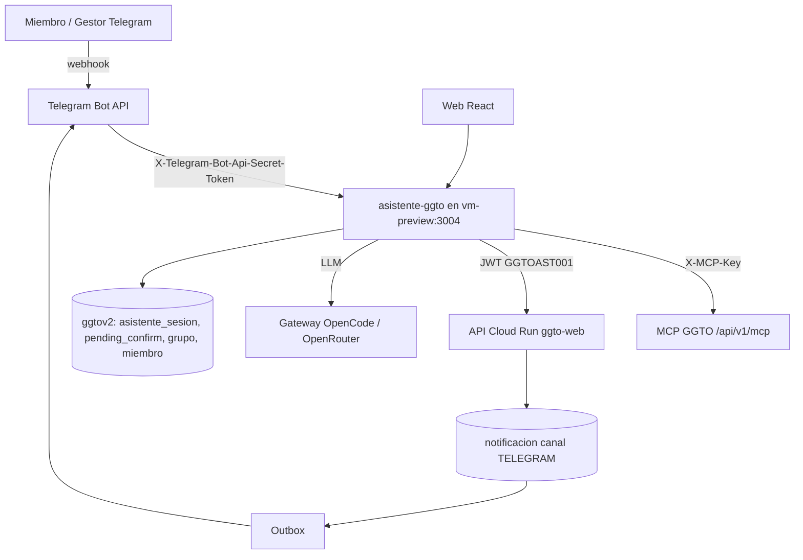

# Documento técnico v2 — Asistente con IA en grupo de Telegram

> Versión 0.1 · 2026-11-26 · Basado en `requerimientos_v2_telegram_grupo.md`,
> `casos_uso_telegram_grupo_v2.md` (APTO en re-auditoría),
> `INFORME_OPTIMIZACION_V4.md` y DEC-TG-01…17. Auditoría: APTO con correcciones aplicadas.

## 1. Visión y alcance

Convertir el grupo de Telegram **GGTOv3-PDE** (`chat_id -5561202916`) en un canal de interacción con GGTO mediante el bot **GGTOv2Testbot** (`bot_id 9052843256`). Tres capacidades:

1. **Consulta** de un caso por `id_averia` o `id_pago` 70* (cualquier miembro).
2. **Actualización** de información/estatus por indicador, con vista previa y `/confirmar <id_pending>` (solo roles de gestión; TECNICO conserva D-68).
3. **Alertas** del sistema publicadas por el bot como un miembro más, vía `notificacion.canal=TELEGRAM`.

**Alcance de esta versión:** grupo + web (DEC-TG-11). La APK queda para un ciclo posterior con RF/RT propios. Las respuestas y alertas contienen **solo referencias** (DEC-TG-05).

Fuera de alcance: alta de casos por Telegram, PII completa, múltiples grupos, conmutación del webhook (riesgo aceptado DEC-TG-04).

## 2. Arquitectura

| Componente | Responsabilidad |
|---|---|
| `asistente-ggto` | Motor único: extrae ficha, resuelve consultas con MCP/API, gestiona pendientes, publica respuestas. Reutilizado por grupo y web. |
| MCP de GGTO | **Consulta:** `estado_central`, `consultar_caso`. **Operación (no invocable en el turno de consulta):** `reportar_falla`, `procesar_notificaciones`. |
| API GGTO | Escrituras canónicas: `PATCH /casos/{id}`, `POST /casos/{id}/estado` (incluye DIFERIDO), `POST /casos/{id}/cita`, `POST /casos/{id}/cierre`, `POST /casos/{id}/enrutado`. |
| `notificacion` + outbox | Cola de alertas al grupo; reintentos y estado terminal. |
| PostgreSQL `ggtov2` | Sesiones, miembros, grupos, pendientes y auditoría. |

## 3. Modelo de datos (nuevo / extendido)

| Entidad | Cambio |
|---|---|
| `asistente_grupo` | Nueva: `chat_id=-5561202916`, `titulo=GGTOv3-PDE`, `id_central`, `politica_pii=REFERENCIAS`, `eventos_config` jsonb validado contra catálogo. |
| `asistente_grupo_miembro` | Nueva y **única fuente de autorización**: `telegram_user_id` (`from.id`), `p00` propio (nunca `GGTOAST001`), `rol`, `puede_actualizar`, `activo`. |
| `asistente_pending_confirm` | Nueva: `id_pending` (serial), `estado`, `expira_en`, `solicitado_por`, `confirmado_por`, `id_mensaje_preview`; índice único **parcial** `(id_grupo, telegram_user_id) WHERE estado='PENDIENTE'`. |
| `asistente_sesion` | Extensión: `canal=TELEGRAM_GRUPO`, `id_grupo`, `mensaje_id`, `from.id`, `resultado`. |
| `asistente_remitente` | Queda solo como registro histórico del chat privado; deja de autorizar. |
| `notificacion` | Sin cambios de esquema; `canal=TELEGRAM`, `destinatario=chat.id`, `asunto=tipo_evento`. |

## 4. Trazabilidad componente ↔ CU ↔ RF

| Componente | CU | RF | RNF | RT |
|---|---|---|---|---|
| Webhook + dedupe | CU-TG-01 | RF-TG-01 | RNF-TG-01/03/04/05/07 | RT-TG-01/02 |
| MCP + JWT servicio | CU-TG-01/02 | RF-TG-01/02 | RNF-TG-01/06 | RT-TG-03 |
| `asistente_pending_confirm` | CU-TG-02 | RF-TG-02 | RNF-TG-03/04/06/07 | RT-TG-02/04 |
| `notificacion` + outbox | CU-TG-03 | RF-TG-03 | RNF-TG-02/03/04 | RT-TG-04 |
| Motor web | CU-TG-04 | RF-TG-04 | RNF-TG-01/02 | RT-TG-05 |
| `asistente_grupo_miembro` | CU-TG-05 | RF-TG-05 | RNF-TG-06 | RT-TG-02/04 |
| `eventos_config` / `politica_pii` | CU-TG-06 | RF-TG-03/05 | RNF-TG-02 | RT-TG-04 |

## 5. Entornos y despliegue

| Dato | Valor |
|---|---|
| Proyecto GCP | `ggto-prod-txblvento2` (nº 695669822281), región `europe-west1` |
| API/web | `https://ggto-web-695669822281.europe-west1.run.app` |
| BD | PostgreSQL 16.15 en `vm-databases` (`10.140.0.2:5432`), base `ggtov2`, vía VPC `ggto-connector` |
| Motor asistente | vm-preview `http://100.113.94.52:3004` · **runtime Node.js 22** (`node:22-alpine`), convive con FastAPI en Cloud Run |
| Proveedor/modelo IA | `opencode` · `nvidia/nemotron-3.5-super-vl-120b-a12b` (DEC-TG-14, verificado en `/health`) |
| Webhook | `https://vm-preview.tailb951ba.ts.net/telegram` |
| Secretos | `ggto-telegram-bot-token`, `ggto-telegram-webhook-secret` (Secret Manager, `plataforma-txbarlovento`) |
| Usuario de servicio | `GGTOAST001` (SUPERVISOR, central 1), cuenta activada 26/11/2026 |
| Rama | `feature/tg-grupo-ia` desde `GGTOv2-DSH-GCP`; sin push sin `/push` |

## 6. Riesgos y decisiones pendientes (de V4)

| Riesgo | Estado | Responsable / Fase de cierre |
|---|---|---|
| H-09 credenciales del outbox en la app | Abierto: el secreto está en otro proyecto GCP | Director de proyecto / Fase 3 |
| H-11 audiencia de respuestas en el grupo | Abierto: solo referencias, audiencia no restringida | SUPER (gobierno) / Fase 3 |
| H-12 DPA/retención/responsable de datos | Abierto: requiere CANTV y dirección | Dirección + CANTV / antes de datos reales |
| H-17 plantilla de mensaje (longitud/cabecera) | Abierto | Analista funcional / Fase 3 |
| H-20 identificador único del modelo LLM | **Resuelto** (DEC-TG-14: `nvidia/nemotron-3.5-super-vl-120b-a12b`, proveedor `opencode`, verificado en `/health` vivo) | Director de proyecto |
| H-21 SLO p95 del turno | Abierto: proponer ≤5 s con LLM | Dirección de proyecto / Fase 3 |
| H-22/H-23 Funnel y rotación `setWebhook` | Riesgo aceptado / runbook pendiente | Operaciones / Fase 3 |
| H-25 monitoreo en proyecto vigente | Abierto | Operaciones / Fase 3 |
| H-26 permisos del chat admin `8589760242` | Abierto | SUPER / Fase 3 |
| H-27 auditoría del canal sin responsable | Abierto | SUPER en solo lectura / tabla de gobierno de `requerimientos.md` §5.3 |
| H-28 dueño funcional del bot | Abierto (nombramiento organizativo, no testeable en CU) | Dirección / Fase 3 |
| H-31 privacy mode del bot | Abierto: `/setprivacy Disabled` o exigir @mención | Operaciones / Fase 3 |
| H-13/H-14/H-18/H-19/H-24 | Corregidos en documentación | — |

**DEC-TG-14:** el proveedor/modelo vigente es el verificado en el despliegue vivo (`proveedor=opencode`, `modelo=nvidia/nemotron-3.5-super-vl-120b-a12b`); OpenRouter queda como alternativo. **DEC-TG-15:** la cabecera inválida da **403** y la falta de credenciales internas da **503**. **DEC-TG-16:** la pendiente usa índice único parcial `WHERE estado='PENDIENTE'`. **DEC-TG-17:** el runtime del motor es Node.js 22 (Dockerfile `node:22-alpine`), conviviendo con FastAPI en Cloud Run.

## 7. Criterios de aceptación para Fase 3

1. `GET /health` del motor con `proveedor=opencode`, `modelo=nvidia/nemotron-3.5-super-vl-120b-a12b`, `mcp`, `telegram` en `configurado`.
2. Webhook: sin `X-Telegram-Bot-Api-Secret-Token` o inválida → **403** sin invocar MCP; con cabecera válida → 200 y sin duplicados por `update_id`; credenciales internas ausentes → **503** con aviso.
3. Consulta de caso devuelve solo los cuatro campos permitidos; falla si aparece nombre/teléfono/dirección.
4. `/confirmar <id_pending>` persistido con índice parcial: TTL, identidad del confirmador y rechazo de terceros con 403.
5. Alertas encoladas en `notificacion.canal=TELEGRAM` y publicadas con plantilla de referencias.
6. Cuota: 30/min y 500/día por grupo y por usuario → 429 con `retryAfterMs`; recinto por central → 403; 503 del LLM → aviso al grupo y conservación de pendiente.
7. `node --test` del motor en verde y `npm run build` de la web sin errores.
8. Sin secretos en el repositorio (verificación con `rg` sobre nombres de secreto).
