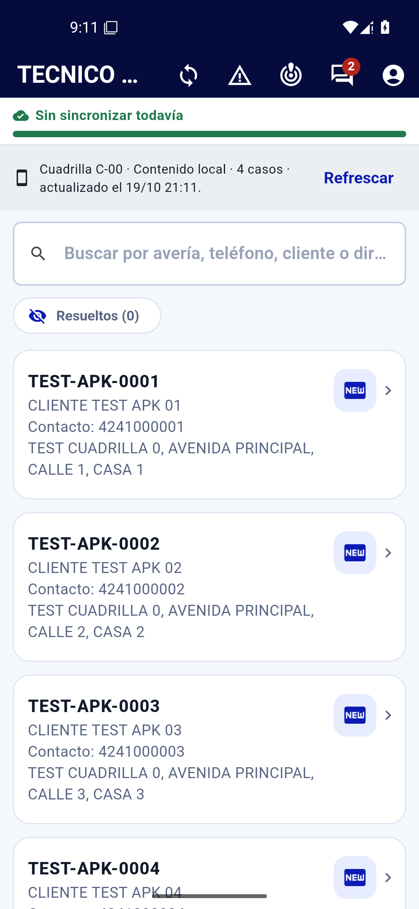
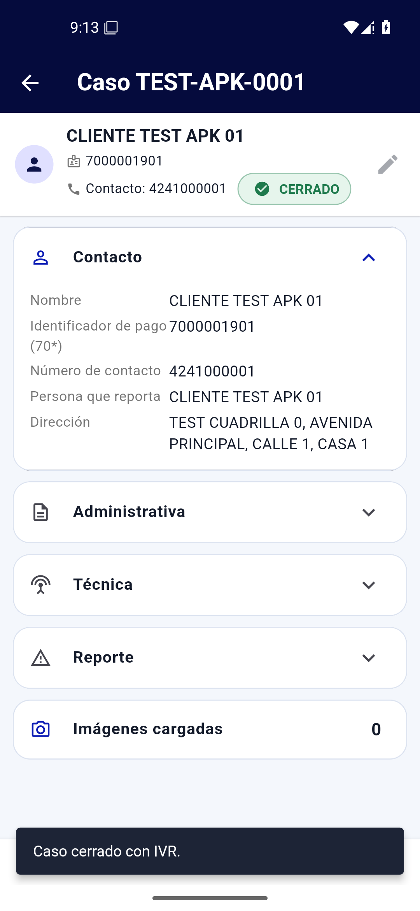
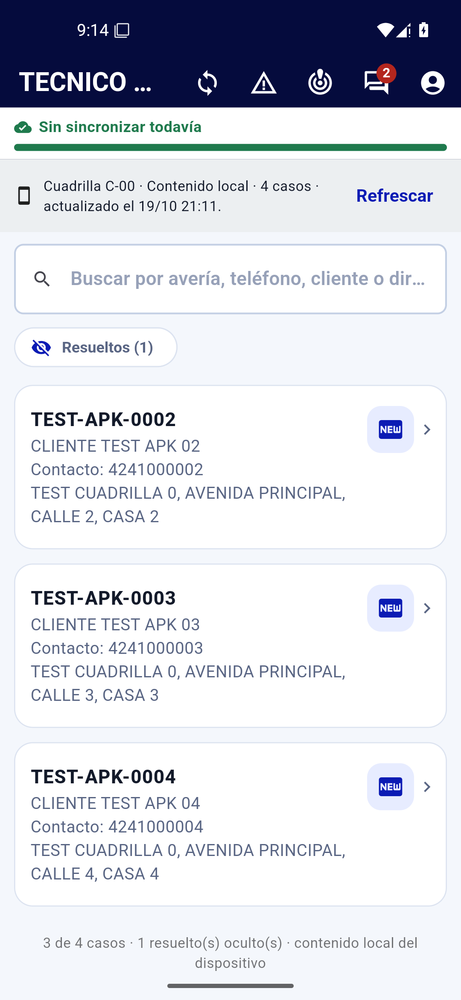

# Incremento D-119 — La APK ya muestra el despacho después de sincronizar

| Campo | Valor |
|---|---|
| Petición | 1) «Después de sincronizar no muestra los casos del despacho» · 2) simular 4 casos nuevos y generar un despacho a la cuadrilla 0 para poder cerrarlos desde la APK |
| Fecha | 2026-10-19 |
| Alcance | Backend (`/sync/descarga`) + APK (purga del dispositivo) · APK **`1.14.1+24`** publicada · despliegue **v51** · sembrado de 4 casos TEST en la cuadrilla 0 |
| Autor | Dirección del proyecto |

---

## 1. El defecto reportado

La APK **descargaba** los casos del despacho del día (el servidor los enviaba) y,
justo después, la **purga del dispositivo los borraba en la misma
sincronización**. El técnico veía «N nuevos» en el resumen y el listado quedaba
vacío: «no muestra los casos del despacho».

### 1.1 Evidencia (producción, mismo día del reporte)

`sync_log` de la cuenta **153806** (técnico de la cuadrilla 0, `C-00`) el
2026-10-19, cada sesión con el servidor entregando casos y el listado sin nada:

| `id_sync_log` | hora (UTC) | APK | recibidos | resultado en el teléfono |
|---:|---|---|---:|---|
| 380 | 17:12:23 | 1.13.0+22 | 3 | listado vacío |
| 385 | 17:12:51 | 1.13.0+22 | 6 | listado vacío |
| 392 | 17:15:33 | 1.13.0+22 | 6 | listado vacío |
| 421 | 18:02:34 | 1.13.0+22 | 7 | listado vacío |
| 435 | 19:51:29 | **1.14.0+23** | 6 | listado vacío |
| 437 | 19:54:21 | **1.14.0+23** | 6 | listado vacío |

El patrón se repetía en **todas** las cuadrillas (`142918` y `143167` recibían
43 casos en cada pasada y el listado seguía vacío): no era un problema del
técnico ni de su teléfono.

Los tres despachos de ese día estaban en **`BORRADOR`** (`#110` cuadrilla 1,
`#111` cuadrilla 8, `#112` cuadrilla 12): el supervisor los había procesado a las
17:59 UTC y todavía no los había publicado.

### 1.2 Causa raíz (dos reglas que se contradecían)

1. **El servidor** (`app/services/sync.py`) calculaba `ids_del_dia` —los casos
   que la APK debe conservar siempre— solo si la cuadrilla tenía un despacho en
   estado `PUBLICADO` o `CERRADO`. Un despacho recién procesado (`BORRADOR`)
   dejaba `despacho_del_dia = null` e `ids_del_dia = []`.
2. **La APK** (`download_service.dart` + `purga_despachos.dart`) ejecuta la purga
   en cuanto el servidor resuelve una cuadrilla de campo (D-115), conservando
   solo lo que viene en `ids_del_dia`, lo ya gestionado y el trabajo sin enviar.
   Con `ids_del_dia` vacío, **todo lo recién descargado era «no atendido»** y se
   borraba.

Eran dos decisiones correctas por separado —D-105 («un borrador no es la
jornada») y D-115 («la actualización purga lo viejo»)— que juntas producían el
bucle *descargar → borrar* en cada sincronización.

---

## 2. Corrección

### 2.1 Backend — el despacho del día cuenta en cualquier estado

`app/services/sync.py`:

```python
ESTADOS_JORNADA_DIA = ("BORRADOR", "PUBLICADO", "CERRADO")
```

`_despacho_del_dia` usa esa tupla: el despacho que el supervisor acaba de
procesar **es** la jornada del técnico, aunque no esté publicado. `ids_del_dia`
vuelve a viajar con sus casos y la purga los conserva.

### 2.2 Backend — nuevo `ids_vigentes` en la descarga

`GET /sync/descarga` añade **`ids_vigentes`**: **todo** el trabajo que el servidor
reconoce a la cuadrilla (casos no terminales cuyo último despacho es suyo), esté
o no en el despacho de hoy. Sirve para que el diferencial y la purga no se peleen:
un caso de una jornada anterior que el servidor sigue enviando ya no se borra en
cada pasada.

- `app/schemas/sync.py`: `SyncDescargaOut.ids_vigentes: list[int]`.
- Retrocompatible: una APK anterior ignora el campo.

### 2.3 APK — la purga no borra lo que el servidor entrega

`app_movil/lib/features/sync/purga_despachos.dart`:

- `planificar(..., idsVigentes, idsDescargados)`: se conservan además los ids que
  el servidor declara vigentes y **los que acaban de llegar en esta descarga**.
- `ejecutar(idsDelDia, idsVigentes, idsDescargados)`.

`app_movil/lib/features/sync/download_service.dart` lee `ids_vigentes` y acumula
los `id_caso` de los casos recibidos; ambos conjuntos viajan a la purga.

Con esto, **ninguna descarga puede borrar lo que ella misma acaba de entregar**,
que es la garantía que faltaba (y que también arregla el caso del despacho de
ayer que el servidor sigue enviando).

**DEC-119-1.** El borrador del día es la jornada del técnico para la APK.
**DEC-119-2.** La purga del dispositivo conserva: el despacho del día, lo vigente
del servidor, lo recién descargado, lo gestionado y el trabajo sin enviar. Solo
borra lo que ya no es del técnico.
**DEC-119-3.** El sembrado de prueba (4 casos `TEST-APK-*`) queda **en
producción** a la cuadrilla 0 para la prueba de cierre desde el teléfono; se
reconoce por el prefijo y se puede depurar con los filtros de siempre.

---

## 3. Los 4 casos nuevos y el despacho a la cuadrilla 0

Script nuevo **`RepoTecnico/pruebas/sembrar_cuadrilla0_apk.py`** (idempotente,
simulación por defecto):

```bash
python RepoTecnico/pruebas/sembrar_cuadrilla0_apk.py --p00 … --clave …            # simulación
python RepoTecnico/pruebas/sembrar_cuadrilla0_apk.py --p00 … --clave … --aplicar  # crea y despacha
```

Crea por **alta manual** los casos `TEST-APK-0001…0004` (REPARACIÓN ·
`SIN_SERVICIO`, identificador de pago `7000001901…1904`, contacto y dirección
`TEST CUADRILLA 0 …`, con la marca **TEST** en nombre, dirección e información) y
los asigna al despacho **del día de la cuadrilla 0** (`C-00`, la del supervisor)
con `POST /despachos/asignar-casos`.

Resultado en producción (2026-10-19):

| Dato | Valor |
|---|---|
| Casos creados | `#465 TEST-APK-0001` · `#466 TEST-APK-0002` · `#467 TEST-APK-0003` · `#468 TEST-APK-0004` |
| Despacho | `#110` · `2026-10-19` · cuadrilla `C-00` · **`BORRADOR`** |
| Casos del despacho | **8** (los 4 nuevos + `#358`, `#377`, `#393`, `#425` que ya tenía) |
| Estado de los nuevos | `NUEVO` |

---

## 4. Verificación

### 4.1 Pruebas automáticas

| Comprobación | Resultado |
|---|---|
| Backend `pytest` (suite completa, esquema aislado) | **426/426 en verde** (425 + el caso de `ids_vigentes`) |
| APK `flutter test` | **212/212 en verde** (209 + 3 de la purga D-119) |
| APK `flutter analyze` | **No issues found!** |
| Backend `ruff` / `mypy` | Sin hallazgos nuevos en los archivos tocados (los 6 avisos de `ruff` y 2 de `mypy` son previos, en archivos ajenos al incremento) |

Pruebas nuevas del backend (`app/tests/test_sync_api.py`):

- `test_un_despacho_en_borrador_es_la_jornada_del_dia`: `despacho_del_dia`,
  `ids_del_dia` e `ids_vigentes` incluyen el caso del borrador.
- `test_ids_vigentes_lleva_todo_el_trabajo_de_la_cuadrilla`: lo de una jornada
  anterior sigue vigente y no entra en `ids_del_dia`.
- Se ajustaron `test_sin_despacho_de_hoy…` y `test_descarga_informa_la_jornada_del_dia`.

Pruebas nuevas de la APK (`app_movil/test/d104_purga_despachos_test.dart`, grupo
D-119): conserva lo vigente, conserva lo recién descargado con el despacho en
borrador, y sigue borrando lo ajeno cuando el servidor no lo respalda.

### 4.2 Payload real de producción (cuadrilla 0)

Leído con la sesión del Super Usuario y su ficha dada de alta **temporalmente** en
la cuadrilla 0 (dada de baja al terminar), es exactamente lo que recibe la APK:

| Campo | Antes del arreglo | Después del arreglo |
|---|---|---|
| `despacho_del_dia` | `null` | `{"id_despacho": 110, "fecha": "2026-10-19"}` |
| `ids_del_dia` | `[]` | `[358, 377, 393, 425, 465, 466, 467, 468]` |
| `ids_vigentes` | *(no existía)* | `[353, 358, 361, 377, 393, 425, 465, 466, 467, 468]` |
| `casos` enviados | 6 | **10** |

Con la regla anterior, la APK conservaba **0** casos de los 6 enviados. Con la
nueva, conserva los 8 del día (y 10 con la APK 1.14.1+24).

### 4.3 La APK real en un emulador Android 15

Entorno aislado (PostgreSQL local + backend del repositorio + los mismos 4 casos y
el mismo despacho en `BORRADOR` para la cuadrilla 0), APK **1.14.1+24** instalada
en el emulador y sesión de un técnico de la cuadrilla 0:

1. **Sincronizar** → `CONEXION · LOGIN · DESCARGA` en **OK**.
2. Listado: «**Cuadrilla C-00 · Contenido local · 4 casos**» con los cuatro
   `TEST-APK-0001…0004` (`NUEVO`, con contacto y dirección).
   
3. Ficha → **Contactado** → **Atender** → **Cerrar** con IVR y descripción:
   «Caso cerrado con IVR.», chip **CERRADO**.
   
4. **Segunda sincronización** (la regresión original): los 3 pendientes siguen en
   el listado y el cerrado pasa a «Resueltos (1)».
   

En el servidor, el cierre quedó registrado con su bitácora
(`NUEVO → CONTACTADO → CERRADO`, motivo «Cierre con IVR», usuario del técnico).

### 4.4 Despliegue y entrega

| Elemento | Valor |
|---|---|
| Imagen | `…/truekeate-repo/ggto-web:v51` |
| Revisión | **`ggto-web-00064-54m`**, 100 % del tráfico |
| Humo en vivo | `/health` 200 · `/ready` 200 (43 tablas) · `/apk/apk.json` 200 |
| Contrato desplegado | `/openapi.json` incluye `SyncDescargaOut.ids_vigentes` |
| APK publicada | **`1.14.1+24`** · 25 068 555 bytes · SHA-256 `dfe6952a4d48e0535d262da333cb95534014bd3a3418d5d850ede7f4d4077c1a` |
| Descarga | `/apk/ggto-tecnico.apk` (la sirve el mismo servicio; el aviso de actualización de la app la ofrece sola) |

---

## 5. Cambios por archivo

| Archivo | Cambio |
|---|---|
| `app/services/sync.py` | `ESTADOS_JORNADA_DIA` con `BORRADOR`; `ids_vigentes` en la respuesta. |
| `app/schemas/sync.py` | `SyncDescargaOut.ids_vigentes`. |
| `app/tests/test_sync_api.py` | Prueba del borrador como jornada, prueba de `ids_vigentes`, ajustes de las existentes. |
| `app_movil/lib/features/sync/purga_despachos.dart` | `planificar`/`ejecutar` conservan `idsVigentes` e `idsDescargados`. |
| `app_movil/lib/features/sync/download_service.dart` | Lee `ids_vigentes` y acumula los `id_caso` recibidos. |
| `app_movil/test/d104_purga_despachos_test.dart` | Grupo D-119 (3 pruebas). |
| `app_movil/pubspec.yaml`, `app_movil/lib/core/constants.dart` | Versión **1.14.1+24**. |
| `RepoTecnico/pruebas/sembrar_cuadrilla0_apk.py` | **Nuevo**: los 4 casos y su despacho a la cuadrilla 0. |
| `docs/imagenes/apk_d119/*.png` | Capturas de la verificación en el emulador. |

---

## 6. Para probarlo en el teléfono

1. Instalar la APK **1.14.1+24** (la app la ofrece en la franja de actualización
   o se descarga de `/apk/ggto-tecnico.apk`).
2. Entrar con la cuenta de la **cuadrilla 0** y abrir **Sincronizar → SINCRONIZAR**.
3. El listado debe mostrar los cuatro `TEST-APK-0001…0004` (además de los casos
   propios de la cuadrilla), y cada uno se cierra con **Contactado → Atender →
   Cerrar** (IVR, COS o SACAS).
4. Al volver a sincronizar, los pendientes **siguen ahí**.

### Notas de estado

- El **Super Usuario** (`123456`) quedó con una pertenencia a la cuadrilla 0
  cerrada con fecha **hoy** (la que se usó para leer el payload real): el sistema
  la considera vigente hasta el final del día y mañana deja de aplicar. No se
  tocó la cuenta del técnico 153806 ni la de ningún técnico de campo.
- Los casos `TEST-APK-*` llevan la marca **TEST** en `id_averia`, nombre,
  dirección e información; se localizan con el buscador (`TEST-APK`) y se pueden
  depurar con el patrón de siempre.
- Queda pendiente regenerar los manuales HTML/PDF (los `.md` de este incremento
  son los únicos nuevos).
