# Propuesta de interfaz para la APK — GGTO Técnico · CANTV

| Campo | Valor |
|---|---|
| Producto | **GGTO Técnico** (`app_movil`, Flutter 3.24 · Dart 3.5 · APK `1.4.0+13`) |
| Cliente | CANTV C.A. — Central **Francisco Salias (Área 4)** |
| Alcance | Interfaz de la aplicación Android: arranque, acceso, trabajo de campo y pantallas de gestión |
| Insumo | Imagen de referencia `autogestion-barra-azul-turquesa-2-min.jpg` + logotipo institucional `docs/imagenes/CANTV_logo.svg` |
| Base | Sistema de diseño ya aplicado a la web (`docs/propuesta-visual/propuesta-visual-UIUX.md`) |
| Estado | **Propuesta para revisión de la Dirección** — no modifica todavía el código de la app |
| Fecha | 12 de octubre de 2026 |

---

## 0. Resumen ejecutivo

La APK es el producto que **más horas usa un trabajador de CANTV**: el técnico la lleva al poste,
con una mano, al sol y, muchas veces, sin señal. Hoy su interfaz es funcional y honesta, pero tiene
tres problemas medibles:

1. **Contraste:** 3 de los 10 colores de estado del listado **incumplen RNF-APK-05** (4,5:1) y 4 más
   quedan en el límite. `Colors.orange` sobre blanco da **2,16:1**.
2. **Navegación:** la barra inferior ya llega a **5 destinos** y, en cuanto el Coordinador reciba
   «Gestión», serán **7** — por debajo de 48 dp de ancho cada uno.
3. **Marca ausente:** el lanzador muestra todavía el **icono por defecto de Flutter**, el arranque es
   una **pantalla blanca** y el único vestigio del logotipo es un WebP de 96 px sobre una tarjeta blanca.

La propuesta traduce a **Material 3** el sistema de marca CANTV ya aplicado a la web (degradado
medido azul eléctrico → violeta → magenta, trama de puntos, logotipo monocromo blanco) y resuelve los
tres problemas con reglas concretas, no con un cambio de color por gusto.

**Lo que ya está hecho y es verificable en esta carpeta**

- **Icono adaptativo, arranque (Android 12+) y banda de acceso** construidos desde el SVG oficial,
  en SVG editable y en WebP listo para `app_movil/assets/marca/` (≈ 62 KB en total).
- **7 pantallas maquetadas a 412 × 915 dp** sobre el sistema real (acceso, mis casos, ficha,
  evidencias, sincronización, inicio de gestión y hoja «Más»).
- **Contraste medido** de los 10 estados actuales frente a los 10 propuestos (`scripts/contraste_apk.py`).
- **Código Flutter listo para pegar** (§6): tema Material 3, barra de aplicación de marca, estado
  accesible, aviso de conexión y navegación de 5 destinos.

---

## 1. Análisis de la APK actual

### 1.1 Tema y estructura

`lib/core/theme.dart:3-26` define un `ThemeData` de **Material 2** (swatch) con un único color
(`#1565C0`), `scaffoldBackgroundColor` `#F5F5F5` y error `#D32F2F`. No hay tokens de marca, ni escala
tipográfica, ni radios, ni tema de tarjetas ni de `NavigationBar` — aunque la app **ya usa widgets de
Material 3** (`NavigationBar` en `inicio_gestion_screen.dart:55`).

| Aspecto | Hoy |
|---|---|
| Color primario | `#1565C0` (azul Material, ajeno a la imagen de referencia) |
| Superficies | Blanco + `#F5F5F5`, sin jerarquía de elevación |
| Tipografía | Sin `textTheme`; tamaños sueltos de 11 a 22 sp |
| Radios | Por defecto de Material (4 dp en tarjetas) |
| Marca | `assets/logo_CANTV.webp` a 96 px en el acceso (`login_screen.dart:116-117`); sin arranque ni icono |

### 1.2 Mapa de navegación por rol (`main.dart:118-158`)

| Rol | Entrada | Barra inferior | Acciones en la barra de título |
|---|---|---|---|
| TECNICO | `CasosScreen` | — | **5** (`casos_screen.dart:97, 106, 112, 121, 164`) |
| SUPERVISOR / ADMIN / SUPER | `InicioGestionScreen` | 5 (Monitoreo · Especiales · Gestión · Casos · Despacho) | — |
| COORDINADOR | `InicioGestionScreen` | 4 (Monitoreo · Especiales · Alertas · Mensajes) | — |

### 1.3 Hallazgos

| # | Hallazgo | Evidencia | Impacto |
|---|---|---|---|
| **H-A1** | **Colores de estado que no cumplen RNF-APK-05.** `Colors.orange` 2,16:1 · `Colors.green` 2,78:1 · `Colors.grey` 2,68:1; `blue` 3,12:1, `red` 3,68:1, `teal` 3,67:1 y `blueGrey` 4,37:1 por debajo de 4,5:1 | `estado_icono.dart:20-39` + `scripts/contraste_apk.py` | **Alto**: el estado del caso no se lee al sol; incumple un RNF aprobado |
| **H-A2** | **Barra inferior al límite.** 5 destinos hoy; 7 si el Coordinador recibe Gestión y Casos | `inicio_gestion_screen.dart:55-100` | **Alto**: etiquetas ilegibles en equipos de 360 dp |
| **H-A3** | **5 acciones en la barra de título del técnico** (sync, alertas, masivas, mensajes, usuario), todas fuera del alcance del pulgar y sin texto | `casos_screen.dart:96-165` | **Medio-alto**: errores de pulsación con guantes |
| **H-A4** | **El aviso de «sin conexión» a sangre (`Colors.red`) es un widget huérfano**: `OfflineBanner` no está importado en ninguna pantalla, así que el rojo no llega a verse. El mensaje real de red vive en la franja de sincronización, con texto de 11 sp | `offline_banner.dart:23` (sin importadores) · `barra_progreso_sync.dart:110` | **Bajo** (latente): si se monta tal cual, el estado normal del campo se leería como falla |
| **H-A5** | **La barra de sincronización usa 11 sp** (texto bajo el mínimo de 16 sp de RNF-APK-05) y una barra de 5 px difícil de ver | `barra_progreso_sync.dart:48, 71, 111` | **Medio**: el técnico no sabe si su trabajo se envió |
| **H-A6** | **Sin identidad de marca ni icono propio**: el lanzador muestra todavía el **icono por defecto de Flutter**, no existe icono adaptativo (`mipmap-anydpi-v26/`) y el arranque es una **pantalla blanca** (`LaunchTheme` con `windowBackground = @android:color/white` sobre el tema `Theme.Black.NoTitleBar`), sin carpeta `values-v31/` | `mipmap-*/ic_launcher.png` · `values/styles.xml:4-6` · ausencia de `drawable/launch_background.xml` y `values-v31/` | **Medio-alto**: en el parque de equipos la app no se distingue de cualquier otra |
| **H-A7** | **Tarjetas de caso densas**: identificador a 16 px en negrita, pero el detalle a **13 sp** con cinco líneas seguidas | `caso_card.dart:32-59` | **Medio**: fatiga de lectura y filas muy altas |
| **H-A8** | **Estado solo con icono (D-101)**, sin etiqueta visible en el listado, y el icono mide 22 dp sobre fondo blanco | `caso_card.dart:51-54` | **Bajo-medio**: se apoya en el `Tooltip`/`semanticsLabel`; funciona con lectores, no a simple vista |

> **Nota de respeto a las decisiones vigentes:** D-101 (estado por icono en el listado) y D-100 (PIN
> local) **se mantienen**, y hay pruebas que las fijan. La propuesta no las revierte: hace el icono
> legible al sol (H-A1), le da 24 dp sobre una pastilla de color claro y limita el rótulo textual a la
> ficha, donde ya existe. Nada de esto cambia la semántica que verifican esas pruebas.
>
> **Corrección tras aplicar la propuesta:** el «banner rojo» de H-A4 resultó ser **código huérfano**
> (`OfflineBanner` no se monta en ninguna pantalla). El aviso de red que el técnico ve hoy es el texto
> de 11 sp de la franja de sincronización. La propuesta se aplicó igual —dejarlo listo y accesible para
> cuando se monte—, pero su severidad baja a **latente**.

---

## 2. Sistema de diseño móvil

```
+----------------------------------------------------------------------------------------+
|  TARGET: GGTO Técnico — APK Android (CANTV, Central Francisco Salias)                   |
+----------------------------------------------------------------------------------------+
|  PATRÓN: App de campo con dos modos de uso                                             |
|     Campo (TECNICO): lista -> ficha -> evidencia -> sync. Todo alcanzable con el pulgar |
|     Gestión: tablero -> detalle -> acción. Refresco automático cada 5 min (RNF-APK-01)  |
|     Navegación: barra inferior de 3-5 destinos + hoja «Más»                             |
|                                                                                        |
|  ESTILO: Material 3 + Gradient Mesh Corporativo (superficies de marca)                  |
|     Keywords: sólido, legible al sol, offline primero, una mano, Android nativo         |
|                                                                                        |
|  COLORES:                                                                              |
|     Primario:    #0B1BB4 (Azul GGTO)      botones, foco, navegación activa              |
|     Secundario:  #00B8C4 (Turquesa)       acento, insignias, datos «en vivo»            |
|     Especial:    #6A13A1 (Violeta)        cuadrilla 0 / supervisor / masivas            |
|     Marca:       #021FBE -> #7C12AF -> #C905A5 -> #E003A0 (degradado medido)            |
|     Fondo:       #F4F7FC   Superficie: #FFFFFF   Contenedor: #EEF3FD                    |
|     Texto:       #131A2A (16,2:1)   Texto suave: #5A6684 (5,7:1)                        |
|     Estados:     #0B1BB4 / #8A6100 / #6A13A1 / #B3261E / #1F7A4D / #5A6684              |
|                  cada uno sobre su fondo claro (todos >= 4,72:1)                        |
|                                                                                        |
|  TIPOGRAFÍA: Roboto (la del sistema Android, sin descargar nada)                        |
|     displaySmall 36/44 · headlineSmall 24/32 · titleLarge 22/28 (barra)                 |
|     titleMedium 16/24 · bodyLarge 16/24 (mínimo) · bodyMedium 14/20 · labelSmall 11.5    |
|                                                                                        |
|  MEDIDAS:                                                                              |
|     Objetivo táctil >= 48 dp con 8 dp de separación (RNF-APK-05)                        |
|     Radios: 16 dp tarjeta · 12 dp control · 8 dp campo · píldora para chips y botones    |
|     Barra inferior 80 dp · barra de aplicación 64 dp · campos 56-60 dp                  |
|     Micro-interacciones 150 ms; nada animado en bucle salvo la barra de progreso        |
|                                                                                        |
|  EFECTOS CLAVE:                                                                        |
|     Degradado de marca en arranque, acceso y cubiertas de KPI (CustomPaint, 0 KB)       |
|     Trama de puntos como acento en cubiertas e insignias                                |
|     Franja de sincronización pegada a la barra de título, siempre visible              |
|     Aviso de conexión con tinte claro (no rojo a sangre) y contador de cambios          |
|                                                                                        |
|  EVITAR (Anti-patrones):                                                               |
|     Rojo saturado para «sin conexión»: es el estado normal del técnico                  |
|     Colores de Material crudos como color de estado (no cumplen contraste)              |
|     Más de 5 destinos en la barra inferior; acciones críticas solo en la barra superior |
|     Texto < 16 sp en pantallas nuevas (RNF-APK-05)                                     |
|     Gestos de deslizamiento como única vía para acciones críticas (guantes, lluvia)     |
|     Emojis como iconos; añadir flutter_svg solo por estética                            |
|                                                                                        |
|  CHECKLIST PRE-ENTREGA:                                                                |
|     [x] Contraste >= 4.5:1 en los 10 estados (medido con script)                        |
|     [x] Objetivos >= 48 dp; chips >= 34 dp de alto                                      |
|     [x] Estado con icono + semanticsLabel + etiqueta en la ficha                        |
|     [x] Acción primaria en la zona del pulgar                                          |
|     [x] Texto >= 16 sp en cuerpo de pantallas nuevas                                    |
|     [x] Estados vacíos, de carga y de error definidos para cada lista                   |
|     [x] Sin dependencias nuevas: vectores rasterizados a WebP por densidad              |
|     [x] 0 KB de imágenes de fondo (degradado y trama dibujados)                          |
+----------------------------------------------------------------------------------------+
```

---

## 3. Activos de marca producidos

Todos derivan del **SVG institucional**. Flutter no dibuja SVG sin `flutter_svg`, así que los vectores
son la fuente y se **rasterizan a WebP por densidad** (mismo enfoque que el actual
`assets/logo_CANTV.webp`): cero dependencias nuevas.

### 3.1 Icono adaptativo

Hoy el lanzador muestra el icono por defecto de Flutter
([`recursos/actual-icono-app.png`](recursos/actual-icono-app.png)):

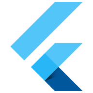

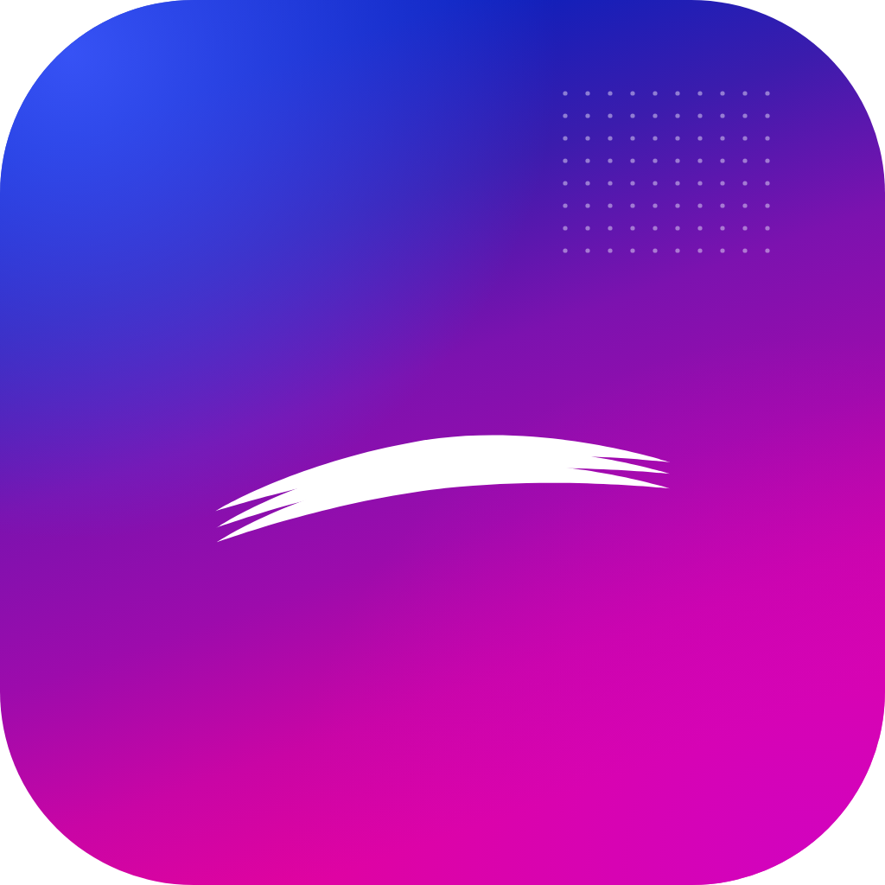

- [`assets/icono-app.svg`](assets/icono-app.svg) (vista compuesta) ·
  [`icono-app-fondo.svg`](assets/icono-app-fondo.svg) (fondo, degradado a sangre) ·
  [`icono-app-primer-plano.svg`](assets/icono-app-primer-plano.svg) (símbolo en la zona segura del 66 %)
- El símbolo es la **cinta de estrellas** del logotipo, no el lockup completo: a 48 dp el wordmark
  «cantv» es ilegible y ensucia el icono.
- Destino: `android/app/src/main/res/mipmap-*/` + `ic_launcher_foreground.xml` y
  `values/ic_launcher_background.xml`.

### 3.2 Arranque (Android 12+)

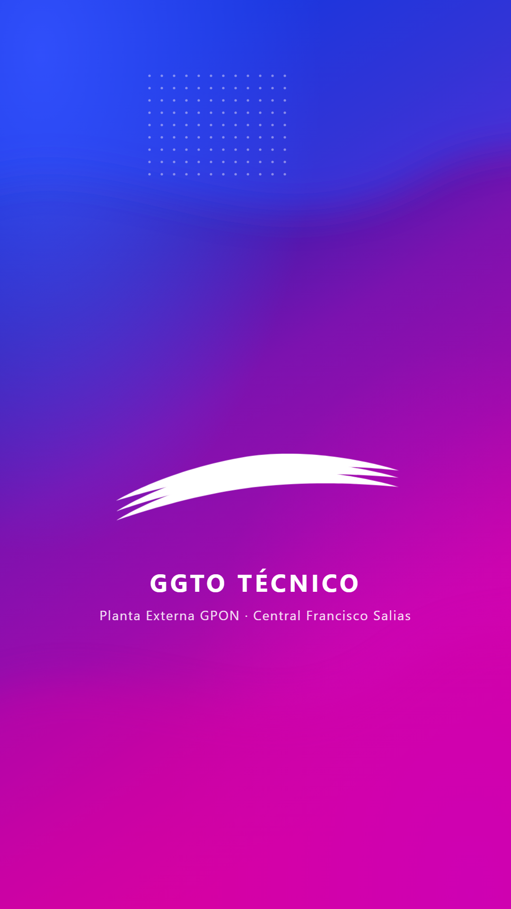

- [`assets/splash-nativo.svg`](assets/splash-nativo.svg) — símbolo centrado en la zona segura, nombre
  del producto y pie institucional.
- Destino: `android/app/src/main/res/drawable/splash_fondo.xml` (degradado) +
  `drawable/splash_simbolo.webp` + `values-v31/styles.xml` con `windowSplashScreenBackground`.

### 3.3 Banda de marca del acceso

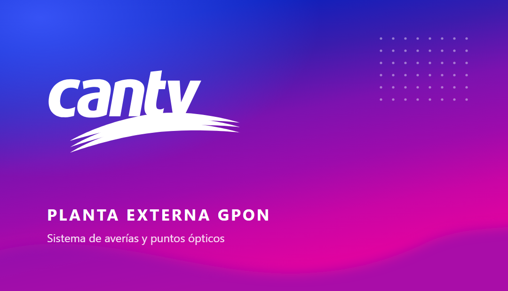

- [`assets/banda-acceso.svg`](assets/banda-acceso.svg) — sustituye al logo suelto sobre tarjeta blanca
  (`login_screen.dart:116-117`) y ya contiene el nombre del producto y el subtítulo.
- Es un `Image.asset` de ancho completo con el sheet blanco montado encima a 28 dp de radio.

### 3.4 Logotipo y trama

| Archivo | Uso |
|---|---|
| [`assets/cantv-logo-blanco.svg`](assets/cantv-logo-blanco.svg) | Lockup completo sobre superficies de marca (cabeceras, PDF de reportes, correos) |
| [`assets/cantv-logo-tinta.svg`](assets/cantv-logo-tinta.svg) | Lockup en una tinta sobre fondo claro |
| [`assets/simbolo-cantv.svg`](assets/simbolo-cantv.svg) | Solo la cinta de estrellas (icono, arranque, marca de agua) |
| [`assets/patron-trama.svg`](assets/patron-trama.svg) | Baldosa de 26 px de la trama de puntos |

---

## 4. Pantallas propuestas

Las siete pantallas están maquetadas a **412 × 915 dp** (equipo Android de referencia) y se pueden
recorrer en [`mockup/apk.html`](mockup/apk.html). El tablero completo está en
[`capturas/apk-tablero-pantallas.png`](capturas/apk-tablero-pantallas.png).

### 4.1 Acceso — `login_screen.dart`

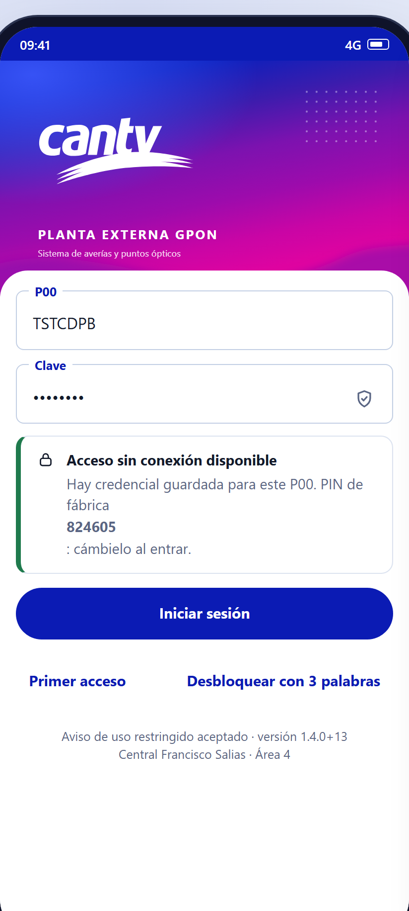

- Banda de marca con logotipo y nombre del producto; el formulario sube sobre una hoja blanca de 28 dp.
- Campos Material de 60 dp con etiqueta flotante y **sufijo de escudo** en la clave.
- El aviso de **PIN sin conexión** (D-100) deja de ser un bloque de texto y pasa a tarjeta con acción.
- Pie: aviso de uso restringido aceptado y **versión visible** (`1.4.0+13`), que ya verifica una prueba.

### 4.2 Mis casos (técnico) — `casos_screen.dart`

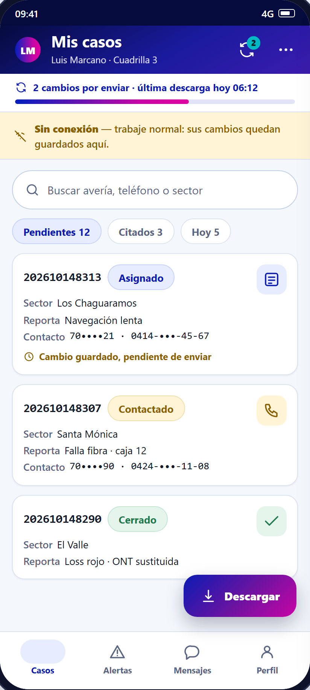

- **Barra de título de 2 acciones** (sincronizar con insignia y «más»): las otras tres bajan a la
  barra inferior, donde llega el pulgar.
- **Franja de sincronización** (RNF-APK-02/D-84) siempre visible bajo la barra: «2 cambios por enviar»
  con barra de progreso de marca.
- **Aviso de conexión en ámbar claro**: «Sin conexión — trabaje normal: sus cambios quedan guardados
  aquí». Reemplaza el rojo a sangre.
- Tarjetas con identificador a 16 sp, estado como chip con texto y color accesible, teléfonos y
  seriales **enmascarados** (`70••••21`).
- **FAB «Descargar»** en la zona del pulgar (D-84: abrir no sincroniza; el técnico decide).

### 4.3 Ficha del caso — `caso_detalle_screen.dart`

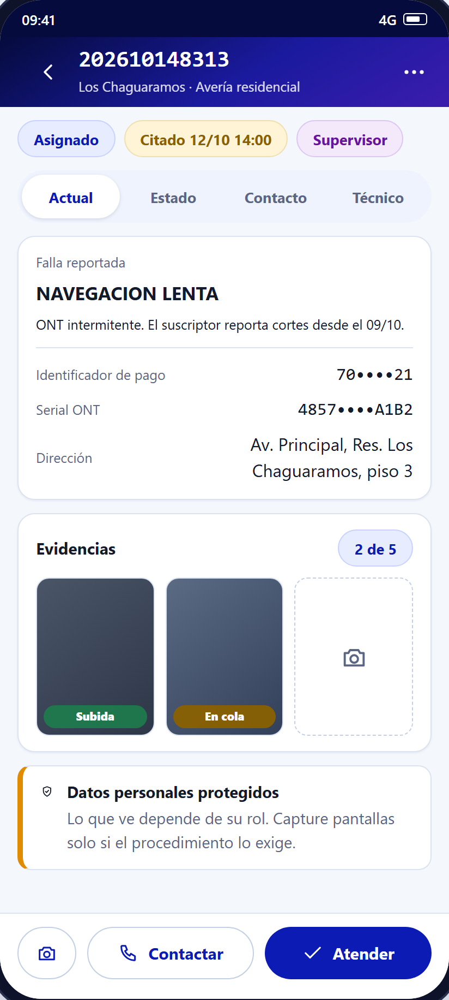

- Pestañas en formato segmentado (Actual · Estado · Contacto · Técnico).
- Datos sensibles enmascarados + aviso de protección de datos (RA-02/RNF-18).
- Bloque de evidencias con contador «2 de 5» (límite CANTV).
- **Barra de acciones al pie**: cámara, «Contactar» (contorno) y «Atender» (relleno).

### 4.4 Evidencias — `camara_screen.dart`

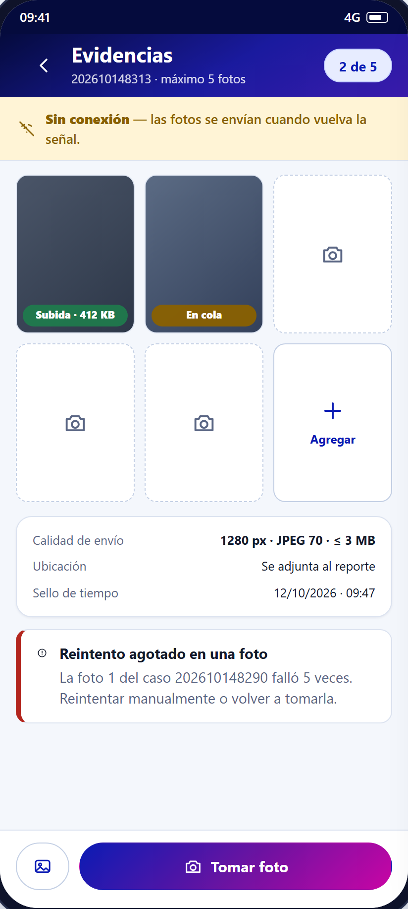

- Rejilla de 5 huecos con **estado por foto** (Subida · En cola · Error) y botón «Agregar».
- Resumen de la política vigente: 1280 px · JPEG 70 · ≤ 3 MB (`constants.dart`), ubicación y sello de
  tiempo.
- Aviso de **reintento agotado** citando el caso y el número de intentos (5, `maxIntentosSync`).

### 4.5 Sincronización — `sync_screen.dart`

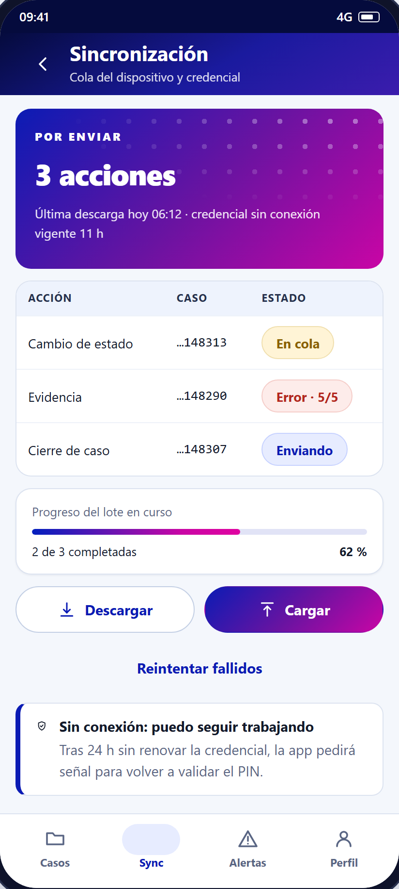

- Cubierta de marca con el total por enviar y la **vigencia de la credencial sin conexión** (24 h).
- Cola en tabla: acción, caso y estado, con el error identificado («Error · 5/5»).
- Descargar / Cargar diferenciados y «Reintentar fallidos» como acción terciaria.

### 4.6 Inicio de gestión — `inicio_gestion_screen.dart`

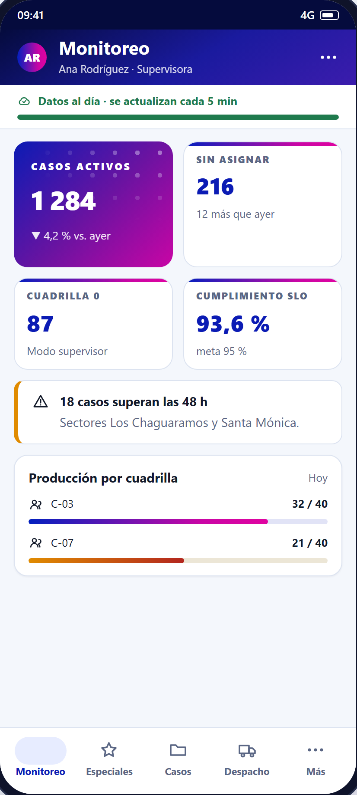

- **Barra inferior de 5** (Monitoreo · Especiales · Casos · Despacho · Más) con indicador de píldora.
- Cubierta de marca para el KPI principal + tres tarjetas con filete de degradado y cifras tabulares.
- Aviso operativo (18 casos > 48 h) antes de las tablas, no como notificación efímera.

### 4.7 Hoja «Más»

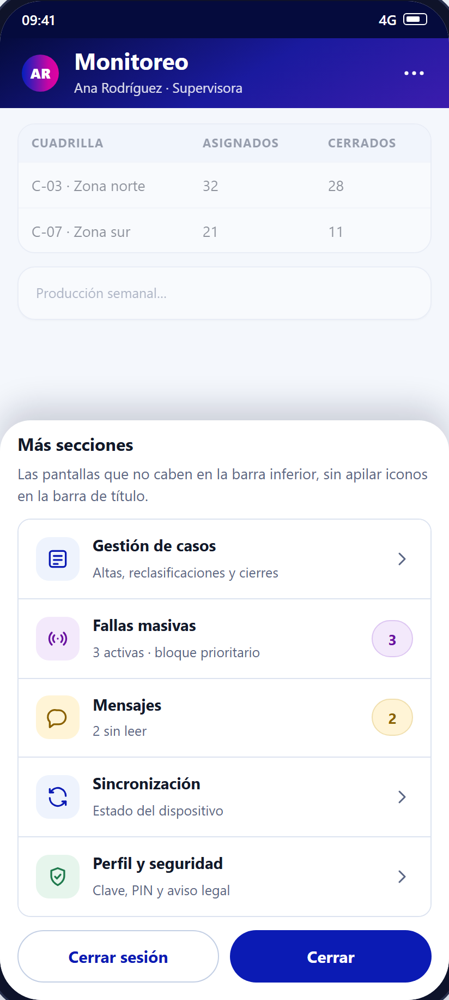

- Descarga la barra inferior sin esconder funciones: Gestión, Fallas masivas (con contador),
  Mensajes, Sincronización y Perfil.
- Cierre de sesión y «Cerrar» como acciones de la hoja.

---

## 5. Correcciones concretas

| # | Antes | Después | Archivo |
|---|---|---|---|
| H-A1 | `Colors.orange`, `Colors.green`, `Colors.grey`… como color de estado (2,16:1 – 6,87:1) | Paleta de 6 tintas con su fondo claro, **todas ≥ 4,72:1**, mismo icono (D-101 intacto) | `widgets/estado_icono.dart` |
| H-A2 | Hasta 7 destinos en la barra inferior | Máximo 5 + hoja «Más» por rol; cada destino ≥ 74 dp en un equipo de 360 dp | `features/inicio/inicio_gestion_screen.dart` |
| H-A3 | 5 `IconButton` en la barra de título del técnico | 2 en la barra + 4 destinos en la barra inferior (sync con insignia) | `features/casos/casos_screen.dart` |
| H-A4 | `Container(color: Colors.red)` con texto blanco (widget huérfano) | Aviso ámbar claro con contador de cambios guardados y sin acción destructiva | `widgets/offline_banner.dart` |
| H-A5 | Barra de sync de 5 px con texto de 11 sp | Franja de 6 px con texto de 13 sp en negrita y contador; barra ancha en «Dispositivo» | `widgets/barra_progreso_sync.dart` |
| H-A6 | Icono por defecto de Flutter (sin capa adaptativa) y arranque blanco | Icono adaptativo de marca (fondo + símbolo) y arranque Android 12+ con el símbolo | `android/app/src/main/res/` |
| H-A7 | Detalle de la tarjeta a 13 sp en 5 líneas | Identificador 16 sp con cifras tabulares y detalle a 14 sp con interlineado 1,4 (se conserva el formato de texto que verifican las pruebas) | `widgets/caso_card.dart` |
| H-A8 | Icono de estado de 22 dp sobre blanco | Icono de 24 dp sobre pastilla con el fondo claro del estado; el rótulo textual sigue en la ficha (**D-101 intacto**) | `widgets/estado_icono.dart` |

---

## 6. Implementación en Flutter (listo para pegar)

### 6.1 Tokens y tema Material 3 — `lib/core/theme.dart`

```dart
import 'package:flutter/material.dart';

/// Tokens de marca GGTO · CANTV.
/// Documento: docs/propuesta-visual-apk/propuesta-apk-UIUX.md
abstract final class Marca {
  // Marca (medida sobre la imagen de referencia «autogestión»).
  static const electrico = Color(0xFF021FBE);
  static const azul = Color(0xFF0B1BB4);
  static const violeta = Color(0xFF3B1CAD);
  static const violeta2 = Color(0xFF7C12AF);
  static const purpura = Color(0xFF9D0BAC);
  static const magenta = Color(0xFFC905A5);
  static const fucsia = Color(0xFFE003A0);
  static const turquesa = Color(0xFF00B8C4);
  static const turquesaClaro = Color(0xFF5CE1E6);
  static const profundo = Color(0xFF050B3D);

  // Superficies y texto.
  static const fondo = Color(0xFFF4F7FC);
  static const contenedor = Color(0xFFEEF3FD);
  static const borde = Color(0xFFDCE3F0);
  static const bordeFuerte = Color(0xFFC3CFE4);
  static const texto = Color(0xFF131A2A);
  static const textoSuave = Color(0xFF5A6684);

  // Semánticos: la tinta va sobre su fondo claro (todos ≥ 4,72:1).
  static const exito = Color(0xFF1F7A4D);
  static const exitoClaro = Color(0xFFE6F5EC);
  static const alerta = Color(0xFF8A6100);
  static const alertaClaro = Color(0xFFFFF4D6);
  static const error = Color(0xFFB3261E);
  static const errorClaro = Color(0xFFFDECEA);
  static const info = Color(0xFF0B1BB4);
  static const infoClaro = Color(0xFFE7ECFF);
  static const especial = Color(0xFF6A13A1);
  static const especialClaro = Color(0xFFF3E9FB);

  /// Degradado de la imagen de referencia (arranque, acceso, cubiertas).
  static const degradado = LinearGradient(
    begin: Alignment.topLeft,
    end: Alignment.bottomRight,
    colors: [electrico, violeta, magenta],
  );

  /// Mismo degradado con los siete tramos medidos, para superficies grandes.
  static const degradadoLargo = LinearGradient(
    begin: Alignment(0, -1),
    end: Alignment(0.4, 1),
    colors: [electrico, Color(0xFF0B20BC), violeta, violeta2, purpura, magenta, fucsia],
    stops: [0, .16, .34, .52, .70, .86, 1],
  );
}

final ThemeData appTheme = ThemeData(
  useMaterial3: true,
  colorScheme: ColorScheme.fromSeed(
    seedColor: Marca.azul,
    brightness: Brightness.light,
  ).copyWith(
    primary: Marca.azul,
    secondary: Marca.turquesa,
    error: Marca.error,
    surface: Colors.white,
    onSurface: Marca.texto,
    surfaceContainerLowest: Marca.fondo,
    surfaceContainer: Marca.contenedor,
    outlineVariant: Marca.borde,
  ),
  scaffoldBackgroundColor: Marca.fondo,
  // 16 sp de cuerpo mínimo (RNF-APK-05).
  textTheme: const TextTheme(
    displaySmall: TextStyle(fontSize: 36, height: 44 / 36, fontWeight: FontWeight.w800),
    headlineSmall: TextStyle(fontSize: 24, height: 32 / 24, fontWeight: FontWeight.w700),
    titleLarge: TextStyle(fontSize: 22, height: 28 / 22, fontWeight: FontWeight.w700),
    titleMedium: TextStyle(fontSize: 16, height: 24 / 16, fontWeight: FontWeight.w600),
    bodyLarge: TextStyle(fontSize: 16, height: 24 / 16),
    bodyMedium: TextStyle(fontSize: 14, height: 20 / 14),
    labelLarge: TextStyle(fontSize: 15, fontWeight: FontWeight.w700),
  ),
  cardTheme: CardThemeData(
    color: Colors.white,
    elevation: 0,
    margin: EdgeInsets.zero,
    shape: RoundedRectangleBorder(
      borderRadius: BorderRadius.circular(16),
      side: const BorderSide(color: Marca.borde),
    ),
  ),
  filledButtonTheme: FilledButtonThemeData(
    style: FilledButton.styleFrom(
      backgroundColor: Marca.azul,
      foregroundColor: Colors.white,
      minimumSize: const Size(48, 48), // objetivo táctil ≥ 48 dp (RNF-APK-05)
      shape: const StadiumBorder(),
    ),
  ),
  inputDecorationTheme: InputDecorationTheme(
    filled: true,
    fillColor: Colors.white,
    contentPadding: const EdgeInsets.symmetric(horizontal: 16, vertical: 18),
    border: OutlineInputBorder(
      borderRadius: BorderRadius.circular(8),
      borderSide: const BorderSide(color: Marca.bordeFuerte, width: 1.5),
    ),
    focusedBorder: OutlineInputBorder(
      borderRadius: BorderRadius.circular(8),
      borderSide: const BorderSide(color: Marca.azul, width: 2),
    ),
  ),
  navigationBarTheme: NavigationBarThemeData(
    height: 80,
    backgroundColor: Colors.white,
    indicatorColor: Marca.infoClaro,
    labelTextStyle: WidgetStateProperty.all(
      const TextStyle(fontSize: 11.5, fontWeight: FontWeight.w700),
    ),
  ),
  snackBarTheme: const SnackBarThemeData(
    backgroundColor: Color(0xFF1D2436),
    behavior: SnackBarBehavior.floating,
  ),
);
```

### 6.2 Barra de aplicación de marca — `lib/widgets/marca_app_bar.dart`

Material no admite degradado en `AppBar`, así que se inyecta en `flexibleSpace`:

```dart
class MarcaAppBar extends StatelessWidget implements PreferredSizeWidget {
  const MarcaAppBar({super.key, required this.titulo, this.subtitulo, this.acciones, this.leading});

  final String titulo;
  final String? subtitulo;
  final List<Widget>? acciones;
  final Widget? leading;

  @override
  Size get preferredSize => const Size.fromHeight(64);

  @override
  Widget build(BuildContext context) {
    return AppBar(
      toolbarHeight: 64,
      leading: leading,
      actions: acciones,
      titleSpacing: leading == null ? 20 : 0,
      // El degradado de marca viaja en el fondo de la barra.
      flexibleSpace: const DecoratedBox(
        decoration: BoxDecoration(gradient: Marca.degradadoLargo),
      ),
      title: Column(
        crossAxisAlignment: CrossAxisAlignment.start,
        mainAxisSize: MainAxisSize.min,
        children: [
          Text(titulo, style: const TextStyle(fontSize: 21, fontWeight: FontWeight.w700)),
          if (subtitulo != null)
            Text(subtitulo!, style: const TextStyle(fontSize: 12.5, height: 1.2)),
        ],
      ),
    );
  }
}
```

### 6.3 Estado del caso con contraste — `lib/widgets/estado_icono.dart`

Se conserva D-101 (icono) y se cambia la tinta; se añade el color de fondo para el chip de la tarjeta.

```dart
/// Aspecto del estado: (icono, tinta, fondo claro).
/// Todos los pares cumplen ≥ 4,5:1 (RNF-APK-05). Ver scripts/contraste_apk.py.
static (IconData, Color, Color) aspecto(String estado) {
  switch (estado.trim().toUpperCase()) {
    case 'NUEVO':
      return (Icons.fiber_new, Marca.info, Marca.infoClaro);
    case 'ASIGNADO':
      return (Icons.assignment_ind, Marca.info, Marca.infoClaro);
    case 'CONTACTADO':
      return (Icons.phone_in_talk, Marca.alerta, Marca.alertaClaro);
    case 'CITADO':
      return (Icons.event_available, Marca.especial, Marca.especialClaro);
    case 'DIFERIDO':
      return (Icons.hourglass_bottom, Marca.error, Marca.errorClaro);
    case 'ENRUTADO':
      return (Icons.alt_route, const Color(0xFF0F6F7A), const Color(0xFFE0F5F7));
    case 'CERRADO':
      return (Icons.check_circle, Marca.exito, Marca.exitoClaro);
    case 'CANCELADO':
      return (Icons.cancel, Marca.textoSuave, Marca.contenedor);
    case 'EN_GESTION':
      return (Icons.engineering, const Color(0xFF7A4C0B), const Color(0xFFFBEEDC));
    default:
      return (Icons.help_outline, Marca.textoSuave, Marca.contenedor);
  }
}
```

### 6.4 Aviso de conexión — `lib/widgets/offline_banner.dart`

```dart
/// Ya no es rojo a sangre: el trabajo sin conexión es el modo normal del técnico.
Container(
  width: double.infinity,
  color: Marca.alertaClaro,
  padding: const EdgeInsets.symmetric(horizontal: 16, vertical: 11),
  child: Row(
    children: [
      const Icon(Icons.wifi_off, size: 18, color: Marca.alerta),
      const SizedBox(width: 10),
      Expanded(
        child: Text(
          'Sin conexión — trabaje normal: ${pendientes == 0 ? 'todo está guardado' : '$pendientes cambios guardados aquí'}.',
          style: const TextStyle(fontSize: 13.5, fontWeight: FontWeight.w600, color: Marca.alerta),
        ),
      ),
    ],
  ),
)
```

### 6.5 Navegación de 5 destinos + «Más» — `lib/features/inicio/inicio_gestion_screen.dart`

```dart
final items = <({String etiqueta, IconData icono, Widget pagina})>[
  (etiqueta: 'Monitoreo', icono: Icons.analytics_outlined, pagina: const MonitoreoScreen()),
  if (puedeCrearEspecial) (etiqueta: 'Especiales', icono: Icons.star_outline, pagina: EspecialesScreen(...)),
  (etiqueta: 'Casos', icono: Icons.folder_open_outlined, pagina: const GestionScreen(soloGestion: false)),
  if (puedeGestion) (etiqueta: 'Despacho', icono: Icons.local_shipping_outlined, pagina: const DespachoScreen()),
  // «Más» abre una hoja modal: nunca se superan 5 destinos en la barra.
  (etiqueta: 'Más', icono: Icons.more_horiz, pagina: const SizedBox.shrink()),
];
```

La hoja «Más» reutiliza `showModalBottomSheet` (ya usado en `gestion_screen.dart:274`) con la lista de
`§4.7`.

### 6.6 Activos en el proyecto

Los recursos ya generados están en [`assets/apk/`](assets/apk/) (**≈ 62 KB en total**) y se copian tal
cual:

| Archivo | Tamaño | Destino |
|---|---|---|
| `logo_blanco.webp` | 900 × 375 · 19 KB | Cabeceras y reportes |
| `logo_tinta.webp` | 600 × 250 · 12 KB | Fondos claros |
| `banda_acceso.webp` | 1080 × 620 · 25 KB | `login_screen.dart` (banda superior) |
| `splash_simbolo.webp` | 512 × 246 · 3 KB (con alfa) | Arranque Android 12+ |
| `icono_frente.webp` | 432 × 432 · 1,7 KB (con alfa) | `ic_launcher_foreground` |
| `trama_26.png` | 26 × 26 · 0,2 KB | Baldosa de la trama (`CustomPaint`) |

```powershell
# Copia de los recursos preparados a la app (paso manual, no lo hace la propuesta)
New-Item -ItemType Directory -Force app_movil\assets\marca
Copy-Item docs\propuesta-visual-apk\assets\apk\* app_movil\assets\marca\
```

Y en `pubspec.yaml`:

```yaml
  assets:
    - assets/disclaimer.txt
    - assets/logo_CANTV.webp        # se conserva para no romper nada
    - assets/marca/
```

---

## 7. Fases y riesgos

| Fase | Estado | Contenido | Riesgo |
|---|---|---|---|
| 1 | ✅ **Aplicada** | Tokens y tema Material 3 (§6.1), estado accesible (§6.3), aviso de conexión (§6.4) y franja de sincronización | Bajo: sin cambios de estructura |
| 2 | ✅ **Aplicada** | Marca: icono adaptativo, arranque Android 12+ y banda del acceso (§3, §6.6) | Bajo-medio: hay que probar el arranque en Android 11 y 12+ |
| 3 | ✅ **Aplicada** | Navegación: barra del técnico de 5 destinos (`InicioTecnicoScreen`) y barra de gestión con «Más» (`HojaMas`) | Medio: toca la navegación por rol; requiere prueba por rol |
| 4 | ✅ **Aplicada** | Tarjetas de caso y tipografía de la ficha (§4.2, §4.3) | Medio: pantalla más usada; medir con el técnico |
| 5 | ⏳ Pendiente | Cubiertas de marca en las pantallas de monitoreo y evidencias | Bajo |

| Riesgo | Mitigación |
|---|---|
| El cambio de tema altera pantallas no revisadas | Los tokens son aditivos: `ThemeData` se sustituye, no se reescriben widgets |
| Subir el texto a 16 sp desborda tarjetas densas | Las tarjetas pasan a pares etiqueta/valor y la lista a 2 columnas por fila cuando hay espacio |
| El rojo desaparece y se pierde urgencia | El rojo se reserva a **error real** (reintento agotado, sesión vencida), no a «sin conexión» |
| Icono adaptativo recortado por el lanzador | El símbolo vive dentro del 66 % central (zona segura) en las dos capas |
| `ThemeData` nuevo cambia `Dialog`, `SnackBar` y menús | Revisar las 5 pantallas con `showDialog`/`showModalBottomSheet` en la fase 1 |

---

## 8. Qué se necesita de la Dirección

1. **Aprobar la paleta de estados accesible** (§6.3): cambia 9 de los 10 colores actuales y es lo que
   cierra H-A1 frente a RNF-APK-05. D-101 (estado por icono) **no se modifica**.
2. **Aprobar la barra de 5 destinos + hoja «Más»** por rol (§4.6, §4.7) antes de que el Coordinador
   reciba nuevas secciones.
3. **Aprobar el cambio de «sin conexión»** de rojo a ámbar claro con contador (H-A4).
4. **Autorizar la fase 1** (tema + estado + aviso) como primer incremento verificable, con medición de
   contraste y prueba en un equipo de 360 dp.

---

## 9. Contenido de la carpeta
```
docs/propuesta-visual-apk/
├─ propuesta-apk-UIUX.md             Este documento
├─ assets/                           Vectores editables (fuente de los recursos de la APK)
│  ├─ icono-app.svg / -fondo / -primer-plano
│  ├─ splash-nativo.svg
│  ├─ banda-acceso.svg
│  ├─ cantv-logo-blanco.svg · cantv-logo-tinta.svg
│  ├─ simbolo-cantv.svg · simbolo-cantv-azul.svg
│  ├─ patron-trama.svg
│  └─ apk/                           WebP y PNG listos para copiar a la app (≈ 62 KB)
├─ capturas/                         PNG de los activos y de las 7 pantallas
├─ mockup/
│  ├─ apk.css                        Tokens móviles y componentes Material
│  └─ apk.html                       Hoja de sistema + tablero de 7 pantallas
├─ recursos/
│  ├─ contraste_apk.json             Medición WCAG de estados actuales y propuestos
│  └─ actual-icono-app.png           Evidencia: icono por defecto de Flutter hoy
└─ scripts/
   ├─ generar_assets_apk.py          Genera los SVG desde el logotipo oficial
   ├─ contraste_apk.py               Verifica contraste (RNF-APK-05)
   ├─ capturar_apk.js                Rasteriza los SVG y captura los mockups (Playwright)
   └─ preparar_apk.py                Convierte a WebP los recursos de la APK
```

**Regenerar todo:**

```powershell
python docs\propuesta-visual-apk\scripts\generar_assets_apk.py
python docs\propuesta-visual-apk\scripts\contraste_apk.py
$env:NODE_PATH="RepoTecnico\pruebas\e2e\node_modules"
node docs\propuesta-visual-apk\scripts\capturar_apk.js
python docs\propuesta-visual-apk\scripts\preparar_apk.py
```

---

## 10. Aplicación en el código

La propuesta queda **aplicada en `app_movil`** (fases 1 a 4). No se tocó ningún endpoint, modelo ni
regla de negocio.

### 10.1 Archivos modificados

| Archivo | Cambio |
|---|---|
| `lib/core/theme.dart` | **Reescrito**: tokens `Marca` (marca, neutros, semánticos, degradados y radios) y `ThemeData` en **Material 3** con `ColorScheme.fromSeed`, escala tipográfica de 16 sp y temas de botón, campo, tarjeta, chip, hoja inferior y aviso flotante |
| `lib/widgets/estado_icono.dart` | Paleta de estados accesible (`(icono, tinta, fondo)`) e icono de 24 dp sobre pastilla; **D-101 intacto** (sigue siendo icono, con `Tooltip` y `Semantics`) |
| `lib/widgets/estado_chip.dart` | Mismo mapa de color que el icono (antes pintaba texto blanco sobre `Colors.orange`: 2,2:1) |
| `lib/widgets/caso_card.dart` | Identificador a 16 sp con cifras tabulares, detalle a 14 sp e icono nuevo |
| `lib/widgets/barra_progreso_sync.dart` | Franja a 13 sp en negrita, barra de 6 px y colores de marca |
| `lib/widgets/offline_banner.dart` | Aviso ámbar claro con contador opcional (era `Colors.red` a sangre) |
| `lib/features/inicio/inicio_tecnico_screen.dart` | **Nuevo**: inicio del TÉCNICO con barra inferior de 5 destinos |
| `lib/features/inicio/inicio_gestion_screen.dart` | Una sola lista de destinos (etiqueta + icono + pantalla), máximo 5 + «Más»; **corrige** que la pestaña «Alertas» del Coordinador abría «Coordinación» |
| `lib/features/inicio/hoja_mas.dart` | **Nuevo**: hoja inferior «Más secciones» |
| `lib/features/auth/login_screen.dart` | Banda de marca (`assets/marca/banda_acceso.webp`) en lugar del logo suelto; colores de aviso y versión con tokens |
| `lib/main.dart` | El rol TECNICO entra por `InicioTecnicoScreen` |
| `pubspec.yaml` | Publica `assets/marca/` |
| `assets/marca/*` | 6 recursos generados (logotipos, banda, símbolo del arranque, frente del icono y trama) |
| `android/.../res/` | Iconos del lanzador por densidad, `mipmap-anydpi-v26/ic_launcher.xml`, fondos de icono y de arranque, `values-v31/styles.xml` (Android 12+) y `values/colors.xml` |
| `test/d101_listado_y_ficha_test.dart` | La tinta esperada pasa de `Colors.green` a `Marca.exito` y se añade una prueba que verifica **≥ 4,5:1 en los 10 estados** |

### 10.2 Cómo se verificó

1. `flutter analyze` → **sin hallazgos** (0 errores, 0 avisos, 0 infos).
2. `flutter test` → **134 pruebas en verde** (incluida la nueva de contraste de estados).
3. `flutter build apk --debug` → **APK construido** (89,8 MB): Gradle procesó el icono adaptativo, los
   mipmaps, la pantalla de arranque y `values-v31` sin errores.
4. Los recursos de marca quedaron **dentro del APK**:
   `res/mipmap-anydpi-v26/ic_launcher.xml`, los 5 `mipmap-*/ic_launcher.png`,
   `res/drawable/launch_background.xml`, `res/drawable/ic_launcher_background.xml` y los 6 activos de
   `assets/flutter_assets/assets/marca/`.
5. `python docs/propuesta-visual-apk/scripts/contraste_apk.py` → los 10 estados propuestos pasan
   (4,72:1 – 9,75:1) frente a 3 que incumplían antes.

> **Nota del entorno:** el disco estaba al 99,98 % y la primera corrida de pruebas falló al compilar.
> Se liberaron las cachés regenerables (`app_movil/build` y `.dart_tool/flutter_build`, ~870 MB) y, con
> espacio, se completaron las pruebas y la compilación del APK.

### 10.3 Pendiente

- **Probar el arranque en un equipo Android 11 y otro 12+** (el icono adaptativo y
  `windowSplashScreenBackground` solo se ven en dispositivo o emulador).
- **Fase 5**: cubiertas de marca en monitoreo y evidencias.
- **Revisión con el técnico** de la barra inferior nueva y del tamaño de las tarjetas en un equipo de
  360 dp real.
