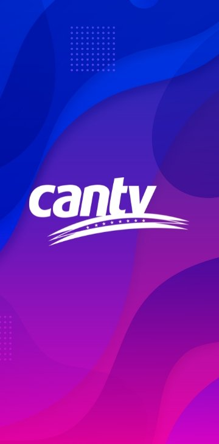
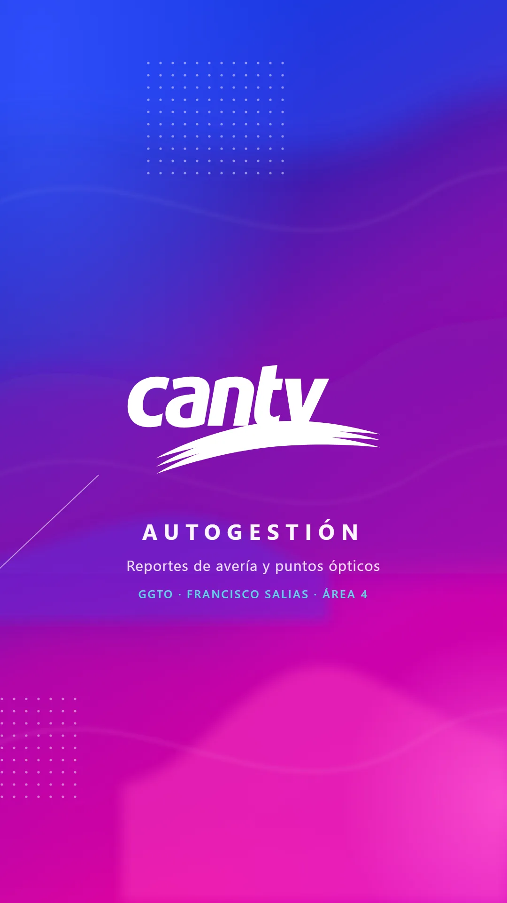
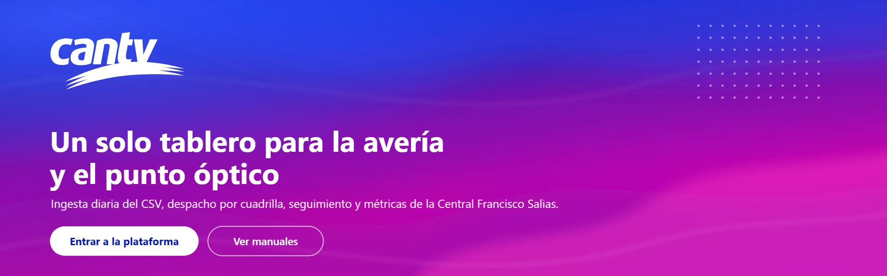
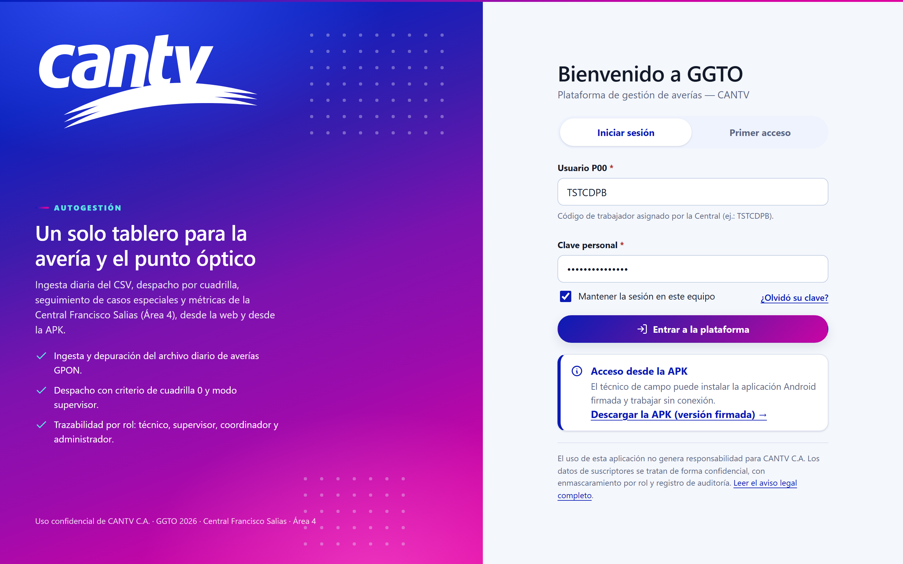
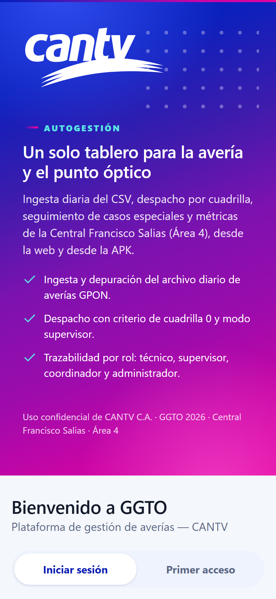
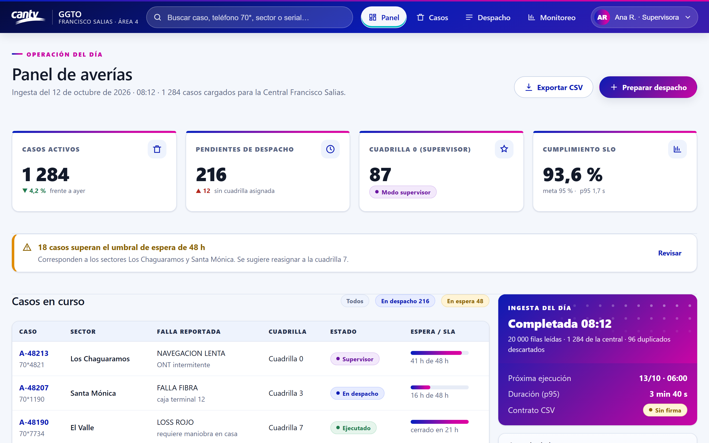

# Propuesta de imagen visual y UI/UX — GGTO · CANTV (v2)

| Campo | Valor |
|---|---|
| Proyecto | **GGTO** — Sistema de administración de reportes de avería y construcción de puntos ópticos |
| Cliente | CANTV C.A. — Central **Francisco Salias (Área 4)** |
| Alcance | Interfaz **web** (`app/web`, React 18 + Vite + hoja de estilos única `styles.css`) y activos de marca reutilizables por la APK y los manuales |
| Insumo | Imagen `autogestion-barra-azul-turquesa-2-min.jpg` (360 × 731 px) y logotipo institucional `docs/imagenes/CANTV_logo.svg` |
| Estado | **Propuesta para revisión de la Dirección del proyecto** — no modifica todavía el código de la aplicación |
| Autor | Diseño UI/UX (skill `@Visual`) |
| Fecha | 12 de octubre de 2026 |

---

## 0. Resumen ejecutivo

La imagen entregada es una **pieza de marca**: degradado azul eléctrico → violeta → magenta con
capas orgánicas y trama de puntos, y el logotipo CANTV **monocromo blanco** al centro. Es un
excelente recurso de identidad, pero **no es aplicable tal cual como interfaz**: su paleta tiene una
saturación media del **88,9 %** y solo un **3,8 %** de píxeles muy claros, de modo que cualquier
texto de trabajo sobre ella incumpliría el contraste mínimo.

La propuesta separa los dos mundos:

| Superficie | Lenguaje | Dónde se usa |
|---|---|---|
| **Superficie de marca** | Degradado completo + capas orgánicas + trama de puntos + logotipo blanco | Acceso (login), portada del `Widget`, fichas de bienvenida, pantallas de carga, APK, manuales y piezas de difusión |
| **Superficie de datos** | Fondo claro neutro, tarjetas blancas, bordes suaves, tipografía densa y accesible | Panel, casos, despacho, monitoreo, catálogos, configuración |

Entre ambas se coloca la **franja de marca** (3 px de degradado bajo la cabecera): un elemento firma que
da continuidad visual sin tocar ni un dato.

**Lo que ya está hecho y verificable en esta carpeta**

- Paleta de marca **medida** sobre la imagen original (k-means de 8 grupos + bandas verticales).
- **3 versiones vectoriales del logotipo** (institucional, monocromo blanco, monocromo tinta) derivadas
  del SVG oficial: sin bitmaps, sin pérdida y escalables a cualquier pantalla.
- **Imagen visual vertical 1080 × 1920** y **cabecera web 1920 × 600** que reproducen el lenguaje de la
  referencia con el logotipo integrado.
- **Sistema de diseño implementado** en `mockup/ggto-v2.css` (tokens + componentes) y **tres pantallas
  maquetadas y capturadas**: sistema de diseño, acceso y panel de operación, en 1440 / 1024 / 768 / 390 px.
- **Contrastes WCAG 2.2 calculados** con script (`recursos/contraste.json`).

---

## 1. Análisis de la imagen de referencia



### 1.1 Composición

| Elemento | Lectura |
|---|---|
| Formato | 360 × 731 px (relación **0,492** ≈ 1:2), pensado para barra lateral, *story* o splash vertical |
| Fondo | Degradado diagonal con predominio vertical; azul eléctrico arriba, magenta/fucsia abajo |
| Capas | 3–4 capas orgánicas tipo «ola» con desenfoque progresivo; pliegues claros que marcan el movimiento |
| Acentos | Glow azul en la esquina superior izquierda, glow fucsia en la inferior derecha |
| Trama | Dos bloques de puntos claros de ~26 px de paso (superior-centro e inferior-izquierda) |
| Hairline | Línea blanca diagonal fina en el borde inferior izquierdo |
| Logotipo | CANTV monocromo blanco, centrado ópticamente a 1/3 de la altura, con el trazo de estrellas y la cinta |

### 1.2 Paleta medida (`recursos/paleta_referencia.json`)

| Muestra | Hex | Área | Uso propuesto |
|---|---|---|---|
| Azul eléctrico | `#021FBE` | 26,7 % | Cabecera, iconos, foco de marca |
| Violeta profundo | `#3B1CAD` | 17,4 % | Segundo tramo del degradado |
| Magenta | `#C905A5` | 14,0 % | Cierre cálido del degradado |
| Púrpura | `#A60CB8` / `#8F0EA1` | 19,7 % | Transición |
| Violeta | `#7A19B9` / `#6A13A1` | 18,3 % | Centro del degradado y **color «especial»** de estado |
| Blanco de logotipo | `#F9F1FC` | 3,9 % | Texto y logotipo sobre marca |

Bandas verticales medidas (de arriba abajo): `#0120BD` → `#0B20BC` → `#2E1BAE` → `#8255C2` →
`#7C12AF` → `#9D0BAC` → `#C605A9`. Esquinas: superior izquierda `#0026C7`, inferior izquierda
`#E003A0`, inferior derecha `#D003C2`.

> **Observación de color:** el nombre del archivo menciona «azul-turquesa», pero la pieza medida es
> **azul → violeta → magenta** (matiz dominante 271°, sin turquesa real). Por eso el turquesa
> `#00B8C4` se incorpora en la propuesta como **acento funcional** —foco, enlaces y datos «en vivo»
> sobre superficies de marca—, no como color principal del degradado. Así se respeta la familia
> cromática anunciada sin inventar un color que la imagen no tiene.

### 1.3 Trama de puntos (`recursos/trama_puntos.json`)

Puntos claros (`≈ #E5DDF8`) sobre el fondo, con **paso vertical medido de 17 px** sobre 731 px de
alto (≈ 2,3 % de la altura) y delta de luminancia de 59,6 puntos sobre el fondo local. En la propuesta
se traduce a un `radial-gradient` repetido de **26 px de paso y punto de 2,6 px al 55 %**, sin
descargar ninguna imagen.

### 1.4 Lectura crítica: qué se adopta y qué no

| Se adopta | Se descarta (y por qué) |
|---|---|
| El degradado como **superficie de marca**, nunca como fondo de datos | Degradado a pantalla completa en pantallas de gestión: la saturación compite con chips, alertas y SLA |
| El logotipo **monocromo blanco** sobre degradado (como en la referencia) | Logotipo en color sobre el degradado: el azul institucional `#0033AA` cae a 1,25:1 sobre el violeta |
| La trama de puntos como textura sutil de acento | Trama sobre zonas con texto: ensucia la lectura |
| Las capas orgánicas y el *hairline* en portadas y estados vacíos | Animarlas en la interfaz de trabajo: ruido y coste de CPU en equipos de la Central |
| La proporción vertical 9:16 para piezas de difusión y APK | Usar la pieza vertical en la web de escritorio (se recortaría el logotipo) |

---

## 2. Sistema de diseño propuesto

```
+----------------------------------------------------------------------------------------+
|  TARGET: GGTO — CANTV (Central Francisco Salias, Área 4) — SISTEMA DE DISEÑO v2        |
+----------------------------------------------------------------------------------------+
|  PATRÓN: Aplicación de gestión (no landing) con dos capas claras                       |
|     Acceso:  superficie de marca 55 % + tarjeta de trabajo 45 % (split)                |
|     Trabajo: cabecera de marca -> franja -> indicadores -> avisos -> tabla + lateral    |
|     CTA:     «Entrar a la plataforma» (única acción primaria por pantalla)             |
|     Secciones: 1. Franja  2. Cabecera  3. Encabezado+acciones  4. KPI  5. Avisos        |
|                6. Tabla de casos  7. Columna lateral (ingesta, agenda, plataforma)      |
|                                                                                        |
|  ESTILO: Gradient Mesh Corporativo + Soft UI Evolution (superficies de datos)          |
|     Keywords: fluido, eléctrico, confiable, institucional, denso en datos              |
|     Mejor para: telco, utilities, back-office operativo, apps internas de campo        |
|                                                                                        |
|  COLORES:                                                                              |
|     Primario:    #0B1BB4 (Azul GGTO)            botones, enlaces, foco de marca        |
|     Secundario:  #6A13A1 (Violeta especial)     casos especiales / cuadrilla 0         |
|     Acento:      #00B8C4 (Turquesa)             foco, «en vivo», datos sobre marca     |
|     Marca:       #021FBE -> #7C12AF -> #C905A5 -> #E003A0 (degradado medido)           |
|     Fondo:       #F4F7FC   Superficie: #FFFFFF   Borde: #DCE3F0                        |
|     Texto:       #131A2A (17,4:1)   Texto suave: #5A6684 (5,7:1)                       |
|     Semánticos:  Éxito #1F7A4D · Alerta #8A6100 · Error #B3261E · Info #0B1BB4         |
|                                                                                        |
|  TIPOGRAFÍA: Archivo (titulares) / Inter (interfaz y cifras), autoalojadas             |
|     Mood: institucional, contemporánea, cifras estables (tabular-nums)                 |
|     Respaldo sin coste: 'Segoe UI' del sistema (la Central trabaja en intranet)        |
|     Escala: 16 px base · h3 1,1 · h2 1,4 · h1 2,15 · display 2,4 rem                   |
|                                                                                        |
|  EFECTOS CLAVE:                                                                        |
|     Franja de marca de 3 px como firma entre cabecera y contenido                      |
|     Cubierta de degradado con trama en las tarjetas destacadas                        |
|     Anillo de foco turquesa de 3 px (blanco sobre superficies de marca)                |
|     Esqueletos con brillo suave para la carga; transiciones 150/300/520 ms             |
|                                                                                        |
|  EVITAR (Anti-patrones):                                                               |
|     Degradado o trama detrás de texto de trabajo o de tablas                          |
|     Logotipo en color sobre el degradado (contraste 1,25:1)                            |
|     Emojis como iconos; iconos sin etiqueta accesible                                 |
|     Chip cuyo significado dependa solo del color                                      |
|     Animar width/height; parallax en pantallas de gestión                             |
|     Fuentes desde Google Fonts (la plataforma vive en la intranet de la Central)      |
|                                                                                        |
|  CHECKLIST PRE-ENTREGA:                                                                |
|     [x] Sin emojis como iconos (SVG de trazo 2 px, aria-hidden cuando decoran)         |
|     [x] cursor-pointer en todo elemento clicable                                       |
|     [x] Timing contextual por tipo de interacción (150 / 300 / 520 ms)                 |
|     [x] Contraste >= 4.5:1 en texto (verificado con scripts/contraste.py)              |
|     [x] Foco visible en navegación por teclado                                         |
|     [x] prefers-reduced-motion respetado                                                |
|     [x] Texto, chips y badges refluyen sin recorte                                     |
|     [x] Responsivo verificado: 1440 / 1024 / 768 / 390 px                              |
+----------------------------------------------------------------------------------------+
```

---

## 3. Piezas visuales producidas

Todas las piezas salen de **SVG editable** (`assets/`) y se rasterizan con un script reproducible
(`scripts/capturar.js`). El logotipo nunca se redibuja: se importa del vector institucional.

### 3.1 Imagen visual vertical 1080 × 1920 (marca / APK / difusión)



- Archivos: [`assets/hero-autogestion-vertical.svg`](assets/hero-autogestion-vertical.svg) ·
  [`capturas/hero-autogestion-vertical.png`](capturas/hero-autogestion-vertical.png) ·
  [`.webp`](capturas/hero-autogestion-vertical.webp) *(1 075 KB → 42 KB, −96 %)*
- Reutiliza el ADN de la referencia: mismos tramos de degradado medidos, capas orgánicas, pliegues
  claros, dos bloques de trama y el *hairline* diagonal.
- Añade el lockup tipográfico «AUTOGESTIÓN / Reportes de avería y puntos ópticos» y el pie institucional.
- Usos: pantalla de arranque de la APK, difusión interna por Telegram/WhatsApp, portada de manuales.

### 3.2 Cabecera de marca web 1920 × 600



- Archivos: [`assets/hero-web.svg`](assets/hero-web.svg) · [`.png`](capturas/hero-web.png) · [`.webp`](capturas/hero-web.webp)
- Usos: portada del `Widget` público, pantalla de inicio de sesión en escritorio, cabecera de la
  Ayuda/manuales, cabecera de correos institucionales.

### 3.3 Logotipo en tres versiones (`assets/`)

| Archivo | Versión | Uso |
|---|---|---|
| [`cantv-logo-color.svg`](assets/cantv-logo-color.svg) | Institucional (azul `#0033AA`, amarillo `#FFDD00`, rojo `#EC2E38`) | Fondos claros, documentos, manuales, pie de correo |
| [`cantv-logo-blanco.svg`](assets/cantv-logo-blanco.svg) | **Monocromo blanco** | Superficies de marca: login, cabeceras, portadas, APK |
| [`cantv-logo-tinta.svg`](assets/cantv-logo-tinta.svg) | Monocromo tinta `#0B1BB4` | Una sola tinta: fax, grabados, marcas de agua |
| [`patron-trama.svg`](assets/patron-trama.svg) | Baldosa de trama 26 × 26 px | Textura de acento (o su equivalente CSS en un `radial-gradient`) |

**Zona de respeto:** área libre equivalente a la altura de la «c» del logotipo. **Ancho mínimo:** 96 px
en la barra superior web, 32 px en la APK. Nunca deformar, ni recolorear fuera de las versiones
aprobadas.

### 3.4 Sistema de diseño aplicado

El sistema completo, con todas sus tablas de color, escala tipográfica, estados de componente y
verificación de accesibilidad, se puede abrir y recorrer en
[`mockup/01-sistema.html`](mockup/01-sistema.html). La captura de página completa está en
[`capturas/sistema-diseno.png`](capturas/sistema-diseno.png) (2880 × 12332) y su vista previa ligera en
[`capturas/sistema-diseno-preview.png`](capturas/sistema-diseno-preview.png).

---

## 4. UI/UX de la web propuesta

### 4.1 Acceso (`mockup/02-login.html`)



**Antes** (`app/web/src/pages/Login.tsx` + `.login-fondo`): caja blanca flotando sobre un degradado azul
liso, sin logotipo, título «GGTO» y subtítulo gris.

**Propuesta:**

1. **Reparto 55/45.** La mitad de marca concentra el lenguaje de la referencia (degradado, capas,
   trama y logotipo blanco) y la mitad de trabajo mantiene una tarjeta limpia y accesible. En móvil
   (≤ 1024 px) la superficie de marca se convierte en una **banda superior** y la tarjeta se apila
   debajo, igual que en la pieza vertical.
2. **Logotipo CANTV visible y vectorial**, con el nombre del producto separado por una línea fina
   («GGTO · FRANCISCO SALIAS · ÁREA 4»): jerarquía CANTV → producto → central.
3. **Tres argumentos operativos** (ingesta, despacho, trazabilidad) que comunican para qué sirve la
   plataforma a quien entra por primera vez.
4. **Pestañas «Iniciar sesión / Primer acceso»** con el patrón de *segmented control* accesible
   (`role="tablist"`, `aria-selected`), en lugar de las pestañas subrayadas de la v1.
5. **El descargador de APK sube a la tarjeta** como aviso informativo con enlace explícito.
6. **Aviso legal al pie de la tarjeta**, discreto pero legible (hoy es un paso bloqueante previo al
   formulario; se propone mantenerlo como consentimiento explícito con enlace al texto completo).



### 4.2 Panel de operación (`mockup/03-panel.html`)



**Estructura propuesta:**

| Zona | Contenido | Decisión de UX |
|---|---|---|
| Cabecera | Franja de marca + barra con logotipo CANTV, «GGTO», buscador global, navegación y cuenta | El buscador global conserva su función y gana superficie (44 px de alto) |
| Encabezado | Etiqueta «Operación del día», título, resumen de la ingesta y acciones | La acción primaria («Preparar despacho») usa el botón de marca; la secundaria, contorno |
| Indicadores | 4 tarjetas con cubierta de degradado y cifra grande `tabular-nums` | La cubierta va en un filete superior de 4 px: marca sin sacrificar lectura |
| Avisos | Umbral de espera de 48 h con acción «Revisar» | El aviso operativo aparece **antes** de la tabla, no como notificación efímera |
| Trabajo | Tabla de casos (caso, sector, falla, cuadrilla, estado, SLA) + columna lateral | El SLA se comunica con barra **y** texto («41 h de 48 h»); el estado, con chip de punto + etiqueta |
| Lateral | Ingesta del día (cubierta de marca), agenda y estado de la plataforma | Agrupa lo que el supervisor consulta sin cambiar de pantalla |

**Decisiones de datos y privacidad (RNF-18):** en la maqueta los teléfonos aparecen como `70*4821`, y
la paginación declara «teléfonos y seriales enmascarados para su rol». La interfaz debe **hacer visible
el enmascaramiento** para que un rol sin permiso entienda que el dato existe pero no le corresponde.

### 4.3 Comportamiento responsivo

| Ancho | Acceso | Panel |
|---|---|---|
| 1440 px | Split 55/45, tarjeta de 432 px | Tabla + columna lateral |
| 1024 px | Banda de marca arriba, tarjeta centrada | La columna lateral pasa debajo de la tabla |
| 768 px | Banda compacta, trama inferior oculta | Indicadores en 2 columnas, tabla con desplazamiento horizontal contenido |
| 390 px | Banda de marca con logotipo, formulario a ancho completo, objetivos de 44 px | Indicadores apilados, buscador a ancho completo, menú en fila desplazable |

---

## 5. Accesibilidad verificada

Calculada con `scripts/contraste.py` (fórmula WCAG 2.2). Resultado completo en
[`recursos/contraste.json`](recursos/contraste.json).

| Combinación | Ratio | Veredicto |
|---|---|---|
| `#131A2A` sobre `#FFFFFF` | 17,37:1 | AA/AAA texto normal |
| `#5A6684` sobre `#FFFFFF` | 5,72:1 | AA texto normal |
| Blanco sobre `#0B1BB4` (primario) | 11,48:1 | AAA |
| Blanco sobre `#050B3D` (base oscura) | 18,72:1 | AAA |
| Blanco sobre `#C905A5` (magenta del degradado) | 5,19:1 | AA texto normal |
| Blanco sobre `#E003A0` (fucsia de cierre) | 4,48:1 | **Solo texto grande y gráficos** |
| Blanco sobre `#0033AA` (azul del logotipo) | 10,22:1 | AAA (por eso el logotipo blanco funciona) |
| `#0033AA` (azul institucional) sobre `#7C12AF` (violeta del degradado) | 1,25:1 | **Inservible**: prohíbe el logotipo en color sobre la marca |

**Consecuencia de diseño:** sobre el degradado, el texto de cuerpo se sitúa en la **mitad superior**
(azul y violeta) o sobre un **velo** `rgba(5,11,61,.55)`; el tramo fucsia se reserva para cierre
decorativo. Es exactamente lo que hacen las piezas `hero-web.svg` y el login maquetado.

Reglas no negociables recogidas en la maqueta:

- Foco visible siempre: anillo turquesa de 3 px; blanco sobre superficies de marca.
- Objetivos táctiles ≥ 44 × 44 px con 8 px de separación.
- El estado nunca depende solo del color (chip de punto + texto, barra de SLA + horas).
- Labels visibles siempre; el *placeholder* nunca sustituye a la etiqueta; error junto al campo con
  `aria-invalid` y `aria-describedby`.
- `prefers-reduced-motion` detiene el brillo de los esqueletos, el giro del botón de carga y cualquier
  transición de entrada.
- Enlace «saltar al contenido» y jerarquía de encabezados correcta (`h1` único por pantalla).

---

## 6. Plan de implementación en la web

### 6.1 Archivos

| Acción | Archivo | Contenido |
|---|---|---|
| Añadir | `app/web/public/marca/cantv-logo-blanco.svg`, `cantv-logo-tinta.svg`, `patron-trama.svg` | Activos de marca servidos como estáticos |
| Fusionar en `styles.css` | tokens `:root` de `mockup/ggto-v2.css` | Nuevas variables `--m-*`, `--grad-*`, `--radio`, `--sombra`, `--t-*` |
| Sustituir | `.topbar` → nuevo bloque `.barra-superior` + `.franja-marca` | Cabecera con logotipo y navegación |
| Sustituir | `.login-fondo` / `.login-caja` → `.login`, `.login__marca`, `.login__panel` | Acceso en dos superficies |
| Ajustar | `.chip` (hoy una sola variante) → variantes `--info/--exito/--alerta/--error/--especial/--neutro` | Estados unificados en toda la aplicación |
| Ajustar | Tablas de `Casos.tsx`, `Despacho.tsx`, `Monitoreo.tsx` | Tokens de densidad, cabecera fija y foco |
| Añadir componente | `app/web/src/components/MarcaCantv.tsx` | Logotipo con variante y `alt`, para no repetir la etiqueta `img` |

### 6.2 Mapeo de tokens (v1 → v2)

| v1 | v2 | Motivo |
|---|---|---|
| `--azul: #0b4f9c` | `--m-azul: #0b1bb4` | Se alinea con el azul eléctrico de la referencia (blanco 11,5:1) |
| `--azul-oscuro: #08396f` | `--m-profundo: #050b3d` | Base oscura de la cabecera (blanco 18,7:1) |
| `--azul-claro: #e8f0fa` | `--superficie-2: #eef3fd` | Cabeceras de tabla y estados de solo lectura |
| `--gris-fondo: #f4f6f9` | `--fondo: #f4f7fc` | Fondo con un punto de azul, más cercano a la marca |
| `--gris-borde: #d7dde6` | `--borde: #dce3f0` | Bordes más fríos y consistentes |
| `--gris-texto: #4a5568` | `--texto-suave: #5a6684` | Mantiene 5,7:1 sobre blanco y armoniza con la marca |
| `--radio: 8px` | `--radio: 14px` | Formas más suaves, propias del lenguaje de la referencia |
| — | `--m-turquesa: #00b8c4` | Foco y acentos sobre superficies de marca |

Los colores **semánticos se conservan** (éxito, alerta, error) porque ya están usados en 2 890 líneas
de CSS y son accesibles: cambiarlos generaría riesgo sin beneficio.

### 6.3 Fases

1. **Tokens y cabecera** (bajo riesgo): variables, `.franja-marca`, `.barra-superior` con logotipo,
   `.chip` con variantes. Sin cambios de estructura en las vistas.
2. **Acceso**: migrar `Login.tsx` al reparto 55/45 con la superficie de marca (aquí sí se toca una
   pantalla completa, con prueba de teclado y de contraste).
3. **Componentes de datos**: `.tarjeta-kpi` con cubierta, tabla densa, avisos, estados vacíos y de carga.
4. **Piezas de marca**: publicar `hero-autogestion-vertical` (APK y difusión) y `hero-web` (portada del
   `Widget` y ayuda).

### 6.4 Riesgos y mitigaciones

| Riesgo | Mitigación |
|---|---|
| Sobrecarga visual si el degradado se extiende a las pantallas de datos | Regla explícita: el degradado solo vive en superficies de marca; auditoría visual por pantalla |
| Fuentes autoalojadas añaden ~180 KB y deben estar disponibles sin red | Entrega opcional: la propuesta funciona con la pila del sistema (`Segoe UI`); decisión de la Dirección |
| Cambio de `--radio` y de la cabecera altera capturas de los manuales | Regenerar las capturas de los manuales en la misma fase 1 |
| El logotipo se usa en tamaños pequeños de la APK | Usar `cantv-logo-blanco.svg` con ancho mínimo de 96 px; revisar el *splash* en pantalla de 5" |
| Más contraste de marca puede confundirse con «color de estado» | Los estados siguen usando exclusivamente los semánticos; el turquesa se reserva al foco |

---

## 7. Contenido de la carpeta

```
docs/propuesta-visual/
├─ propuesta-visual-UIUX.md        Este documento
├─ assets/                         Activos vectoriales (editables)
│  ├─ cantv-logo-color.svg         Logotipo institucional
│  ├─ cantv-logo-blanco.svg        Monocromo blanco (superficies de marca)
│  ├─ cantv-logo-tinta.svg         Monocromo tinta
│  ├─ patron-trama.svg             Baldosa de trama de puntos
│  ├─ hero-autogestion-vertical.svg  Imagen visual 1080 × 1920
│  └─ hero-web.svg                 Cabecera de marca 1920 × 600
├─ capturas/                       Rasterizaciones (PNG + WebP)
├─ mockup/                         Sistema de diseño y pantallas
│  ├─ ggto-v2.css                  Tokens y componentes propuestos
│  ├─ 01-sistema.html              Sistema de diseño (color, tipografía, componentes, accesibilidad)
│  ├─ 02-login.html                Acceso
│  └─ 03-panel.html                Panel de operación
├─ recursos/                       Insumo y evidencias de medición
│  ├─ referencia-autogestion.jpg   Imagen entregada (copia de trabajo)
│  ├─ paleta_referencia.json       k-means, bandas y esquinas
│  ├─ trama_puntos.json            Paso y color de la trama
│  └─ contraste.json               Matriz de contraste WCAG
└─ scripts/                        Reproducible con `python` y `node`
   ├─ analizar_referencia.py       Paleta de la imagen
   ├─ analizar_trama.py            Trama de puntos
   ├─ contraste.py                 Verificación WCAG
   ├─ generar_assets.py            Genera los SVG con el logotipo
   ├─ capturar.js                  Rasteriza los SVG y captura los mockups (Playwright)
   └─ optimizar.py                 Exporta a WebP y genera la vista previa del sistema
```

**Regenerar todo:**

```powershell
python docs\propuesta-visual\scripts\analizar_referencia.py
python docs\propuesta-visual\scripts\analizar_trama.py
python docs\propuesta-visual\scripts\contraste.py
python docs\propuesta-visual\scripts\generar_assets.py
$env:NODE_PATH="RepoTecnico\pruebas\e2e\node_modules"
node docs\propuesta-visual\scripts\capturar.js
python docs\propuesta-visual\scripts\optimizar.py
```

---

## 8. Qué se necesita de la Dirección

1. **Aprobar la separación de superficies** (marca vs. datos) y el uso del logotipo monocromo blanco
   sobre el degradado.
2. **Decidir la tipografía**: autoalojar Archivo + Inter (≈ 180 KB) o mantener la pila del sistema.
3. **Aprobar el cambio de tokens** de la sección 6.2, incluido el paso de `--radio` a 14 px.
4. **Autorizar la fase 1** (tokens y cabecera) como primer incremento verificable, con regeneración de
   las capturas de los manuales.
